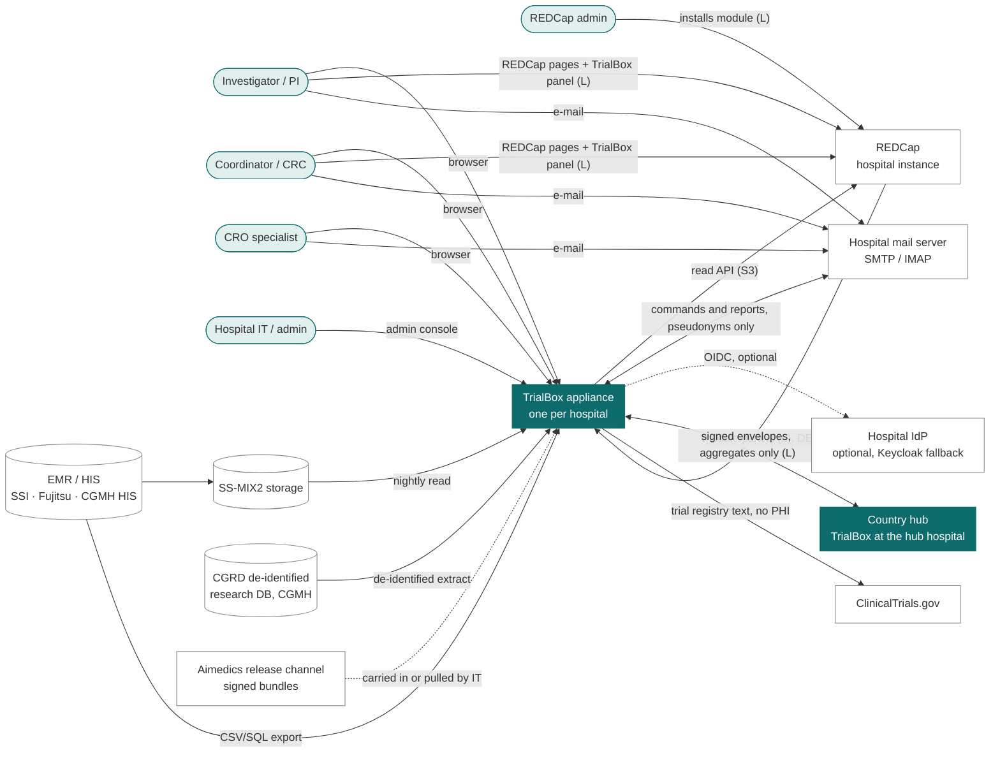
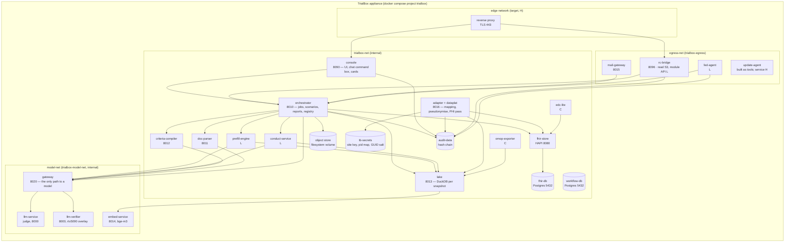
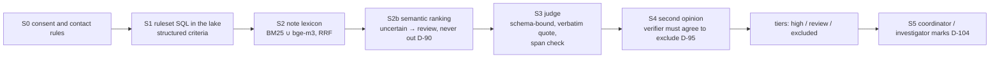
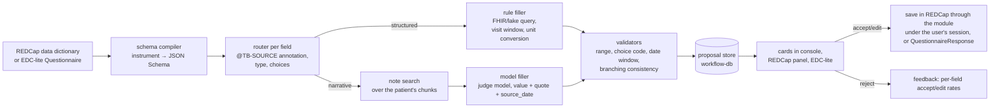
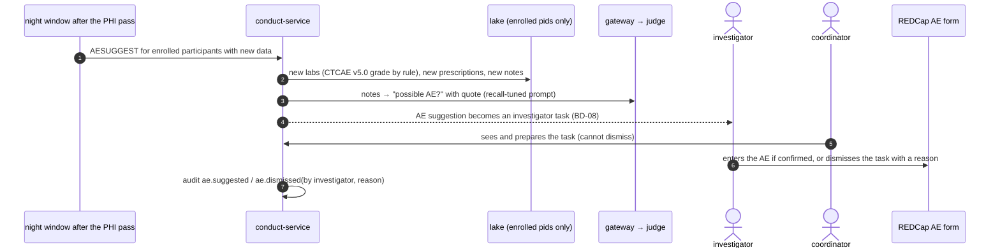
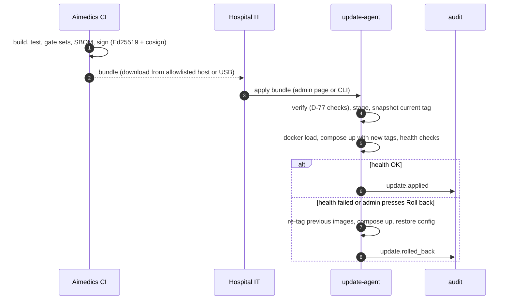
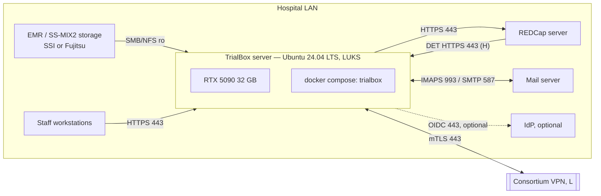

# TB-DS-02 TrialBox Architecture and Design Description

| Field | Value |
| --- | --- |
| Document ID | TB-DS-02 |
| Title | TrialBox Architecture and Design Description |
| Version | 0.10 (reference; frozen for the build stage; build scope per `20-build-map.md`) |
| Date | 2026-11-07 |
| Owner | Aimedics (author: Claude, for Changfu Kuo, product owner) |
| Status | Frozen reference. Build scope is set by `20-build-map.md` (TB-DS-20): steps S1–S5, S0 built and kept, H hospital stage, L later. Build tags follow the one legend in TB-DS-00 §2 (S0 built, S1–S5 build step, H hospital stage, L later). Tables and headings carry them; "How to read" gives the rule for any M1/M2 word left in running prose. |
| Approvals | Prepared: Claude (2026-11-07). Reviewed: TB-REV-006 findings applied in v0.2; re-review pending. Approved: — (product owner, pending). |
| Template | arc42 (all 12 sections), C4 model diagrams (Mermaid), ISO/IEC/IEEE 42010 viewpoints (Annex A) |
| Companion documents | TB-DS-00 Baseline decisions and canonical numbers (wins on any conflict); TB-DS-01 Software Requirements Specification (FR/NFR IDs); TB-DS-03 Security and Privacy; TB-DS-04 Verification, Validation and Operations; TB-DS-05 Open-source reuse survey; TB-PLAN-01 Project plan; TB-REV-006 review |
| Sources | Repository `zandis/Auto-GPT`, directory `trialbox/` at master `a1e55fa`; `docs/ARCHITECTURE.md`, `docs/DECISIONS.md`, `docs/INTEGRATION_SCENARIOS.md`, `deploy/docker-compose*.yml`; the report "TrialBox on REDCap and FHIR" (v7); the product owner's answers of 2026-11-07; public SS-MIX2 and JLAC10 specifications (cited where used) |

## How to read this document

- **[built]** means the code is on `master` (a1e55fa) today and has tests. Each [built] claim in v0.2 was checked
  against that commit; where a claim could not be checked it says so.
- **[target]** means designed here and not yet built. Every target carries a build tag from the legend in TB-DS-00 §2:
  **S1–S5** (the build step in `20-build-map.md` that delivers it), **H** (hospital stage: only when a hospital uses real
  patient data), **L** (later). Where running prose still says "M1", read "the first release: its build-step items are S1–S5
  and the rest H, as TB-DS-20 §1 assigns them"; "M2" and "C" read as L. Tables and headings no longer use M1/M2/C.
- **[spike]** marks a target that depends on a time-boxed experiment before it is committed.
- Every number that has a canonical value is written with its source, for example "k = 10 (TB-DS-00 N-01)". If this
  document and TB-DS-00 differ, TB-DS-00 is right and this document is wrong.
- Functional requirements are referenced by area from TB-DS-01, for example "FR-EDC-\*". Area codes: ING ingest, DEID
  de-identification, FEAS feasibility, SCR screening list, CASE single-patient check, EDC REDCap pre-fill, CON consent,
  TC trial conduct, FED consortium, RC REDCap integration, EDCL EDC-lite, UI user interface, CHAT chat command box,
  MAIL e-mail channel, AUTH accounts and login, AUD audit, MOD models, JP Japanese customs, I18N languages, OMOP export,
  OPS operations, REP reports.
- Non-functional requirements use the TB-DS-01 families only: **NFR-PERF**, **NFR-CAP**, **NFR-AVAIL**, **NFR-MAINT**,
  **NFR-USAB**, **NFR-PORT**, **NFR-COMP**. Security and privacy requirements are FR-AUTH, FR-DEID, FR-AUD and TB-DS-03
  controls. The trace from this document to requirements is in §10.3.
- Data classes are D0–D4 only (BD-02, TB-DS-00 §3). Network zones are networks (§7.2), not data classes.
- Role names are the code names `admin`, `coordinator`, `investigator`, `viewer`, `cro`, plus `auditor` [hospital stage, H]
  (BD-03). "PI" means a user with the `investigator` role; "CRC" or "study nurse" means `coordinator`.

### Contents

1. Introduction and goals
2. Constraints
3. Context and scope
4. Solution strategy
5. Building block view
6. Runtime view
7. Deployment view (includes the single authoritative port table, §7.2)
8. Cross-cutting concepts (includes the data model and interface specifications)
9. Architecture decisions
10. Quality requirements (includes the architecture-to-requirements trace, §10.3)
11. Risks and technical debt
12. Glossary

Annex A: ISO/IEC/IEEE 42010 stakeholders, concerns and viewpoints. Change history at the end.

---

## 1. Introduction and goals

### 1.1 Purpose

TrialBox is an on-premises appliance that helps hospitals find patients for clinical studies and fill study forms. It
reads the hospital's own data, applies a study's eligibility criteria and returns:

1. **Flow A, feasibility:** before a study is approved, a complete feasibility report with a recruitment funnel,
   computed on pseudonymised data. Satisfies FR-FEAS-\*, FR-REP-\*. Build step S1.
2. **Flow B, patient list:** after approval, a list of likely eligible patients for the investigator and the
   coordinator, with the reason each patient fits, what is missing and the next visit. Satisfies FR-SCR-\*, FR-CASE-\*.
   Build step S2; on real data the two-phase pilot applies (H; TB-DS-04 §8.2).
3. **Forms:** proposed values for REDCap (or TrialBox EDC-lite, L) screening and visit forms, each with a quote from the
   chart, confirmed by a person before saving. Satisfies FR-EDC-\*, FR-TC-\* (L); FR-EDCL-\* (L).

The product stays **standalone** (its own UI, e-mail in/out, its own login) and **integrates deeply with REDCap** where
a hospital runs it (product owner answer 2). It stays **outside the regulated path**: it proposes, a person decides,
and regulated trial data lives in REDCap or the sponsor's EDC (product owner decision of 2026-10-25, reconfirmed
2026-11-07: not a medical device).

In the hospital-stage pilot (TB-DS-00 §2.H) TrialBox runs in **two phases** (TB-DS-04 §8.2): in Phase 1 (weeks 1–6; older text calls this "shadow mode") staff screen as usual in parallel and TrialBox lists are additive only; in Phase 2 (weeks 7–12, after the week-6 checkpoint and explicit ethics approval) staff start from the TrialBox list with a 20 % manual spot-check per study.

### 1.2 Business context and scope of this version

| Item | Decision (2026-11-07) |
| --- | --- |
| First customers | Academic sites first; pharma pays later. Free during the pilot. |
| Pilot sites | Japan head hospital (EMR from SSI or Fujitsu; REDCap installed) and Chang Gung Memorial Hospital, CGMH (self-developed HIS; CGRD research database; REDCap installed) |
| Build and pilot | Build steps S1–S5 on synthetic data now (`SIMPLE-PLAN.md`); a hospital pilot only when a hospital chooses to use real data (H; TB-DS-00 §2.H) |
| First studies | Early Alzheimer's disease (Japan head hospital); rheumatology (CGMH; rulesets RA-BIO, RA-COH, GOUT-COH exist) |
| Scale design point | 500,000 patients, 10 concurrent users, 20 studies (Japan) / 50 studies (CGMH) (TB-DS-00 N-18); not measured above 50,000 patients |
| Scope | Recruitment (S1–S5) and trial-conduct support (visit pre-fill, AE and con-med suggestions; L) |
| Consortium | One hub per country (BD-06): Japan hub at the Japan head hospital, Taiwan hub at CGMH. Only aggregate counts cross the border. The investigator at each site approves each cross-site query. Build tag L. |
| Team | One engineer; maintenance probably by the Japan team; hospital IT installs signed updates; Aimedics gives engineering support without remote access |
| Sponsors | Never receive patient-level data; feasibility reports go to sponsors only after the site approves release |
| Patients | Contacted by their treating doctor only; TrialBox never contacts patients |
| Languages | Japanese, Traditional Chinese, English for staff; all three (and more on request) for patient materials |

### 1.3 Quality goals (top five, in priority order)

| Priority | Quality goal | Motivation | Measure (see §10) |
| --- | --- | --- | --- |
| 1 | **Patient safety of the list (recall)** | A missed eligible patient is the costliest error; an LLM must never silently exclude. | SIGIR lost pairs ≤ baseline + 1 and never above 8/79 (TB-DS-00 N-11); TREC loss ≤ 5 % (N-12); pilot pooled recall ≥ 90 %, Wilson lower bound ≥ 75 % (N-16) |
| 2 | **Privacy and security** | Hospital data, APPI/PDPA, MHLW GL 第7.0版, no patient-level data leaves the hospital | Zero patient-level data in any egress; note PHI leak ≤ 0.5 % and zero leaked direct identifiers (N-07) |
| 3 | **Usability for clinical staff** | Staff drop tools that add steps; "UI/UX is very important" (owner) | Pre-screen time reduced ≥ 50 % against the measured site baseline (N-17); page p95 ≤ 2 s (N-13) |
| 4 | **Low maintenance** | One engineer, hospital IT installs, no remote access | One signed bundle per release; automatic rollback on failed health check (QS-15); no inbound connections from outside the hospital |
| 5 | **Auditability and reproducibility** | Ethics committees and monitors ask "why was this patient listed?" | Every output reproducible from inputs + versions (D-82); every model output carries model id, prompt version and quote |

### 1.4 Stakeholders

| Stakeholder | TrialBox role (BD-03) | Main concern |
| --- | --- | --- |
| Principal investigator (PI) | `investigator` | Approves rulesets, reviews the weekly list, approves cross-site queries, decides AE suggestions: is the list complete and is each patient really eligible? |
| Clinical research coordinator / study nurse (CRC) | `coordinator` | Pre-screens, fills forms, books visits: fewer clicks, clear evidence, one place to work |
| SMO specialist | `coordinator` with study scope and expiry | Site support for named studies |
| CRO specialist | `cro` (aggregates only) | Feasibility, site selection: complete, comparable numbers |
| Monitor / internal auditor | `auditor` [hospital stage, H] | Read-only audit trail and screening log |
| Hospital IT | `admin` | Small footprint, no inbound access, signed updates, clear runbook |
| Hospital REDCap administrator | (REDCap) | Module is thin, safe, switchable per project |
| Ethics committee / privacy officer | `viewer` or none | Pseudonymisation, purpose limitation, audit |
| Sponsor (pharma) | none | Credible feasibility, faster enrolment; never patient data |
| Consortium steering committee | none | Each site keeps control; tamper-evident records |
| Aimedics engineer | none on site | Simple architecture, testable end to end |
| Patient | — | Privacy, contacted only by their own doctor |

The full concern-to-viewpoint mapping is in Annex A.

---

## 2. Constraints

### 2.1 Technical constraints

| ID | Constraint | Consequence |
| --- | --- | --- |
| TC-1 | All processing on premises; no patient-level data leaves the hospital | No cloud inference on patient data; no model provider on the egress allowlist in the pilot |
| TC-2 | No inbound connections from outside the hospital | Updates are pulled or carried in as signed bundles (D-77); support via diagnostics export |
| TC-3 | One RTX 5090 (32 GB) per standard site; two at CGMH (BD-10) | Only one large model resident by day; models time-share by the night schedule (BD-11, ADR-03) |
| TC-4 | REDCap is licensed only to non-profit institutions; Aimedics can't obtain or host the source | Integration only through the public API and the External Module framework (NFR-COMP-06); a REDCap-compatible API simulator for CI (ADR-05) |
| TC-5 | EMRs differ per site: SSI and Fujitsu (Japan) via SS-MIX2 or vendor export; CGMH self-developed | Per-site YAML mapping (D-84, extended) into FHIR R4 |
| TC-6 | Linux x86-64 host with Docker Compose (arm64 for GB10/Spark, D-79) | No Kubernetes in a hospital |
| TC-7 | FHIR R4 4.0.1 inside, JP Core 1.2.0 and TW Core as pinned in the repo (BD-12) | HAPI FHIR JPA 8.12 (S0, BD-01); Medplum only if the later spike passes (L) |
| TC-8 | Python 3.12 services (FastAPI) and the JVM for HAPI/CQL tools | Two runtimes in images. A third (Node, Redis) is added only if Medplum is adopted (L) |

### 2.2 Organisational and regulatory constraints

| ID | Constraint | Consequence |
| --- | --- | --- |
| OC-1 | Not a medical device (PMDA, TFDA): TrialBox doesn't diagnose or treat and never makes the final eligibility decision | Human confirmation on every patient-level decision; wording in UI and reports |
| OC-2 | Outside the regulated EDC path (no Part 11 / ER/ES e-signature in TrialBox) | EDC-lite (L, TB-DS-00 §2) would be for registries, feasibility and investigator-initiated studies; regulated data goes to REDCap or the sponsor EDC |
| OC-3 | APPI: pseudonymised information (仮名加工情報) can't be used to contact the person | Recruitment lists are resolved to chart numbers only on the on-prem web after an audited reveal (BD-04) |
| OC-4 | MHLW 医療情報システムの安全管理に関するガイドライン 第7.0版: 2FA expected for systems in operation in 令和9年度, i.e. from April 2027 (BD-12) | Console-native TOTP 2FA for all interactive accounts at hospital go-live (BD-01, H; not needed while only synthetic data is used) |
| OC-5 | Taiwan PDPA and Cyber Security Management Act obligations for CGMH | Controls mapped in TB-DS-03 |
| OC-6 | Retention: audit chain 10 years (TB-DS-00 N-02); screening log, approvals and study records each study's GCP retention, at least 5 years (N-03) | Retention classes in §8.12 |
| OC-7 | One engineer builds; Japan team maintains | Prefer existing components; no blockchain; no Kubernetes |
| OC-8 | The investigator at each site approves each cross-site query | The hub can't run a query at a site without that site's investigator approval |
| OC-9 | Only aggregate counts cross a national border (BD-06) until counsel confirms the status of Bloom-filter encodings | One hub per country; GUID linkage only inside one country |

### 2.3 Conventions

- Built decisions are logged in `docs/DECISIONS.md` as D-nn; decisions proposed here are ADR-nn (§9.2), each dated.
  Baseline decisions BD-nn live in TB-DS-00 and are cited, not restated.
- Contracts are JSON Schema in `schemas/` and generated pydantic models (`libs/tb_contracts`); `make lint` fails when
  stale. New interfaces in §8 follow the same rule.
- Reports are deterministic (D-82): fixed run date, normalised OOXML, metadata-free figures.
- C4 level names are used only as the model names: System Context, Container, Component.

---

## 3. Context and scope

### 3.1 Business context (C4 System Context)



| Neighbour | Direction | What crosses | Data class (§8.11) | Status |
| --- | --- | --- | --- | --- |
| EMR / HIS export (CSV, SQL) | in | patients, encounters, diagnoses, labs, prescriptions, notes, appointments | D4 | [built] adapter (D-84) |
| SS-MIX2 standardised storage (SSI, Fujitsu) | in | HL7 v2.5 files per patient, date and data type (§8.13.1: ADT, PPR, OMP, OML, OMG data types) and extended-storage documents | D4 | [target, H] reader for one vendor; hardening for further vendors L |
| FHIR R4 bulk / JP-CLINS documents | in | FHIR resources where the EMR or the national 電子カルテ情報共有サービス exposes them | D4 | [built] `fhir_bulk`; [target, L] JP-CLINS documents |
| CGRD | in | de-identified extract for feasibility only | D2 | [target, H] D2 source |
| Consent registry | in | research-use consent and contact preferences | D4 | [built] D-72 |
| REDCap | both | S3: data dictionary and records export, screening-log export (project-level read token). Later (L): module panels; Data Entry Trigger calls (H); writes of accepted values through the module under the user's REDCap session (BD-05, ADR-13) | D4 | [target, S3] read connector; [target, L] module and writes |
| Hospital mail server | both | commands in, reports out; patient lists carry pseudonyms only, never chart numbers or names (BD-04) | D1–D3 | [built] mail-gateway; pseudonym-only rule [target, H] where it differs from built routing |
| Hospital IdP | in | user identity, groups | D1 | [built] trusted-header SSO (D-93); [target, H] OIDC via Keycloak fallback (BD-01) |
| Country hub | both | signed rulesets out, signed aggregate funnels back; Bloom-filter GUIDs only within the country | D1 aggregates; D2 GUID encodings in-country only | [target, L] |
| ClinicalTrials.gov | out (query) | trial identifiers and text | D0 | [built] |
| Release channel | in | signed bundles: images, models, rulesets | D0 | [built] D-77 |

Out of scope: direct EMR write-back; computer control of EMR screens; sponsor EDC connectors (Medidata, Veeva; C);
patient-facing contact.

### 3.2 Technical context

| Interface | Protocol | Port / path | Auth | Release | Section |
| --- | --- | --- | --- | --- | --- |
| HIS export drop | SFTP or mounted share, CSV/Parquet/SQL dump | site-specific | SSH key / share ACL | [built] | §8.13.1 |
| SS-MIX2 storage | read-only SMB/NFS mount of the storage tree | site-specific | share ACL | H (was M1) | §8.13.1 |
| REDCap API (read) | HTTPS POST, form-encoded, `https://<redcap>/api/` | 443 | **project-level read token** in the appliance secret store (BD-05) | S3 (was M1) | §8.13.2 |
| REDCap Data Entry Trigger | HTTPS POST from REDCap to TrialBox | 443 → `/rc/det` | per-project secret + source IP allowlist | L (was M2) | §8.13.3 |
| REDCap module ↔ appliance | HTTPS JSON | 443 → `/rc/v1/...` | module client credential + signed user assertion | L (was M2) | §8.13.4 |
| Browser → console | HTTPS | 443 (reverse proxy) → 8090 | console session after local login with TOTP 2FA (BD-01) | S0 (TOTP H) (was M1) | §8.13.6 |
| Mail | IMAP(S) poll, SMTP submission | 993 / 587 | mailbox credentials; DMARC/SPF/DKIM check (D-86) | [built] | §8.13.5 |
| Consortium | HTTPS with mutual TLS over the hospital VPN, or signed e-mail | 443 | site certificates + Ed25519 envelope signatures | L (was M2) | §8.13.7 |
| Release channel | HTTPS pull from an allowlisted host, or USB | 443 | Ed25519 signature (D-77) | [built] | §8.13.8 |

---

## 4. Solution strategy

| Quality goal / constraint | Strategy | Where |
| --- | --- | --- |
| Recall (goal 1) | **Filter first**: deterministic SQL/CQL decides every structured criterion; LLMs read notes only for patients still in play; a single model may route a patient to review but never excludes; two models must agree to exclude on a note (D-95, D-97) | §5.3.1, §8.9 |
| Privacy (goal 2) | Data classes D0–D4 with a boundary table (built, `tb_common.policy.may_reach`); pseudonymise at ingest; free-text PHI pass (S1 rules + NER; LLM tagger H); chart numbers only after audited reveal on the on-prem web (BD-04); aggregates only across borders (BD-06) | §8.11, TB-DS-03 |
| Usability (goal 3) | One interaction per decision: **cards** (proposal + quote + one primary action); command field as a fixed-grammar command launcher (S4); the same tasks in the web page and e-mail; REDCap panel (L) | §5.3, §8.3, §8.6 |
| Low maintenance (goal 4) | One Docker Compose project; HAPI stays (S0, BD-01); MinIO removed in favour of the built filesystem object store (BD-09, ADR-16); signed offline bundles; no blockchain; no Kubernetes | §7, §9 |
| Auditability (goal 5) | Append-only hash-chained audit (built); deterministic reports (D-82); every model output records model id, prompt version, quote and span check | §8.5 |
| REDCap licence (TC-4) | Public API and module framework only; read-only (S3 and H); later writes (L) only through the module under the user's own session (ADR-13); simulator for CI; EDC-lite for sites without REDCap (C) | ADR-04, ADR-05, ADR-13 |
| One 5090 (TC-3) | Day: one judge model resident; night: PHI tagger, then verifier, swapped in by the BD-11 schedule; weekend full re-check | ADR-03, §6.10 |
| Consortium efficiency | One hub per country (ADR-15): signed rulesets out, signed aggregate funnels back, nightly batch; countersigned audit chain heads for tamper evidence | ADR-02, §6.3 |

Technology choices: Python 3.12 + FastAPI + pydantic v2 (built); DuckDB lake (built); vLLM for local models (built,
image `vllm/vllm-openai:v0.11.0` by default); bge-m3 embeddings (built); filesystem object store (built in
`libs/tb_common/objstore.py`, today used in tests; default for hospital installs, H, ADR-16); Postgres 16 (built); HAPI
FHIR JPA 8.12 (built; Medplum evaluated later, L, BD-01); REDCap External Module in PHP, thin (L).

---

## 5. Building block view

### 5.1 Container view (C4 Container)



Networks are shown as subgraphs; §7.2 lists exact memberships (a service may join more than one network). The
embed-service sits on the internal application network today; it is drawn beside the models because it serves vectors.

### 5.2 Container responsibilities

| Container | Responsibility | Status | Key requirements |
| --- | --- | --- | --- |
| reverse proxy | TLS termination, HSTS, rate limits, route `/` to console and `/rc/` to rc-bridge; `/fhir/` closed | [target, H]; today the console binds 127.0.0.1 behind the hospital proxy | NFR-PORT-\*, TB-DS-03 |
| console | Web UI for all roles: report-first role pages (`/home`, `/week`, study patient pages) with audited reveal of chart numbers (`/studies/{rs}/patients/{pid}/reveal`), admin pages, users, audit viewer | [built] (roles D-93/D-101/D-104; checked in `services/console/home.py`, `auth.py`); [target, S1] feasibility input page (S2, S3); [target, S2] S20 ruleset approval on one page with one Approve (FR-FEAS-12, BD-13), no scores or model names on clinical-role pages (FR-UI-17); [target, S3] S21 study set-up, three build sections (TB-DS-09); [target, S4] role homes S16 PI (phone and clinic-PC layouts) and S8 CRC "Today" / "Marks today" (auto-refresh by polling every 60 s) / "This week", header command field (S1 header, FR-CHAT-\*), three languages; [target, H] console-native TOTP 2FA (BD-01), `auditor` role, S17 RA status, S19 notification settings beyond N1/N2; [target, L] cards for EDC/TC | FR-UI-\*, FR-UI-14..16, FR-CHAT-\*, FR-AUTH-\*, FR-AUTH-13, FR-FEAS-12 |
| orchestrator | Job queue (SQLite today, 4 workers), scenarios (FEAS, SCREEN, CASE, COHORT, NAV, CONSENT, RELEASE (sponsor packs only; consent explainers go live from their approval record, BD-15), …), APScheduler, reports (PDF/XLSX/DOCX), delivery routing, candidate registry, outbox | [built]; [target, H] components `notify` (ICD-13 notices, budget, one-item-once), `studyset` (study settings, ethics approval record, flow-B gate FR-STUDY-06), `reconcile` (REDCap status read through the project link, registry–EMR reconciliation), `uploads` (ICD-14 shadow log and study databases); [target, L] scenarios PREFILL, VISITS, AESUGGEST, FEDFEAS | FR-FEAS-\*, FR-SCR-\*, FR-CASE-\*, FR-REP-\*, FR-NOTIF-\*, FR-STUDY-\*, FR-ING-19/21 |
| criteria-compiler | Protocol → CriterionIR (LLM, schema-bound) → terminology → CQL + SQL templates (never LLM-generated) → equivalence gate → review package → approval → git tag | [built] | FR-FEAS-\*, FR-MOD-\* |
| doc-parser | PDF/DOCX → ParsedDoc with I/E sections | [built] | FR-FEAS-\* |
| mail-gateway | IMAP poll, sender checks (DMARC/SPF/DKIM), allowlist and permissions, rate limit, subject grammar, attachments; SMTP send | [built]; [target, S2] patient lists by mail carry pseudonyms only (BD-04) | FR-MAIL-\* |
| adapter + dataplat | Site mapping (YAML), landing, standardise, pseudonymise (HMAC pid), MPI, DQ, publish gate, FHIR NDJSON snapshot, lineage | [built]; [target, S1] free-text PHI pass (rules + NER); [target, H] SS-MIX2 reader, LLM PHI tagger (lead candidate Gemma 4 behind the regex guard for JA / zh-TW / EN; MedPHINER and OpenMed as comparators; TB-DS-03 §13.3), date shift for D2; [target, L] GUID encoder | FR-ING-\*, FR-DEID-\*, FR-JP-\* |
| lake | DuckDB per snapshot: patient, encounter, condition, observation, medication, procedure, report, document, claim, consent, appointment, practitioner, document_chunk; SELECT-only guard; embeddings cache (float32, D-105) | [built] | FR-SCR-\*, FR-FEAS-\* |
| fhir-store | FHIR R4 server: HAPI JPA 8.12 + Postgres (`fhir-db`) with CQL `$evaluate` | [built]; Medplum [spike, L] (BD-01) | FR-ING-\* |
| fhir-db, workflow-db | Postgres 16 for HAPI and for workflow state (outbox, target proposal store) | [built] | NFR-AVAIL-03 |
| object store | Buckets `attachments`, `outputs`, `rulesets`, `lake`, `twpas` behind `ObjectStore` (`libs/tb_common/objstore.py`) | [built] interface with MinIO and filesystem back-ends; [target, H] filesystem back-end by default, MinIO container removed (ADR-16) | NFR-MAINT-\* |
| gateway | The only path to a model (port 8020); class-aware routing (`models/routing.yaml`), served-model check against the registry, PHI recognisers and tripwire, redacted traces | [built] | FR-MOD-\*, FR-DEID-\* |
| llm-service | vLLM serving the judge (Gemma 4 26B-A4B 4-bit) | [built] | FR-MOD-\* |
| llm-verifier | Separate vLLM container for the verifier (`cyankiwi/Qwen3.5-9B-AWQ-4bit`, thinking off) in the `docker-compose.rtx5090.yml` overlay. The overlay is named for the target card; as configured on 6 Nov (both models resident) it needs 35.0 GiB and does not fit one 32 GB 5090 (ADR-03). Both-must-agree to exclude (D-97). | [built] overlay; [target, S5] model swap controller (TD-5, measured in step 5); PHI tagger slot [target, H] (BD-11) | FR-MOD-\* |
| llm-stub | Deterministic stub model for CI and demo, port 8000 | [built], test/stub profile only | verification |
| embed-service | bge-m3 dense vectors (1024-d) | [built] | FR-SCR-\* |
| rc-bridge | S3: REDCap read connector with a project-level read token from the secret store (records, data dictionary, screening-log export), reading status fields per study through the project link and field map (TB-DS-08 §4.1a). H: Data Entry Trigger receiver and module API (`/rc/v1`) | [target, S3] read connector; [target, L] module API | FR-RC-\*, FR-EDC-\* |
| prefill-engine | Data dictionary → instrument schema; rule fill of structured fields from FHIR; model fill of narrative fields; validators; proposal store; save through the module (ADR-13) or edc-lite (C) | [target, L] | FR-EDC-\*, FR-TC-\* |
| conduct-service | Visit windows from REDCap events/arms; visit pre-fill; AE suggestions (CTCAE v5.0 grade from labs); con-med changes; ongoing eligibility | [target, L] | FR-TC-\* |
| edc-lite | Study forms on FHIR Questionnaire/QuestionnaireResponse (SDC) on HAPI, imported from a REDCap data dictionary; per-field history; export to REDCap | [target, L]; does not depend on Medplum | FR-EDCL-\* |
| fed-agent | Consortium envelope signing and verification, ruleset receipt, funnel return, in-country GUID return, chain-head countersignature exchange | [target, L] | FR-FED-\* |
| omop-exporter | OMOP CDM v5.4 export from the lake following the HL7 FHIR-to-OMOP IG | [target, L] | FR-OMOP-\* |
| update-agent | Verify and apply signed bundles; staged rollout; rollback; health page feed | [built] as `tools/verify_update.py` + `tools/apply_update.sh` (D-77); [target, H] service with automatic rollback | FR-OPS-\* |
| REDCap External Module (outside the appliance) | Thin PHP module: panels on project home, record home and data-entry pages; calls `/rc/v1`; saves accepted values through REDCap's own data-entry path under the logged-in user; no logic, no PHI storage | [target, L] | FR-RC-\*, FR-UI-\* |
| REDCap API simulator (test only) | Implements the subset of the documented REDCap API in §8.13.2 and the DET call, from public documentation only | [target, S3] `services/rc_sim` (TB-DS-08 §4.4), CI and demo images only, never in product images | FR-RC-\* (verification) |

### 5.3 Selected components (C4 Component)

#### 5.3.1 Matching cascade (orchestrator + matching) [built, D-103]



Policies: `TB_NOTE_BLOCK=both_agree|never` (D-95/D-97); no verifier → never exclude on notes, warning on page and
PDF; suspected findings never exclude (judge v4, D-96); negated exclusions rewritten at import (D-98).

#### 5.3.2 Pre-fill engine [target, L]



Responsibilities and rules:
- The schema compiler maps REDCap field types: `text` (+ validation `date_ymd`, `integer`, `number`), `radio`,
  `dropdown`, `checkbox`, `yesno`, `truefalse`, `calc` (never filled, computed by REDCap), `descriptive` (ignored),
  `file` (never filled), `notes` (narrative). Each property gets companion `quote`, `source_ref`, `source_date`,
  `confidence` fields.
- Field annotation `@TB-SOURCE=<kind>:<system>:<code>[:<window>]` pins a field to a structured source, e.g.
  `@TB-SOURCE=lab:JLAC10:3D046:visit±14d` (HbA1c, NGSP value; the JLAC10 analyte code 3D046 is the NGSP code and 3D045
  the older JDS code, per MHLW 特定健診 code tables). `@TB-SKIP` keeps a field manual.
- Rule filler picks the value closest to the visit date within the window; ties keep the most recent; conflicting
  values are both shown (provenance retained, INTEGRATION_SCENARIOS E-T1).
- Model filler is called only for fields with no structured source. The quote must be verbatim in the record (same
  check as the judge).
- Validators never fix a value. A failure becomes a card flagged "needs your check" and, after saving, a REDCap Data
  Quality rule hit.
- Acceptance targets: ≥ 95 % of proposed values accepted unedited for rule-filled fields and ≥ 90 % for model-filled
  fields (TB-DS-00 N-09). A field is demoted to manual when edits + rejects exceed 20 % over its last 30 proposals
  (N-10).
- TrialBox never sets a form status. The form stays at REDCap's status as set by the user; status codes are
  0 Incomplete, 1 Unverified, 2 Complete, and TrialBox never writes 2.

#### 5.3.3 Console and chat command box

| Component | Responsibility | Status |
| --- | --- | --- |
| Header command field (replaces the entry page, FR-UI-01) | One command box in the header of every page; role home = work list | [target, S4] |
| Feasibility input page | Paste criteria or upload a protocol, choose site data window, run FEAS | [target, build step 1] |
| Chat command box | Fixed grammar only, the same commands as mail (§8.13.5, §8.13.6); a line that doesn't parse shows the tiles and "I can do: …" and runs nothing; never approves, excludes or saves | [target, S4] grammar; model-based intent parsing [target, L] (if added, by the judge model, Gemma 4, which scored 30/30 against Qwen3.5-9B's 24/30 on the ja/zh-TW/en chat test, LLM survey 2026-11-07) (`classify_intent` exists in `services/channels` [built] but is not wired to the console) |
| Role pages | Report-first pages per role: `/home`, `/week`, study patient pages with per-criterion evidence, marks and audited reveal | [built] (D-104) |
| Cards | One proposal, quote, source, one primary action, keyboard J/K/A/E/R | per-criterion evidence [built]; EDC/TC cards [target, L] |
| Admin | Users, roles, studies, models card, audit; health page and updates | [built] partly; health page and updates [target, H] |

#### 5.3.4 Country hub [target, L]

| Component | Responsibility |
| --- | --- |
| Ruleset distributor | Signs and sends an approved ruleset to member sites in the same country (envelope type `ruleset.offer`) |
| Site approval inbox (at each site) | Shows the offer to the site investigator; only that approval lets the site run it (OC-8) |
| Funnel aggregator | Verifies signed `funnel.result`, applies k = 10 suppression for output leaving a site (TB-DS-00 N-01) with complementary suppression, sums sites |
| GUID linker | In-country only (BD-06): receives Bloom-filter encodings (CLK) per candidate; computes overlap with a Dice threshold; returns only counts |
| Cross-border exchange | Hub-to-hub: aggregate counts only, never CLKs |
| Chain-head notary | Receives daily audit chain heads from each site, countersigns, returns the countersignature, keeps a members-visible log |

---

## 6. Runtime view

Each scenario lists the requirement areas it satisfies and its release. "box" means the site appliance. Times are site
local time.

### 6.1 Nightly ingest and PHI pass (satisfies FR-ING-\*, FR-DEID-\*, FR-JP-\*; S1 ingest and rules + NER pass, LLM tagger H)

Per the night schedule (BD-11): ingest 22:00–23:30, PHI pass 23:30–02:00 with the PHI tagger loaded. The PHI pass runs
on notes that ingest has just landed; it never runs before ingest.

```mermaid
sequenceDiagram
  autonumber
  participant SCH as orchestrator scheduler (22:00)
  participant AD as adapter / dataplat
  participant SRC as SS-MIX2 / HIS export
  participant PHI as PHI pass (S1; tagger H)
  participant VLLM as PHI tagger (loaded 23:30)
  participant FS as fhir-store
  participant LK as lake
  participant AUD as audit chain
  SCH->>AD: INGEST job (22:00)
  AD->>SRC: read changed files since last watermark
  AD->>AD: map (site YAML), NFKC, 和暦→ISO, code systems (標準病名, YJ, JLAC10)
  AD->>AD: pid = HMAC(site key, MRN); identity → AES-GCM pid map
  AD->>AD: DQ checks, HL7 validator sample 1 %, publish gate (HOLD keeps last snapshot)
  AD->>FS: mirror snapshot (deletes resources that left source, D-86)
  AD->>LK: rebuild DuckDB snapshot (D4 notes in the identified views)
  AD->>AUD: ingest.report (counts, errors, sha256 of snapshot)
  SCH->>PHI: PHI pass on notes new since last run (23:30)
  PHI->>PHI: rules (chart no., phone, 郵便番号, insurer no., dates) + JA NER
  PHI->>VLLM: LLM tagger (batch)
  PHI->>LK: spans (union); surrogate text (D3); date shift only on D2 exports (H, N-08); chunk and embed new chunks
  PHI->>AUD: phi.pass (counts per span type)
  PHI-->>SCH: done → screening window opens at 02:00
```

Failure behaviour: validation error rate > 0.5 % → publish gate HOLD, last good snapshot stays current, admin mail and
health page red. PHI tagger unavailable or the pass not finished by 02:00 → those notes are held out of the scrubbed D3 copy
(fail closed); D4 processing continues.

Today [built] the APScheduler `ingest` job runs at 02:00 (`SPEC.md`); moving it to 22:00 and adding the PHI pass is
[target, H].

### 6.2 Flow A, feasibility at one site (satisfies FR-FEAS-\*, FR-REP-\*, FR-CHAT-\*, FR-MAIL-\*; S1)

```mermaid
sequenceDiagram
  autonumber
  actor U as investigator / coordinator
  participant C as console (feasibility page or command box) or mail-gateway
  participant O as orchestrator
  participant DP as doc-parser
  participant CC as criteria-compiler
  participant GW as gateway → judge
  participant LK as lake (D3 pseudonymised)
  U->>C: "FEAS" + criteria text or protocol PDF
  C->>O: JobCreate(FEAS, draft ruleset)
  O->>DP: parse protocol → I/E sections
  O->>CC: compile draft
  CC->>GW: ir_extract (judge model, day slot)
  CC-->>O: CriterionIR, routes (filter / mixed / notes / human), SQL
  O->>LK: funnel per criterion (SQL only on structured criteria)
  O->>LK: note criteria → sample estimate (no patient list)
  O->>O: monthly incidence, Monte-Carlo enrolment, small-cell suppression (k = 5 inside the site, k = 10 for any output leaving it; N-01)
  O-->>C: Feasibility report (PDF/XLSX), language of request
  C-->>U: report page; e-mail reply with the same report
```

The report states which criteria the data can't answer (human criteria) and the source dates (E-T3). Pre-approval
feasibility on D3 data was agreed by the owner (round-4 answer); it is subject to each site's ethics confirmation
(TB-DS-01 AS-03 / OI-05).

### 6.3 Flow A, consortium feasibility within one country (satisfies FR-FED-\*; L)

```mermaid
sequenceDiagram
  autonumber
  actor HPI as Hub investigator
  participant H as country hub (hub hospital box)
  participant S as site box (each member in the same country)
  actor SPI as Site investigator
  HPI->>H: approve ruleset for consortium query
  H->>S: envelope ruleset.offer (signed Ed25519, mTLS or signed mail)
  S->>SPI: approval card "Run consortium query X?"
  SPI->>S: approve (or decline → funnel.declined)
  S->>S: run FEAS locally on D3; cells < 10 suppressed (N-01)
  S->>S: CLK Bloom filters for the candidate set (country consortium salt)
  S->>H: envelope funnel.result + guid.clk (signed)
  H->>H: verify, sum funnels, Dice overlap → duplicates removed
  H-->>HPI: consortium report (site rows + total, de-duplicated)
  H-->>H: other country's hub: funnel totals only (no CLKs)
```

Offers are processed in the night window. A declined or silent site is shown as "no answer", never estimated. The e2e
fixture uses two sites in one country (BD-06).

### 6.4 Flow B, patient list (satisfies FR-SCR-\*, FR-UI-\*; S2)

```mermaid
sequenceDiagram
  autonumber
  participant SCH as scheduler (night window 02:00) / investigator on demand
  participant O as orchestrator SCREEN
  participant LK as lake (D4 view, identified zone)
  participant GW as gateway
  participant J as judge
  participant V as verifier (swapped in after the judge)
  participant R as candidate registry
  actor PI as investigator
  SCH->>O: SCREEN <ruleset> (approved on one page by the investigator, FR-FEAS-12 / BD-13; pinned judge v4)
  O->>O: if site setting ethics_gate is on (off in DEV/TEST, TB-REV-006f F6-03): flow-B gate for every study type incl. opt-out registries (BD-20): ethics approval record exists, covers screening, not expired (FR-STUDY-06); else refuse, feasibility only
  O->>LK: S0 consent, S1 SQL (filters)
  O->>LK: S2/S2b note retrieval for remaining pids
  O->>GW: S3 judge per (pid, note criterion)
  GW->>J: batch
  O->>GW: S4 verifier only where the judge would block
  GW->>V: batch
  O->>R: promote new candidates, keep marks (events)
  O-->>PI: worklist (why-fits sentence deterministic, missing items, next visit); mail notice with pseudonyms only (BD-04)
  PI->>O: marks Approach / Need info / Not suitable (per-study reasons) / Ask treating doctor (registry events)
```

The gate in step 2 is [target, H] (TB-REV-006c C-19). Feasibility (flow A) never resolves identities and is not gated by it.

Built today: the weekly `microbatch` job (Mon 03:00) and on-demand SCREEN (`SPEC.md`). [target, H]: nightly
incremental runs in the 02:00–05:30 window for pids with new data, and the weekend full re-check from Saturday 22:00 to
Monday 06:00 (BD-11).

### 6.5 Single-patient check (satisfies FR-CASE-\*; S0 built in the console, REDCap panel L)

```mermaid
sequenceDiagram
  autonumber
  actor CRC as coordinator
  participant P as console (S0) or REDCap panel (L)
  participant RB as rc-bridge (L path)
  participant O as orchestrator CASE
  participant GW as gateway → judge (day slot)
  CRC->>P: "Check this patient" (chart number in console, record id in REDCap)
  P->>RB: POST /rc/v1/projects/{pid}/case {record} (L only)
  RB->>O: CASE <ruleset> with record resolved in the box
  O->>O: structured criteria in lake; note criteria → judge
  O->>GW: judge calls
  O-->>P: per-criterion cards: met / not met / unknown, quote, date
  CRC->>P: confirm or override each card → registry event
```

Latency: single-patient check p95 ≤ 60 s (TB-DS-00 N-13), measured for up to 20 note criteria and 200 notes per patient.

### 6.6 EDC pre-fill, accept and save (satisfies FR-EDC-\*, FR-RC-\*, FR-AUD-\*; L)

```mermaid
sequenceDiagram
  autonumber
  actor CRC as coordinator
  participant RC as REDCap data-entry page + TrialBox module panel
  participant RB as rc-bridge
  participant PF as prefill-engine
  participant LK as lake / fhir-store
  participant GW as gateway → judge
  CRC->>RC: opens instrument screening_v1 for record 17, event baseline
  RC->>RB: panel GET /rc/v1/projects/{pid}/prefill?record=17&instrument=screening_v1&event=baseline
  RB->>PF: proposals for (record, instrument, event)
  alt no cached proposals
    PF->>RB: data dictionary (read token, cached per project version)
    PF->>LK: rule fill structured fields
    PF->>GW: model fill narrative fields
    PF->>PF: validators
  end
  PF-->>RC: cards (value, quote, source date, status)
  CRC->>RC: Accept 24 (mmse_total)
  RC->>RC: module puts the value in the form field; the user saves the form in REDCap under their own session
  RC->>RB: POST /rc/v1/prefill/{proposal_id}/accept {value, saved_by}
  RB->>RB: audit prefill.accepted (model, prompt version, quote sha, REDCap log reference)
  RB-->>RC: card shows "saved"
```

The appliance never holds a personal REDCap API token and never calls `importRecords` for a user (BD-05, ADR-13).
TrialBox never sets `*_complete`; status codes are 0 Incomplete, 1 Unverified, 2 Complete, and the user sets them. A
REDCap error is shown on the card with REDCap's text; nothing is retried silently.

### 6.7 Consent explainer (satisfies FR-CON-\*; S0 built generator, approval-record process H; BD-15)

```mermaid
sequenceDiagram
  autonumber
  actor CRC as coordinator (study set-up, S21)
  actor PI as investigator
  participant O as orchestrator CONSENT / studyset
  participant GW as gateway
  actor EC as ethics committee (outside TrialBox)
  actor SP as sponsor (industry trials only)
  participant RC as REDCap e-Consent / consent page
  CRC->>O: ICF uploaded on S21 (explainer on, the default)
  O->>GW: consent_explain, consent_translate, consent_verify (built schemas)
  O-->>CRC: explainer draft added to the ICF submission pack (one submission)
  CRC->>EC: ICF + explainer submitted together (site's usual route)
  EC-->>CRC: approval (possibly with wording edits to the explainer, no ICF amendment)
  SP-->>CRC: sponsor approval of patient-facing material (企業治験 only)
  CRC->>O: approval record: committee, number, date, ICF version, committee-approved explainer file (stamped PDF or its text), sponsor approval date/person if industry-sponsored
  PI->>O: confirms the approval record (same screen, second role)
  O->>O: live explainer = the approved file; content hash stored as a safeguard
  O-->>RC: approved explainer shown on the study's consent page / attached to the e-Consent survey
```

- **Committee edits without an ICF amendment** produce a new approved file on the same record; nothing is regenerated.
- **ICF amendment:** a new ICF version regenerates the draft for the amendment pack; the previous approved explainer stays live until the amendment's approval record is entered and confirmed (FR-CON-08).
- **Explainer off** (site or study setting, FR-CON-07): only the ICF is used.
- There is no `RELEASE` step for explainers (the command is removed, TB-DS-08 §6). The doctor runs consent with the patient; TrialBox stores nothing signed.

### 6.8 Adverse-event suggestion (satisfies FR-TC-\*; L)



### 6.9 Signed update and rollback (satisfies FR-OPS-\*; S0 built tools, service H)



Database migrations are forward-compatible for one release (expand–contract), so rollback never needs a data restore.
Health-check and rollback durations are unmeasured; the target is set after the first SITE-TEST (QS-15).

### 6.10 GPU model time-sharing, one 5090 (satisfies FR-MOD-\*, NFR-PERF-05, NFR-PERF-06; S5 measured, FR-MOD-10)

Schedule per BD-11 (TB-DS-00 §3):

| Window (local time) | Resident on GPU | Jobs |
| --- | --- | --- |
| 06:00–22:00 (day) | Judge (Gemma 4 26B-A4B, NVFP4) | Protocol ir_extract, CASE, consent drafts, pre-fill (L) |
| 22:00–23:30 | Judge (idle) | Ingest of the day's export (CPU) |
| 23:30–02:00 | PHI tagger | PHI pass on new notes |
| 02:00–05:30 | Judge, then verifier (Qwen3.5-9B, AWQ 4-bit) swapped in | SCREEN S3, then S4; AESUGGEST (L); consortium FEAS (L) |
| 05:30–06:00 | Judge | Reports and mail; warm-up, health check |
| Saturday 22:00 – Monday 06:00 | as above, looping | Full re-check of all active studies |

```mermaid
sequenceDiagram
  participant SW as model swap controller (target, in gateway)
  participant V as vLLM
  participant Q as job queue
  SW->>Q: pause new GPU jobs (day jobs show "queued")
  SW->>V: unload current model, load the next one
  V-->>SW: ready (health + served-model check against registry)
  SW->>Q: resume; window jobs run
```

With two cards (CGMH): judge on GPU 0 all the time; verifier and PHI tagger on GPU 1; no swaps.

A day-time request that needs a night-only model is queued to the night window; the UI says so. Swap times, the 32 GB
fit and night throughput are unmeasured and must be measured on a real 5090 (TB-DS-04; build step S5, FR-MOD-10). The 6 Nov 35.0 GiB figure was with both models resident, not this schedule; the fit options and the recorded configuration are in ADR-03. The swap may be done with vLLM sleep mode or stop/start of the containers, so the night batch does not wait for the swap controller (TD-5).

### 6.11 EDC-lite form entry (satisfies FR-EDCL-\*; L)

```mermaid
sequenceDiagram
  autonumber
  actor A as admin
  actor CRC as coordinator
  participant E as edc-lite
  participant FS as fhir-store (HAPI)
  participant PF as prefill-engine
  A->>E: import REDCap data dictionary (CSV)
  E->>FS: Questionnaire (item.linkId = field_name), versioned
  CRC->>E: open form for participant and visit
  E->>PF: proposals (same engine as §6.6)
  PF-->>E: cards
  CRC->>E: accept / edit / reject each value, save
  E->>FS: QuestionnaireResponse + Provenance per accepted value
  E->>E: audit edcl.saved; export to REDCap import CSV on request
```

### 6.12 OMOP export (satisfies FR-OMOP-\*; L)

```mermaid
sequenceDiagram
  autonumber
  actor A as admin
  participant O as orchestrator
  participant OX as omop-exporter
  participant LK as lake (D3 or D2 view)
  A->>O: enable TB_MOD_OMOP, choose D3 (in-site) or D2 (date-shifted, for export)
  O->>OX: nightly after screening (05:30 window)
  OX->>LK: read snapshot
  OX->>OX: map per §8.14, vocabulary version pinned
  OX->>OX: write separate DuckDB/Postgres schema; DQD run off-box on request
  OX->>O: audit omop.exported (row counts, vocabulary version)
```

---

### 6.13 Clinic-day list and CRC digest generation (satisfies FR-NOTIF-01..05/08/09, FR-UI-14..16; S2 for N1 and N2, budgets H)

```mermaid
sequenceDiagram
  autonumber
  participant SCH as scheduler
  participant O as orchestrator notify
  participant R as candidate registry
  participant LK as lake (appointments)
  participant ST as notification settings / notice log
  participant MG as mail-gateway (SMTP)
  actor PI as investigator
  actor CRC as coordinator
  SCH->>O: 05:30 (after the night window, BD-11) build today's notices
  O->>R: candidates per study with tier, marks, status
  O->>LK: appointments today / this week, practitioner per visit
  O->>O: group per recipient: "Your clinic", "Other study doctors", "Other doctors" (Ask treating doctor); one patient once with study badges (FR-UI-16)
  O->>ST: recipient's channel, clinic days, delivery time, quiet hours, snooze; items already read on the web (FR-NOTIF-05); week's count vs budget (NFR-USAB-10)
  O->>MG: N1 at 07:00 on the PI's clinic days (Monday fallback); N2 at the CRC's time (ICD-13)
  MG-->>PI: clinic-day list (pseudonyms, counts, link to S16)
  MG-->>CRC: digest (link to S8)
  PI->>O: mark Approach on S16 for a patient with a visit today
  O-->>CRC: S8 "Marks today" pane shows it at the next 60 s poll; optional N3 if the study switched it on
  O->>ST: notice log (notice_id, kind, recipient, item_ids, sent_at) for FR-NOTIF-08 counts
```

[target, H]. The built weekly page `/week` and `microbatch` job are reused as the data source; the per-recipient mail, the clinic-day schedule, the digest and the budget are new (TB-DS-20 step 2; hospital-stage plan TB-PLAN-01 WP-18).

### 6.14 REDCap status read (S3) and registry reconciliation (FR-STUDY-03, L) (satisfies FR-RC-02/03a, FR-STUDY-01..03, NFR-USAB-07)

```mermaid
sequenceDiagram
  autonumber
  participant SCH as scheduler (22:00, with ingest)
  participant RB as rc-bridge
  participant RC as hospital REDCap (read token)
  participant O as orchestrator reconcile
  participant PM as pid map (identified zone)
  participant R as candidate registry / cohort
  actor CRC as coordinator
  SCH->>RB: read linked projects (TB-DS-08 §4.1a)
  RB->>RC: R3 metadata (check mapped fields exist), R7 records changed since last_read
  RB->>PM: link_mode tb_screening_no (default, BD-18): screening_no → pid in the registry; mrn: MRN → pid inside the identified zone, MRN discarded
  RB->>O: (pid, record_id, consent_date, enrolled, screen_fail+reason, withdrawn)
  O->>R: status events (outcome → status mapping, TB-DS-07); REDCap wins for these four statuses
  O->>O: registry/observational: compare registry values with EMR values per variable, unit-normalised tolerance (FR-STUDY-03)
  O-->>CRC: S8 / S17 lists: conflicts, "in REDCap, not in TrialBox", mismatches; nothing written to REDCap (BD-05)
  CRC->>O: decision per mismatch (accept EMR value as a note for REDCap entry, keep registry, ignore) → reconciliation decisions store
```

Cohort currency (FR-STUDY-02) depends on the cohort kind set on S21: **enrolled** cohorts keep membership fixed and show only new candidates; **dynamic** cohorts are re-evaluated each night (TB-REV-006c C-22).

### 6.15 Upload import: Phase-1 comparison log (FR-SCR-13, H) and personal study database (FR-ING-19/21, L; TB-DS-00 §2)

```mermaid
sequenceDiagram
  autonumber
  actor U as investigator / RA (study_db) or research office (shadow_log)
  participant C as console upload page (on-prem only)
  participant O as orchestrator uploads
  participant PM as pid map (identified zone)
  participant LK as lake (study-scoped dataset)
  participant CMP as Phase-1 comparison table
  U->>C: file + metadata (study, ethics approval no., consent type, allowed use) (ICD-14)
  C->>O: store in identified zone (D4); refuse if metadata missing (UP-META)
  O->>O: apply the layout mapping (written once by the pilot team at the hospital stage; wizard later, L)
  O->>PM: identifier columns → pid; unmatched rows counted, not imported
  O->>LK: study_db: study-scoped dataset, identifiers dropped, allowed-use tag
  O->>CMP: shadow_log: (pid, date screened, staff outcome, reason) only
  O->>O: delete the original unless the study keeps it as source; audit upload, mapping and use
  O-->>U: import report: rows, matched, unmatched, dropped columns
```

The nightly Phase-1 comparison (upload kind `shadow_log`; found by both / staff only / TrialBox only) reads CMP and the candidate registry and feeds the pilot report (TB-DS-04 §8.9).

## 7. Deployment view

### 7.1 Site boxes



| Item | Japan head hospital | CGMH |
| --- | --- | --- |
| GPU | 1 × RTX 5090 32 GB | 2 × RTX 5090 32 GB |
| CPU | 16–24 cores | 24–32 cores |
| RAM | 256 GB | 256–384 GB |
| Storage | 8 TB NVMe, mirrored (LUKS) | 16 TB NVMe, mirrored (LUKS) |
| Network | 2 × 1 GbE (LAN, management) | same |
| Power | UPS ≥ 15 min, clean shutdown hook | same |
| Box cost (estimate) | ≈ US$8–10k | ≈ US$13–16k |
| Studies | ≤ 20 | ≤ 50 |
| Sources | SS-MIX2 tree (ro mount) or vendor export; REDCap | HIS export / data warehouse (site mapping with CGMH IT); CGRD extract as D2 source; REDCap |
| Profile | JP Core 1.2.0 | TW Core (pinned) |
| Hub role (L) | Japan hub | Taiwan hub |

Hardware per BD-10 (TB-DS-00 §3); figures are estimates until measured on a real card. The first job on each box is a
full-size dry run (N-18). TPM: `deploy/check_host.sh` checks for a TPM 2.0 device and warns if absent; sealing secrets
with the TPM is documented in `docs/HARDENING.md` but not enforced by the installer [target, H].

### 7.2 Networks and ports (single authoritative table, TB-DS-00 N-19)

Docker networks (from `deploy/docker-compose.yml`):

| Docker network | Compose name | `internal` | Members | Purpose |
| --- | --- | --- | --- | --- |
| `trialbox-net` | default project network | yes | all application and data services, embed-service, gateway | east-west only, no route out |
| `model-net` | `trialbox-model-net` | yes | gateway, llm-service, llm-verifier, llm-stub | models reachable only through the gateway |
| `egress-net` | `trialbox-egress` | no | mail-gateway, criteria-compiler (CT.gov), rc-bridge [S3], fed-agent [L], update-agent [H], adapter (only where the EMR/DWH export is pulled over SFTP/SMB rather than a host-level mount), console (only when an optional IdP is enabled), orchestrator (TWPAS SUBMIT, Taiwan only, off by default) | the only services that leave the box, each limited by nftables (D-76) |
| `edge` | [target, H] | no | reverse proxy | the only listener on the host LAN interface |

Ports. "Built" was checked against `deploy/docker-compose.yml`, `docker-compose.rtx5090.yml` and
`docker-compose.test.yml` at a1e55fa. Each container has its own network namespace, so several containers using
container port 8000 or 5432 do not collide; host ports must be unique and only the reverse proxy has one.

| Service | Container port | Host exposure | Status |
| --- | --- | --- | --- |
| reverse proxy | 443 | LAN 443 (the only host port) | [target, H] |
| console | 8090 | via proxy `/` | [built] |
| orchestrator | 8010 | none | [built] |
| doc-parser | 8011 | none | [built] |
| criteria-compiler | 8012 | none | [built] |
| lake | 8013 | none | [built] |
| embed-service | 8014 | none | [built] |
| mail-gateway | 8015 | none | [built] |
| adapter | 8016 | none | [built] |
| gateway | 8020 (`TB_GATEWAY_URL=http://gateway:8020/v1`) | none | [built] |
| llm-service (judge) | 8000 | none | [built], profile `gpu` |
| llm-verifier | 8000 (own container) | none | [built], `docker-compose.rtx5090.yml` overlay |
| llm-stub | 8000 | none | [built], CI/stub profile only |
| PHI tagger | served by llm-service in its night slot (port 8000) | none | [target, H] |
| fhir-store (HAPI) | 8080 | none; `/fhir/` closed at the proxy | [built] |
| fhir-db (Postgres) | 5432 | none | [built] |
| workflow-db (Postgres) | 5432 | none | [built] |
| minio | 9000 | none | [built]; **removed (H)** (ADR-16) |
| rc-bridge | 8096 | via proxy `/rc/` | [target, S3] |
| hermes channel-relay | 8095 | none | [built] in `deploy/hermes`, optional, blocked (TD-7) |
| update-agent | 8097 | none (admin page via console) | [target, H] |
| prefill-engine | 8017 | none | [target, L] |
| conduct-service | 8018 | none | [target, L] |
| fed-agent | 8019 | none (outbound only) | [target, L] |
| edc-lite | 8091 | via proxy `/edc/` | [target, L] (port reserved) |
| omop-exporter | none (batch job) | none | [target, L] |
| Medplum (if adopted) | 8103 | none | [spike, L] |
| Test only: mailpit (replaces mailhog, BD-09), greenmail, REDCap simulator | 1025/8025, 3025/3143, 8099 | none | [built] greenmail; [target, S5] mailpit; [target, S3] simulator |

Ports 8017–8019, 8091, 8096, 8097 and 8099 are reserved here; no built service uses them.

### 7.3 Egress allowlist (nftables, default deny; D-76 extended)

| Service | Destination | Port | Why | Release |
| --- | --- | --- | --- | --- |
| mail-gateway | hospital mail server | 993, 587 | commands and reports | [built] |
| rc-bridge | hospital REDCap host | 443 | API read (H) | S3 (was M1) |
| adapter | hospital EMR export host / data warehouse (CGMH) | 22 (SFTP) or 445 (SMB) | pull of the export where no host-level mount is used | H (was M1) |
| fed-agent | country hub (VPN address) | 443 | envelopes | L (was M2) |
| criteria-compiler | clinicaltrials.gov | 443 | trial text (D0) | [built] |
| update-agent | Aimedics release host (optional; USB otherwise) | 443 | bundles | H (was M1) |
| console | hospital IdP or Keycloak | 443 | login, optional | H |
| orchestrator | NHI TWPAS (Taiwan only, SUBMIT) | 443 | built feature, off unless enabled | [built] |

No model provider is on the allowlist. NTP to the hospital time server is allowed for the host. A read-only SS-MIX2
mount is done by the host, not a container, so it needs no container egress rule.

### 7.4 Environments

| Environment | Data | Where | Purpose |
| --- | --- | --- | --- |
| DEV | D0 synthetic only | developer machine, cloud container | build |
| CI | D0 synthetic, REDCap simulator, stub model, Mailpit | GitHub Actions | tests, end to end (TB-DS-04) |
| GPU-TEST | D0 synthetic + public sets (SIGIR, TREC, MedTxt) | Aimedics GPU test box (real 5090) | model gate sets, swap timing, throughput |
| SITE-TEST | site data, hospital test window | hospital box in TEST mode, REDCap development server | acceptance |
| PROD | site data | hospital box | pilot (Phase 1 / Phase 2) |

### 7.5 Storage and capacity model (unmeasured)

All figures are design estimates for the N-18 design point and are **unmeasured above 50,000 patients**; the first
full-size dry run on each box replaces them.

| Store | Driver | Estimate at 500,000 patients | Basis |
| --- | --- | --- | --- |
| Landing + NDJSON snapshots | source size × (3 nightly + 36 month-end, N-04) | dominated by notes; to be measured | D-78 retention |
| Lake (DuckDB per snapshot) | rows + float32 1024-d embeddings per note chunk | 4 KB per chunk for vectors; chunk count unmeasured | D-105 |
| fhir-db (HAPI) | resources × indexes | unmeasured | — |
| audit-data | events per day × 10 years (N-02) | small (JSONL, compressed) | — |
| object store | reports, attachments, rulesets | small | site retention settings |
| Model weights | judge + verifier + PHI tagger + bge-m3 | ≈ 40–60 GB | model cards |

The 8 TB / 16 TB sizes in §7.1 leave head-room for this; if the dry run uses more than 60 % of the mirrored volume,
the box is resized before go-live.

---

## 8. Cross-cutting concepts

### 8.1 Internationalisation (FR-I18N-\*)

- UI, mail and reports in `ja`, `zh-TW`, `en` (built, D-100: `orchestrator/i18n.py`; console `lang=` option).
- Language chosen per user profile, overridable per request (`lang=`); mail replies use the requester's language.
- PDFs embed Noto Sans JP/TC (built). Dates in ISO by default; 和暦 as an optional display (`令和8年11月7日`) in
  Japanese UI only; storage always ISO 8601.
- Patient materials (consent explainer) in all three languages and more on request.

### 8.2 Japanese and Taiwanese clinical customs (FR-JP-\*)

Normalisers run in the adapter before any model sees the data.

| Normaliser | Input | Output | Notes |
| --- | --- | --- | --- |
| `nfkc` | full-width/half-width mix | NFKC text; kana kept | before pseudonym and matching |
| `wareki` | 令和/平成/昭和 dates, `R8.11.7`, `H31` | ISO 8601 date | era table in code, tested at boundaries (平成31年4月30日 → 令和元年5月1日) |
| `disease_master` | 標準病名マスタ (MEDIS) codes + 修飾語 | ICD-10 code, `suspected` flag (〜の疑い), `insurance_only` heuristic flag | 保険病名 never excludes alone |
| `drug_code` | YJ / HOT / レセ電算 codes | ingredient (and RxNorm Extension in OMOP) | brand → generic |
| `lab_code` | JLAC10 (17 digits: analyte 5, identification 4, specimen 3, method 3, result 2) / JLAC11 | LOINC where mapped, unit normalised | e.g. HbA1c NGSP `3D046 0000 019 …`; unmapped codes kept with local system |
| `abbrev` | mixed JA/EN/DE abbreviations (s/o, r/o, #, Ope) | lexicon hints to the judge | site rule book, versioned |
| `kana_name` | カナ氏名 from SS-MIX2 PID-5 | normalised kana for GUID | never leaves D4 except as CLK, in-country only |
| `tw_nid` | national ID format A123456789 | validated, then only in the pid map / hashed key where the IRB allows | CGMH |
| `care_level` | 要介護度, 自立度 | coded observations | structured filter |

### 8.3 Cards (interaction concept) (FR-UI-\*)

A card is the only way a model output reaches a person. Fields: `card_id`, `kind`
(`criterion|prefill|ae|conmed|visit|offer`), `subject` (pid or record), `proposal`, `quote`, `source_ref`,
`source_date`, `status` (`needs_check|proposed|saved|dismissed|error`), `primary_action`, `secondary_actions`,
`model_id`, `prompt_version`. Primary action rules: on a "not suitable" verdict the primary action is "Send to
investigator", never "Exclude"; on a pre-fill, "Accept <value>"; on an AE suggestion, "Open AE form" (investigator task,
BD-08). Keyboard: J/K move, A accept, E edit, R reject, O open source.

### 8.4 Error handling

- Every service returns RFC 9457 problem details (`type`, `title`, `status`, `detail`, `instance`) with a stable
  `type` URI per error; the console shows `title` and `detail` in the user's language.
- External errors (REDCap, mail, hub) are shown verbatim on the card or job page, never retried silently; idempotent
  retries only for network timeouts (exponential back-off 2, 4, 8, 16 s; max 4).
- Jobs have states `queued → running → done | failed | cancelled` (built); a failed job keeps its partial outputs off
  the delivery path.
- Model call failures: retried once; still failing → criterion `unknown` → patient goes to review (never excluded)
  (D-89/D-95 fail-closed rule).

### 8.5 Audit (FR-AUD-\*)

- Append-only daily JSONL files, each line hashed with its predecessor (built, `tb_common.audit`); `tools/audit_verify.py`.
- Events (existing and new): `job.state`, `output`, `console.login`, `console.reveal`, `console.export`,
  `update.applied`, `retention.deleted`; new [target] `phi.pass`, `prefill.proposed|accepted|edited|rejected`,
  `rc.read`, `rc.det.received`, `case.checked`, `ae.suggested|dismissed`, `consent.released(hash)`,
  `fed.offer|approved|declined|result`, `chain.head.countersigned`, `model.swap`, `edcl.saved`, `omop.exported`.
- Each model-derived event records `model_id`, `model_sha`, `prompt_id`, `prompt_version`, `quote_sha256`,
  `span_check` result.
- Daily chain head (sha256 of the last line) is sent to the country hub and countersigned [target, L] (ADR-02).
- Retention 10 years (TB-DS-00 N-02). The `auditor` role [target, H] reads the audit viewer and screening log only.

### 8.6 Channels (FR-MAIL-\*, FR-CHAT-\*, FR-RC-\*)

The same job model serves all channels; a web request becomes the exact mail line and the same `POST /jobs` (built in
the console pilot workspace). Channel parity rule: every user task is reachable from the web page and mail; the REDCap
panel (L) covers the record-level tasks (CASE, pre-fill, AE, visit list).

Identified data by e-mail (BD-04): patient lists sent by mail carry pseudonyms only, never chart numbers or names. A
chart number is shown only on the on-prem web, after an audited reveal, to a coordinator or investigator with scope on
that study (built reveal routes in `services/console/home.py` and `app.py`). Mail routing that sends identified
lists today must be changed to this rule before the pilot [target, H].

### 8.7 Configuration

- `.env` + `settings.yaml` schema-validated at start; services refuse to start on error (built).
- Per-site mapping YAML (D-84) with `tools/mapping_check.py`; per-site rule book (abbreviations, care-level codes).
- Per-project REDCap settings (rc-bridge store, §8.16): project id, base URL, reference to the project-level read token
  in the secret store, instrument map, `@TB-SOURCE` annotations, DAG-to-site mapping, module-enabled flag (L). No
  personal REDCap tokens are stored (BD-05).
- Feature flags per module: `TB_MOD_PREFILL`, `TB_MOD_CONDUCT`, `TB_MOD_FED`, `TB_MOD_EDCLITE`, `TB_MOD_OMOP`
  ("core only" = all off).
- Object store back-end `TB_OBJECT_STORE` (built; default changes from `minio` to the filesystem back-end at the hospital stage (H),
  ADR-16).
- Model routing in `models/routing.yaml` (built); swap schedule in `models/schedule.yaml` [target, H].

### 8.8 Security architecture (summary; detail in TB-DS-03)

- Networks: edge, egress, application, model (§7.2). Data classes D0–D4 (§8.11) are a separate concept, enforced by
  `tb_common.policy.may_reach` (built).
- Secrets: `tb-secrets` volume; pid map rows AES-GCM (D-81); LUKS at rest (host check). TPM sealing of the site HMAC
  key and GUID salt is documented in `docs/HARDENING.md`, checked for presence by `deploy/check_host.sh`, and not
  enforced [target, H].
- AuthN (BD-01): console-native accounts with TOTP 2FA [target, H] (WebAuthn optional); session 30 min idle, 8 h
  absolute (N-05, built); lockout after 5 failed logins for 15 min (N-06, built); trusted-header SSO (D-93, built).
  Keycloak is the fallback IdP if hospital SSO is wanted before Medplum; Medplum evaluated later (L). The REDCap module
  (L) uses a module client credential plus a signed user assertion (§8.13.4).
- AuthZ (BD-03): roles `admin`, `coordinator`, `investigator`, `viewer`, `cro` [built, `services/console/auth.py`]
  plus `auditor` [target, H], with study scopes and expiry. SMO specialists are coordinators with study scope and
  expiry; CRO specialists see aggregates only. REDCap user rights and DAG are intersected with TrialBox scope for panel
  data (L).
- Supply chain: signed images and bundles, SBOM, pinned digests (built pins), model pins (`tools/pin_model.py`).
- Standards baseline (BD-12): MHLW GL 第7.0版, OWASP ASVS 5.0, ISO/IEC 27001:2022.

### 8.9 Model gating (FR-MOD-\*)

- Models are released like code: a model id + quantisation + build is pinned; approved rulesets name the judge prompt
  and model they were approved with (D-96, D-103).
- Gate sets before any model, prompt or quantisation change ships: SIGIR 79 pairs EN/JA, lost eligible pairs ≤
  measured baseline + 1 (EN ≤ 5, JA ≤ 4) and never above 8/79 (TB-DS-00 N-11, NFR-PERF-08); TREC CT 2021/22 projected
  true loss ≤ 5 % (N-12, NFR-PERF-09); MedTxt JA recall gate as defined in NFR-PERF-10; EDC pre-fill set (N-09, L);
  JA PHI set (N-07, NFR-PERF-14; synthetic planted spans in S1, real notes H). Gate procedures are owned by TB-DS-04.
- Served-model check: the gateway refuses a model whose served name or hash differs from the registry (built).

### 8.10 Data model — FHIR R4 inside

| Resource | Use | Profile JP (JP Core 1.2.0) | Profile TW | Key elements used |
| --- | --- | --- | --- | --- |
| Patient | demographics (pid as identifier in D3) | JP_Patient | TWCorePatient | identifier (pid system `urn:tb:pid:<site>`), gender, birthDate (D2: date-shifted), deceased |
| Encounter | visits, admissions | JP_Encounter | TWCoreEncounter | class, period, serviceType, location |
| Condition | diagnoses | JP_Condition | TWCoreCondition | code (ICD-10, 標準病名), verificationStatus (`provisional` for 疑い), extension `tb-insurance-only` |
| Observation | labs, vitals, scales (MMSE, CDR, DAS28), care level | JP_Observation_LabResult, JP_Observation_VitalSigns | TWCoreObservationLaboratoryResult | code (JLAC10/LOINC), value, effective, interpretation |
| MedicationRequest / MedicationAdministration / MedicationStatement | prescriptions, injections, administrations | JP_MedicationRequest, JP_MedicationAdministration | TWCoreMedicationRequest | medication code (YJ/HOT), authoredOn, dosage |
| ServiceRequest / ImagingStudy / Procedure | radiology, endoscopy and physiology orders and results | JP_ServiceRequest (where defined), JP_ImagingStudy_Radiology, JP_Procedure | TWCoreProcedure | code, performed |
| DiagnosticReport | radiology/pathology reports | JP_DiagnosticReport_Radiology | TWCoreDiagnosticReport | conclusion, presentedForm |
| DocumentReference | notes, letters (診療情報提供書) | JP_DocumentReference | TWCoreDocumentReference | content.attachment (text), date, type |
| AllergyIntolerance | allergies (SS-MIX2 ADT-61) | JP_AllergyIntolerance | TWCoreAllergyIntolerance | code, criticality |
| Consent | research-use consent, contact rules (D-72) | JP_Consent | TWCoreConsent | status, scope, provision |
| Appointment | next clinic visit (from HIS export; SS-MIX2 has no appointment data type) | — | — | start, participant |
| Practitioner | investigator / treating doctor | JP_Practitioner | TWCorePractitioner | identifier |
| Claim | insurance claims (NAV, Taiwan) | — | TWCoreClaim | built for NHI |
| Questionnaire / QuestionnaireResponse [C] | EDC-lite forms and answers | SDC | SDC | item.linkId = REDCap field_name |
| Provenance [L] | link from accepted value to source resource and model | — | — | target, entity, agent (model id) |

Profile names marked "where defined" are to be checked against the JP Core 1.2.0 package when the validator is wired
(TD-6). Profiles are validated on a 1 % sample at ingest (built for TW Core); JP Core validation is [target, H].

### 8.11 Data classes and keys (BD-02)

| Class | Meaning | Where it lives | Who sees it |
| --- | --- | --- | --- |
| D4 identified | chart number, name, national ID in the pid map; original notes | vault (`tb-secrets`), D4 views of the lake | coordinator or investigator with study scope, via audited reveal on the on-prem web (BD-04) |
| D3 pseudonymised | pid instead of chart number; notes with surrogates | lake, fhir-store | roles with study scope |
| D2 de-identified | D2-K (project pseudonyms, re-linkable via the vault) or D2-L (de-linked); date-shifted; small cells suppressed | exports, CGRD source | `cro` aggregates; consortium |
| D1 confidential, no PHI | configs, metrics, logs, aggregate counts | everywhere | admins; aggregates to hubs |
| D0 public | trial registry text, code | everywhere | anyone |

Small cells: k = 5 inside the site, k = 10 for any output leaving it (TB-DS-00 N-01; code default 5 today, external
k = 10 is [target, H]).

Keys:

| Key | Definition | Scope |
| --- | --- | --- |
| pid | `HMAC-SHA256(site_key, normalised chart number)`, hex 32 (built) | one site, stable |
| pid_alias | MPI alias when a registry ID maps to a chart number later (built `pid_alias`) | one site |
| record_ref | `(redcap_project_id, record_id, event, repeat_instance)` | REDCap link, stored only in rc-bridge, D4 |
| shift_days | per-patient random shift in ±182 days, fixed for that patient, applied only to data leaving the identified zone (D2 and below); intervals within a patient preserved (TB-DS-00 N-08). Derived as an integer in [−182, +182] from `HMAC(site_key, "shift"‖pid)` [target, L] | one site |
| GUID (CLK) | Bloom-filter encoding of normalised kana name bigrams + birth date + sex, keyed with the country consortium secret (anonlink style, 1024 bits, k=30) [target, L] | one country (BD-06) |
| tw_nid_key | `HMAC(consortium_key, national ID)` for Taiwan sites where the IRB allows [target, L] | Taiwan only |

### 8.12 Retention per data class (FR-OPS-\*, OC-6)

| Data | Retention | Mechanism |
| --- | --- | --- |
| NDJSON / parquet / DuckDB snapshots | 3 nightly + 36 month-ends + CURRENT (TB-DS-00 N-04, built D-78) | adapter prune |
| Attachments, outputs, CT.gov cache | `attachments_days`, `outputs_days` (site settings) | RETENTION job (built) |
| Candidate registry and screening log | each study's GCP retention, at least 5 years (N-03) | per-ruleset retention date [target, H] |
| Approvals and study records held by TrialBox | same as above (N-03) | per-ruleset retention date |
| Pre-fill proposals and decisions | same as the study's screening log (N-03) | proposal store (L) |
| Audit chain | 10 years (N-02); never deleted by the box before that | audit |
| Consortium envelopes | same as the study's records (N-03) at hub and site | fed-agent store (L) |
| Logs (containers) | 5 × 50 MB rotation, no PHI (built) | json-file |
| Model traces | redacted, 90 days [target, H] | tracestore |

### 8.13 Interface specifications

#### 8.13.1 Source readers

| Reader | Input | Mapping | Status |
| --- | --- | --- | --- |
| `csv` / `sql` | HIS export tables | site YAML extending `tw_core/demo_his.yaml` (D-84) | [built] |
| `fhir_bulk` | NDJSON per resource type | identity mapping + profile validation | [built] |
| `ssmix2` | SS-MIX2 standardised storage (layout and data types below); extended storage for documents | table below | [target, H] one vendor; further vendors L |
| `cgrd` | CGRD extract (de-identified tables) | D2 mapping; feasibility only | [target, H] |
| `redcap` | REDCap records as a source (registries) | data dictionary → Observation/QuestionnaireResponse | [target, L] (INTEGRATION_SCENARIOS rank 13) |

**SS-MIX2 standardised storage layout** (verified against JAMI "SS-MIX2 標準化ストレージ 構成の説明と構築ガイドライン"
Ver.1.2h, §2.2 and §3.1.1):

```
<root>/                       facility root (10-digit facility ID recommended)
  <pid[0:3]>/                 first 3 characters of the patient ID
    <pid[3:6]>/               characters 4–6 of the patient ID (patient ID is at least 6 characters)
      <pid>/                  full patient ID
        -/                    patient basic information (no date)
        <YYYYMMDD>/           one folder per care date
          <data type>/        e.g. OML-11
            <pid>_<date>_<data type>_<order no>_<timestamp>_<dept code>_<condition flag>
```

Files are never deleted physically; a condition flag marks deleted versions, and the reader takes the latest valid
version per order number.

**Data type → HL7 v2.5 message → FHIR** (data types and messages verified against Ver.1.2h Table 3.1-2; FHIR targets
are this design's choice):

| SS-MIX2 data type | HL7 message | FHIR resource(s) |
| --- | --- | --- |
| ADT-00 patient basic information | ADT^A08 (update), ADT^A23 (delete) | Patient |
| ADT-12 outpatient reception; ADT-21/22 admission planned/performed; ADT-41/42 transfer; ADT-51/52 discharge; ADT-31/32 leave | ADT^A04; ADT^A14/A01; ADT^A15/A02; ADT^A16/A03; ADT^A21/A22 (with cancel messages) | Encounter |
| ADT-01 attending physician | ADT^A54 / ADT^A55 | Encounter.participant, Practitioner |
| ADT-61 allergy | ADT^A60 | AllergyIntolerance |
| PPR-01 diagnosis | PPR^ZD1 | Condition (標準病名 + 修飾語) |
| OMP-01 prescription order; OMP-02 injection order | RDE^O11 | MedicationRequest |
| OMP-11 prescription administration; OMP-12 injection administration | RAS^O17 | MedicationAdministration |
| OML-01 lab order | OML^O33 | ServiceRequest |
| OML-11 lab result | OUL^R22 | Observation (JLAC10) |
| OMG-01/02/03 radiology / endoscopy / physiology order | OMG^O19 | ServiceRequest |
| OMG-11/12 radiology / endoscopy performed | OMI^Z23 | ImagingStudy / Procedure |
| OMG-13 physiology result | ORU^R01 | Observation / DiagnosticReport |
| OMD meal order | OMD^O03 | not read |
| Extended storage documents (PDF, text) | — | DocumentReference |

Appointments: SS-MIX2 standardised storage has no appointment data type (SIU^S12 is not listed in Ver.1.2h). Next-visit
dates come from the HIS export or, where a vendor writes them, from extended storage; to be confirmed per site
(unverified for SSI and Fujitsu).

Watermark per reader: last processed file mtime/sequence; idempotent by content hash.

#### 8.13.2 REDCap API calls used by rc-bridge

All calls: `POST https://<redcap>/api/`, `Content-Type: application/x-www-form-urlencoded`,
`token=<project-level read token from the secret store>` (BD-05), `format=json`, `returnFormat=json`. TLS verified
against the hospital CA. The read token belongs to a dedicated REDCap service user with export rights only (no
import, no delete) and the project's DAG scope.

| Purpose | `content` | `action` | Key params | Used in | Error handling | Release |
| --- | --- | --- | --- | --- | --- | --- |
| Version check | `version` | — | — | connect, health | below the supported version → connector disabled, admin warning | S3 (was M1) |
| Project info | `project` | export | — | connect | 403 → token invalid → admin prompted | S3 (was M1) |
| Data dictionary | `metadata` | export | `forms[]` optional | schema compiler, screening-log mapping | 400 → show message | S3 (was M1) |
| Instruments | `instrument` | export | — | schema compiler | — | S3 (was M1) |
| Events / arms / instrument-event map | `event`, `arm`, `formEventMapping` | export | — | longitudinal projects, visit windows | classic project → none | S3 (was M1) |
| Records export | `record` | export | `type=flat`, `records[]`, `fields[]`, `events[]`, `rawOrLabel=raw`, `exportDataAccessGroups=true` | screening-log export and comparison, pre-fill context (L), visit status | 403 (DAG) → "no access" | S3 (was M1) |
| Files | `file` | export | `record`, `field`, `event` | read uploaded documents (optional) | — | L (was M2) |
| Logging | `log` | export | `record`, `beginTime`, `endTime` | link audit to the REDCap log entry of a user's save | optional | L (was M2) |
| User rights | `user`, `userRole`, `userDagMapping` | export | — | intersect panel scope with REDCap rights | — | L (was M2) |
| DAGs | `dag` | export | — | site mapping in a multi-site project | — | S3 (was M1) |
| Repeating forms | `repeatingFormsEvents` | export | — | repeat instances (visits, AEs) | — | S3 (was M1) |

Not used by the appliance: `record` import, `generateNextRecordName`, `delete`, `projectXml`, `rename`, survey
participant contact data (TrialBox never contacts patients). Later writes (L) happen inside REDCap through the module under
the logged-in user's session (ADR-13), so REDCap's own audit log records the user as the author.

Form status codes read from `<instrument>_complete`: 0 Incomplete, 1 Unverified, 2 Complete.

Rate limit: rc-bridge caps at 5 requests/second per project and backs off on HTTP 429/503. The simulator implements
exactly this table (CI).

#### 8.13.3 Data Entry Trigger (REDCap → rc-bridge) [H]

`POST /rc/det` (form-encoded, sent by REDCap on record save): `project_id`, `instrument`, `record`,
`redcap_event_name`, `redcap_data_access_group`, `<instrument>_complete`, `redcap_url`, `project_url`, `username`.

Handling: verify source IP in the REDCap allowlist and a per-project secret appended to the configured DET URL
(`/rc/det?k=<per-project secret>`); deduplicate on `(project_id, record, instrument, event, time bucket 60 s)`; map to a
job: screening instrument saved → `CASE`; visit instrument saved → `PREFILL` for the next visit. Response `200` within
2 s always (work is queued); errors only logged.

#### 8.13.4 REDCap module ↔ appliance API (`/rc/v1`) [L]

Auth: the module holds a client credential per REDCap server (registered at install). Each call carries a
short-lived user assertion: a JWT signed by the module's key with `sub=<REDCap username>`, `pid=<project id>`,
`rights=<hash of user rights + DAG>`, `exp` ≤ 5 min. The appliance maps `sub` to a TrialBox account (linked once) and
intersects scopes.

| Method | Path | Request | Response |
| --- | --- | --- | --- |
| GET | `/rc/v1/projects/{pid}/candidates?ruleset=&week=` | — | rows: record_ref or pid, tier, why_fits, missing[], next_visit, marks |
| POST | `/rc/v1/projects/{pid}/case` | `{record, ruleset, lang}` | `{job_id}`; then GET `/rc/v1/jobs/{job_id}` → cards |
| GET | `/rc/v1/projects/{pid}/prefill` | query `record, instrument, event, instance` | `{status: ready or computing, cards: [...]}` |
| POST | `/rc/v1/prefill/{proposal_id}/accept` | `{value, saved_by, redcap_log_ref?}` after the user saved in REDCap | `{ok: true}` or problem details |
| POST | `/rc/v1/prefill/{proposal_id}/reject` | `{reason}` | `{ok: true}` |
| GET | `/rc/v1/projects/{pid}/visits?from=&to=` | — | visit windows with status |
| GET | `/rc/v1/projects/{pid}/ae-suggestions?record=` | — | AE tasks (investigator) |
| POST | `/rc/v1/cards/{card_id}/dismiss` | `{reason}` | `{ok: true}`; AE tasks only by `investigator` (BD-08) |
| GET | `/rc/v1/health` | — | `{version, redcap_compat, modules}` |

Payloads are JSON Schema contracts in `schemas/rc_v1/*.schema.json` [target]. Card payload as §8.3. PHI in responses:
only for users whose TrialBox role and REDCap rights both allow; otherwise pseudonymous rows.

#### 8.13.5 Mail command grammar (built; extended)

Built grammar (`libs/tb_common/subject.py`):

```
subject = cmd SP ruleset *(SP option) [SP "--" SP comment]
cmd     = "FEAS" / "SCREEN" / "COHORT" / "NAV" / "APPROVE" / "STATUS" / "CANCEL" / "SUBMIT" / "FEEDBACK"
        / "CONSENT" / "RELEASE" / "CASE"
ruleset = 1*16(ALPHA / DIGIT / "-" / "_")    ; STATUS / CANCEL / RELEASE take a job id (ULID); RELEASE is for sponsor packs only, consent explainers have no release step (BD-15)
option  = key "=" value
key     = "window" / "pract" / "dept" / "lookback" / "version" / "variant" / "since" / "pid" / "bundle" / "site"
        / "lang" / "drop" / "keep" / "mrn"
```

Target additions (L): `cmd =/ "PREFILL" / "VISITS" / "FEDFEAS"`; `key =/ "record" / "instrument" / "event" / "project"`.
Reply subjects stay outcome-first (`job_subject`, D-88). Replies to review mails matched by `In-Reply-To`. Replies
carrying patient lists use pseudonyms only (BD-04); a `CASE ... mrn=` request is answered with a link to the on-prem
page, not with identified content.

#### 8.13.6 Chat commands (console command box) [S4]

| User types (examples) | Normalised command | Runs |
| --- | --- | --- |
| `FEAS` + pasted criteria | `FEAS <draft>` + attached text | flow A |
| `SCREEN GZQO` | `SCREEN GZQO` (view latest) | flow B page |
| `CASE GZQO mrn=12345` | `CASE GZQO mrn=12345` | single check (result on the web page) |
| `STATUS 01J…` | `STATUS <ULID>` | job page |
| `VISITS RA-BIO window=7d` (L) | `VISITS RA-BIO window=7d` | visit list |
| anything else | — | shows tiles + "I can do: …" (no guess, nothing runs) |

The build (S4) accepts the fixed grammar only (owner: simple chat, upgradable). Free-text intent parsing with a model, shown as a
proposal the user confirms, is [target, L]. The chat never answers clinical questions in free text. Chat reply p95 ≤ 3 s
(N-13).

#### 8.13.7 Consortium envelope [L]

```json
{
  "envelope_version": "1",
  "type": "ruleset.offer | ruleset.approved | funnel.result | funnel.declined | guid.clk | chain.head | chain.countersign",
  "msg_id": "<ULID>",
  "in_reply_to": "<ULID or null>",
  "from_site": "jp-head",
  "to_site": "jp-site2",
  "created_at": "2026-11-07T22:00:00Z",
  "expires_at": "2026-11-14T22:00:00Z",
  "data_class": "D0 | D1 | D2",
  "payload_sha256": "<hex>",
  "payload": { "...": "type-specific, JSON Schema schemas/fed/<type>.schema.json" },
  "signature": { "alg": "Ed25519", "key_id": "<site key id>", "sig": "<base64 over JCS(RFC 8785) of all fields except signature>" }
}
```

Rules: `data_class` must be ≤ D2 (D3/D4 rejected by `may_reach`); `funnel.result` carries counts with suppression flags
(cells < 10 suppressed, N-01; complementary suppression built in `services/deliverables`); `guid.clk` carries base64
CLKs only and is accepted only when `from_site` and `to_site` are in the same country (BD-06); hub-to-hub envelopes
across a border carry `funnel.result` totals only (D1); replay protection by `msg_id` store and `expires_at`; transport
HTTPS mTLS (site certificates from the country consortium CA) or signed mail with the envelope as attachment.

#### 8.13.8 Update bundle (built D-77)

Uncompressed tar: `manifest.json` (UpdateManifest schema), `manifest.json.sig` (Ed25519), `files/<path>`. Kinds:
images, models, rulesets. Target additions (H): `release_notes.md` (validation record), `sbom.spdx.json`,
`rollback_tag`.

### 8.14 OMOP mapping [L]

| FHIR source | OMOP CDM v5.4 table | Concept source | Notes |
| --- | --- | --- | --- |
| Patient | PERSON | gender → 8507/8532 | year_of_birth; D2 export date-shifted (N-08) |
| Encounter | VISIT_OCCURRENCE | class → Visit domain | |
| Condition | CONDITION_OCCURRENCE | ICD-10 → SNOMED via Athena "Maps to"; 標準病名 → ICD-10 first | `provisional` → condition_status_concept_id for "preliminary diagnosis" |
| Observation (lab) | MEASUREMENT | JLAC10 → LOINC (mapping table), else source concept 0 + source value | unit → UCUM |
| Observation (scale, care level) | OBSERVATION / MEASUREMENT | LOINC where it exists | |
| MedicationRequest / MedicationAdministration | DRUG_EXPOSURE | YJ → RxNorm / RxNorm Extension | |
| Procedure | PROCEDURE_OCCURRENCE | local → SNOMED | |
| DocumentReference | NOTE | — | only scrubbed text (D3) |
| Consent | — | not mapped | |

Built from the lake into a separate DuckDB/Postgres schema (§6.12); checked with OHDSI DQD and Achilles off-box. The
lake keeps source codes and standard codes side by side, so adding the export needs no migration (owner answer 7).

### 8.15 Testability

The end-to-end test (TB-DS-04) runs the end-to-end walk with two simulated sites in one country and their hub (BD-06),
the REDCap simulator, EDC-lite (C, when built) and the stub model, on every release. Existing `tools/cascade_e2e.py` (16 checks),
`spark-e2e`, and the 50,000-patient run are kept.

### 8.16 Data model of TrialBox's own stores

FHIR (§8.10) holds clinical data. These are the stores TrialBox itself owns. "PII" means the store holds data that
identifies a person (patient or staff).

| Store | Engine / location | Main entities and columns | Data class | PII | Retention | Status |
| --- | --- | --- | --- | --- | --- | --- |
| pid map | `tb-secrets` volume, AES-GCM per row (D-81) | `pid`, `site`, encrypted `{chart_no, name, kana, birth_date, national_id?}`, `created_at` | D4 | yes (patient) | life of the site deployment | [built] |
| Candidate registry (screening log) | orchestrator store | events: `event_id`, `ruleset`, `pid`, `tier`, `why_fits`, `missing[]`, `next_visit`, `mark` (built codes `approach` / `need_info` / `not_suitable`, plus `ask_treating` and `not_now` [target, H], TB-DS-07), `reason` (from the study's reason list), `by_user`, `at`; [target, S2] `screening_no` issued by TrialBox at the first Approach mark (BD-18, on the identified side), `contact_outcome` events with reason codes, status per the outcome → status table of TB-DS-07 | D3 (D4 for `screening_no`) | pid only; reveal via pid map | N-03 | [built] D-92; additions [target, H] |
| Job queue | SQLite in `orch-data`, 4 workers | `job_id` (ULID), `kind`, `ruleset`, `params`, `state`, `requested_by`, `channel`, `created_at`, `finished_at`, `outputs[]` | D1–D3 | staff user id | outputs per site settings | [built] |
| Outbox | workflow-db | `msg_id`, `channel`, `recipient`, `subject`, `body_ref`, `state`, `attempts` | D1–D3 | staff address | 90 days | [built] |
| Audit chain | `audit-data`, daily JSONL | `ts`, `event`, `actor`, `subject` (pid or job), `details`, `model_*`, `prev_hash`, `hash` | D3 | staff id, pid | 10 years (N-02) | [built] |
| Console accounts | console store | `user_id`, `display_name`, `email`, `role` (BD-03), `study_scopes[]` with `expires_at`, `password_hash`, `totp_secret` (encrypted, H), `failed_logins`, `locked_until`, `last_login` | D1 | yes (staff) | account life + audit | [built] except TOTP and `auditor` (H) |
| Site settings | `site.sqlite` | key/value: retention days, k thresholds, feature flags, mail routing | D1 | no | life | [built] |
| rc-bridge settings | rc-bridge store (workflow-db schema `rc`) | Connection settings only: `project_id`, `base_url`, `read_token_ref` (secret store key, never the token), `instrument_map`, `dag_site_map`, `module_enabled`. The per-study **project link** `rc_project_link` (TB-DS-08 §4.1a) is owned by the orchestrator study store S-28 (TB-DS-07 §4.6.1), because the night REDCap read runs in the orchestrator; rc-bridge reads it from there | D1 | no | life | S3 (connection settings and test) |
| record_ref link | rc-bridge store | `pid`, `redcap_project_id`, `record_id`, `event`, `repeat_instance`, `linked_by`, `at` | D4 | via pid map | N-03 | [target, H] |
| Proposal store | workflow-db schema `prefill` | `proposal_id`, `record_ref`, `instrument`, `field`, `value`, `quote`, `source_ref`, `source_date`, `filler` (`rule` / `model`), `model_id`, `prompt_version`, `status`, `decided_by`, `decided_at`, `final_value` | D4 | via record_ref | N-03 | [target, L] |
| Consent approvals (BD-15) | orchestrator store | `study`, `lang`, `icf_version`, `committee`, `approval_no`, `approval_date`, `approved_file_ref` (stamped PDF or text, the live explainer), `approved_sha256`, `sponsor_approval {date, person}` (required when the study is industry-sponsored), `entered_by` (coordinator), `confirmed_by` (investigator), `superseded_by` | D1 | staff id | N-03 | [target, H] |
| Study settings (S21) | orchestrator study store S-28 `orch-data/studies.db` (`studyset`; the console edits through the orchestrator API, TB-REV-006f F6-14; tables `study_settings`, `ethics_record`, `study_team` of TB-DS-07) | `study`, `type` (trial / registry / observational), `cohort_kind` (enrolled / dynamic), `consent_scope`, `industry_sponsored`, ethics approval record for screening (`committee`, `approval_no`, `date`, `expires`, `covers_screening`), team and scopes, treating-physician list and introduction policy, `not_suitable_reasons[]`, `explainer_on`, forecast parameters, protocol version pinned to the ruleset; reuses the built `site_profile` fields (target_n, screen-fail, competing trials) | D1 | staff ids | life of study + N-03 | [target, H]; columns in TB-DS-07 |
| Notification settings and notice log | orchestrator store (`notify`) | settings: `user_id`, `channel`, `clinic_days`, `delivery_time`, `quiet_hours`, `snooze_until`, `deputy`; log: `notice_id`, `kind`, `user_id`, `item_ids[]`, `sent_at`, `read_on_web_at` | D1 (item ids reference pids) | staff id | 1 year (counts kept) | [target, H] |
| Reconciliation decisions | orchestrator store (`reconcile`) | `study`, `pid`, `variable`, `emr_value`, `registry_value`, `decision`, `by`, `at` | D3 | pid only | N-03 | [target, H] |
| Upload metadata and Phase-1 comparison | orchestrator store (`uploads`) | metadata per ICD-14; comparison rows `study`, `pid`, `date_screened`, `staff_outcome`, `reason`, `week` | D3 (identifiers dropped after mapping) | pid only | N-03 | [target, H] |
| GUID store | fed-agent store | `pid`, `clk` (base64), `consortium_key_id`, `created_at` | D2 | encoded only | N-03 | [target, L] |
| Envelope store | fed-agent store | full envelopes, `received_at`, `verified` | ≤ D2 | no | N-03 | [target, L] |
| Model traces | `traces-data` | redacted prompt/response, `model_id`, `prompt_version`, latency | D1 after redaction | no | 90 days | [built] store; retention [target] |

---

## 9. Architecture decisions

### 9.1 Existing decisions this design builds on (from `docs/DECISIONS.md`)

| ID | Decision | Relevance |
| --- | --- | --- |
| D-72 | Consent registry → FHIR Consent | S0 consent stage |
| D-76 | Egress allowlist via nftables | §7.3 |
| D-77 | Signed offline update bundles | §6.9, §8.13.8 |
| D-78 | Retention of snapshots | §8.12 |
| D-81 | Pid map encrypted per row (AES-GCM) | §8.11, §8.16 |
| D-82 | Reproducible outputs | quality goal 5 |
| D-84 | Site onboarding without code changes | readers, mapping |
| D-86 | Mail sender authentication, ledger-based FHIR mirror | §6.1, §8.13.5 |
| D-88 | Lightweight ruleset approval; outcome-first subjects | OC-2 |
| D-89 / D-95 / D-97 | Two-model agreement; consumer-card profiles; never exclude without a verifier | §5.3.1, §6.10 |
| D-90 | Uncertain inclusion → review | recall |
| D-91 | CASE | §6.5 |
| D-92 | Candidate registry (screening log) | flow B |
| D-93 / D-101 / D-104 | Roles, investigator role, report-first role pages | AuthZ, UI |
| D-96 | Suspected findings never exclude (judge v4) | JP customs |
| D-98 | Mixed criteria, polarity rewrite | compiler |
| D-99 | Audited reveal of chart numbers (cited in code and TB-DS-00 BD-04; **no D-99 entry found in `docs/DECISIONS.md` at a1e55fa**) | D4 access |
| D-100 | Language of mail and reports | I18N |
| D-103 | SCREEN runs the v4 cascade | flow B |
| D-105 | Lake rebuild with float32 embeddings | scale |

### 9.2 Decisions of this document (ADR-01..16)

Status values: **Accepted** (fixed by the owner or by a TB-DS-00 baseline decision, which the owner approves with TB-DS-00), **Proposed** (this document's recommendation; no build step depends on it yet), **Superseded**. Each row names who decided and when, and the drivers (the concerns and constraints that forced the choice; 42010 §5.8).

| ID | Date | Title | Status | Decided by / on | Decision drivers | Decision | Alternatives considered | Consequences | Affects | Build tag |
| --- | --- | --- | --- | --- | --- | --- | --- | --- | --- | --- |
| ADR-01 | 2026-11-07 | Standalone product with deep two-way REDCap integration | Accepted | Owner (Changfu Kuo), answer 2, 2026-11-07 | Owner wants a standalone product; sites without REDCap; REDCap licence limits (TC-4) | TrialBox UI, mail and login are primary; REDCap read connector (S3) and module (L) are an integration mode | REDCap as system of record with TrialBox inside it | Works at sites without REDCap; two UI surfaces to keep in parity (§8.6) | QS-9 | S0 / S3 / L |
| ADR-02 | 2026-11-07 | No blockchain; federated hub with signed envelopes and countersigned audit heads | Proposed | — | No consensus nodes to run; APPI deletion rights; owner asked blockchain vs REDCap | §8.13.7 envelope, nightly batch, chain-head notary | Permissioned ledger (Hyperledger Fabric); central REDCap for everything | Tamper evidence without consensus nodes; APPI deletion rights respected; patient data never shared | QS-8 | L |
| ADR-03 | 2026-11-07 | One RTX 5090 with model time-sharing as the standard box; two at CGMH | Accepted, re-decided at S5 | Baseline TB-DS-00 BD-10, BD-11 (Claude for the owner; TB-DS-00 owner approval pending); fit measured in step 5 (FR-MOD-10) | Lowest hardware cost per site; one engineer to maintain; 32 GB fit unmeasured | Day: judge only; night: PHI tagger, then verifier, per BD-11; weekend full re-check | 2 × 5090 everywhere; RTX PRO 6000; DGX Spark | Lowest cost; swap timing and 32 GB fit must be measured; day requests needing night models are queued **Fit on 32 GB (TB-REV-006f F6-12, L8-03):** the only hardware measurement (6 Nov 2026, RTX PRO 6000 capped to 5090 limits, vLLM v0.32.0, `nvidia/Gemma-4-26B-A4B-NVFP4` judge + `cyankiwi/Qwen3.5-9B-AWQ-4bit` verifier with thinking off, max-model-len 8192, max-num-seqs 4, enforce-eager, gpu-memory-utilization 0.22 / 0.105) had **both models resident** and showed 35.0 GiB, mostly vLLM pre-allocation (weights 17.1 + 7.5 GiB). A 32 GB card holds 29.8 GiB. The design does not need both resident: it time-shares (judge by day; verifier swapped in at night, used only on criteria the judge would block). Fit options, in order: (1) measure the time-shared mode with vLLM sleep mode or stop/start; (2) tighter per-container memory caps; (3) a QAT Gemma build or 4k context (4k costs long Japanese radiology and discharge text); (4) 2 × 5090. Model file hashes were not recorded for the 6 Nov run; step 5 records them. Build step 5 measures the fit (FR-MOD-10) and records the result here. | QS-11, QS-12 | S5 |
| ADR-04 | 2026-11-07 | EDC-lite on FHIR Questionnaire (HAPI) for sites/studies without REDCap | Proposed | — | Sites or studies without REDCap; outside the regulated EDC path (OC-2) | Forms imported from REDCap data dictionaries; per-field history; export to REDCap | Build a full validated EDC; adopt LibreClinica | Not for regulated sponsor trials (OC-2); no dependency on Medplum | QS-3 | L |
| ADR-05 | 2026-11-07 | REDCap-compatible API simulator for CI and demos, from public docs only | Accepted | Build map TB-DS-20 step 3 (FR-RC-17), 2026-11-07 | No partner REDCap dev server in the build; REDCap source not licensable to Aimedics (TC-4) | Implements §8.13.2 (+ DET, H); never shipped in product images | Test only against a hospital dev server | E2E tests without anyone's REDCap; drift risk → acceptance on the hospital REDCap development server each release | QS-17 | S3 |
| ADR-06 | 2026-11-07 | Medplum replaces HAPI and the console account store | Superseded by ADR-14 | Baseline TB-DS-00 BD-01, 2026-11-07 | Medplum's built-in auth and FHIR were attractive; CQL gate and migration risk before a pilot | v0.1 proposed Medplum to replace HAPI and the console account store before the pilot. | HAPI + console-native accounts (chosen, ADR-14); Keycloak | Medplum is evaluated in a later spike (L); migration only if the spike passes | QS-6 | — |
| ADR-07 | 2026-11-07 | Cards as the only surface for model output; chat is a fixed-grammar command launcher | Proposed | — | Predictability and audit of every model output; owner asked for simple chat, upgradable | §8.3, §8.13.6 | Conversational agent | Predictable, auditable; model intent parsing later (L) | QS-9, QS-11 | S2 / S4 |
| ADR-08 | 2026-11-07 | Free-text PHI pass = union of rules, JA NER and an LLM tagger, with surrogates | Proposed | — | Recall-first PHI removal in JA and zh-TW; regex alone misses names in notes | §6.1 | Regex only (today); LLM only | Recall-first; leak rate measured per N-07 before D3/D2 note use | QS-5 | S1 (rules + NER) / H (LLM tagger) |
| ADR-09 | 2026-11-07 | Cross-site GUID by Bloom-filter linkage (CLK) with a country consortium secret | Proposed | — | Cross-site de-duplication without sharing identifiers; kana name variation | §8.11; in-country only (ADR-15) | NIH GUID service; plain hashed identifiers | Fuzzy matching on kana; key custody by the consortium, not Aimedics | QS-8 | L |
| ADR-10 | 2026-11-07 | OMOP as an export, not the working model | Proposed | — | No migration cost; OMOP only when a network or sponsor asks (owner: optional) | §8.14, §6.12 | OMOP as primary store | No migration; build only when a network or sponsor asks | — | L |
| ADR-11 | 2026-11-07 | REDCap module is thin (no logic, no PHI storage) | Proposed | — | Survive REDCap upgrades; one code base; no PHI in the PHP tier | All logic in the appliance | Logic in the PHP module | Survives REDCap upgrades; one code base | QS-17 | L |
| ADR-12 | 2026-11-07 | Reverse proxy as the only host listener | Proposed | — | One TLS configuration and one rate-limit point; hospital firewall rules | §7.2 | Each service binds the host | One TLS config, one place for rate limits | QS-4 | H |
| ADR-13 | 2026-11-07 | REDCap write path | Accepted | Baseline TB-DS-00 BD-05 (Claude for the owner; TB-DS-00 owner approval pending), 2026-11-07 | Attributability of every REDCap value (GCP); no personal tokens on the appliance | Read only (S3 and H), with a project-level read token in the appliance secret store. Later writes (L) go through the External Module under the user's own REDCap session; the appliance stores no personal REDCap API tokens and never calls `importRecords` for a user | Appliance calls `importRecords` with each user's personal token; a shared write token | REDCap's audit shows the real user; no token custody risk; writes need the module installed (L); TrialBox never sets form status 2 | QS-3, QS-6 | S3 (read) / L (writes) |
| ADR-14 | 2026-11-07 | Identity baseline for the pilot | Accepted | Baseline TB-DS-00 BD-01 (as for ADR-13), 2026-11-07 | MHLW GL 第7.0版 2FA from April 2027 (OC-4); no new runtime before a pilot | HAPI FHIR 8.12 stays; console-native accounts with TOTP 2FA (WebAuthn optional) (TOTP at H); Keycloak is the fallback IdP if hospital SSO is wanted before Medplum; Medplum spike later (L), migration only if it passes | Medplum before the pilot (ADR-06 v0.1); Keycloak from day one | Meets MHLW GL 第7.0版 2FA before April 2027 with the least new infrastructure; no Node/Redis before the Medplum spike (L); CQL path unchanged | QS-6 | S0 (accounts) / H (TOTP) |
| ADR-15 | 2026-11-07 | One consortium hub per country | Accepted | Baseline TB-DS-00 BD-06 (as for ADR-13), 2026-11-07 | APPI and PDPA cross-border rules; status of Bloom-filter encodings unknown | Japan hub at the Japan head hospital, Taiwan hub at CGMH; only aggregate counts cross the border until counsel confirms the status of Bloom-filter encodings; e2e fixture with two sites in one country | One global hub at the Japan head hospital (v0.1) | Lower cross-border legal risk; cross-border de-duplication not possible; two hubs to operate | QS-8 | L |
| ADR-16 | 2026-11-07 | Object store and test mail | Accepted | Baseline TB-DS-00 BD-09 (as for ADR-13), 2026-11-07 | MinIO archived upstream; MailHog unmaintained; fewer containers | Replace MinIO (archived upstream) with the built filesystem `ObjectStore` back-end on a local volume (H); remove the `minio` container and port 9000; replace MailHog with Mailpit in tests | Keep MinIO; another S3 server | One container fewer; no unmaintained dependency; no S3 API inside the box (none needed); backups cover one more directory | QS-15 | H (MinIO removal) / S5 (Mailpit) |

---

## 10. Quality requirements

### 10.1 Quality tree

| Quality | Sub-quality | SRS reference (TB-DS-01) | Scenario IDs |
| --- | --- | --- | --- |
| Accuracy | recall of eligible patients; pre-fill correctness; JA performance | NFR-PERF-08, -09, -10, -11, -15; FR-EDC-\* | QS-1, QS-2, QS-3 |
| Privacy | no patient-level egress; note scrubbing; minimisation | NFR-COMP-\*, NFR-PERF-14, FR-DEID-\* | QS-4, QS-5 |
| Security | authN/authZ; supply chain; tamper evidence | FR-AUTH-\*, FR-AUD-\*, FR-OPS-\*, TB-DS-03 | QS-6, QS-7, QS-8 |
| Usability | pre-screen time; one place; languages | NFR-USAB-\* | QS-9, QS-10 |
| Performance | day latency; night window | NFR-PERF-01..07 | QS-11, QS-12 |
| Capacity | patients, studies, users | NFR-CAP-\* | QS-13 |
| Availability | working-hours availability; degraded modes; backup | NFR-AVAIL-\* | QS-14 |
| Maintainability | update, rollback, one engineer | NFR-MAINT-\* | QS-15, QS-16 |
| Portability | new site, new EMR | NFR-PORT-\* | QS-17 |

### 10.2 Quality scenarios

| ID | Source / stimulus | Environment | Response | Measure (canonical source) | SRS |
| --- | --- | --- | --- | --- | --- |
| QS-1 | Release candidate with a new judge build | GPU-TEST | Gate sets run | SIGIR lost ≤ baseline + 1 (EN ≤ 5, JA ≤ 4), never > 8/79 (N-11); TREC projected true loss ≤ 5 % (N-12); MedTxt per NFR-PERF-10 | NFR-PERF-08, -09, -10 |
| QS-2 | Pilot studies, manual chart review | PROD (hospital stage, pilot Phases 1–2) | Compare list vs review | pooled recall ≥ 90 % and Wilson 95 % lower bound ≥ 75 %; every miss explained (N-16) | NFR-PERF-11 |
| QS-3 | Pre-fill on the pre-fill gate set | CI + GPU-TEST | Proposals vs gold | ≥ 95 % accepted unedited for rule-filled fields, ≥ 90 % for model-filled (N-09); demotion rule N-10 | NFR-PERF-15, FR-EDC-\* (L) |
| QS-4 | Any service attempts egress to a non-allowlisted host | PROD | nftables drops; alert | 0 packets leave; alert within 1 min | NFR-COMP-\*, TB-DS-03 |
| QS-5 | JA note test set scrubbed | SITE-TEST | count leaked identifier spans | ≤ 0.5 % gold identifier spans not removed AND zero leaked direct identifiers (N-07) | NFR-PERF-14 |
| QS-6 | User without 2FA tries to log in | PROD (hospital stage, H; BD-17) | refused, enrolment prompt | 100 % of interactive logins with TOTP 2FA; lockout 5 fails → 15 min (N-06); session 30 min idle / 8 h (N-05) | FR-AUTH-\* |
| QS-7 | Tampered update bundle | PROD | rejected before staging | verify fails, `update.rejected` audited | FR-OPS-\* |
| QS-8 | A site edits a past audit line | PROD (hub, L) | next countersign check fails | detected within 24 h | FR-AUD-\* |
| QS-9 | Coordinator pre-screens a patient | PROD | cards | pre-screen time reduced ≥ 50 % against the site baseline measured before the pilot (N-17) | NFR-PERF-13 |
| QS-10 | Japanese coordinator uses the system for a week | PROD | all screens in Japanese | 0 untranslated strings in the UI (i18n test) | NFR-USAB-\* |
| QS-11 | Page / chat command / CASE / pre-fill during the day | PROD, 10 users | answer | p95: page ≤ 2 s, chat ≤ 3 s, single-patient check ≤ 60 s, one-form pre-fill ≤ 60 s (N-13) | NFR-PERF-01..04 |
| QS-12 | Nightly run, 20 studies (Japan) / 50 studies (CGMH) at the N-18 design point | PROD | finishes inside the BD-11 windows | screening done by 05:30, reports by 06:00; weekend full re-check by Monday 06:00 | NFR-PERF-05, -06 |
| QS-13 | 500,000-patient lake rebuild | SITE-TEST (synthetic hospital TB-DS-21 on the demo VM in the build) | completes | **provisional until measured:** rebuild ≤ 4 h and peak RAM ≤ 192 GB on the 256 GB box (linear scaling of the 50,000-patient run of 2026-11-05: 805 s, 17 GB incl. swap); measured on the first 500,000-patient generation (TB-DS-20 step 1) (N-18) | NFR-CAP-01, -05 |
| QS-14 | GPU fails during working hours | PROD | degraded mode | structured feasibility and lists still run; note criteria marked unknown → review; banner shown; availability 99 % in working hours (N-14); RPO 24 h, RTO 2 working days (N-15) | NFR-AVAIL-01..04 |
| QS-15 | Update applied, health fails | SITE-TEST (H) | automatic rollback | **provisional until measured:** previous version serving within 10 min of the failed health check, no data loss, `update.rolled_back` audited | NFR-MAINT-\* |
| QS-16 | New engineer installs and updates a box | TEST | follows the Japanese documentation only (NFR-MAINT-05) | **provisional until measured:** install from the bundle, `e2e_simple` green and one update applied within 2 working days, with no help from the author | NFR-MAINT-\* |
| QS-17 | New hospital with a different EMR export | SITE-TEST (H) | mapping YAML only | no code change; mapping check ≥ 99 % of fields (TB-DS-15 OQ-03); **provisional until measured:** ≤ 5 engineer-days from first extract to a passing check | NFR-PORT-\* |

### 10.3 Architecture-to-requirements trace

| Building block / decision | FR areas | NFR | Scenarios | Release |
| --- | --- | --- | --- | --- |
| adapter + dataplat, `ssmix2`, `csv`/`sql`, `cgrd` readers | FR-ING, FR-JP | NFR-PERF-05, NFR-PORT-\* | QS-12, QS-17 | S0 / S1; SS-MIX2 H |
| PHI pass (ADR-08) | FR-DEID | NFR-PERF-14 | QS-5 | S1 (rules + NER); tagger H (was M1) |
| lake, embed-service | FR-SCR, FR-FEAS | NFR-CAP-\* | QS-13 | built |
| criteria-compiler, doc-parser | FR-FEAS, FR-MOD | NFR-PERF-\* | QS-1, QS-11 | built |
| orchestrator (FEAS, SCREEN, CASE, registry) | FR-FEAS, FR-SCR, FR-CASE, FR-REP | NFR-PERF-01..06 | QS-2, QS-11, QS-12 | S0 / S1–S2 |
| gateway, llm-service, llm-verifier, swap controller (ADR-03) | FR-MOD | NFR-PERF-05..10 | QS-1, QS-12, QS-14 | S0 / S5 (swap controller) |
| console (role pages, reveal, feasibility page, chat box, TOTP; ADR-07, ADR-14) | FR-UI, FR-CHAT, FR-AUTH | NFR-USAB-\*, NFR-PERF-01..02 | QS-6, QS-9, QS-10, QS-11 | S0 / S1, S2, S4; TOTP H |
| mail-gateway (BD-04 rule) | FR-MAIL | NFR-USAB-\* | QS-9 | S0 / S2 |
| audit chain | FR-AUD | NFR-COMP-\* | QS-8 | built |
| rc-bridge read connector, simulator (ADR-05, ADR-13) | FR-RC | NFR-COMP-06 | QS-17 | S3 (was M1) |
| REDCap module, DET, `/rc/v1` (ADR-11, ADR-13) | FR-RC, FR-EDC | NFR-COMP-06, NFR-PERF-04 | QS-3, QS-11 | L (was M2) |
| prefill-engine | FR-EDC, FR-TC | NFR-PERF-15 | QS-3 | L (was M2) |
| conduct-service | FR-TC | — | — | L (was M2) |
| edc-lite (ADR-04) | FR-EDCL | — | QS-3 | L (was C) |
| fed-agent, hub (ADR-02, ADR-09, ADR-15) | FR-FED | NFR-COMP-\* | QS-8 | L (was M2) |
| omop-exporter (ADR-10) | FR-OMOP | — | — | L (was C) |
| update-agent, reverse proxy (ADR-12), object store (ADR-16) | FR-OPS | NFR-MAINT-\*, NFR-AVAIL-03 | QS-7, QS-15 | S0 / H |
| consent explainer live from the approval record, hash check as safeguard (BD-15) | FR-CON | — | — | S0 / H |

SRS requirement IDs inside each area are owned by TB-DS-01; this table names areas and families only, so it stays
valid while TB-DS-01 is revised.

---

## 11. Risks and technical debt

### 11.1 Risks

| ID | Risk | Likelihood | Impact | Mitigation |
| --- | --- | --- | --- | --- |
| R-1 | REDCap licence: no source, behaviour drift between versions and our simulator | M | M | Thin module (ADR-11); acceptance on the hospital REDCap development server each release; version check at connect |
| R-2 | CDIS with a non-Epic/Cerner SMART source unproven | H | L | Not used in any build step or at H; API path works without it |
| R-3 | Pre-fill looks more certain than it is (rare events, dates) | M | H | Quotes, user-set form status, per-field demotion (N-10), structured dates preferred |
| R-4 | JA PHI detection unmeasured on real charts | H | H | Union of detectors, fail closed, leak rate measured per N-07 before D3/D2 note use |
| R-5 | 5090 swap times / 32 GB fit / night throughput unmeasured | M | M | GPU-TEST run before the pilot; fall back to 2 × 5090 |
| R-6 | 500k-patient scale unmeasured (50k passed) | M | M | Full-size dry run first (N-18); batched lake rebuild (D-105) |
| R-7 | Hospital asks for SSO before Medplum is evaluated | M | L | Keycloak fallback IdP (BD-01, ADR-14) |
| R-8 | SS-MIX2 not installed or partial at the head hospital; vendor variations | M | M | Vendor export path; confirm per site; later (L) hardening for further vendors |
| R-9 | CGMH self-developed HIS export effort | M | M | Mapping workshop with CGMH IT; CGRD for early feasibility |
| R-10 | One engineer: bus factor | H | H | This document set, runbook, CI end-to-end test, Japan team handover |
| R-11 | Scope creep toward a full EDC or EHR | M | H | OC-2; EDC-lite limited by ADR-04; build map TB-DS-20 (S1–S5 / H / L) |
| R-12 | Consortium governance not in place | M | M | Hub features (L) behind `TB_MOD_FED`; single-site pilot unaffected |
| R-13 | Full-system scope cannot be validated by January 2027 | H | H | Superseded for the build by `SIMPLE-PLAN.md` and TB-DS-20 (five steps on synthetic data); at the hospital stage TB-DS-00 §2.H applies; two-phase pilot with parallel screening in Phase 1 and a 20 % spot-check in Phase 2 |

### 11.2 Technical debt (as built)

| ID | Debt | Impact | Plan |
| --- | --- | --- | --- |
| TD-1 | Two query paths (HAPI CQL and lake SQL) kept for the equivalence gate | Two engines to maintain | Revisit with the later Medplum spike (L) |
| TD-2 | v1 and v4 services side by side (spec v4 §9, `git mv` steps pending) | Confusing layout | Consolidate after the pilot |
| TD-3 | Console accounts without 2FA; trusted-header SSO only | OC-4 gap | Console-native TOTP 2FA at the hospital stage (H, ADR-14) |
| TD-4 | Job queue in SQLite (4 workers) | Throughput at 50 studies | Move to the Postgres outbox as queue if the bench shows contention |
| TD-5 | Model swap controller absent | ADR-03 depends on it | Build in the gateway in step 5, with the 32 GB fit measurement (FR-MOD-10) |
| TD-6 | JP Core validation not wired (TW Core only) | Profile errors unseen | Add the JP Core 1.2.0 package to the validator (S1) |
| TD-7 | Hermes integration blocked (S1-11) | Unused code, port 8095 | Keep blocked or remove |
| TD-8 | Update apply is a CLI, no automatic rollback | QS-15 | update-agent service (H) |
| TD-9 | MinIO is the default object store and is archived upstream | Unmaintained dependency | ADR-16 (H) |
| TD-10 | Ingest scheduled at 02:00, no PHI pass, screening weekly | Conflicts with BD-11 | Re-schedule per §6.1/§6.10 (S1: on demand in DEV per FR-OPS-12; BD-11 window H) |
| TD-11 | Small-cell default k = 5 everywhere | External outputs need k = 10 (N-01) | Separate internal/external thresholds (H; FR-DEID-11a) |

---

## 12. Glossary

The single glossary of the design set is TB-DS-01 Appendix C (it defines AE, CDIS, CGRD, CLK, Coordinator, D0–D4, DAG, DET, EDC-lite, Filter-first, GUID, Investigator, pid, Shadow mode, SS-MIX2, the build tags and the Japanese terms used here). The list below keeps only terms used in this document and not defined there.

| Term | Meaning |
| --- | --- |
| C4 | Context–Container–Component–Code diagram model used in §3 and §5 |
| CTCAE | Common Terminology Criteria for Adverse Events, v5.0 (BD-12) |
| JLAC10 | Japanese laboratory code standard (17 characters; TB-DS-10 §5) |
| JP Core / TW Core | Japanese / Taiwanese FHIR R4 core implementation guides |
| MPI | Master patient index |
| QS-n | Quality scenario in §10.2 |
| YJ / HOT | Japanese drug codes (TB-DS-10 §4) |
| 標準病名マスタ | MEDIS standard disease name master (TB-DS-10 §3) |

---

## Annex A. ISO/IEC/IEEE 42010 view

### A.1 Concerns

| ID | Concern | Stakeholders |
| --- | --- | --- |
| C-1 | Will eligible patients be missed? | investigator, sponsor, ethics |
| C-2 | Does any patient data leave the hospital or reach the wrong person? | privacy officer, patient, IT |
| C-3 | How much time, which screen, which language? | coordinator, investigator |
| C-4 | Can it be installed, updated and rolled back without the vendor logging in? | IT, Aimedics |
| C-5 | Why was this patient listed or this value proposed? | investigator, monitor, ethics |
| C-6 | Does it fit the hospital's REDCap without risk? | REDCap admin |
| C-7 | Can sites cooperate without sharing patient data? | consortium, sponsor |
| C-8 | What does it cost to run per site? | owner, hospital |
| C-9 | Is it a medical device or a regulated EDC? | owner, regulator |

### A.2 Viewpoints and where they are addressed

| Viewpoint | Model kinds | Concerns | Section |
| --- | --- | --- | --- |
| Context | C4 System Context, interface table | C-2, C-6, C-7 | §3 |
| Functional / building block | C4 Container and Component | C-1, C-5, C-6 | §5 |
| Information | FHIR resource table, data classes, keys, retention, own stores, OMOP mapping | C-2, C-5 | §8.10–8.16 |
| Behaviour | sequence diagrams | C-1, C-3, C-5, C-7 | §6 |
| Deployment | deployment diagram, networks, ports, egress, capacity | C-2, C-4, C-8 | §7 |
| Security | networks, authN/Z, supply chain (detail TB-DS-03) | C-2, C-4 | §8.8 |
| Interaction | cards, channels, chat commands | C-3 | §8.3, §8.6, §8.13.6 |
| Regulatory | constraints and decisions | C-9 | §2.2, ADR-01/04/13 |
| Quality | quality tree, scenarios, trace | C-1 … C-8 | §10 |

### A.3 Correspondence rules

- Every container in §5 appears in at least one runtime scenario in §6 and one row of the port table in §7.2. Four
  supporting containers are not drawn as participants in the §6 diagrams; this table states which scenarios they take
  part in, so the rule is met:

  | Container | Scenarios it takes part in | How |
  | --- | --- | --- |
  | reverse proxy | §6.2, §6.4, §6.5, §6.7 (every browser step) | Terminates TLS 443 and routes to console or rc-bridge before the first console step |
  | embed-service | §6.1 ("chunk and embed new chunks"), §6.4 (retrieval step of the cascade) | Returns bge-m3 vectors to the PHI pass and to the engine |
  | llm-stub | §6.1, §6.4, §6.10 in CI and demo only | Replaces llm-service / llm-verifier behind the gateway in the stub profile |
  | fed-agent | §6.3 (both "envelope" arrows) | Signs, sends, verifies and receives the envelopes drawn between hub H and site S |
- Every interface in §3.2 has a specification in §8.13.
- Every [target] building block carries a build tag (S1–S5 / H / L) and is traced to an SRS area in §10.3, to SRS IDs in Annex B, and to a
  build step in TB-DS-20 (`20-build-map.md`) or the H / L tag there.
- Every ADR names the quality scenarios it affects (§9.2 "Affects").
- Every number with a canonical value cites TB-DS-00.


## Annex B. Requirement-level trace (generated)

Generated by `tools/gen_trace.py --annex-b` from TB-DS-01 v0.12 §3 (601 rows, all split IDs included) by the rule in this annex: each requirement is traced to the containers, decisions and quality scenarios of its area, as §10.3 assigns them, and carries its build tag from the SRS Pri cell. A split row (letter suffix) takes its root row's trace. Regenerate after every SRS version; `tools/doclint.py` check B reports any SRS ID missing here or carrying a different tag. A requirement whose area has no container would be listed under *Gaps*.

| Requirement | Build tag | Containers | Decisions | Quality scenarios |
| --- | --- | --- | --- | --- |
| FR-ING-01 | S1 | adapter + dataplat | — | QS-12, QS-17 |
| FR-ING-02 | S1 | adapter + dataplat | — | QS-12, QS-17 |
| FR-ING-03 | H | adapter + dataplat | — | QS-12, QS-17 |
| FR-ING-03b | H | adapter + dataplat | — | QS-12, QS-17 |
| FR-ING-03a | H | adapter + dataplat | — | QS-12, QS-17 |
| FR-ING-04a | H | adapter + dataplat | — | QS-12, QS-17 |
| FR-ING-04b | L | adapter + dataplat | — | QS-12, QS-17 |
| FR-ING-04c | L | adapter + dataplat | — | QS-12, QS-17 |
| FR-ING-05 | H | adapter + dataplat | — | QS-12, QS-17 |
| FR-ING-06 | L | adapter + dataplat | — | QS-12, QS-17 |
| FR-ING-07a | H | adapter + dataplat | — | QS-12, QS-17 |
| FR-ING-07b | H | adapter + dataplat | — | QS-12, QS-17 |
| FR-ING-08a | S1 | adapter + dataplat | — | QS-12, QS-17 |
| FR-ING-08b | S1 | adapter + dataplat | — | QS-12, QS-17 |
| FR-ING-09 | H | adapter + dataplat | — | QS-12, QS-17 |
| FR-ING-10 | S0 | adapter + dataplat | — | QS-12, QS-17 |
| FR-ING-11 | S0 | adapter + dataplat | — | QS-12, QS-17 |
| FR-ING-12 | S1 | adapter + dataplat | — | QS-12, QS-17 |
| FR-ING-12a | S1 | adapter + dataplat | — | QS-12, QS-17 |
| FR-ING-13 | L | adapter + dataplat | — | QS-12, QS-17 |
| FR-ING-14 | L | adapter + dataplat | — | QS-12, QS-17 |
| FR-ING-15a | H | adapter + dataplat | — | QS-12, QS-17 |
| FR-ING-15b | H | adapter + dataplat | — | QS-12, QS-17 |
| FR-ING-16 | S0 | adapter + dataplat | — | QS-12, QS-17 |
| FR-ING-17 | H | adapter + dataplat | — | QS-12, QS-17 |
| FR-ING-18 | H | adapter + dataplat | — | QS-12, QS-17 |
| FR-ING-19 | L | adapter + dataplat | — | QS-12, QS-17 |
| FR-ING-19a | L | adapter + dataplat | — | QS-12, QS-17 |
| FR-ING-19e | L | adapter + dataplat | — | QS-12, QS-17 |
| FR-ING-19b | L | adapter + dataplat | — | QS-12, QS-17 |
| FR-ING-19c | L | adapter + dataplat | — | QS-12, QS-17 |
| FR-ING-19d | L | adapter + dataplat | — | QS-12, QS-17 |
| FR-ING-20 | L | adapter + dataplat | — | QS-12, QS-17 |
| FR-ING-21 | L | adapter + dataplat | — | QS-12, QS-17 |
| FR-ING-21a | L | adapter + dataplat | — | QS-12, QS-17 |
| FR-ING-21b | L | adapter + dataplat | — | QS-12, QS-17 |
| FR-ING-22 | L | adapter + dataplat | — | QS-12, QS-17 |
| FR-DEID-01 | S1 | adapter + dataplat (PHI pass); gateway | ADR-08, ADR-09 | QS-5 |
| FR-DEID-02 | S0 | adapter + dataplat (PHI pass); gateway | ADR-08, ADR-09 | QS-5 |
| FR-DEID-03 | S0 | adapter + dataplat (PHI pass); gateway | ADR-08, ADR-09 | QS-5 |
| FR-DEID-03a | S0 | adapter + dataplat (PHI pass); gateway | ADR-08, ADR-09 | QS-5 |
| FR-DEID-04 | S1 | adapter + dataplat (PHI pass); gateway | ADR-08, ADR-09 | QS-5 |
| FR-DEID-05a | H | adapter + dataplat (PHI pass); gateway | ADR-08, ADR-09 | QS-5 |
| FR-DEID-05b | H | adapter + dataplat (PHI pass); gateway | ADR-08, ADR-09 | QS-5 |
| FR-DEID-05c | H | adapter + dataplat (PHI pass); gateway | ADR-08, ADR-09 | QS-5 |
| FR-DEID-05d | H | adapter + dataplat (PHI pass); gateway | ADR-08, ADR-09 | QS-5 |
| FR-DEID-06 | H | adapter + dataplat (PHI pass); gateway | ADR-08, ADR-09 | QS-5 |
| FR-DEID-06a | H | adapter + dataplat (PHI pass); gateway | ADR-08, ADR-09 | QS-5 |
| FR-DEID-06b | H | adapter + dataplat (PHI pass); gateway | ADR-08, ADR-09 | QS-5 |
| FR-DEID-07 | L | adapter + dataplat (PHI pass); gateway | ADR-08, ADR-09 | QS-5 |
| FR-DEID-08 | H | adapter + dataplat (PHI pass); gateway | ADR-08, ADR-09 | QS-5 |
| FR-DEID-08a | H | adapter + dataplat (PHI pass); gateway | ADR-08, ADR-09 | QS-5 |
| FR-DEID-09 | H | adapter + dataplat (PHI pass); gateway | ADR-08, ADR-09 | QS-5 |
| FR-DEID-10 | H | adapter + dataplat (PHI pass); gateway | ADR-08, ADR-09 | QS-5 |
| FR-DEID-11a | H | adapter + dataplat (PHI pass); gateway | ADR-08, ADR-09 | QS-5 |
| FR-DEID-11b | S1 | adapter + dataplat (PHI pass); gateway | ADR-08, ADR-09 | QS-5 |
| FR-DEID-12 | L | adapter + dataplat (PHI pass); gateway | ADR-08, ADR-09 | QS-5 |
| FR-DEID-13 | L | adapter + dataplat (PHI pass); gateway | ADR-08, ADR-09 | QS-5 |
| FR-DEID-13a | L | adapter + dataplat (PHI pass); gateway | ADR-08, ADR-09 | QS-5 |
| FR-DEID-14 | L | adapter + dataplat (PHI pass); gateway | ADR-08, ADR-09 | QS-5 |
| FR-DEID-14a | L | adapter + dataplat (PHI pass); gateway | ADR-08, ADR-09 | QS-5 |
| FR-DEID-15 | L | adapter + dataplat (PHI pass); gateway | ADR-08, ADR-09 | QS-5 |
| FR-FEAS-01a | S1 | orchestrator; criteria-compiler; lake | ADR-01 | QS-1, QS-11 |
| FR-FEAS-01b | S1 | orchestrator; criteria-compiler; lake | ADR-01 | QS-1, QS-11 |
| FR-FEAS-01c | S1 | orchestrator; criteria-compiler; lake | ADR-01 | QS-1, QS-11 |
| FR-FEAS-02 | S1 | orchestrator; criteria-compiler; lake | ADR-01 | QS-1, QS-11 |
| FR-FEAS-03 | S1 | orchestrator; criteria-compiler; lake | ADR-01 | QS-1, QS-11 |
| FR-FEAS-04a | S1 | orchestrator; criteria-compiler; lake | ADR-01 | QS-1, QS-11 |
| FR-FEAS-04b | S1 | orchestrator; criteria-compiler; lake | ADR-01 | QS-1, QS-11 |
| FR-FEAS-04c | S1 | orchestrator; criteria-compiler; lake | ADR-01 | QS-1, QS-11 |
| FR-FEAS-04d | S1 | orchestrator; criteria-compiler; lake | ADR-01 | QS-1, QS-11 |
| FR-FEAS-04e | S1 | orchestrator; criteria-compiler; lake | ADR-01 | QS-1, QS-11 |
| FR-FEAS-04f | S1 | orchestrator; criteria-compiler; lake | ADR-01 | QS-1, QS-11 |
| FR-FEAS-04g | S1 | orchestrator; criteria-compiler; lake | ADR-01 | QS-1, QS-11 |
| FR-FEAS-04h | S1 | orchestrator; criteria-compiler; lake | ADR-01 | QS-1, QS-11 |
| FR-FEAS-04i | S1 | orchestrator; criteria-compiler; lake | ADR-01 | QS-1, QS-11 |
| FR-FEAS-05 | S1 | orchestrator; criteria-compiler; lake | ADR-01 | QS-1, QS-11 |
| FR-FEAS-05a | S1 | orchestrator; criteria-compiler; lake | ADR-01 | QS-1, QS-11 |
| FR-FEAS-06 | S1 | orchestrator; criteria-compiler; lake | ADR-01 | QS-1, QS-11 |
| FR-FEAS-07 | S1 | orchestrator; criteria-compiler; lake | ADR-01 | QS-1, QS-11 |
| FR-FEAS-07a | S1 | orchestrator; criteria-compiler; lake | ADR-01 | QS-1, QS-11 |
| FR-FEAS-08 | H | orchestrator; criteria-compiler; lake | ADR-01 | QS-1, QS-11 |
| FR-FEAS-09 | L | orchestrator; criteria-compiler; lake | ADR-01 | QS-1, QS-11 |
| FR-FEAS-10 | L | orchestrator; criteria-compiler; lake | ADR-01 | QS-1, QS-11 |
| FR-FEAS-11 | S1 | orchestrator; criteria-compiler; lake | ADR-01 | QS-1, QS-11 |
| FR-FEAS-11a | S1 | orchestrator; criteria-compiler; lake | ADR-01 | QS-1, QS-11 |
| FR-FEAS-12 | S2 | orchestrator; criteria-compiler; lake | ADR-01 | QS-1, QS-11 |
| FR-FEAS-12a | S2 | orchestrator; criteria-compiler; lake | ADR-01 | QS-1, QS-11 |
| FR-FEAS-12b | S2 | orchestrator; criteria-compiler; lake | ADR-01 | QS-1, QS-11 |
| FR-FEAS-12c | S2 | orchestrator; criteria-compiler; lake | ADR-01 | QS-1, QS-11 |
| FR-FEAS-12d | S2 | orchestrator; criteria-compiler; lake | ADR-01 | QS-1, QS-11 |
| FR-FEAS-12e | S2 | orchestrator; criteria-compiler; lake | ADR-01 | QS-1, QS-11 |
| FR-FEAS-12f | S2 | orchestrator; criteria-compiler; lake | ADR-01 | QS-1, QS-11 |
| FR-FEAS-13 | S2 | orchestrator; criteria-compiler; lake | ADR-01 | QS-1, QS-11 |
| FR-SCR-01 | S2 | orchestrator; lake; gateway | ADR-07 | QS-1, QS-2, QS-12 |
| FR-SCR-02a | S2 | orchestrator; lake; gateway | ADR-07 | QS-1, QS-2, QS-12 |
| FR-SCR-02b | S2 | orchestrator; lake; gateway | ADR-07 | QS-1, QS-2, QS-12 |
| FR-SCR-03 | S2 | orchestrator; lake; gateway | ADR-07 | QS-1, QS-2, QS-12 |
| FR-SCR-04a | H | orchestrator; lake; gateway | ADR-07 | QS-1, QS-2, QS-12 |
| FR-SCR-04b | L | orchestrator; lake; gateway | ADR-07 | QS-1, QS-2, QS-12 |
| FR-SCR-04c | L | orchestrator; lake; gateway | ADR-07 | QS-1, QS-2, QS-12 |
| FR-SCR-05 | S2 | orchestrator; lake; gateway | ADR-07 | QS-1, QS-2, QS-12 |
| FR-SCR-05a | S2 | orchestrator; lake; gateway | ADR-07 | QS-1, QS-2, QS-12 |
| FR-SCR-05b | S2 | orchestrator; lake; gateway | ADR-07 | QS-1, QS-2, QS-12 |
| FR-SCR-06 | S2 | orchestrator; lake; gateway | ADR-07 | QS-1, QS-2, QS-12 |
| FR-SCR-06a | S2 | orchestrator; lake; gateway | ADR-07 | QS-1, QS-2, QS-12 |
| FR-SCR-07 | S2 | orchestrator; lake; gateway | ADR-07 | QS-1, QS-2, QS-12 |
| FR-SCR-07a | S2 | orchestrator; lake; gateway | ADR-07 | QS-1, QS-2, QS-12 |
| FR-SCR-07g | S2 | orchestrator; lake; gateway | ADR-07 | QS-1, QS-2, QS-12 |
| FR-SCR-07h | S2 | orchestrator; lake; gateway | ADR-07 | QS-1, QS-2, QS-12 |
| FR-SCR-07d | S2 | orchestrator; lake; gateway | ADR-07 | QS-1, QS-2, QS-12 |
| FR-SCR-07i | S2 | orchestrator; lake; gateway | ADR-07 | QS-1, QS-2, QS-12 |
| FR-SCR-07e | S2 | orchestrator; lake; gateway | ADR-07 | QS-1, QS-2, QS-12 |
| FR-SCR-07j | S2 | orchestrator; lake; gateway | ADR-07 | QS-1, QS-2, QS-12 |
| FR-SCR-07f | S2 | orchestrator; lake; gateway | ADR-07 | QS-1, QS-2, QS-12 |
| FR-SCR-07b | L | orchestrator; lake; gateway | ADR-07 | QS-1, QS-2, QS-12 |
| FR-SCR-07k | L | orchestrator; lake; gateway | ADR-07 | QS-1, QS-2, QS-12 |
| FR-SCR-07c | L | orchestrator; lake; gateway | ADR-07 | QS-1, QS-2, QS-12 |
| FR-SCR-08 | L | orchestrator; lake; gateway | ADR-07 | QS-1, QS-2, QS-12 |
| FR-SCR-09 | W (withdrawn) | orchestrator; lake; gateway | ADR-07 | QS-1, QS-2, QS-12 |
| FR-SCR-10a | S2 | orchestrator; lake; gateway | ADR-07 | QS-1, QS-2, QS-12 |
| FR-SCR-10b | S2 | orchestrator; lake; gateway | ADR-07 | QS-1, QS-2, QS-12 |
| FR-SCR-10c | S2 | orchestrator; lake; gateway | ADR-07 | QS-1, QS-2, QS-12 |
| FR-SCR-11 | S2 | orchestrator; lake; gateway | ADR-07 | QS-1, QS-2, QS-12 |
| FR-SCR-12 | S2 | orchestrator; lake; gateway | ADR-07 | QS-1, QS-2, QS-12 |
| FR-SCR-12c | S2 | orchestrator; lake; gateway | ADR-07 | QS-1, QS-2, QS-12 |
| FR-SCR-12a | S2 | orchestrator; lake; gateway | ADR-07 | QS-1, QS-2, QS-12 |
| FR-SCR-12b | S2 | orchestrator; lake; gateway | ADR-07 | QS-1, QS-2, QS-12 |
| FR-SCR-13 | H | orchestrator; lake; gateway | ADR-07 | QS-1, QS-2, QS-12 |
| FR-CASE-01a | S0 | orchestrator | ADR-07 | QS-11 |
| FR-CASE-01b | L | orchestrator | ADR-07 | QS-11 |
| FR-CASE-02 | H | orchestrator | ADR-07 | QS-11 |
| FR-CASE-03 | H | orchestrator | ADR-07 | QS-11 |
| FR-CASE-04 | S0 | orchestrator | ADR-07 | QS-11 |
| FR-CASE-05 | L | orchestrator | ADR-07 | QS-11 |
| FR-EDC-01 | L | prefill-engine; REDCap External Module | ADR-11, ADR-13 | QS-3 |
| FR-EDC-02 | L | prefill-engine; REDCap External Module | ADR-11, ADR-13 | QS-3 |
| FR-EDC-03 | L | prefill-engine; REDCap External Module | ADR-11, ADR-13 | QS-3 |
| FR-EDC-03a | L | prefill-engine; REDCap External Module | ADR-11, ADR-13 | QS-3 |
| FR-EDC-04 | L | prefill-engine; REDCap External Module | ADR-11, ADR-13 | QS-3 |
| FR-EDC-04a | L | prefill-engine; REDCap External Module | ADR-11, ADR-13 | QS-3 |
| FR-EDC-05 | L | prefill-engine; REDCap External Module | ADR-11, ADR-13 | QS-3 |
| FR-EDC-05b | L | prefill-engine; REDCap External Module | ADR-11, ADR-13 | QS-3 |
| FR-EDC-05a | L | prefill-engine; REDCap External Module | ADR-11, ADR-13 | QS-3 |
| FR-EDC-06 | L | prefill-engine; REDCap External Module | ADR-11, ADR-13 | QS-3 |
| FR-EDC-06a | L | prefill-engine; REDCap External Module | ADR-11, ADR-13 | QS-3 |
| FR-EDC-07 | L | prefill-engine; REDCap External Module | ADR-11, ADR-13 | QS-3 |
| FR-EDC-07a | L | prefill-engine; REDCap External Module | ADR-11, ADR-13 | QS-3 |
| FR-EDC-07b | L | prefill-engine; REDCap External Module | ADR-11, ADR-13 | QS-3 |
| FR-EDC-08 | L | prefill-engine; REDCap External Module | ADR-11, ADR-13 | QS-3 |
| FR-EDC-09 | L | prefill-engine; REDCap External Module | ADR-11, ADR-13 | QS-3 |
| FR-EDC-09a | L | prefill-engine; REDCap External Module | ADR-11, ADR-13 | QS-3 |
| FR-EDC-10 | L | prefill-engine; REDCap External Module | ADR-11, ADR-13 | QS-3 |
| FR-CON-01 | S0 | orchestrator (CONSENT scenario) | — | — |
| FR-CON-02 | H | orchestrator (CONSENT scenario) | — | — |
| FR-CON-03 | L | orchestrator (CONSENT scenario) | — | — |
| FR-CON-04 | L | orchestrator (CONSENT scenario) | — | — |
| FR-CON-04b | L | orchestrator (CONSENT scenario) | — | — |
| FR-CON-04a | L | orchestrator (CONSENT scenario) | — | — |
| FR-CON-05 | H | orchestrator (CONSENT scenario) | — | — |
| FR-CON-05a | H | orchestrator (CONSENT scenario) | — | — |
| FR-CON-06 | H | orchestrator (CONSENT scenario) | — | — |
| FR-CON-07 | H | orchestrator (CONSENT scenario) | — | — |
| FR-CON-07a | H | orchestrator (CONSENT scenario) | — | — |
| FR-CON-08 | H | orchestrator (CONSENT scenario) | — | — |
| FR-CON-08a | H | orchestrator (CONSENT scenario) | — | — |
| FR-CON-09 | H | orchestrator (CONSENT scenario) | — | — |
| FR-CON-09a | H | orchestrator (CONSENT scenario) | — | — |
| FR-CON-10 | H | orchestrator (CONSENT scenario) | — | — |
| FR-TC-01 | L | conduct-service | — | — |
| FR-TC-02 | L | conduct-service | — | — |
| FR-TC-03 | L | conduct-service | — | — |
| FR-TC-03a | L | conduct-service | — | — |
| FR-TC-03b | L | conduct-service | — | — |
| FR-TC-04 | L | conduct-service | — | — |
| FR-TC-04a | L | conduct-service | — | — |
| FR-TC-04b | L | conduct-service | — | — |
| FR-TC-05 | L | conduct-service | — | — |
| FR-TC-06 | L | conduct-service | — | — |
| FR-TC-07 | L | conduct-service | — | — |
| FR-FED-01 | L | fed-agent | ADR-02, ADR-09, ADR-15 | QS-8 |
| FR-FED-02 | L | fed-agent | ADR-02, ADR-09, ADR-15 | QS-8 |
| FR-FED-02a | L | fed-agent | ADR-02, ADR-09, ADR-15 | QS-8 |
| FR-FED-03 | L | fed-agent | ADR-02, ADR-09, ADR-15 | QS-8 |
| FR-FED-04 | L | fed-agent | ADR-02, ADR-09, ADR-15 | QS-8 |
| FR-FED-05 | L | fed-agent | ADR-02, ADR-09, ADR-15 | QS-8 |
| FR-FED-06 | L | fed-agent | ADR-02, ADR-09, ADR-15 | QS-8 |
| FR-FED-06a | L | fed-agent | ADR-02, ADR-09, ADR-15 | QS-8 |
| FR-FED-07 | L | fed-agent | ADR-02, ADR-09, ADR-15 | QS-8 |
| FR-FED-08 | L | fed-agent | ADR-02, ADR-09, ADR-15 | QS-8 |
| FR-FED-09 | L | fed-agent | ADR-02, ADR-09, ADR-15 | QS-8 |
| FR-FED-09a | L | fed-agent | ADR-02, ADR-09, ADR-15 | QS-8 |
| FR-FED-10 | L | fed-agent | ADR-02, ADR-09, ADR-15 | QS-8 |
| FR-RC-01 | S3 | rc-bridge | ADR-01, ADR-05, ADR-11, ADR-13 | QS-17 |
| FR-RC-02 | S3 | rc-bridge | ADR-01, ADR-05, ADR-11, ADR-13 | QS-17 |
| FR-RC-03a | S3 | rc-bridge | ADR-01, ADR-05, ADR-11, ADR-13 | QS-17 |
| FR-RC-03b | L | rc-bridge | ADR-01, ADR-05, ADR-11, ADR-13 | QS-17 |
| FR-RC-04 | L | rc-bridge | ADR-01, ADR-05, ADR-11, ADR-13 | QS-17 |
| FR-RC-05 | L | rc-bridge | ADR-01, ADR-05, ADR-11, ADR-13 | QS-17 |
| FR-RC-05a | L | rc-bridge | ADR-01, ADR-05, ADR-11, ADR-13 | QS-17 |
| FR-RC-06a | L | rc-bridge | ADR-01, ADR-05, ADR-11, ADR-13 | QS-17 |
| FR-RC-06b | L | rc-bridge | ADR-01, ADR-05, ADR-11, ADR-13 | QS-17 |
| FR-RC-06c | L | rc-bridge | ADR-01, ADR-05, ADR-11, ADR-13 | QS-17 |
| FR-RC-07 | L | rc-bridge | ADR-01, ADR-05, ADR-11, ADR-13 | QS-17 |
| FR-RC-07a | L | rc-bridge | ADR-01, ADR-05, ADR-11, ADR-13 | QS-17 |
| FR-RC-08 | L | rc-bridge | ADR-01, ADR-05, ADR-11, ADR-13 | QS-17 |
| FR-RC-09 | S3 | rc-bridge | ADR-01, ADR-05, ADR-11, ADR-13 | QS-17 |
| FR-RC-10 | S3 | rc-bridge | ADR-01, ADR-05, ADR-11, ADR-13 | QS-17 |
| FR-RC-10a | H | rc-bridge | ADR-01, ADR-05, ADR-11, ADR-13 | QS-17 |
| FR-RC-11 | L | rc-bridge | ADR-01, ADR-05, ADR-11, ADR-13 | QS-17 |
| FR-RC-12 | L | rc-bridge | ADR-01, ADR-05, ADR-11, ADR-13 | QS-17 |
| FR-RC-13 | L | rc-bridge | ADR-01, ADR-05, ADR-11, ADR-13 | QS-17 |
| FR-RC-14 | S3 | rc-bridge | ADR-01, ADR-05, ADR-11, ADR-13 | QS-17 |
| FR-RC-14a | S3 | rc-bridge | ADR-01, ADR-05, ADR-11, ADR-13 | QS-17 |
| FR-RC-15 | S3 | rc-bridge | ADR-01, ADR-05, ADR-11, ADR-13 | QS-17 |
| FR-RC-16 | S3 | rc-bridge | ADR-01, ADR-05, ADR-11, ADR-13 | QS-17 |
| FR-RC-17 | S3 | rc-bridge | ADR-01, ADR-05, ADR-11, ADR-13 | QS-17 |
| FR-RC-17a | S3 | rc-bridge | ADR-01, ADR-05, ADR-11, ADR-13 | QS-17 |
| FR-EDCL-01 | L | edc-lite | ADR-04 | QS-3 |
| FR-EDCL-02 | L | edc-lite | ADR-04 | QS-3 |
| FR-EDCL-03 | L | edc-lite | ADR-04 | QS-3 |
| FR-EDCL-04 | L | edc-lite | ADR-04 | QS-3 |
| FR-EDCL-05 | L | edc-lite | ADR-04 | QS-3 |
| FR-EDCL-06 | L | edc-lite | ADR-04 | QS-3 |
| FR-UI-01 | S4 | console | ADR-07 | QS-9, QS-10 |
| FR-UI-01a | S4 | console | ADR-07 | QS-9, QS-10 |
| FR-UI-02 | H | console | ADR-07 | QS-9, QS-10 |
| FR-UI-03 | H | console | ADR-07 | QS-9, QS-10 |
| FR-UI-04a | S4 | console | ADR-07 | QS-9, QS-10 |
| FR-UI-04b | L | console | ADR-07 | QS-9, QS-10 |
| FR-UI-05 | S2 | console | ADR-07 | QS-9, QS-10 |
| FR-UI-06 | S2 | console | ADR-07 | QS-9, QS-10 |
| FR-UI-07 | L | console | ADR-07 | QS-9, QS-10 |
| FR-UI-08a | H | console | ADR-07 | QS-9, QS-10 |
| FR-UI-08b | H | console | ADR-07 | QS-9, QS-10 |
| FR-UI-09 | S0 | console | ADR-07 | QS-9, QS-10 |
| FR-UI-10 | H | console | ADR-07 | QS-9, QS-10 |
| FR-UI-11a | S0 | console | ADR-07 | QS-9, QS-10 |
| FR-UI-11b | H | console | ADR-07 | QS-9, QS-10 |
| FR-UI-11c | H | console | ADR-07 | QS-9, QS-10 |
| FR-UI-11d | H | console | ADR-07 | QS-9, QS-10 |
| FR-UI-11e | H | console | ADR-07 | QS-9, QS-10 |
| FR-UI-11f | H | console | ADR-07 | QS-9, QS-10 |
| FR-UI-12 | H | console | ADR-07 | QS-9, QS-10 |
| FR-UI-13 | H | console | ADR-07 | QS-9, QS-10 |
| FR-UI-13a | H | console | ADR-07 | QS-9, QS-10 |
| FR-UI-13b | H | console | ADR-07 | QS-9, QS-10 |
| FR-UI-14 | S4 | console | ADR-07 | QS-9, QS-10 |
| FR-UI-14a | S4 | console | ADR-07 | QS-9, QS-10 |
| FR-UI-15 | S4 | console | ADR-07 | QS-9, QS-10 |
| FR-UI-16 | S4 | console | ADR-07 | QS-9, QS-10 |
| FR-UI-17 | S2 | console | ADR-07 | QS-9, QS-10 |
| FR-UI-17a | S2 | console | ADR-07 | QS-9, QS-10 |
| FR-UI-18 | S4 | console | ADR-07 | QS-9, QS-10 |
| FR-UI-19 | S4 | console | ADR-07 | QS-9, QS-10 |
| FR-CHAT-01 | S4 | console | ADR-07 | QS-11 |
| FR-CHAT-02 | S4 | console | ADR-07 | QS-11 |
| FR-CHAT-03 | S4 | console | ADR-07 | QS-11 |
| FR-CHAT-03a | S4 | console | ADR-07 | QS-11 |
| FR-CHAT-04 | S4 | console | ADR-07 | QS-11 |
| FR-CHAT-04a | S4 | console | ADR-07 | QS-11 |
| FR-CHAT-05 | S4 | console | ADR-07 | QS-11 |
| FR-CHAT-06 | S4 | console | ADR-07 | QS-11 |
| FR-CHAT-07 | L | console | ADR-07 | QS-11 |
| FR-MAIL-01 | H | mail-gateway | — | QS-9 |
| FR-MAIL-02 | S2 | mail-gateway | — | QS-9 |
| FR-MAIL-03 | S2 | mail-gateway | — | QS-9 |
| FR-MAIL-03a | S2 | mail-gateway | — | QS-9 |
| FR-MAIL-04 | S2 | mail-gateway | — | QS-9 |
| FR-MAIL-05 | L | mail-gateway | — | QS-9 |
| FR-MAIL-06 | H | mail-gateway | — | QS-9 |
| FR-MAIL-06a | H | mail-gateway | — | QS-9 |
| FR-AUTH-01a | S0 | console | ADR-14 | QS-6 |
| FR-AUTH-01b | H | console | ADR-14 | QS-6 |
| FR-AUTH-01c | H | console | ADR-14 | QS-6 |
| FR-AUTH-02 | S0 | console | ADR-14 | QS-6 |
| FR-AUTH-02a | S0 | console | ADR-14 | QS-6 |
| FR-AUTH-03 | L | console | ADR-14 | QS-6 |
| FR-AUTH-04 | L | console | ADR-14 | QS-6 |
| FR-AUTH-04a | L | console | ADR-14 | QS-6 |
| FR-AUTH-05a | S0 | console | ADR-14 | QS-6 |
| FR-AUTH-05b | S0 | console | ADR-14 | QS-6 |
| FR-AUTH-05c | H | console | ADR-14 | QS-6 |
| FR-AUTH-05d | H | console | ADR-14 | QS-6 |
| FR-AUTH-06 | S0 | console | ADR-14 | QS-6 |
| FR-AUTH-06a | S0 | console | ADR-14 | QS-6 |
| FR-AUTH-07 | L | console | ADR-14 | QS-6 |
| FR-AUTH-08 | H | console | ADR-14 | QS-6 |
| FR-AUTH-09 | H | console | ADR-14 | QS-6 |
| FR-AUTH-10 | H | console | ADR-14 | QS-6 |
| FR-AUTH-10a | H | console | ADR-14 | QS-6 |
| FR-AUTH-11 | H | console | ADR-14 | QS-6 |
| FR-AUTH-11a | H | console | ADR-14 | QS-6 |
| FR-AUTH-11b | H | console | ADR-14 | QS-6 |
| FR-AUTH-12 | L | console | ADR-14 | QS-6 |
| FR-AUTH-12a | L | console | ADR-14 | QS-6 |
| FR-AUTH-12b | L | console | ADR-14 | QS-6 |
| FR-AUTH-13 | S2 | console | ADR-14 | QS-6 |
| FR-AUTH-13a | S2 | console | ADR-14 | QS-6 |
| FR-AUTH-13b | S2 | console | ADR-14 | QS-6 |
| FR-AUD-01a | S5 | audit chain (all services) | ADR-02 | QS-8 |
| FR-AUD-01b | S5 | audit chain (all services) | ADR-02 | QS-8 |
| FR-AUD-01c | H | audit chain (all services) | ADR-02 | QS-8 |
| FR-AUD-01d | S0 | audit chain (all services) | ADR-02 | QS-8 |
| FR-AUD-01e | S5 | audit chain (all services) | ADR-02 | QS-8 |
| FR-AUD-01f | H | audit chain (all services) | ADR-02 | QS-8 |
| FR-AUD-01g | H | audit chain (all services) | ADR-02 | QS-8 |
| FR-AUD-01h | H | audit chain (all services) | ADR-02 | QS-8 |
| FR-AUD-01i | L | audit chain (all services) | ADR-02 | QS-8 |
| FR-AUD-01j | L | audit chain (all services) | ADR-02 | QS-8 |
| FR-AUD-01k | L | audit chain (all services) | ADR-02 | QS-8 |
| FR-AUD-02 | S0 | audit chain (all services) | ADR-02 | QS-8 |
| FR-AUD-03 | H | audit chain (all services) | ADR-02 | QS-8 |
| FR-AUD-03a | H | audit chain (all services) | ADR-02 | QS-8 |
| FR-AUD-04 | S0 | audit chain (all services) | ADR-02 | QS-8 |
| FR-AUD-05 | H | audit chain (all services) | ADR-02 | QS-8 |
| FR-AUD-06 | L | audit chain (all services) | ADR-02 | QS-8 |
| FR-AUD-07 | H | audit chain (all services) | ADR-02 | QS-8 |
| FR-SEC-01 | H | all containers (TB-DS-03 controls) | ADR-12, ADR-14 | QS-4, QS-6, QS-7 |
| FR-SEC-01a | H | all containers (TB-DS-03 controls) | ADR-12, ADR-14 | QS-4, QS-6, QS-7 |
| FR-SEC-01c | H | all containers (TB-DS-03 controls) | ADR-12, ADR-14 | QS-4, QS-6, QS-7 |
| FR-SEC-01b | H | all containers (TB-DS-03 controls) | ADR-12, ADR-14 | QS-4, QS-6, QS-7 |
| FR-SEC-02 | H | all containers (TB-DS-03 controls) | ADR-12, ADR-14 | QS-4, QS-6, QS-7 |
| FR-SEC-03 | H | all containers (TB-DS-03 controls) | ADR-12, ADR-14 | QS-4, QS-6, QS-7 |
| FR-SEC-04 | H | all containers (TB-DS-03 controls) | ADR-12, ADR-14 | QS-4, QS-6, QS-7 |
| FR-SEC-04a | H | all containers (TB-DS-03 controls) | ADR-12, ADR-14 | QS-4, QS-6, QS-7 |
| FR-SEC-05 | H | all containers (TB-DS-03 controls) | ADR-12, ADR-14 | QS-4, QS-6, QS-7 |
| FR-SEC-05a | H | all containers (TB-DS-03 controls) | ADR-12, ADR-14 | QS-4, QS-6, QS-7 |
| FR-SEC-06 | H | all containers (TB-DS-03 controls) | ADR-12, ADR-14 | QS-4, QS-6, QS-7 |
| FR-SEC-06a | H | all containers (TB-DS-03 controls) | ADR-12, ADR-14 | QS-4, QS-6, QS-7 |
| FR-SEC-07 | H | all containers (TB-DS-03 controls) | ADR-12, ADR-14 | QS-4, QS-6, QS-7 |
| FR-SEC-08 | H | all containers (TB-DS-03 controls) | ADR-12, ADR-14 | QS-4, QS-6, QS-7 |
| FR-SEC-08a | H | all containers (TB-DS-03 controls) | ADR-12, ADR-14 | QS-4, QS-6, QS-7 |
| FR-SEC-09 | H | all containers (TB-DS-03 controls) | ADR-12, ADR-14 | QS-4, QS-6, QS-7 |
| FR-SEC-10 | H | all containers (TB-DS-03 controls) | ADR-12, ADR-14 | QS-4, QS-6, QS-7 |
| FR-SEC-10a | H | all containers (TB-DS-03 controls) | ADR-12, ADR-14 | QS-4, QS-6, QS-7 |
| FR-SEC-11 | W (withdrawn) | all containers (TB-DS-03 controls) | ADR-12, ADR-14 | QS-4, QS-6, QS-7 |
| FR-SEC-12 | H | all containers (TB-DS-03 controls) | ADR-12, ADR-14 | QS-4, QS-6, QS-7 |
| FR-SEC-13 | H | all containers (TB-DS-03 controls) | ADR-12, ADR-14 | QS-4, QS-6, QS-7 |
| FR-SEC-13a | H | all containers (TB-DS-03 controls) | ADR-12, ADR-14 | QS-4, QS-6, QS-7 |
| FR-ERR-01 | H | all services (error model TB-DS-08 §2.2) | — | QS-14 |
| FR-ERR-02 | H | all services (error model TB-DS-08 §2.2) | — | QS-14 |
| FR-ERR-02a | H | all services (error model TB-DS-08 §2.2) | — | QS-14 |
| FR-ERR-03 | H | all services (error model TB-DS-08 §2.2) | — | QS-14 |
| FR-ERR-04 | S0 | all services (error model TB-DS-08 §2.2) | — | QS-14 |
| FR-ERR-04a | S0 | all services (error model TB-DS-08 §2.2) | — | QS-14 |
| FR-ERR-05 | L | all services (error model TB-DS-08 §2.2) | — | QS-14 |
| FR-ERR-05a | L | all services (error model TB-DS-08 §2.2) | — | QS-14 |
| FR-ERR-06 | L | all services (error model TB-DS-08 §2.2) | — | QS-14 |
| FR-ERR-06a | L | all services (error model TB-DS-08 §2.2) | — | QS-14 |
| FR-ERR-06b | L | all services (error model TB-DS-08 §2.2) | — | QS-14 |
| FR-ERR-07 | L | all services (error model TB-DS-08 §2.2) | — | QS-14 |
| FR-ERR-08 | H | all services (error model TB-DS-08 §2.2) | — | QS-14 |
| FR-LOG-01 | H | all services | — | QS-8 |
| FR-LOG-01a | H | all services | — | QS-8 |
| FR-LOG-01b | H | all services | — | QS-8 |
| FR-LOG-01c | H | all services | — | QS-8 |
| FR-LOG-02 | H | all services | — | QS-8 |
| FR-LOG-02a | H | all services | — | QS-8 |
| FR-LOG-03 | H | all services | — | QS-8 |
| FR-LOG-03b | H | all services | — | QS-8 |
| FR-LOG-03a | H | all services | — | QS-8 |
| FR-LOG-04 | L | all services | — | QS-8 |
| FR-MOD-01 | S0 | gateway; llm-service; llm-verifier | ADR-03 | QS-1, QS-12, QS-14 |
| FR-MOD-02 | H | gateway; llm-service; llm-verifier | ADR-03 | QS-1, QS-12, QS-14 |
| FR-MOD-03 | H | gateway; llm-service; llm-verifier | ADR-03 | QS-1, QS-12, QS-14 |
| FR-MOD-04 | H | gateway; llm-service; llm-verifier | ADR-03 | QS-1, QS-12, QS-14 |
| FR-MOD-04b | H | gateway; llm-service; llm-verifier | ADR-03 | QS-1, QS-12, QS-14 |
| FR-MOD-04a | H | gateway; llm-service; llm-verifier | ADR-03 | QS-1, QS-12, QS-14 |
| FR-MOD-05 | S0 | gateway; llm-service; llm-verifier | ADR-03 | QS-1, QS-12, QS-14 |
| FR-MOD-06 | H | gateway; llm-service; llm-verifier | ADR-03 | QS-1, QS-12, QS-14 |
| FR-MOD-06a | H | gateway; llm-service; llm-verifier | ADR-03 | QS-1, QS-12, QS-14 |
| FR-MOD-07 | H | gateway; llm-service; llm-verifier | ADR-03 | QS-1, QS-12, QS-14 |
| FR-MOD-07a | H | gateway; llm-service; llm-verifier | ADR-03 | QS-1, QS-12, QS-14 |
| FR-MOD-08 | S0 | gateway; llm-service; llm-verifier | ADR-03 | QS-1, QS-12, QS-14 |
| FR-MOD-09 | S0 | gateway; llm-service; llm-verifier | ADR-03 | QS-1, QS-12, QS-14 |
| FR-MOD-09a | S0 | gateway; llm-service; llm-verifier | ADR-03 | QS-1, QS-12, QS-14 |
| FR-MOD-10 | S5 | gateway; llm-service; llm-verifier | ADR-03 | QS-1, QS-12, QS-14 |
| FR-JP-01 | S4 | adapter + dataplat; criteria-compiler | — | QS-1 |
| FR-JP-02 | S4 | adapter + dataplat; criteria-compiler | — | QS-1 |
| FR-JP-03 | H | adapter + dataplat; criteria-compiler | — | QS-1 |
| FR-JP-03a | H | adapter + dataplat; criteria-compiler | — | QS-1 |
| FR-JP-04 | H | adapter + dataplat; criteria-compiler | — | QS-1 |
| FR-JP-05 | H | adapter + dataplat; criteria-compiler | — | QS-1 |
| FR-JP-06 | L | adapter + dataplat; criteria-compiler | — | QS-1 |
| FR-JP-07 | L | adapter + dataplat; criteria-compiler | — | QS-1 |
| FR-JP-08 | S4 | adapter + dataplat; criteria-compiler | — | QS-1 |
| FR-JP-09 | L | adapter + dataplat; criteria-compiler | — | QS-1 |
| FR-I18N-01 | S4 | console; mail-gateway | — | QS-10 |
| FR-I18N-02 | S4 | console; mail-gateway | — | QS-10 |
| FR-I18N-02a | S4 | console; mail-gateway | — | QS-10 |
| FR-I18N-03 | S4 | console; mail-gateway | — | QS-10 |
| FR-I18N-04 | S4 | console; mail-gateway | — | QS-10 |
| FR-I18N-04a | S4 | console; mail-gateway | — | QS-10 |
| FR-OMOP-01 | L | omop-exporter | ADR-10 | — |
| FR-OMOP-02 | H | omop-exporter | ADR-10 | — |
| FR-OMOP-03 | L | omop-exporter | ADR-10 | — |
| FR-OMOP-04 | L | omop-exporter | ADR-10 | — |
| FR-OPS-01 | S0 | update-agent; reverse proxy; object store | ADR-12, ADR-16 | QS-7, QS-15 |
| FR-OPS-02 | S0 | update-agent; reverse proxy; object store | ADR-12, ADR-16 | QS-7, QS-15 |
| FR-OPS-03 | H | update-agent; reverse proxy; object store | ADR-12, ADR-16 | QS-7, QS-15 |
| FR-OPS-04 | H | update-agent; reverse proxy; object store | ADR-12, ADR-16 | QS-7, QS-15 |
| FR-OPS-05 | H | update-agent; reverse proxy; object store | ADR-12, ADR-16 | QS-7, QS-15 |
| FR-OPS-06 | H | update-agent; reverse proxy; object store | ADR-12, ADR-16 | QS-7, QS-15 |
| FR-OPS-06a | H | update-agent; reverse proxy; object store | ADR-12, ADR-16 | QS-7, QS-15 |
| FR-OPS-07 | H | update-agent; reverse proxy; object store | ADR-12, ADR-16 | QS-7, QS-15 |
| FR-OPS-08 | H | update-agent; reverse proxy; object store | ADR-12, ADR-16 | QS-7, QS-15 |
| FR-OPS-09 | S0 | update-agent; reverse proxy; object store | ADR-12, ADR-16 | QS-7, QS-15 |
| FR-OPS-10 | S0 | update-agent; reverse proxy; object store | ADR-12, ADR-16 | QS-7, QS-15 |
| FR-OPS-11 | S5 | update-agent; reverse proxy; object store | ADR-12, ADR-16 | QS-7, QS-15 |
| FR-OPS-12 | S1 | update-agent; reverse proxy; object store | ADR-12, ADR-16 | QS-7, QS-15 |
| FR-REP-01 | S5 | orchestrator | — | — |
| FR-REP-02 | S5 | orchestrator | — | — |
| FR-REP-03 | H | orchestrator | — | — |
| FR-REP-04a | H | orchestrator | — | — |
| FR-REP-04b | H | orchestrator | — | — |
| FR-REP-04c | H | orchestrator | — | — |
| FR-REP-04d | L | orchestrator | — | — |
| FR-REP-05 | L | orchestrator | — | — |
| FR-REP-06 | H | orchestrator | — | — |
| FR-REP-07 | L | orchestrator | — | — |
| FR-REP-08 | L | orchestrator | — | — |
| FR-REP-08a | L | orchestrator | — | — |
| FR-REP-09 | S2 | orchestrator | — | — |
| FR-STUDY-01 | S2 | orchestrator (`studyset`, store S-28); console | — | — |
| FR-STUDY-01a | S2 | orchestrator (`studyset`, store S-28); console | — | — |
| FR-STUDY-01b | S2 | orchestrator (`studyset`, store S-28); console | — | — |
| FR-STUDY-02 | S2 | orchestrator (`studyset`, store S-28); console | — | — |
| FR-STUDY-03 | L | orchestrator (`studyset`, store S-28); console | — | — |
| FR-STUDY-03a | L | orchestrator (`studyset`, store S-28); console | — | — |
| FR-STUDY-04 | L | orchestrator (`studyset`, store S-28); console | — | — |
| FR-STUDY-05 | L | orchestrator (`studyset`, store S-28); console | — | — |
| FR-STUDY-05a | L | orchestrator (`studyset`, store S-28); console | — | — |
| FR-STUDY-05b | L | orchestrator (`studyset`, store S-28); console | — | — |
| FR-STUDY-06 | H | orchestrator (`studyset`, store S-28); console | — | — |
| FR-STUDY-07 | S3 | orchestrator (`studyset`, store S-28); console | — | — |
| FR-STUDY-07a | S3 | orchestrator (`studyset`, store S-28); console | — | — |
| FR-STUDY-07b | S3 | orchestrator (`studyset`, store S-28); console | — | — |
| FR-STUDY-07c | S3 | orchestrator (`studyset`, store S-28); console | — | — |
| FR-STUDY-08 | S2 | orchestrator (`studyset`, store S-28); console | — | — |
| FR-STUDY-09 | S2 | orchestrator (`studyset`, store S-28); console | — | — |
| FR-STUDY-10 | H | orchestrator (`studyset`, store S-28); console | — | — |
| FR-STUDY-10a | H | orchestrator (`studyset`, store S-28); console | — | — |
| FR-NOTIF-01 | S2 | orchestrator (`notify`); mail-gateway | — | QS-9 |
| FR-NOTIF-02 | S2 | orchestrator (`notify`); mail-gateway | — | QS-9 |
| FR-NOTIF-03 | H | orchestrator (`notify`); mail-gateway | — | QS-9 |
| FR-NOTIF-04 | H | orchestrator (`notify`); mail-gateway | — | QS-9 |
| FR-NOTIF-04a | H | orchestrator (`notify`); mail-gateway | — | QS-9 |
| FR-NOTIF-04b | H | orchestrator (`notify`); mail-gateway | — | QS-9 |
| FR-NOTIF-05 | H | orchestrator (`notify`); mail-gateway | — | QS-9 |
| FR-NOTIF-06 | L | orchestrator (`notify`); mail-gateway | — | QS-9 |
| FR-NOTIF-06c | L | orchestrator (`notify`); mail-gateway | — | QS-9 |
| FR-NOTIF-06a | L | orchestrator (`notify`); mail-gateway | — | QS-9 |
| FR-NOTIF-06b | L | orchestrator (`notify`); mail-gateway | — | QS-9 |
| FR-NOTIF-07 | L | orchestrator (`notify`); mail-gateway | — | QS-9 |
| FR-NOTIF-08 | H | orchestrator (`notify`); mail-gateway | — | QS-9 |
| FR-NOTIF-09 | S2 | orchestrator (`notify`); mail-gateway | — | QS-9 |
| FR-PLAT-01 | H | console; orchestrator | ADR-12 | QS-14, QS-15 |
| FR-PLAT-02 | H | console; orchestrator | ADR-12 | QS-14, QS-15 |
| FR-PLAT-02a | H | console; orchestrator | ADR-12 | QS-14, QS-15 |
| FR-PLAT-03 | H | console; orchestrator | ADR-12 | QS-14, QS-15 |
| FR-PLAT-03b | H | console; orchestrator | ADR-12 | QS-14, QS-15 |
| FR-PLAT-03a | H | console; orchestrator | ADR-12 | QS-14, QS-15 |
| FR-PLAT-03c | H | console; orchestrator | ADR-12 | QS-14, QS-15 |
| FR-PLAT-04 | S4 | console; orchestrator | ADR-12 | QS-14, QS-15 |
| FR-PLAT-05 | H | console; orchestrator | ADR-12 | QS-14, QS-15 |
| FR-PLAT-06 | H | console; orchestrator | ADR-12 | QS-14, QS-15 |
| FR-PLAT-07 | H | console; orchestrator | ADR-12 | QS-14, QS-15 |
| FR-PLAT-07a | H | console; orchestrator | ADR-12 | QS-14, QS-15 |
| FR-PLAT-07b | H | console; orchestrator | ADR-12 | QS-14, QS-15 |
| FR-PLAT-08 | S4 | console; orchestrator | ADR-12 | QS-14, QS-15 |
| FR-PLAT-09 | H | console; orchestrator | ADR-12 | QS-14, QS-15 |
| FR-PLAT-09a | H | console; orchestrator | ADR-12 | QS-14, QS-15 |
| FR-PLAT-10 | S3 | console; orchestrator | ADR-12 | QS-14, QS-15 |
| FR-PLAT-11 | H | console; orchestrator | ADR-12 | QS-14, QS-15 |
| FR-PLAT-11a | H | console; orchestrator | ADR-12 | QS-14, QS-15 |
| FR-PLAT-12 | S4 | console; orchestrator | ADR-12 | QS-14, QS-15 |
| FR-PLAT-12a | S4 | console; orchestrator | ADR-12 | QS-14, QS-15 |
| FR-PLAT-12b | S4 | console; orchestrator | ADR-12 | QS-14, QS-15 |
| FR-PLAT-13 | L | console; orchestrator | ADR-12 | QS-14, QS-15 |
| FR-PLAT-14 | S4 | console; orchestrator | ADR-12 | QS-14, QS-15 |
| FR-PLAT-14a | S4 | console; orchestrator | ADR-12 | QS-14, QS-15 |
| FR-PLAT-15 | H | console; orchestrator | ADR-12 | QS-14, QS-15 |
| FR-PLAT-16 | L | console; orchestrator | ADR-12 | QS-14, QS-15 |
| FR-PLAT-17 | S4 | console; orchestrator | ADR-12 | QS-14, QS-15 |
| FR-PLAT-18 | H | console; orchestrator | ADR-12 | QS-14, QS-15 |
| FR-PLAT-19 | S4 | console; orchestrator | ADR-12 | QS-14, QS-15 |
| FR-PLAT-20 | H | console; orchestrator | ADR-12 | QS-14, QS-15 |
| FR-PLAT-21 | L | console; orchestrator | ADR-12 | QS-14, QS-15 |
| FR-PLAT-22 | H | console; orchestrator | ADR-12 | QS-14, QS-15 |
| FR-PLAT-23 | H | console; orchestrator | ADR-12 | QS-14, QS-15 |
| FR-PLAT-23a | H | console; orchestrator | ADR-12 | QS-14, QS-15 |
| FR-PLAT-23b | H | console; orchestrator | ADR-12 | QS-14, QS-15 |
| FR-PLAT-24 | H | console; orchestrator | ADR-12 | QS-14, QS-15 |
| FR-PLAT-25 | H | console; orchestrator | ADR-12 | QS-14, QS-15 |
| FR-PLAT-26 | H | console; orchestrator | ADR-12 | QS-14, QS-15 |
| FR-PLAT-26a | H | console; orchestrator | ADR-12 | QS-14, QS-15 |
| FR-PLAT-26b | H | console; orchestrator | ADR-12 | QS-14, QS-15 |
| FR-PLAT-27 | H | console; orchestrator | ADR-12 | QS-14, QS-15 |
| FR-PLAT-27a | H | console; orchestrator | ADR-12 | QS-14, QS-15 |
| FR-PLAT-28 | H | console; orchestrator | ADR-12 | QS-14, QS-15 |
| FR-PLAT-29 | H | console; orchestrator | ADR-12 | QS-14, QS-15 |
| FR-PLAT-30 | H | console; orchestrator | ADR-12 | QS-14, QS-15 |
| FR-SYN-01 | S1 | test tooling `tools/synth` (not in product images) | — | QS-13 |
| FR-SYN-02 | S1 | test tooling `tools/synth` (not in product images) | — | QS-13 |
| FR-SYN-03 | S1 | test tooling `tools/synth` (not in product images) | — | QS-13 |
| FR-SYN-04 | S1 | test tooling `tools/synth` (not in product images) | — | QS-13 |
| FR-SYN-04a | S1 | test tooling `tools/synth` (not in product images) | — | QS-13 |
| NFR-PERF-01 | H | per requirement (§10.2) | ADR-03 | QS-1, QS-11, QS-12 |
| NFR-PERF-02 | H | per requirement (§10.2) | ADR-03 | QS-1, QS-11, QS-12 |
| NFR-PERF-03 | H | per requirement (§10.2) | ADR-03 | QS-1, QS-11, QS-12 |
| NFR-PERF-04 | L | per requirement (§10.2) | ADR-03 | QS-1, QS-11, QS-12 |
| NFR-PERF-05 | H | per requirement (§10.2) | ADR-03 | QS-1, QS-11, QS-12 |
| NFR-PERF-06 | H | per requirement (§10.2) | ADR-03 | QS-1, QS-11, QS-12 |
| NFR-PERF-07a | H | per requirement (§10.2) | ADR-03 | QS-1, QS-11, QS-12 |
| NFR-PERF-07b | H | per requirement (§10.2) | ADR-03 | QS-1, QS-11, QS-12 |
| NFR-PERF-08 | S5 | per requirement (§10.2) | ADR-03 | QS-1, QS-11, QS-12 |
| NFR-PERF-09 | S5 | per requirement (§10.2) | ADR-03 | QS-1, QS-11, QS-12 |
| NFR-PERF-10 | H | per requirement (§10.2) | ADR-03 | QS-1, QS-11, QS-12 |
| NFR-PERF-11 | H | per requirement (§10.2) | ADR-03 | QS-1, QS-11, QS-12 |
| NFR-PERF-11a | H | per requirement (§10.2) | ADR-03 | QS-1, QS-11, QS-12 |
| NFR-PERF-12 | H | per requirement (§10.2) | ADR-03 | QS-1, QS-11, QS-12 |
| NFR-PERF-13 | H | per requirement (§10.2) | ADR-03 | QS-1, QS-11, QS-12 |
| NFR-PERF-14 | H | per requirement (§10.2) | ADR-03 | QS-1, QS-11, QS-12 |
| NFR-PERF-14a | H | per requirement (§10.2) | ADR-03 | QS-1, QS-11, QS-12 |
| NFR-PERF-15 | L | per requirement (§10.2) | ADR-03 | QS-1, QS-11, QS-12 |
| NFR-CAP-01 | H | lake; orchestrator | ADR-03 | QS-13 |
| NFR-CAP-02 | H | lake; orchestrator | ADR-03 | QS-13 |
| NFR-CAP-03 | H | lake; orchestrator | ADR-03 | QS-13 |
| NFR-CAP-04 | L | lake; orchestrator | ADR-03 | QS-13 |
| NFR-CAP-05 | H | lake; orchestrator | ADR-03 | QS-13 |
| NFR-CAP-05a | H | lake; orchestrator | ADR-03 | QS-13 |
| NFR-AVAIL-01 | H | all; backup (§8.12) | ADR-03 | QS-14 |
| NFR-AVAIL-02 | S0 | all; backup (§8.12) | ADR-03 | QS-14 |
| NFR-AVAIL-03 | H | all; backup (§8.12) | ADR-03 | QS-14 |
| NFR-AVAIL-04 | H | all; backup (§8.12) | ADR-03 | QS-14 |
| NFR-MAINT-01a | S0 | update-agent; documentation | ADR-16 | QS-15, QS-16 |
| NFR-MAINT-01b | H | update-agent; documentation | ADR-16 | QS-15, QS-16 |
| NFR-MAINT-02 | H | update-agent; documentation | ADR-16 | QS-15, QS-16 |
| NFR-MAINT-03 | H | update-agent; documentation | ADR-16 | QS-15, QS-16 |
| NFR-MAINT-04 | H | update-agent; documentation | ADR-16 | QS-15, QS-16 |
| NFR-MAINT-04a | H | update-agent; documentation | ADR-16 | QS-15, QS-16 |
| NFR-MAINT-05 | H | update-agent; documentation | ADR-16 | QS-15, QS-16 |
| NFR-USAB-01 | H | console; mail-gateway | ADR-07 | QS-9, QS-10 |
| NFR-USAB-02 | W (withdrawn) | console; mail-gateway | ADR-07 | QS-9, QS-10 |
| NFR-USAB-03 | S0 | console; mail-gateway | ADR-07 | QS-9, QS-10 |
| NFR-USAB-04 | H | console; mail-gateway | ADR-07 | QS-9, QS-10 |
| NFR-USAB-05 | H | console; mail-gateway | ADR-07 | QS-9, QS-10 |
| NFR-USAB-06 | H | console; mail-gateway | ADR-07 | QS-9, QS-10 |
| NFR-USAB-06a | H | console; mail-gateway | ADR-07 | QS-9, QS-10 |
| NFR-USAB-07 | H | console; mail-gateway | ADR-07 | QS-9, QS-10 |
| NFR-USAB-07a | H | console; mail-gateway | ADR-07 | QS-9, QS-10 |
| NFR-USAB-08 | S2 | console; mail-gateway | ADR-07 | QS-9, QS-10 |
| NFR-USAB-08a | S2 | console; mail-gateway | ADR-07 | QS-9, QS-10 |
| NFR-USAB-09 | H | console; mail-gateway | ADR-07 | QS-9, QS-10 |
| NFR-USAB-10 | H | console; mail-gateway | ADR-07 | QS-9, QS-10 |
| NFR-PORT-01 | H | adapter + dataplat | — | QS-17 |
| NFR-PORT-02 | S0 | adapter + dataplat | — | QS-17 |
| NFR-PORT-03 | S0 | adapter + dataplat | — | QS-17 |
| NFR-COMP-01 | H | all (TB-DS-03) | ADR-02, ADR-13 | QS-4 |
| NFR-COMP-02 | W (withdrawn) | all (TB-DS-03) | ADR-02, ADR-13 | QS-4 |
| NFR-COMP-03a | H | all (TB-DS-03) | ADR-02, ADR-13 | QS-4 |
| NFR-COMP-03b | H | all (TB-DS-03) | ADR-02, ADR-13 | QS-4 |
| NFR-COMP-03c | H | all (TB-DS-03) | ADR-02, ADR-13 | QS-4 |
| NFR-COMP-04 | H | all (TB-DS-03) | ADR-02, ADR-13 | QS-4 |
| NFR-COMP-05 | H | all (TB-DS-03) | ADR-02, ADR-13 | QS-4 |
| NFR-COMP-06 | H | all (TB-DS-03) | ADR-02, ADR-13 | QS-4 |
| NFR-COMP-06a | H | all (TB-DS-03) | ADR-02, ADR-13 | QS-4 |
| NFR-COMP-07 | H | all (TB-DS-03) | ADR-02, ADR-13 | QS-4 |
| NFR-COMP-08 | W (withdrawn) | all (TB-DS-03) | ADR-02, ADR-13 | QS-4 |
| DR-01 | S0 | own stores §8.16; FHIR store | ADR-10, ADR-14 | — |
| DR-02 | S0 | own stores §8.16; FHIR store | ADR-10, ADR-14 | — |
| DR-03 | S0 | own stores §8.16; FHIR store | ADR-10, ADR-14 | — |
| DR-03a | S0 | own stores §8.16; FHIR store | ADR-10, ADR-14 | — |
| DR-04 | S0 | own stores §8.16; FHIR store | ADR-10, ADR-14 | — |
| DR-04b | S0 | own stores §8.16; FHIR store | ADR-10, ADR-14 | — |
| DR-04a | S0 | own stores §8.16; FHIR store | ADR-10, ADR-14 | — |
| DR-05 | S0 | own stores §8.16; FHIR store | ADR-10, ADR-14 | — |
| DR-06 | L | own stores §8.16; FHIR store | ADR-10, ADR-14 | — |
| DR-07 | S0 | own stores §8.16; FHIR store | ADR-10, ADR-14 | — |
| DR-08 | S0 | own stores §8.16; FHIR store | ADR-10, ADR-14 | — |
| DR-08a | S0 | own stores §8.16; FHIR store | ADR-10, ADR-14 | — |
| DR-08b | S0 | own stores §8.16; FHIR store | ADR-10, ADR-14 | — |
| DR-08c | S0 | own stores §8.16; FHIR store | ADR-10, ADR-14 | — |
| DR-09 | H | own stores §8.16; FHIR store | ADR-10, ADR-14 | — |
| DR-10 | L | own stores §8.16; FHIR store | ADR-10, ADR-14 | — |
| IR-01 | S0 | interfaces TB-DS-08 | ADR-05, ADR-13 | QS-17 |
| IR-02 | S0 | interfaces TB-DS-08 | ADR-05, ADR-13 | QS-17 |
| IR-03a | S3 | interfaces TB-DS-08 | ADR-05, ADR-13 | QS-17 |
| IR-03b | L | interfaces TB-DS-08 | ADR-05, ADR-13 | QS-17 |
| IR-04 | L | interfaces TB-DS-08 | ADR-05, ADR-13 | QS-17 |
| IR-05 | L | interfaces TB-DS-08 | ADR-05, ADR-13 | QS-17 |
| IR-06 | S0 | interfaces TB-DS-08 | ADR-05, ADR-13 | QS-17 |
| IR-07 | L | interfaces TB-DS-08 | ADR-05, ADR-13 | QS-17 |
| IR-08 | H | interfaces TB-DS-08 | ADR-05, ADR-13 | QS-17 |
| IR-09 | S0 | interfaces TB-DS-08 | ADR-05, ADR-13 | QS-17 |
| IR-10 | S2 | interfaces TB-DS-08 | ADR-05, ADR-13 | QS-17 |
| IR-11 | S0 | interfaces TB-DS-08 | ADR-05, ADR-13 | QS-17 |
| IR-11a | S0 | interfaces TB-DS-08 | ADR-05, ADR-13 | QS-17 |
| IR-11b | L | interfaces TB-DS-08 | ADR-05, ADR-13 | QS-17 |
| IR-12 | S0 | interfaces TB-DS-08 | ADR-05, ADR-13 | QS-17 |

**Gaps:** none — every requirement area maps to at least one container.

---

## Annex C. References

- ISO/IEC/IEEE 42010:2022 Architecture description (Annex A; 42010 §5.8 decision records in §9.2).
- arc42 template, version 8 (sections 1–12).
- C4 model (c4model.com) for §3 and §5 diagrams.
- ISO/IEC 25010:2023 product quality model (quality tree §10.1).
- HL7 FHIR R4 4.0.1; JP Core 1.2.0; TW Core; OMOP CDM v5.4 (TB-DS-00 BD-12).
- Shared terms: TB-DS-01 Appendix C. Interface detail: TB-DS-08. Security detail: TB-DS-03.

## Change history

| Seq | Version | Date | Author | Change |
| --- | --- | --- | --- | --- |
| 1 | 0.1 | 2026-11-07 | Claude | First draft (as TB-DD-02). |
| 2 | 0.2 | 2026-11-07 | Claude | Applied TB-REV-006 and TB-DS-00: renamed TB-DS-02 with control table; M1/M2/C release tags; identity per BD-01 (HAPI + console TOTP in M1, Medplum M2 spike; ADR-06 superseded by ADR-14); roles per BD-03; data classes D0–D4 only, networks separate (BD-02); e-mail pseudonym rule (BD-04); REDCap read-only M1 and module writes under the user's session M2 (ADR-13, BD-05); one hub per country (ADR-15, BD-06); MinIO → filesystem store, MailHog → Mailpit (ADR-16, BD-09); night schedule per BD-11 with PHI pass after ingest; single authoritative port table checked against compose files (gateway 8020, llm-verifier, rc-bridge 8096); SS-MIX2 layout and data-type mapping verified against JAMI Ver.1.2h; JLAC10 example corrected to 3D046; REDCap form status codes; numbers cite TB-DS-00; NFR families aligned with TB-DS-01; removed unverified "PR #22 workbench" claims; added EDC-lite and OMOP runtime views, own-store data model (§8.16), capacity model (§7.5) and architecture-to-requirements trace (§10.3). |
| 3 | 0.2a | 2026-11-07 | Claude | TB-REV-006b: §6.1 date shift only on D2 exports (M2) and `shift_days` tagged [target, M2] (R2-18); QS-9 traces NFR-PERF-13 (R2-17); A.3 now lists the scenarios for reverse proxy, embed-service, llm-stub and fed-agent (F-42); M1 tag and shadow-mode text cite TB-DS-00 §2 pilot dates (R2-01). |
| 4 | 0.3 | 2026-11-07 | Claude | TB-REV-006c: container responsibilities add the clinical layer (role homes S16/S8/S17/S19/S20/S21, orchestrator components notify, studyset, reconcile, uploads; rc-bridge project link) (C-02); §6.4 flow-B ethics gate and two-sign-off approval (C-19, C-09); §6.7 rewritten to BD-15 with approved-file record, committee-edit path, sponsor approval, coordinator enters / investigator confirms, no RELEASE (C-05); new runtime views §6.13 clinic-day list and digest, §6.14 REDCap status read and reconciliation (with cohort kind, C-22), §6.15 upload import (C-02, C-21); §8.16 stores: registry additions (screening number, contact outcomes, mark vocabulary), project link, consent approvals per BD-15, study settings, notification settings and log, reconciliation decisions, upload metadata and shadow comparison (C-02, C-06, C-10). |
| 5 | 0.4 | 2026-11-07 | Claude | TB-REV-006d: EDC-lite tagged C in §1, §2, §5.2, §6.11, §7.2, ADR-04, §10.3 and glossary (D-14, C-27); §10.3 consent row per BD-15 (D-12); §6.4 gate for every study type (D-20); §6.15 split: comparison-log import at go-live, personal-database import M2 (D-02); comparison wording (D-01). |
| 6 | 0.5 | 2026-11-07 | Claude for Aimedics | TB-REV-006e: workstream 3 tags FR-EDCL C (E-06); cites TB-PLAN-01 v0.5 (E-02). |
| 7 | 0.6 | 2026-11-07 | Claude for Aimedics | TB-REV-006f: ADR-03 states the 32 GB fit is unmeasured and is measured in build step 5 (F6-12); §6.4 gate only when `ethics_gate` is on (F6-03); §8.16 study settings in orchestrator store S-28 (F6-14). Frozen as reference. |
| 8 | 0.7 | 2026-11-07 | Claude for Aimedics | TB-REV-006f §R: header points at TB-DS-20 (N7-11); `rc_project_link` owned by S-28, rc-bridge keeps connection settings (F6-14, N7-06); simulator row names `services/rc_sim`, step 3; TD-5 step 5; entry page row → header command field; `auditor` H. Release cells in the interface, port, REDCap method and quality tables re-tagged S0–S5 / H / L (was M1/M2/C). |
| 9 | 0.8 | 2026-11-07 | Claude for Aimedics | TB-REV-006g Q-10..Q-14, S-02, S-05, S-06, S-08: ADR table with Decided by / on, Decision drivers and Build tag columns; ADR-03, -05, -13, -14, -15, -16 Accepted per TB-DS-00 baseline and TB-DS-20, ADR-06 filled as superseded; all M1/M2/C tags in tables, headings, diagrams and prose re-expressed as S0–S5 / H / L; provisional measures for QS-13, QS-15, QS-16, QS-17; §5.2 / §6.4 two sign-offs replaced by one Approve; new Annex B requirement-level trace generated from TB-DS-01 v0.9 (rule: area → containers, ADRs, QS) and A.3 rule pointed at TB-DS-20; three malformed tables repaired; §12 glossary trimmed to terms not in TB-DS-01 App C; Annex C references; sequence column in this history. |
| 10 | 0.9 | 2026-11-07 | Claude for Aimedics | TB-REV-006g §R (R-02, R-03, R-10..R-13) and TB-REV-006f §8 (L8-02, L8-03, L8-07, L8-11): §5.2 console status split by build step; chat command box S4; §1.1 pilot framing → TB-DS-00 §2.H; OC-2, OC-4, §3.1, ADR-07 tags; ADR-03 fit note moved to Consequences with the 6 Nov configuration and the four fit options; §6.10 model builds and time-shared fit; llm-verifier row caveat; PHI-tagger candidate; Annex B provenance (against v0.10, hand-maintained, coverage checked by doclint). |
| 11 | 0.10 | 2026-11-07 | Claude for Aimedics | TB-REV-006g §F F-01: Annex B regenerated with `tools/gen_trace.py --annex-b` from TB-DS-01 v0.12 (all rows, split rows take the root row's trace, FR-DEID-04 S1); header states the regeneration rule and the doclint check B. |

*End of TB-DS-02.*
