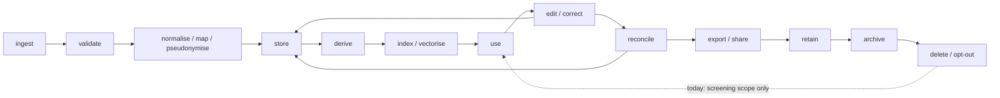

# TrialBox data flow: the lifecycle of every kind of data, from every input to every output

| Field | Value |
| --- | --- |
| Date | 2026-11-09 |
| Head reviewed | `origin/master` 20e89d0 with the docs of branch `claude/trialbox-plan-v4-oxn56n` (same head in the working tree); D-141, D-142 and D-143 read from the worktrees under `/home/user/Auto-GPT/.claude/worktrees/` (not merged) |
| Kind | Read-only review. No code changed, no push, no PR, no cloud. Experiments under `/tmp/claude-0/review-dataflow/scratch/`, removed afterwards |
| Inputs | `docs/ARCHITECTURE.md`, `DATA.md`, `SECURITY.md`, `RUNBOOK.md`, `DECISIONS.md` D-120 to D-143, the five 2026-11-09 reviews and their six component parts, the owner's decisions of 2026-11-09, `spec/v4/05_data_platform_model_privacy.md`, and the code named with file:line in the text |
| Clinical item catalogue | **Not present at this head or in any worktree** (`catalogue/`, `scores/*.yaml`, `2026-11-09-clinical-item-catalogue.md` do not exist). Where this review refers to it, it refers to the agreed design (owner decisions 2026-11-09; standalone review §4.7) |

Marks: **(verified)** checked on the web today, source in Appendix C; **(measured)** measured here on a 4-core, 15 GB container with no GPU, synthetic data only; **(unverified)** could not be checked and must be confirmed before anyone relies on it; **(estimate)** my arithmetic from stated assumptions.

---

## 0. One page

### 0.1 Verdict

TrialBox moves data through **five stores with four different ideas of "the record"**: the adapter's NDJSON snapshot, the HAPI mirror, the DuckDB lake, Postgres `trialbox_wf` (eleven schemas) and the object folders. The paths that exist are careful about the things that matter most (pseudonyms at the door, the one rule for model-read facts, fail-closed unknowns, a hash-chained audit, an encrypted backup). What is missing is the **spine**: there is no single place that says, for every source and every record, *what state it is in, when it was last right, what is pending and what has left the box*. Nine of the twelve gaps below follow from that.

The biggest gaps, in order of harm:

1. **No record-level status for clinical facts.** A hospital row has no provenance, no first/last-seen, no status and no conflict slot (`lake/flatten.py:24-130`). Only `site_fact.basis` (proposed/confirmed) exists. The OMOP + `tb_fact_provenance` + `tb_fact_status` + `tb_conflict` design of the two 2026-11-09 reviews is the right fix and is not started.
2. **No opt-out or erasure path beyond screening.** A FHIR `Consent` with status `rejected` removes a patient from scope at S0 (`matching/cascade/engine.py:349-367`) and nowhere else: the facts stay in NDJSON, HAPI, the lake, the pid map, the embed cache and every kept snapshot. `DATA.md` §5 says so ("no erasure (tombstone) path"). Profiles and vectors will make this worse.
3. **Deletes do not propagate on a delta night.** `adapter/ndjson.py:47-53` merges a `--since` run *over* the previous snapshot by id, so a record removed at the source stays in every later snapshot until a full run; HAPI's ledger then also keeps it (`load_fhir.py:181-183` deletes only what left the *snapshot*).
4. **Embeddings are copied into every snapshot file.** `document_chunk.embedding FLOAT[1024]` is written into each `db/<snapshot>.duckdb` (`lake/store.py:168-186`). With 3 nightly + 36 month-end snapshots kept, a 50,000-patient site stores the same ~18 GB of vectors about 39 times (§7). Vectors belong in one store (pgvector, as decided), not in snapshots.
5. **Derived values are code, not data, and have no unit check.** eGFR, BMI, DAS28, BASDAI and ASDAS are templated SQL (`compile_sql/generator.py:198-253`) over constants in `tb_common/derived.py`; the CRP term assumes mg/L while Japanese and Taiwanese labs usually report mg/dL; components are each "latest in window" with no requirement that they come from the same visit; no JSN eGFR; no stored derived row; no provenance; no worked-example tests against published values.
6. **The backup compresses with gzip level 9 before encrypting** (`tools/trialbox/backup.py:386`, `tarfile` `w|gz` default level 9). That is the right order (compress, then encrypt) and the wrong codec: measured 10–30 MB/s on one core here, against 500–900 MB/s for zstd -1/-3 at a better ratio (§7.3). At 50–100 GB a full backup is hours of CPU instead of minutes. It is also always a full backup.
7. **Site publishing rebuilds the current snapshot under the same id** (`sitesetup/publish.py`, `lake/store.py:127-130`, D-135 FR-REP-02), so a steward's confirmation during a SCREEN changes the data a running job reads between two of its queries.
8. **No central data-operations view.** Freshness, failed rows, quarantine, pending confirmations, open conflicts, mapping coverage, recompute status, staleness, exports and consent live in six places or nowhere (§3).
9. **Exports have no ledger.** The audit records a sha per output file and the mail recipients, but there is no queryable "what left this box, to whom, under which approval, with which de-identification", and no round-trip check except the ODM re-import test.
10. **The lake schema is implicit** (a Python dict, no version in `lake_meta`, `store.py:191-194`), so every downstream reader learns of a change by breaking.
11. **Audit integrity is a plain hash chain**, writable from six containers (full-system review R-18); no signed day head.
12. **Point-in-time recovery does not exist**: no WAL archive, no incremental backup; a restore is "last night's full file".

### 0.2 Compression: CPU, not GPU

- CPU zstd is already faster than the box's disks. Measured here **(measured)**: zstd -1 at 510–900 MB/s and zstd -3 at 410–640 MB/s on one core, decompression 1.3–1.9 GB/s, ratio 7–9.5× on TrialBox-shaped synthetic data (notes, CSV, pg_dump, Parquet). gzip -9, the current backup codec, ran at 10–30 MB/s for a *worse* ratio than zstd -3 on three of five samples. lz4 compressed at 0.7–1.0 GB/s with a ratio of 3.9–5.2×. Four zstd threads on this 4-core box gave 330–770 MB/s (the samples are small; multi-threading pays on files over a few MB). The upstream Silesia numbers agree in shape: zstd -1 510 MB/s and 1,550 MB/s, lz4 675 and 3,850 MB/s, zlib -1 105 and 390 MB/s on an i7-9700K **(verified)**.
- The data rates involved are small: a nightly delta is megabytes to a few gigabytes; the first all-history backfill at 500,000 patients is a one-off of some hundreds of gigabytes; a nightly full `.tbbak` is 50–100 GB at 50,000 patients **(estimate)**. A 16-core workstation CPU with zstd -3 multi-threaded compresses that in minutes; the NVMe (3–7 GB/s) and the encryption step, not the codec, set the floor.
- The repository the owner linked, `github.com/meta/zstd`, **is the official Zstandard repository** (GitHub shows owner `meta` on both the old `facebook/zstd` and the new URL; the release page is v1.5.7, dual-licensed BSD or GPLv2) **(verified)**; it is not a fork. The CLI since 1.5.7 is multi-threaded by default (up to 4 threads) **(verified)**.
- GPU compression: NVIDIA nvCOMP 6.0 supports LZ4, Snappy, Zstandard, Deflate, GDeflate, Cascaded, Bitcomp and ANS **(verified)**, but it ships under the **proprietary "LICENSE AGREEMENT FOR NVIDIA SOFTWARE DEVELOPMENT KITS"**: non-transferable, no sublicensing, redistribution only inside an application that adds material functionality **(verified)**. On this box the GPU is 60 % occupied by the two LLMs on the PRO 6000 and 100 % on the 5090 (sleep swap). GPU compression needs the bytes in GPU memory first (PCIe, then back), which is slower than letting one CPU core run zstd -1 while the disk is the bottleneck. **Verdict: do not use GPU compression. Leave the card to the judge, the verifier and later the embedder. Use CPU zstd everywhere it is available: `.tbbak` (zstd -3, multi-threaded), `pg_dump --compress=zstd` (PG 16+, verified), `wal_compression = zstd` (PG 15+, verified), pgBackRest `compress-type=zst` (verified), Parquet `COMPRESSION zstd` (DuckDB, verified), log and audit archives (`.jsonl.zst` instead of `.gz`). Postgres TOAST has no zstd in 16, 17 or 18 (pglz or lz4 only; verified against the PG 18 docs; a zstd TOAST patch is 19 work); set `default_toast_compression = lz4`.**

### 0.3 The central-control proposal in one paragraph

Add one schema, `dataops`, and one page, `/data-ops`, for the data steward, with the same calls under `/api/v1/data/*`. It holds three registries the box lacks today: a **batch registry** (every ingest, sheet, chart, REDCap sync, refdata load and export is a batch with a state machine), a **record status** table (every clinical fact carries `coded | proposed | confirmed | signed | derived | rejected | superseded | tombstoned`, plus the open-conflict flag), and a **flow ledger** (what entered, what left, under which approval). The page shows per source: freshness, rows, failed and quarantined rows, pending confirmations, open conflicts, mapping coverage, derived-score recompute status, profile and vector staleness, export history and the consent/opt-out register, with one red/amber/green per source and per study. The readiness page, the Sources and Conflicts pages, the hospital-codes page, the excluded page and the research-office counts become views of it (§3).

### 0.4 The derived-data framework in one paragraph

Derived values become **definitions in data** (`tb_score_definition`, `tb_score_component`, versioned, with the published reference, UCUM units, allowed unit conversions, per-component windows and a maximum spread between components), computed by one engine after ingest and on every input change, stored as `measurement` rows with `measurement_type = derived`, `FACT_RELATIONSHIP` rows to each input, and the formula version in provenance. A missing or unit-mismatched input gives **no row and reason `derived_missing_input` / `derived_unit`** (unknown, never FALSE). Each definition ships with worked examples from the publication that a test must reproduce (§4 gives them for CKD-EPI 2021, JSN 2009, DAS28-ESR/CRP, CDAI, BMI, age). A documented score in a note (a DAS28 written by the rheumatologist) is a proposed or signed fact; when it disagrees with the computed value beyond the score's tolerance a `tb_conflict` of kind `derived_vs_documented` opens and the item is unknown until resolved. Screening and profiles read the stored row; `compile_sql`'s `_derived` branch shrinks to "latest derived value of concept X in the window". The catalogue's `scores/*.yaml` is the source the definitions are generated from, once it exists.

### 0.5 The ten recommendations that matter most

| # | Recommendation | When | Effort |
| --- | --- | --- | --- |
| 1 | Per-record status and provenance on every clinical fact (`tb_fact_status`, `tb_fact_provenance`, `tb_conflict`); the screening view admits only coded/confirmed/signed with no open conflict | P0, with the OMOP work | L (part of OMOP step 2) |
| 2 | Opt-out and erasure path: a consent register, tombstones that reach NDJSON, lake, HAPI, pid map, embed cache, snapshots, profiles, vectors and the export ledger | P0 before any real data | M |
| 3 | Propagate deletions on delta nights (tombstone list in the NDJSON merge) and make `--since` safe to run every night | P0 | S |
| 4 | Move embeddings out of snapshot files into one store (pgvector as decided); keep `document_chunk` text and FTS in the snapshot | P1, first sites | M |
| 5 | Content-addressed snapshot ids and job-pinned file handles; batched "apply" for site publishing to `main` | P1 | M |
| 6 | Backup: zstd -3 multi-threaded inside the `.tbbak`, hashes taken from the stream, nightly schedule off-box, and pgBackRest (zstd) for incremental and point-in-time recovery of Postgres | P0 (codec, schedule), P1 (pgBackRest) | S + M |
| 7 | The data-operations console and `dataops` schema (batch state machine, record status, flow ledger, consent register) | P1 | L |
| 8 | Derived-data framework with unit handling, same-visit windows, worked-example tests, JSN eGFR and CDAI; fix the CRP unit assumption first | P0 (unit fix, tests), P1 (framework) | S + M |
| 9 | Statistics page with k = 5 and controlled rounding for anything leaving the study team, per source, department and year | P1 | M |
| 10 | Export ledger and "prepare a database" (study extract with de-identification profile, data dictionary, manifest, round-trip check) | P1 | M |

---

## 1. Inventory: data kinds and their inputs

### 1.1 Data kinds, where they come from, where they live today

| Kind | Inputs | Store at head (schema or path) | Owner of the record | Code |
| --- | --- | --- | --- | --- |
| Coded clinical facts: diagnoses, drugs, labs, procedures, encounters, appointments, claims, providers, consent | hospital CSV export, CGRD SQL views, SS-MIX2 storage, FHIR bulk NDJSON | `lake/ndjson/<snap>/*.ndjson` → HAPI `hapi` (delta) → `lake/parquet/snapshot=<snap>/` → `lake/db/<snap>.duckdb` (13 tables) | the hospital (read-only) | `adapter/pipeline.py:113-283`, `lake/flatten.py:24-130`, `lake/store.py:120-200` |
| Notes and reports (free text) | SS-MIX2 extended storage, CSV `note`/`report`, FHIR DocumentReference, pasted chart text | `document`, `report` tables; `document_chunk` (500-char windows, tokens, `FLOAT[1024]`), FTS index, `embed_cache.duckdb` | the hospital; chart text: the site | `lake/flatten.py:310-322`, `lake/textproc.py`, `lake/store.py:143-190, 202-237` |
| Documents and scans (files) | chart upload (txt, Word, PDF, image, pasted), mailed protocols | `orch-data/sitesetup/<space>/inputs/` (original, text, redacted text); `objects/attachments/` (mail) | the site | `sitesetup/charts.py`, `sitesetup/ocr.py`, `sitesetup/store.py:27-30` |
| PI spreadsheets and IT dumps | CSV (UTF-8, Shift_JIS, Big5), XLSX | `sitesetup.input`, `sitesetup.fact` (status `coded`), `check_item`, `fix` → published to `lake/site/*.ndjson` → joined into every snapshot | the site (steward / coordinator) | `sitesetup/intake.py`, `messy.py`, `store.py:26-53`, `publish.py:67-178`, `lake/store.py:103-117` |
| REDCap records | REDCap API (two-way) | `datacore.value/history/conflict/src_record`; `study.rc_*` (link, read log, write ledger) | per field: TrialBox or REDCap (D-123) | `datacore/sync.py:78-133`, `rc_bridge/`, `orchestrator/studystore.py:36-85` |
| Built-in form answers (screening log, consent, enrolment, visit, AE, deviation, withdrawal) | console entry pages, `/api/v1` | `datacore.value/history` | TrialBox (coordinator enters) | `datacore/sync.py:214-268`, `datacore/builtin/forms.csv` |
| Proposed facts (model-read) | chart text through the local model (`chart_facts_v1`) | `sitesetup.fact` status `proposed` with quote; lake `site_fact` only | nobody until a person confirms | `sitesetup/service.py`, `lake/flatten.py:361-372, 380-397`, `matching/proposed.py` |
| Confirmed facts | one tap by coordinator/steward | `sitesetup.fact` status `confirmed` (`before` keeps the model's version); lake coded tables **and** `site_fact` | the confirming person | `sitesetup/store.py`, `publish.py:31-35` |
| Physician annotations (structured, signed; free text) | **not built** (target: console) | target `tb_annotation`, OMOP event + `tb_fact_status = signed` | the signing physician | design review §2.7.2, standalone review §4.2 |
| Derived scores (BMI, eGFR, DAS28, BASDAI, ASDAS) | computed in the compiled SQL at query time | **not stored**; a column `C_<ID>` per criterion in the query result | the ruleset (code) | `tb_common/derived.py`, `compile_sql/generator.py:198-253` |
| Profiles (narrative, twin) | **not built** | target `tb_patient_profile`, `tb_profile_page`, `profile_version` | the box (model writes, nobody edits) | design review §2.7, standalone review §4 |
| Vectors | chunk embeddings (hash, bge-m3 or embed-service) | `document_chunk.embedding` in every snapshot file; `embed_cache.duckdb` | the box | `lake/store.py:159-186, 202-237` |
| Trial and criteria data | protocol PDF/Word/paste/registry id → doc-parser → compiler → PI approval | `/data/rulesets` git (tags `<ID>/v<n>`), `site.criterion_labels`, `orch.jobs` | the PI (approval) | `criteria_compiler/`, `console/approval.py` |
| Screening results | SCREEN/NAV/CASE jobs | `orch.candidates`, `candidate_events`, `pool`; `objects/outputs/<job>/` (candidate XLSX phi, `excluded_*.json`, PDF) | the job (byte-identical re-run, D-82) | `orchestrator/db.py:69-93`, `scenarios/screen.py:477-530` |
| Marks, outcomes, screening numbers, reveals | console (PI, CRC) and `/api/v1` | `site.pi_marks`, `contact_outcomes`, `screening_no`; reveals in the audit only | the PI (marks), CRC (outcomes, numbers) | `console/sitestore.py:66-150` |
| Lifecycle | derived from forms, registry status, or a person's step | `datacore.subject`, `subject_step`, `schedule`, `ae_ack` | the coordinator (steps), rules (derivation) | `datacore/lifecycle.py` |
| Mail | IMAP in, SMTP out | `mail.intake`, `sent`, `send_keys`; `objects/attachments/` | the mail gateway | `mail_gateway/store.py:11-40`, `outbound.py:153-240` |
| Audit | every service | `audit-data/<day>.jsonl` (hash chain); nightly copy `TB_AUDIT_ARCHIVE_DIR/<year>/<day>.jsonl.gz` | append-only, nobody | `tb_common/audit.py`, `tools/trialbox/logs.py:142-175` |
| Refdata and vocabularies | vendor pack (CT.gov, TFDA, MHLW, NHI, ICD-10-CM, LOINC notice), site loads (MEDIS, JLAC10, YJ, UMIN), terminology Parquet in the compiler, `sitesetup.local_code` | `refdata.*`, `terminology.release/concept`, `criteria_compiler/terminology/*.parquet`, `sitesetup.local_code` | the vendor (pack), the site (licensed, local maps) | `tb_common/refdata.py:62-75`, `adapter/licensed.py:56-62`, `sitesetup/mapping.py` |
| Consortium exports | COHORT job tables, MERGE | `orch.cohort_tables`; CSV by mail, k = 5 | the site (sends), the lead (merges) | `scenarios/cohort.py:141-226` |
| Reference secrets and keys | install, `secrets init` | `tb-secrets` volume (`site_hmac.key`, `pid_map.key`), `deploy/secrets/services/` | hospital IT | `tb_common/crypto.py`, `tools/trialbox/svc_secrets.py` |

### 1.2 Inputs by channel

| Channel | Kinds carried | Validation at the door | Identifiers at the door |
| --- | --- | --- | --- |
| Hospital feed (CSV, CGRD views) | all coded facts, notes, registry consent | mapping check (`tools/mapping_check.py`), 1 % HL7 validator sample, `missing_required`, undated orders dropped (`pipeline.py:172-178`) | chart number → `HMAC(site key, mrn)` (`pipeline.py:160`); names and IDs to the AES-GCM pid map only (`pidmap.py`) |
| SS-MIX2 | ADT, PPR (dx, 疑い flag after D-142), OMP (orders, 実施), OML (labs), extended storage documents | JP Core sample check (50 per type, `jp_core_check`), reader counts (`reader.json`) | as above; document id a keyed hash |
| FHIR bulk NDJSON (disk) | any resource | `pseudonymise_bulk` rewrites references, drops `name`, `telecom`, `address`, `photo`, `contact`, `identifier` of Patient (`pipeline.py:79-105`) | id → pseudonym |
| CSV/Excel sheets, IT dumps | demographics, dx, labs, meds as rows | messy fixes listed, "please check" questions, name/phone/address columns dropped and listed | chart-number column → pseudonym; column that *might* be a chart number held back |
| Paste / upload (charts) | text, Word, PDF, scans | OCR when installed; quote must be found in text; guard redacts chart number, names, phones, IDs | chart number becomes pseudonym on arrival, never stored |
| REDCap | dictionary, records | dictionary identifier fields dropped; record key = screening number, else pseudonym, else refused | no chart numbers |
| Console, `/api/v1` | marks, outcomes, numbers, forms, confirmations, mappings, resolutions, labels | form checks (type, range, branching, ownership), state machine, role checks | screening numbers and pseudonyms; chart numbers only through a reveal |
| Mail | commands, protocols, sheets, cohort tables | sender allowlist, `Authentication-Results`, permission group, rate limit | attachments stored 90 days |
| Models | proposed facts, note verdicts, drafts, (later) narratives | schema-bound output; quotes verified against the record; two-model rule | the model never writes a fact silently (D-131) |
| Vendor update bundle | images, models, rulesets, refdata | Ed25519 + sha256, path and symlink checks | none |

---

## 2. Lifecycle per data kind

### 2.1 The stages and where authority sits



| Stage | Who has authority today | What the audit records today | Gap |
| --- | --- | --- | --- |
| ingest | the adapter (timer 02:00) or an administrator (`console.cli ingest`) | `ingest.done` / `ingest.failed` with counts, validator %, pruned snapshots (`pipeline.py:268-281`) | no batch id; a `--since` run's tombstones are lost (`ndjson.py:47-53`) |
| validate | code (0.5 % rule), the steward reads `ingest_report.json` on disk | the same event | no quarantine set; a failing night leaves the previous snapshot current but nobody is told except by the job list |
| normalise / map | the steward maps local codes once (`sitesetup/mapping.py`); the vendor ships the mapping template | `setup.*` events per mapping decision; `terminology.load` per licensed release | no mapping version on a fact; a remap does not say which facts it changed |
| store | code | sha of outputs; nothing for lake tables | no checksums, keys or schema version in the lake |
| derive | the compiled SQL at query time | nothing (a derived value is never stored) | §4 |
| index / vectorise | code, every rebuild | nothing | model name on the cache row only; no "embedded_at" |
| use | the job engine; roles per page | every job state change, every view of identifiers, every reveal | API reads of candidates are audited through the job, not per patient |
| edit / correct | coordinator (confirm, resolve, enter), PI (marks, approval), steward (codes); the model never | `console.site_*`, `setup.*`, `datacore` history rows, `life.step`, `console.resolve` | no reason-for-change on trial data; no record lock; no e-signature (review 03) |
| reconcile | a person, per conflict (datacore); publish disagreements (demographics) | `console.resolve`, `setup.decide` | no conflict model for clinical facts; a note vs code disagreement has no home |
| export / share | the requester of a job; `sees_ids` for chart numbers (D-143); CRO masked | `job.output` with sha and recipients; `registry.export`, `console.export`, `mail.sent` | no export ledger with approval and de-identification parameters |
| retain | RETENTION job (05:00), snapshot pruning, log collection | `retention.deleted/mail/pools` with hashes | retention per *data kind* is not written down for lake, HAPI, pid map, sitesetup files, refdata |
| archive | `trialbox logs daily` (audit `.jsonl.gz`, service logs) | manifest sha256 | gzip; same-box default; no off-box verification of day heads |
| delete / opt-out | nobody (no path) except the RETENTION job and snapshot pruning | `retention.*` | the central gap (§6.6) |

### 2.2 Coded clinical facts (hospital feed)

| Stage | At head (file:line) | Error handling, retry, idempotency | Target (OMOP + extensions) |
| --- | --- | --- | --- |
| ingest | `run_ingest` reads every table into memory (`pipeline.py:147-171`); `--since` delta per table through `mapping.source_column(table, delta)` | a mapping `ValueError` is appended to `errors` and the table is skipped (`170-171`); the run is marked failed but the snapshot files are still written and the lake still rebuilt; nothing is retried automatically | L0 landing batch with manifest, control totals, write-once (spec v4 §5.3); staging tables loaded with `COPY` (`db.py:68-77` exists) |
| validate | 1 % HL7 sample or structural validator (`212-226`); JP Core 50 per type (`228-232`, `286-305`); `missing_required` counts | over 0.5 % → `passed: false`, snapshots not pruned (`267`); the lake was already rebuilt and `CURRENT` already moved (`store.py:199`), so a failed validation does **not** keep the previous snapshot current | validation before publish; a blocking finding holds the batch and keeps the previous snapshot `CURRENT` |
| normalise / map | `Mapper.map_table` → FHIR resources; codes through the mapping's `values` and lookups; `labvalue.parse` for text results (D-142, worktree) | unmapped codes stay as local codes → `unknown_code_system` at run time (D-130); units from the lookup not the row (R-31) | `*_source_value`, `*_source_concept_id`, local concepts ≥ 2 B, `source_to_concept_map` with `mapping_version` |
| pseudonymise | `pid_for_mrn` (`pipeline.py:160`); pid map upsert with `first_seen/last_seen` (`pidmap.py:59-73`) | key created silently on first use (R-50); no chart-number normaliser (R-48) | key ceremony at install; one normaliser per site rule |
| store | NDJSON per snapshot (`ndjson.py:40-60`), HAPI delta by content hash (`load_fhir.py:160-187`), Parquet + DuckDB whole rebuild (`store.py:120-200`) | HAPI failure → error string, run continues (`204-205`); lake failure → error string (`210-211`); ledger widened before load so a failed night reloads (`173-177`) | OMOP `cdm` schema as the record; lake *exported* from it with the same 13 table names; HAPI out of the nightly path |
| derive | at query time only | — | §4 |
| index | FTS index per snapshot; embeddings per snapshot with a sha cache | a missing cache row → embed again; model change → full re-embed on the next rebuild | pgvector `note_chunk`, `embedding_model` per row |
| use | FEAS, SCREEN, NAV, CASE, COHORT, readiness, all pinned to a snapshot (`cascade/engine.py:109, 340-349, 401`; `evaluate.py:90-99`) | a missing `consent` table is tolerated; any other lake error fails the run (D-127) | unchanged |
| edit / correct | none: the hospital record is read-only (owner decision 2) | — | corrections arrive as new source rows or as signed annotations; never in place |
| reconcile | none for hospital rows | — | `tb_conflict` (note vs coded, source vs source) |
| export | FHIR NDJSON is the snapshot itself; no OMOP export | — | FHIR on demand from OMOP; OMOP CSV export for OHDSI |
| retain | 3 nightly + 36 month-end snapshots (`retention.py:56-70`, `pipeline.py:308-324`); HAPI keeps the current state only | pruning only after a passed run | per-kind retention table (§6.7) |
| delete / opt-out | S0 scope only (`engine.py:349-367`) | — | tombstones, crypto-shred of L0, export notification (§6.6) |

**Provenance and lineage today.** A lake row knows its resource id and nothing else. The snapshot id is the only lineage key (`lineage: snapshot:<id>` on evidence, `engine.py:473, 486, 519`). There is no `ingest_run_id`, no `source_file`, no `source_row`, no `mapping_version`, no `first_seen_snapshot`. The spec v4 L0–L5 platform (`services/dataplat/`, OpenLineage events, bitemporal columns) exists as code that nothing calls (design review §1.3 item 11).

### 2.3 Notes, documents and scans

| Stage | At head | Gap |
| --- | --- | --- |
| ingest | `document` rows from DocumentReference (`flatten.py:310-322`), SS-MIX2 extended storage (D-137), chart text from site set-up as `DocumentReference` type `chart` (`publish.py:147-159`); scans through Tesseract when installed (`sitesetup/ocr.py`), else refused | OCR never run on a real scan (R-71); `doc_parser._ocr_pdf` hard-codes `chinese_cht` |
| validate | none beyond "has text" | no language detection stored, no section awareness, no page count |
| normalise | redaction by the guard for chart text (`sitesetup/service.py`), not for hospital notes (they are D3 and stay verbatim) | — |
| store | `document.text` in Parquet and DuckDB per snapshot; chunks 500 chars / 100 overlap (`textproc.py`); originals in `orch-data/sitesetup/<space>/inputs/` | text duplicated in every snapshot; originals and OCR text in clear on disk (R-05) |
| index | BM25 over CJK bigrams, cosine over `FLOAT[1024]`, RRF (`store.py:273-335`) | the only cross-patient index is per snapshot; S2b embeds on the fly (`s2b_semantic.py`) |
| use | S2/S2b/S3/S4 read the window's notes; proposed facts from charts; the profile (later) | the cascade loads a year of notes for every alive patient into one Arrow table (R-87) |
| edit | none; a chart can be re-uploaded (a new input) | no "superseded by" on inputs |
| export | never (quotes only, in the box) | the consortium rule: no quotes, no vectors (owner decision) |
| retain | with the snapshot; `attachments/` 90 days; trace store 90 days of redacted text | retention of chart originals is unspecified (they are in `orch-data`, backed up, never pruned) |
| delete | none | tombstones must remove chunks, cache rows and vectors too |

### 2.4 PI spreadsheets and IT dumps

Path: `intake.py` (encoding detection, header finding) → `messy.py` (safe fixes, "please check") → `store.fact` with status `coded` → `publish.resources()` → `lake.put_site()` → the next rebuild joins `lake/site/*.ndjson` into **every** snapshot built afterwards (`store.py:127-130`).

- **Authority.** The steward or coordinator answers each check item once (`check_item.answer`); the owner decided sheet values are trusted as coded with the source shown, and a disagreement with the feed is a conflict (owner decisions 2026-11-09).
- **Validation.** Dates (era, 民國, Excel serial, D/M), full-width, units (five analytes), merged cells, title rows; name/phone/address columns dropped; a possible chart-number column held back. Only the first worksheet is read (R-79); lab cells like `<0.3` vanish silently (R-94).
- **Idempotency.** "Each answer re-reads the stored file, so the result always depends only on the file and the answers" (D-135): good. But a sheet re-uploaded is a new `input` with new fact ids; nothing marks the old input `superseded`, so the same patient's facts exist twice until the steward rejects them.
- **Conflicts.** Only demographics are compared (`publish.disagreements()`, `publish.py:54-64`); a sheet diagnosis against a feed diagnosis is never compared. The owner's "sheet vs feed disagreement is a conflict" rule has no code yet.
- **Logging.** Every decision is audited (`setup.*`); the fact's `decided_by/decided_at/before` are the trail.
- **Gap against target.** Sheet facts should be OMOP rows with `tb_fact_provenance.source_kind = sheet`, `source_ref = <input id>:<row>`, trust `coded`, and a `tb_conflict` on any coded disagreement (standalone review §5.1).

### 2.5 REDCap records and built-in form answers (the data core)

The data core is the one store today with a complete record lifecycle: value, owner, history, conflict, source id (`datacore/store.py:25-43`).

| Stage | At head | Notes |
| --- | --- | --- |
| ingest | `sync()` pulls rows keyed by screening number or pseudonym (`sync.py:78-133`); sheets and FHIR QuestionnaireResponse bundles through the same `Source` protocol | rows with no key are refused and listed (`SyncResult.refused`) |
| validate | `save_form` checks type, range, branching, required, ownership, whole-form (`sync.py:214-268`) | calculated fields shown, not computed (D-129) |
| store | one TEXT value per (study, record, event, field) with `changed_by/at`, `seen`, `pushed`; every change in `history` (`store.py:122-145`) | values are TEXT; units and types live in the dictionary |
| reconcile | source-owned vs TrialBox-owned rules; a conflict is listed once and closed by a person (`sync.py:104-129, 168-183`) | no undo for a resolution (R-75); longitudinal blanking fixed in D-142 |
| export | ODM 1.3.2 Snapshot, REDCap CSV, XLSX (`datacore/export.py`); FHIR QR on an internal route | no ODM import; repeat keys always 1; no Define-XML |
| retain | forever (no rule) | trial records follow the sponsor's retention; write it down |
| audit | `datacore` history rows plus console events | no reason-for-change, no e-signature, no record lock (review 03, J-GCP) |

**Idempotency.** The REDCap write-back keeps a hash ledger per screening number (`study.rc_write`) and `overwriteBehavior=normal`, so a repeated run writes nothing (D-123). A sync is re-runnable; the `seen`/`pushed` pair makes the second run a no-op.

### 2.6 Proposed and confirmed facts

Covered by D-135 and verified in `tests/unit/test_one_rule.py`. State machine today: `proposed → confirmed | rejected`; `coded` for sheet rows. What is missing against the target: `signed` (a physician's structured entry), `superseded` (a correction of a confirmed fact; today `before` keeps one version only), `derived`, `tombstoned`; a `model`, `prompt_version`, `confidence` on the proposed fact (`sitesetup.fact` has `quote` and `before` only, `store.py:31-36`); and the one-tap confirmation is **unbatched**: each confirmation republishes the whole space (D-135 "Not done"; R-79), which at `main` scale is minutes per tap and a snapshot rebuild under running jobs.

### 2.7 Physician annotations (target only)

Not built. The owner's rules (a signed structured entry counts as confirmed data; free text is read as a note; nothing excludes silently) need: `tb_annotation` with `status {draft, signed, retracted, superseded}` and re-authentication at signing; a signed structured annotation written as an OMOP event with `tb_fact_status = signed`; retraction as supersession, never deletion; the excluded page (D-143 built it) naming the annotation as evidence. Authority: steward and PI for whole-database or own-study conflicts; a PI may annotate, not confirm (design review §2.5).

### 2.8 Derived scores

See §4. Lifecycle today: computed in SQL per (pid, index_date) at query time; never stored, never audited, never shown to a person with its inputs except as evidence ids `oid|date` concatenated (`generator.py:244-246`).

### 2.9 Profiles and vectors (target)

Two clocks (owner decision): facts and the twin within minutes, the narrative nightly. Versions kept 10 years. Vectors in backups. The lifecycle that must exist before the first profile: a `dirty` set per layer; `profile_version` immutable per version with `as_of_facts`, `as_of_narrative`, `snapshot_id`, `model_version`, `prompt_version`; every view audited with version and basis of access; opt-out removes the person's profiles and vectors (§6.6). Today the only vector lifecycle is "rebuild everything into the new snapshot file, reuse cached vectors by sha" (`store.py:202-237`).

### 2.10 Trial and criteria data

Protocol text → doc-parser → compiler → IR → SQL and CQL → equivalence gate → S20 approval → git tag. The ruleset repository is the one versioned, signed-by-approval store in the box. Edits are new versions; the approved SQL is byte-stable; labels per language live in `site.criterion_labels` and are audited. Gap: a ruleset depends on a terminology version (`icd10cm_full.parquet`, the licensed lists) that is **not recorded in the ruleset manifest**, so "recompile with the new ICD-10-CM year" is undetectable; D-122 notes "rulesets already compiled keep their approved lists until they are recompiled".

### 2.11 Screening results, marks, outcomes, numbers

- **Store.** `orch.candidates` with `candidate_events` (every status change with previous, reason, by, source job: `db.py:69-93`); `site.pi_marks` with undo as a new event; `screening_no` one store of record (D-127 F-08).
- **Outputs.** Per job in `objects/outputs/`: candidate XLSX (phi, chart numbers resolved through the pid map, `screen.py:290-293, 491-493`), `excluded_<study>_v<n>.json` (D-143), summary PDF (aggregate). Each output's sha and recipients in the audit.
- **Re-run.** Byte-identical on the stub for FEAS and the structured part; note judgements drift ~9 % with the pair (R-41).
- **Retention.** Outputs 365 days, hashes kept.
- **Gap.** A candidate row has no snapshot id; the job has. A patient listed by two studies has two independent rows (right) with no cross-study view for the steward (needed for "whole-hospital screening").

### 2.12 Lifecycle (participants)

`datacore.subject`, `subject_step` (old, new, day, reason, note, who, when, source), `schedule`; derivation from forms never goes backwards; undo is a new step; the screening log mirrors the state after a step (D-134). Gap: `anchors()` used undone steps (R-44); the schedule is not versioned with amendments; the SAE acknowledgement and reporting clock arrived in D-143.

### 2.13 Mail

Intake rows, sent rows and send keys in schema `mail`; attachments 90 days; mail logs 5 or 7 years by country; the outbox table exists but nothing dispatches through it (R-16). PHI leaves only as 7z AES-256 with the password in a second mail (`outbound.py:116-125, 211-225`; the review's R-12 asks for links instead). Idempotency: send keys prevent double delivery but a pre-DATA failure leaves a key stuck in `sending`.

### 2.14 Audit

Append-only JSONL, hash-chained, `flock`-serialised, torn-line repair, disk-space check (`audit.py:98-202`); `verify()` recomputes the chain; nightly gzip copy with a sha manifest. Kept 10 years on the box, forever in the archive. Gaps: unkeyed chain writable from six containers (R-18), no signed day head, no index (the console reads the newest 1,000 lines from files, R-93), no per-event retention class (a reveal event and a `job.state` event live the same 10 years), and the archive codec is gzip.

### 2.15 Refdata and vocabularies

Four homes (design review §1.3 item 8): `refdata` (vendor pack, one transaction per pack, verify by sha and record count; `refdata.py`), `terminology` (licensed releases with version, sha256, encoding, who loaded; the older release stays inactive; `licensed.py:56-62`), the compiler's Parquet, and `sitesetup.local_code` per space. Target: one `vocab` schema (`concept`, `vocabulary`, `concept_relationship`, `source_to_concept_map` with versions) that the pack, the loaders and the mapping page all write (design review §2.4). The refdata pack is 2.2 GB and inflates every rollback dump and backup (R-60); it should be excluded from the nightly backup and restored from the pack.

### 2.16 Consortium exports

COHORT writes quarterly tables with `suppress()` at k = 5 (`cohort.py:141-167`), MERGE sums site files and gives a `lo–hi` range when a cell is suppressed (`204-226`). Transport is mail. The owner's decision adds de-identified profiles (project pseudonyms, ±180-day shift, k = 5 over quasi-identifiers, no quotes, no vectors, signed manifest, privacy-office review of the first export). None of the profile export exists; the counts path has no signature yet.

---

## 3. Central control of data status and flow

### 3.1 What exists today, and where

| Need | Exists? | Where | Who sees it |
| --- | --- | --- | --- |
| Source freshness | partly | `ingest_report.json` on disk per snapshot; lake `/healthz` says the current snapshot id; `datacore.source_cfg.last_sync/last_result` on the Sources page; `refdata` tile says "data as of" | administrator (disk, health), coordinator (Sources) |
| Row counts | partly | `IngestReport.counts`; `RebuildStats.tables`; `sitesetup.published.counts`; backup manifest row counts | nobody on a page except the refdata tile |
| Failed rows | partly | `missing_required` in the report; `SyncResult.refused`; the SS-MIX2 `reader.json` `missed` | administrator reading JSON; coordinator (Sources page shows refused rows) |
| Quarantined data | no | a failed night marks the report `passed: false` but the data is in the lake and `CURRENT` has moved | — |
| Pending confirmations | yes | readiness page `patients.proposed` with a link (`readiness.py:66-68`) | coordinator, investigator |
| Open conflicts | partly | datacore Conflicts page (trial fields); readiness `patients.disagree` (demographics only) | coordinator |
| Mapping coverage | partly | readiness `patients.unmapped` and `unknown_share` (`readiness.py:69-99`); hospital-codes page; `mapping_check.py` on the command line; FEAS notes `unknown_system` | coordinator; IT (CLI) |
| Derived-score recompute status | no | nothing is stored | — |
| Profile and vector staleness | no (not built) | `embed_cache` has no timestamps | — |
| Export history | partly | audit events `job.output`, `console.export`, `registry.export`, `mail.sent`; the audit page shows the newest 1,000 events | administrator |
| Consent / opt-out status | partly | lake `consent` table (`flatten.py:206-213`), counted at S0 as `opted_out`; shown as a number in the SCREEN funnel | PI, CRC per run |
| Service health | yes | admin health tiles (`backend.py:324-345`): up/down and the snapshot id; "GPU, disk, backup and chain status will be added at install" (R-43) | administrator |
| Data-quality numbers | partly | research-office counts per study and year with k = 5 (`screening_log.py:267-293`); FEAS basis columns (coded, confirmed, proposed) | admin, viewer, coordinator |
| Excluded and why | yes (D-143) | `/studies/{rs}/excluded` | PI, CRC, admin |

So: the readiness page answers "is this study ready?", the Sources and Conflicts pages answer "is this study's REDCap in step?", and the rest is JSON on disk or absent. Nothing answers the steward's question: "what is the state of the hospital's data in this box, today?"

### 3.2 The data-operations console

One schema `dataops` in `trialbox_wf`, one steward page `/data-ops` (tabs: Sources, Batches, Records, Conflicts, Mapping, Derived, Profiles, Exports, Consent, Statistics), and `/api/v1/data/*` with the same calls. Every page the box has today becomes a filtered view of these tables.

**Batch registry** (`dataops.batch`): one row per unit of work that moves data: nightly ingest per source, a sheet or dump, a chart, a REDCap sync, a refdata or licensed load, a lake rebuild, a publish, a derived recompute, a profile build, an export, a retention run, a backup.

```
batch (batch_id, kind, source_id, started_at, finished_at, state, snapshot_id, rows_in, rows_accepted,
       rows_quarantined, rows_deleted, control_totals jsonb, errors jsonb, actor, parent_batch_id,
       input_sha256, report_path, superseded_by)
```

State machine per batch (every transition an audit event `batch.<state>`):

```
LANDED ──► VALIDATED ──► MAPPED ──► PSEUDONYMISED ──► PUBLISHED
   │           │            │             │
   └─► FAILED  └─► HELD     └─► FAILED    └─► FAILED
HELD ──(steward: accept with reason | reject)──► VALIDATED | REJECTED
PUBLISHED ──(a later batch of the same source and window)──► SUPERSEDED
```

`HELD` is the quarantine the box lacks: the batch's rows are stored under its id, nothing downstream runs for that source, the previous snapshot stays `CURRENT`, and the steward is told with the diff. This fixes the current behaviour where a failing validation still moves `CURRENT` (`store.py:199` runs before `pipeline.py:239-248` decides).

**Record status** (`dataops.fact_status`, the `tb_fact_status` of the design, keyed by OMOP table and id once OMOP exists; by lake table and id until then):

```
coded ──► superseded (a newer source row for the same source record)
proposed ──► confirmed | rejected
confirmed ──► superseded (corrected again) | rejected (retracted with reason)
signed ──► retracted (physician) | superseded
derived ──► superseded (an input or the formula version changed)
any ──► tombstoned (opt-out, erasure, source delete)          -- the row is hidden, never dropped, until crypto-shred
plus a flag: in_open_conflict (from tb_conflict)
```

The screening view admits `coded`, `confirmed`, `signed`, `derived` with `in_open_conflict = false`. Everything else can only widen an answer to unknown (D-135's rule, generalised).

**Flow ledger** (`dataops.flow`): one row per thing that entered or left: `(flow_id, direction in|out, kind, counterpart (source system, recipient, project), batch_id, approval_ref (IRB, DSA, job), deid_profile_id, identifiers_level {chart_number, screening_no, pseudonym, project_pseudonym, aggregate}, sha256, rows, created_at, actor)`. Exports already made by the box (candidate XLSX, screening log, enrolment report, cohort tables, ODM, REDCap push) write a row here as well as the audit line; opt-out propagation reads it (§6.6).

**Consent register** (`dataops.consent`): `(pid, scope {research_screening, contact, profile, consortium}, status {permit, deny, withdrawn}, basis {notice_opt_out, consent_form, irb_waiver}, source, effective_from, recorded_at, recorded_by)`, fed by the hospital registry (today's FHIR Consent) and by the console (a withdrawal entered by the CRC). S0 reads this, not the lake table.

**Page content per source** (one row each for: hospital feed, SS-MIX2, FHIR bulk, each sheet or dump, charts, each REDCap project, refdata, licensed lists):

| Column | From |
| --- | --- |
| last successful batch, age (green < 26 h, amber < 50 h, red beyond) | `batch` |
| rows in / accepted / quarantined / deleted last night; 30-day sparkline | `batch` |
| held batches waiting for the steward | `batch.state = HELD` |
| mapping coverage: % rows with a readable code per domain; unmapped local codes with row counts | `source_to_concept_map`, the readiness query |
| pending confirmations | `fact_status = proposed` |
| open conflicts, oldest age | `tb_conflict` |
| derived scores: definitions, last recompute, rows stale | `dataops.batch kind=derive`, `fact_status = derived` |
| profiles: built / stale / abstained; vectors: embedded / pending / model | `profile_version`, `note_chunk` |
| exports last 30 days with identifier level | `flow` |
| consent: permits, denies, withdrawals pending propagation | `consent`, `tombstone` queue |

**API.** `GET /api/v1/data/sources`, `/batches?source=&state=`, `/batches/{id}` (report, errors, quarantine sample without identifiers), `POST /batches/{id}/accept|reject`, `GET /records/status?pid=` (a steward's view of one patient's facts with status and provenance), `GET /conflicts`, `POST /conflicts/{id}/resolve`, `GET /mapping/coverage`, `GET /derived/status`, `POST /derived/recompute`, `GET /profiles/status`, `GET /flows?direction=out`, `GET /consent?pid=`, `POST /consent` (a withdrawal), `GET /statistics?by=source|department|year`. Reads behind the service token and the steward role; every read of a patient-level row audited with basis of access (owner decision).

### 3.3 The statistics page

Purpose: data quality and coverage so the steward and the PI know what the box can and cannot answer, and so the IRB and the research office get honest numbers.

| Block | Numbers (per source × department × calendar year) | Who sees the exact number | Who sees it suppressed |
| --- | --- | --- | --- |
| Population | patients with ≥ 1 encounter; new patients; deceased; opted out | steward, administrator | PI and CRC of a study see only their study's scope; research office, IRB, sponsor: k = 5 with controlled rounding |
| Volume | encounters, diagnoses, lab results, drug orders, procedures, notes, reports; rows per patient-year | steward | same |
| Coding coverage | % diagnoses in ICD-10-CM (or readable by a ValueSet), % drugs with ATC, % labs with LOINC, % labs with a unit, % results numeric vs censored vs text; unmapped local codes by count | steward, PI | same |
| Completeness | % patients with birth date, sex; % encounters with department and provider; % notes with text; % labs with a reference range | steward | same |
| Timeliness | source → box lag (median, p95) per source; nights failed or held | steward, administrator | aggregate only |
| Conformance | validator error %, JP Core / TW Core sample failures, DQD-lite checks once OMOP exists | steward | aggregate only |
| Proposed vs confirmed | counts of proposed, confirmed, rejected facts; median time to confirm; confirm rate per model/prompt version | steward, PI | aggregate only |
| Conflicts | open and resolved by kind and age; resolutions by authority | steward | aggregate only |
| Derived | scores computed, skipped for missing input, skipped for unit mismatch, per definition version | steward, PI | aggregate only |
| Screening activity | the research-office counts that exist (listed, reviewed, approached, contacted, consented, enrolled, screen-failed, declined) per study and year | admin, coordinator, viewer (today's rule) | k = 5, rounding |

Small-cell rule, in one place: `tb_common/smallcell.py` already has `suppress`, `round_count` and `rate_publishable`. The rule for this page: inside the study team and for the steward, exact counts (the data is theirs); anything that leaves the study team (research office, IRB report, sponsor, consortium, printout, mail) goes through `round_count` for cells that sit beside each other and `rate_publishable` for every percentage, k = 5 by default and a site setting that may only be raised. Department × year × source cells are exactly the kind that re-identify a rare patient; the page must apply the rule to the *cross-tabulation*, not to each count alone (the standalone review's point about quasi-identifiers, §5.2).

### 3.4 What the central view changes in existing pages

- The readiness page's three lights become the study-scoped view of `dataops`: the "patients" light turns amber on any `HELD` batch of a source the study depends on and on any open conflict touching a listed patient (owner: an open conflict blocks "ready").
- The admin health page gains the runtime tiles the full-system review asked for (last backup, last ingest, egress loaded, disk per volume, GPU, canary, chain verified at, last run per timer; R-43), fed from `batch`.
- The Sources and Conflicts pages stay, filtered to the study.
- The hospital-codes page becomes the Mapping tab.
- The excluded page gains the status and provenance of each fact that excluded.

---

## 4. Derived data

### 4.1 How derived values are computed today

| Score | Where | Formula in code | Components (system, code) | Window | Gaps |
| --- | --- | --- | --- | --- | --- |
| BMI | `derived.py:64-65`; SQL `generator.py:207-208` | weight / (height/100)² | LOINC 29463-7, 8302-2 | 365 d each, independently latest | none serious; height may be years old at a child site (not in scope) |
| eGFR | `derived.py:50-59, 68-73`; SQL `209-221` | CKD-EPI 2021 race-free: 142·min(Cr/κ,1)^α·max(Cr/κ,1)^−1.2·0.9938^age·(1.012 if female) **(verified against NKF)** | LOINC 2160-0 creatinine mg/dL; age from `date_sub('year', birth_date, index_date)`; sex from `patient.sex` | 365 d | **no JSN 2009 equation** (the one Japanese protocols and the JSN use); creatinine unit taken from the lookup, never the row (R-31); no Jaffé/enzymatic note; NULL when sex is NULL (right) |
| DAS28 | `derived.py:60, 76-92`; SQL `222-232` | DAS28-ESR when an ESR is in the window, else DAS28-CRP; 0.56√TJC + 0.28√SJC + 0.70 ln ESR + 0.014 GH; CRP form + 0.36 ln(CRP+1) + 0.96 **(verified: protocol SAPs)** | TJC28, SJC28, PtGA (local system `clinical-score`), ESR 4537-7, CRP 1988-5 | 90 d, each component independently latest | **CRP assumed mg/L** (`derived.py:6`); Japanese and Taiwanese labs commonly report mg/dL, so a CRP of 1.0 mg/dL (= 10 mg/L) enters as 1.0 and the score is understated by up to ~0.8; components may come from different visits up to 90 days apart; ESR = 0 gives ln(0); no GH-less 3-variable form; no CDAI/SDAI |
| BASDAI | `derived.py:95-96`; SQL `233-235` | (Q1+Q2+Q3+Q4+(Q5+Q6)/2)/5 | six local codes | 90 d | none |
| ASDAS-CRP | `derived.py:61, 99-106`; SQL `236-241` | 0.12 back + 0.06 stiffness + 0.11 PtGA(0–10) + 0.07 peripheral + 0.58 ln(CRP+1) | BASDAI Q2, Q6, Q3, PtGA/10, CRP | 90 d | same CRP unit issue; PtGA divided by 10 assumes a 0–100 mm VAS |
| Age at index | SQL `295` | complete years between birth date and index date | `patient.birth_date` | — | correct; a birth date with day unknown (some SS-MIX2 feeds give YYYYMM) is read as a full date upstream |
| CDAI, SDAI, ECOG, MMSE, CDR | not implemented | — | — | — | the design (§2.3 of the design review) lists them as first definitions |

Missing-input behaviour today is right in direction: every formula returns NULL when a component is NULL (`generator.py:216, 228-231`), and a derived atom without a value comparison yields NULL → unknown (`251`). But a derived value compared with `latest` quantifier semantics inherits the unit problem silently, and nothing records *why* a value is missing.

No test reproduces a published worked example; `tests/unit/test_derived_phi.py` and `test_cql_sql_generators.py` check shape and SQL/CQL parity, not clinical correctness.

### 4.2 The framework

**Registry.** Two tables (from the design review §2.3, extended), generated from the catalogue's `scores/*.yaml` when the catalogue exists, otherwise maintained by hand under version control:

```
tb_score_definition (score_concept_id, version, name, formula_kind, params jsonb, unit_concept_id,
                     result_min, result_max, reference_doi, reference_text, population_note,
                     valid_from, valid_to, author, approved_by, approved_at, status {draft, approved, retired})
tb_score_component  (score_concept_id, version, role, component_concept_id, unit_concept_id,
                     allowed_units jsonb, required bool, max_age_days, value_min, value_max,
                     transform {none, ln, sqrt, divide_by_10}, zero_rule {null, substitute:1})
tb_score_rule       (score_concept_id, version, same_visit bool, max_spread_days, anchor {index_date, latest_component, visit_date},
                     tie_break {latest, earliest, max, min}, prefer jsonb)
```

`formula_kind` is a closed set the box implements (`weighted_sqrt_log` for DAS28, `sum` for CDAI, `ckd_epi_2021`, `jsn_2009`, `bmi`, `entered`); a model never writes a formula; a new kind is a code change with its own worked examples.

**Units.** Every component row has `unit_concept_id` (UCUM) and `allowed_units` with the factor to the definition's unit (`mg/dL → mg/L × 10`, `µmol/L creatinine → mg/dL ÷ 88.4`, `mmol/mol HbA1c → % NGSP (0.0915·x + 2.15)`). The input row's own unit (R-31 adds a `source_unit`) is compared; a unit that is not allowed gives **no row and reason `derived_unit`**; a missing unit at a site uses the site's declared default per analyte (a `site_policy` row, audited), never a global assumption.

**Windows and anchoring.** Each component has `max_age_days` from the anchor; `tb_score_rule.same_visit` requires all components within `max_spread_days` of each other (DAS28: 7 days; eGFR: creatinine alone; BMI: weight ≤ 365 d, height ≤ 1,825 d). Anchor `index_date` for screening (the ruleset's window), `latest_component` for the profile ("the last DAS28 we can compute"), `visit_date` for a protocol visit. The computed row carries its anchor and the dates of its inputs.

**Missing input.** No row, a `derived_skip (person_id, score, version, anchor, reason {missing:<role>, unit:<role>, out_of_range:<role>, spread, zero})` row for the statistics page, and `unknown` in screening with reason `derived_missing_input` (words in en, ja, zh-TW), never FALSE. ESR = 0 follows `zero_rule`: default `null` (unknown), a protocol may choose `substitute:1` as its SAP says.

**Recompute triggers.** Any insert, supersession, status change (proposed → confirmed, signed, rejected, tombstoned) or remap of a row whose concept is a component of an approved definition for that person; a new definition version (forward only: old rows keep their version); a terminology map change that moves a local code into or out of a component concept. Implemented as a `dataops.batch kind = derive` per night plus an on-change queue (`LISTEN/NOTIFY` or a 5-minute poller on `recorded_at`, the same mechanism the profile's symbolic layers use).

**Storage and provenance.** A `measurement` row with `measurement_type_concept_id = derived`, `value_as_number`, `unit_concept_id`, `measurement_date = anchor`; `tb_fact_provenance (source_kind = derived, formula_version, inputs jsonb [{table, id, date, value, unit}])`; one `FACT_RELATIONSHIP` per input ("derived from"); `tb_fact_status = derived`. Until OMOP exists, the same as a lake table `derived (did, pid, score, version, anchor, value, unit, inputs, computed_at)` exported into every snapshot, which also makes derived values reproducible per snapshot.

**How screening and profiles use them.** `compile_sql`'s `_derived` branch becomes "latest `derived` row of score X with version in the approved set in the window" (same `latest` CTE as a lab); the approved ruleset pins the definition versions it was approved with, so a formula change needs a re-approval (S20) exactly as a code list change does. The profile's record layer shows the value with its inputs and version; the timeline shows the series; setpoints are computed over stored derived rows, never recomputed ad hoc.

**Validation with worked examples.** Each definition ships `examples: [{inputs, expected, tolerance, source}]`; a unit test runs the engine over them and the SQL template over a one-patient lake. Examples the first release must pass (my arithmetic from the published formulas; expected values rounded):

| Score | Inputs | Expected | Note |
| --- | --- | --- | --- |
| CKD-EPI 2021 | female, 55 y, Cr 1.1 mg/dL | 59.3 mL/min/1.73 m² | matches the NKF-style calculators found today **(verified: 59.3)** |
| CKD-EPI 2021 | male, 60 y, Cr 1.2 mg/dL | 69.2 | matches a public calculator **(verified: 69.2)** |
| JSN 2009 | male, 60 y, Cr 1.0 mg/dL | 59.9 | 194 · 1.0^−1.094 · 60^−0.287 |
| JSN 2009 | female, 55 y, Cr 1.1 mg/dL | 40.9 | 194 · 1.1^−1.094 · 55^−0.287 · 0.739. **The same patient is 59.3 by CKD-EPI and 40.9 by JSN**: an "eGFR ≥ 45" criterion flips. The protocol, not the box, chooses the equation; the ruleset must name it |
| DAS28-ESR | TJC 4, SJC 3, ESR 20 mm/h, GH 40 mm | 4.26 | 1.12 + 0.485 + 2.097 + 0.56 |
| DAS28-CRP | TJC 4, SJC 3, CRP 10 mg/L, GH 40 | 3.99 | 1.12 + 0.485 + 0.863 + 0.56 + 0.96; with CRP wrongly read as 1.0 (mg/dL unconverted): 3.38 |
| CDAI | TJC 4, SJC 3, PtGA 4.0, EvGA 3.5 | 14.5 | sum; 10–22 moderate |
| BMI | 70 kg, 175 cm | 22.9 | |
| Age at index | born 1960-11-10, index 2026-11-09 | 65 | complete years, the day before the birthday |

The JSN pair above is the strongest argument for the registry: today the box silently computes CKD-EPI 2021 for a Japanese protocol whose SAP says JSN, and no page says which equation was used.

**Conflicts between a derived and a documented value.** A DAS28 written in a note is extracted as a proposed fact (concept DAS28, value, date, quote); a physician's signed DAS28 is a signed fact. When a derived row exists within `max_spread_days` of the documented value and `|derived − documented| > tolerance` (DAS28 0.2; eGFR 5; BMI 0.5), `tb_conflict (kind = derived_vs_documented)` opens; the item is unknown for screening until the steward or the PI resolves `keep_derived | keep_documented | both_at_dates`; the profile shows both with the badge. A documented value with no computable counterpart (components missing) stands alone as what it is (proposed or signed) and follows those rules.

**Catalogue link.** Each `tb_score_definition.score_concept_id` and each component concept must resolve in the catalogue (LOINC where a code exists, e.g. 29463-7, 8302-2, 2160-0, 4537-7, 1988-5; CDISC QRS or a consortium-shared local concept otherwise; whether LOINC has codes for TJC28/SJC28/PtGA and for CDR is **(unverified)**, for the catalogue agent to check; a CDISC QRS supplement for DAS28 was **not found today (unverified)**). The current local system `https://trialbox.local/fhir/CodeSystem/clinical-score` (`derived.py:20`) becomes a `TB-SHARED` vocabulary with ids ≥ 2,000,000,000.

---

## 5. To and from other systems

### 5.1 Every import and export path

| Path | Direction | Format at head | Mapping | Identifiers allowed | Authority | Audit | Round-trip check | Versioning | Standard to adopt |
| --- | --- | --- | --- | --- | --- | --- | --- | --- | --- |
| Hospital CSV / CGRD views | in | site CSV, SQL views → canonical tables → FHIR R4 NDJSON | site YAML (`mapping/templates/`) | chart number at the door only | hospital IT (export), steward (mapping) | `ingest.*` | counts in the report; `mapping_check.py` | snapshot id; mapping file unversioned on the fact | keep; add `mapping_version` |
| SS-MIX2 | in | HL7 v2.5 storage + extended files | `jp_core/ssmix2_site.yaml`, MEDIS/JLAC10/YJ lookups | same | same | same + `reader.json` | CSV path = SS-MIX2 path funnel (test) | same | keep |
| FHIR bulk NDJSON | in | R4 NDJSON on disk | `pseudonymise_bulk` | same | same | same | none | same | **FHIR Bulk Data Access IG v3.0.0 (STU 3, R4)** is the current published IG **(verified)**; a SMART Backend Services client is the gap (`DATA.md` §5) |
| REDCap | in and out | API `content=record` JSON/CSV; dictionary CSV; events and arms | datacore field map, per-field ownership | screening number, pseudonym; identifier fields dropped | coordinator (attach, sync), PI (nothing) | `rc_read_log`, `rc_write`, `datacore.history`, console events | e2e stage 8/9 on the simulator; **never against a real REDCap** (R-80) | the project's dictionary hash should be stored per sync (it is not) | REDCap API as is; add ODM import |
| Sponsor EDC | out (planned) | not built | — | screening number only | PI, CRC | — | — | — | CDISC ODM-XML 1.3.2 now (what REDCap and most EDCs import); **ODM v2.0 (2023-08-23, verified)** when the sponsor accepts it; Define-XML 2.1 for the data dictionary |
| CSV / XLSX for PIs | in (sheets) and out (datacore, screening log, enrolment, candidate workbook, research-office counts) | CSV UTF-8/Shift_JIS/Big5, XLSX (deterministic OOXML) | datacore dictionary; sheet column roles | in: chart number → pseudonym; out: screening numbers and pseudonyms; chart numbers only in the candidate workbook and the screening log with `sees_ids` (D-143) | coordinator; PI for own study; CRO masked | `console.export`, `registry.export` (actor, sha; D-143) | none for the outbound sheets | file name carries the date; no manifest | add a manifest row (`flow`) and an `about` sheet with the de-identification level, as the research-office XLSX already does |
| ODM | out | ODM 1.3.2 Snapshot (`export.py:145-239`) | REDCap OIDs | screening numbers, pseudonyms | coordinator, PI, admin | `console.export` | re-import into `rc_sim` with every value equal (e2e stage 10) | `MetaDataVersion` OID carries a stamp | add ODM import; Define-XML 2.1 alongside |
| FHIR QuestionnaireResponse | out | bundle on an internal orchestrator route | datacore forms are Questionnaires | pseudonym | service token | — | — | — | expose on `/api/v1`; TW Core / JP Core profile claims |
| FHIR NDJSON (clinical) | out (exchange, planned) | the snapshot files | — | pseudonym | administrator | — | JP Core sample validation exists | snapshot id | generate from OMOP on demand (decided); Bulk Data IG shape |
| OMOP export | out (planned) | not built | the OMOP writer | pseudonym (`person_source_value`), person_id minted once | steward | — | DQD / Achilles as scripts | `cdm_source`, `tb_snapshot` | OMOP CDM 5.4 CSV per table with `cdm_source` row; DQD 2.x supports 5.4 **(verified)** |
| Consortium counts | out and in (MERGE) | CSV with `<5` cells | cohort definition id | aggregate | the job requester | `job.output`, `mail.sent` | MERGE refuses foreign sites (`cohort.py:318-329`) | quarter label | signed file (Ed25519 with `tb_common.crypto`), manifest like `refdata.verify` |
| De-identified profiles | out (planned) | not built | project pseudonym = HMAC(site pseudonym, project key) | project pseudonyms only | steward + IRB + DSA; privacy office reviews the first export | `flow` + audit | re-identification check printed in the manifest | release manifest | the owner's floor: ±180-day shift, k = 5 over quasi-identifiers, no quotes, no vectors |
| Screening log | out | XLSX | registry statuses | screening numbers; chart numbers with `sees_ids` | coordinator, PI | `console.export` | — | — | the ICH E6(R3) screening log; add the referral route and outcome columns the owner asked for |
| Enrolment report | out | CSV, XLSX | lifecycle states | screening numbers | PI, coordinator, admin | `console.export` | counts equal the screening log and REDCap (e2e stage 11) | — | apply k when it leaves the team (today it never does) |
| IRB reports | out | research-office counts XLSX (k = 5) | — | aggregate | admin, coordinator, viewer | `console.export` | — | year | add the IRB's own template per site as a report definition |
| Printouts and PDFs | out | summary PDF (aggregate), case HTML | — | pseudonym; "not a medical device" footer only in `case_html.py` (R-100) | requester | `job.output` | — | job id | footer on every PDF |
| Mail attachments | out | 7z AES-256, password by second mail | — | chart numbers in candidate workbooks | the study's internal list only (`routing.py`) | `mail.sent` with recipients and sha | — | — | links instead of attachments (R-12) |

### 5.2 Round-trip integrity, the general rule

Every outbound file gets a `flow` row and a sidecar `manifest.json` (format id, parameters, row counts, suppressed cells, sha256 per file, the snapshot id, the identifier level, the approval reference), signed by the box with the site's Ed25519 key. Every inbound file is hashed into its batch. A "round trip" is then checkable: REDCap push → read back equals; ODM export → import equals; cohort counts → MERGE sums; OMOP export → DQD passes and row counts equal `tb_snapshot`. The e2e suite already does three of these on simulators; the manifest makes them checkable on a real system by the steward.

### 5.3 "Prepare a database": a study extract for a PI

What a PI asks for: "give me the data of my study's patients as a dataset I can analyse". What the box must produce, in one job (`EXTRACT <study>`):

1. **Scope.** Patients: the study's enrolled (or listed, by option) participants from `datacore.subject`, or a cohort definition. Items: the catalogue items the protocol names plus a default panel per specialty template; dates from consent or from a window. Everything is written in the extract's `manifest.json` and is reproducible from the pinned snapshot.
2. **De-identification profile**, chosen by the steward from three fixed levels and never typed free: `team` (screening numbers, exact dates; stays inside the study team; no k), `institution` (pseudonyms, dates shifted per person, ages in 5-year bands, k = 5 on quasi-identifiers; may leave the team inside the hospital), `external` (project pseudonyms, the consortium floor, no free text, k = 5, privacy-office review). The profile id goes into the manifest and the `flow` row.
3. **Shape.** One folder: OMOP-shaped CSVs (`person`, `visit_occurrence`, `condition_occurrence`, `measurement`, `drug_exposure`, `procedure_occurrence`, `observation`, `derived_measurement`), a `trial_data.csv` from the data core (ODM beside it), `README.md`, and the **data dictionary**: per column name, label in the site's language, OMOP table and field, concept id and vocabulary, unit, value set, derivation (for derived scores: the definition version and reference), the de-identification applied, and the completeness (% non-null). Define-XML 2.1 for the trial-data part; a `dictionary.csv` for the clinical part (CDISC has no standard for an OMOP extract dictionary).
4. **Checks before release.** Row counts against the snapshot; no chart number, name, phone or ID (the guard's recognisers over every text column); k-anonymity over (age band, sex, site, rarest concept) for `institution` and `external`; every cell of a count table through `round_count`. A failed check stops the extract with the reason; nothing partial leaves.
5. **Authority and audit.** The study's PI requests; the steward releases; the privacy office approves `external`. `flow` row, audit `export.created`, the manifest sha in the mail. The PI downloads from the console (no mail attachment of patient-level data).
6. **Versioning.** Extract id = study + snapshot id + profile id + definition versions; a re-run on the same inputs is byte-identical (the D-82 rule).

### 5.4 Standards, in one place

| Need | Standard | Status today |
| --- | --- | --- |
| Trial data exchange | CDISC ODM-XML 1.3.2 (built); ODM v2.0 (2023) when partners accept it; Define-XML 2.1 (May 2019, current; a 2.1.x package of 2026 is reported but **unverified**) | ODM 1.3.2 export only |
| Clinical data exchange | HL7 FHIR R4 with JP Core 1.1.0 / TW Core; FHIR Bulk Data Access IG v3.0.0 (STU 3) | NDJSON written; validation offline; no SMART client |
| Research database | OMOP CDM v5.4; HL7 Vulcan FHIR-to-OMOP IG (2.0.0-ballot, STU 1 ballot; **status to re-check**) for the mapping record; OHDSI Phenotype Library (R package, v3.36.0 **(verified)**) for phenotype definitions | decided, not started |
| REDCap | the REDCap API (`content=record`, `overwriteBehavior`, `forceAutoNumber`, `returnContent`) | built against the simulator |
| Vocabularies | ICD-10-CM, LOINC, ATC (from NHI), UCUM, local vocabularies with ids ≥ 2 B; SNOMED only with an affiliate licence | four homes; one `vocab` schema is the target |
| Aggregates | k = 5 with controlled rounding; a signed manifest | `smallcell.py` exists; no signature |

---

## 6. Data safety

### 6.1 Integrity

| Mechanism | At head | Gap |
| --- | --- | --- |
| Checksums on outputs | sha256 of every job output and attachment in the audit (`core.py`); every NDJSON file written as canonical JSON sorted by id (`ndjson.py:3-4`); backup manifest sha per member and `md5(sorted rows)` per table (`backup.py:296-317, 343-350`) | no checksum on Parquet or DuckDB snapshot files; no `data_checksums` on the Postgres cluster (the official image's `initdb` does not enable them by default; whether `deploy/docker/db-init` does is **unverified**: check `pg_controldata`); the backup hashes files *before* reading them into the tar (R-45) |
| Constraints | `datacore`, `sitesetup`, `orch`, `pidmap` have primary keys; `value` writes lock the row (`store.py:125-127`) | the lake has no keys (`CREATE TABLE AS SELECT * FROM read_parquet`, `store.py:167`); `candidates` has no foreign key to a job; `history` is append-only by convention, not by grant |
| Transactional boundaries | one transaction per `migrate` version (`db.py:160-175`); `write` and `add_conflict` in transactions; `write_snapshot` and `rebuild` use tmp + rename per file | a nightly run is **not** one unit: NDJSON written, HAPI partly loaded, lake rebuilt, `CURRENT` moved, validation decided afterwards (`pipeline.py:189-248`); publish-to-lake is a rebuild with no "all or nothing" across `put_site` and `rebuild` |
| Schema versioning | `_schema_version` per Postgres schema | scripts split on `;`, not checksummed (R-13); the lake has none |
| Reproducibility | run date fixed at start; byte-identical FEAS re-run; GOUT-COH funnel pinned | notes drift ~9 % with the pair (R-41); a same-day publish breaks the pin (FR-REP-02) |

### 6.2 Accidental deletion and corruption

| Store | Soft delete | Versioning | Point-in-time | Today's recovery |
| --- | --- | --- | --- | --- |
| Postgres `trialbox_wf` | datacore `history`; `subject_step`; `candidate_events`; `pi_marks` events | none at row level otherwise | **none** (no WAL archiving, no base backups) | last `.tbbak` (full) |
| Lake snapshots | n/a (immutable per snapshot) | 3 nightly + 36 month-ends | per snapshot | rebuild from NDJSON; NDJSON itself has no second copy except the backup |
| HAPI | HAPI keeps resource versions internally | yes | no | re-load from NDJSON (hours) |
| Rulesets | git | git tags | yes | git |
| Object folders | none | none | no | backup |
| Audit | append-only; torn-line repair; `.torn-n` evidence kept | n/a | daily files | archive copy |
| pid map | none | `first_seen/last_seen` | no | backup; **losing `pid_map.key` loses every chart number** |
| Secrets | none | none | no | the `tb-secrets` volume is inside the `.tbbak` (`backup.py:59-67`), so the hospital's private key also opens the site keys: fine for recovery, worth stating in SECURITY |

Recommendations: WAL archiving with pgBackRest (`compress-type=zst`, full weekly, differential nightly, PITR to any minute; **(verified)** pgBackRest supports zst and lz4) on the hospital NAS; `data_checksums` on at `initdb` for new boxes; `tb_fact_status = tombstoned` instead of any `DELETE` on clinical facts; a `RESTRICT`ed database role for the services (no `DELETE` on `history`, `subject_step`, `candidate_events`, `audit`-like tables); Parquet and DuckDB files with a `.sha256` sidecar written by the rebuild and checked by `doctor`.

### 6.3 Backup coverage of every store

| Store | In the `.tbbak`? | Note |
| --- | --- | --- |
| `trialbox_wf` (all schemas incl. `refdata`, `terminology`, `pidmap`, `datacore`, `sitesetup`) | yes (`pg_dump` custom, `backup.py:256-271`) | `refdata` (several GB of CT.gov JSONB) inflates every backup (R-60); exclude and restore from the pack |
| `hapi` | only when `TB_HAPI_DB_URL` is set, which install does not do (R-20) | once HAPI leaves the nightly path, exclude it and regenerate |
| lake volume: NDJSON, Parquet, DuckDB of **every kept snapshot**, `embed_cache.duckdb`, `site/*.ndjson`, `fhir_ledger`, `tmp/` spill files | yes, whole volume (`DEFAULT_DIRS["lake"]`) | at 50,000 patients this is the largest part of the backup by far (§7.2); only `CURRENT`'s NDJSON (or Parquet) and the month-end Parquet need to be in it; `tmp/` must be excluded |
| objects (attachments, outputs) | yes | outputs include `phi` files; fine, encrypted |
| audit | yes | plus the nightly archive copy |
| rulesets | yes | plus git |
| orchestrator data (`sitesetup/<space>/inputs/`, canary report) | yes | chart originals in clear inside the volume (R-05); fine inside the encrypted backup |
| mail | yes | |
| secrets | yes | see 6.2 |
| vectors (future pgvector) | will be in the `pg_dump` | the dump grows by the vector size; `halfvec` halves it; the owner decided vectors go in the backup |
| uploads (refdata pack staging under `deploy/refdata/pending/`, `deploy/updates/<bundle>/rollback/` plaintext dumps) | no | the rollback dumps are plaintext PHI on the host (R-36); expire and audit |
| host-side: `deploy/.env`, `deploy/secrets/services/`, `deploy/site/*.json` | no | needed to rebuild a box; add a small host bundle to the backup set |
| the Windows/WSL2 host configuration | no | out of scope of the file; the install checklist must say what to keep |

### 6.4 Encryption at rest and in transit

- At rest: LUKS2 + TPM on Ubuntu is designed and checked (`check_host.sh`); on the shipped Windows/WSL2 box BitLocker and WSL swap are not checked (R-05, Blocker). pid map rows AES-256-GCM with the pid as associated data (`pidmap.py`). Backups X25519 + HKDF + AES-256-GCM in 1 MiB chunks with the header authenticated in every chunk (`backup.py:120-203`): good. Postgres has no transparent data encryption (none in community Postgres; relies on the disk). Chart originals, OCR text, candidate workbooks and rollback dumps are plaintext on the volume.
- In transit: service-to-service HTTP inside the compose networks is plaintext with per-service tokens (D-138); the console is TLS only behind the hospital's proxy; mail to the hospital MTA with STARTTLS; REDCap over HTTPS (http allowed for internal hosts, R-99). No mTLS. Inside one host this is acceptable if the host is trusted; the review's R-53 asks for a shipped TLS proxy and the Secure cookie by default.

### 6.5 PHI minimisation per flow

| Flow | What crosses | Minimised how | Residual |
| --- | --- | --- | --- |
| hospital → adapter | chart numbers, names, IDs, dates, text | pseudonym at the door; names only in the pid map `identity` blob (encrypted, `pidmap.py:75-88`); Patient `name/telecom/address/identifier` dropped for bulk FHIR | free text is verbatim (D3 by design); SS-MIX2 extended files may embed names and are not redacted |
| adapter → HAPI, lake | pseudonymised resources | — | the same text; HAPI without a token (R-34) |
| lake → models (gateway) | note excerpts, criteria | the PHI guard on the egress path; local models only for D3 | notes contain names; the judge sees them; trace store keeps redacted text 90 days |
| box → mail | pseudonyms and screening numbers in N1/N2; chart numbers only in 7z-encrypted candidate workbooks to the internal list | routing check before every send (`routing.py`); small cells in aggregates | the password-in-second-mail pattern (R-12) |
| box → console pages | pseudonym by default; chart number by reveal with reason, rate-limited, audited; PI of the study may see (D-143) | `mask_ids` | audit tables masked for everyone (D-143) |
| box → REDCap | three TrialBox fields; screening numbers | never a REDCap-owned field | the REDCap project itself may hold identifiers (the site's business) |
| box → consortium | counts with k = 5 | `suppress`, ranges on merge | no signature yet; profiles not built |
| box → vendor (support) | `ingest_report.json`, `docker compose ps`, job id | the RUNBOOK says never patient lists | no PHI-free support bundle (R-61) |
| box → backup media | everything | encrypted to the hospital key | the key's custody is the control |

### 6.6 Opt-out and withdrawal: the propagation path

Today a patient's research-use opt-out is a FHIR `Consent` row from the hospital registry (`flatten.py:206-213`) read at S0 (`engine.py:349-367`). It removes the patient from screening scope and from COHORT contactable counts. Nothing else happens. The patient's facts, notes, chunks, vectors, pid-map row, HAPI resources, the `candidates` rows of earlier runs, the candidate workbooks already mailed, and the kept snapshots are untouched. A withdrawal entered in the console (`wd_date`, `wd_reason`) ends the participant's lifecycle and nothing more.

The target path, as a state machine on `dataops.consent` with a worker that runs within minutes (owner's "facts update within minutes"):

```
withdrawal or opt-out recorded (hospital registry row, CRC entry, or steward on the Consent tab; audited with basis)
  1. consent register: status = deny|withdrawn, scope, effective_from
  2. screening: S0 reads the register; every open candidate row -> status withdrawn (candidate_events, reason opt_out);
     every running job excludes the pid at its next stage (the job reads the register at S0 and before publishing)
  3. facts: tb_fact_status -> tombstoned for every clinical row of the person (OMOP; lake rows via the exporter's view);
     the screening view and FEAS no longer see them; the person's row count appears as "opted out" on the statistics page
  4. derived rows, profile versions, person_vector and note_chunk rows -> tombstoned (hidden), then deleted at the
     next retention run after the legal hold check; the embed cache rows of the person's chunks deleted (they are keyed by
     text sha, so only chunks unique to the person go)
  5. snapshots: the person is filtered out of the next export; kept month-end snapshots are rebuilt lazily (a
     "tombstone list" applied at query time until the snapshot is rebuilt or pruned); NDJSON of kept snapshots rewritten
     at the next night (or the tombstone list applied on read)
  6. HAPI: DELETE the person's resources (the ledger already supports deletes)
  7. pid map: the row is kept while the legal basis requires (to recognise the person on a later feed and keep them out)
     and crypto-shredded at erasure; the identity blob deleted at once
  8. exports already sent: the flow ledger lists every outbound file that contained the pid (candidate workbooks,
     screening logs, extracts); the steward gets a task per recipient, as the DSA or sponsor agreement requires;
     the task and its outcome are audited
  9. trial data: datacore values are trial records of a consented participant and follow GCP retention; a withdrawal
     of consent to *use* data (not only to continue) is a steward task with legal review (J-GCP, 人體研究法)
 10. a report: "opt-out <pid short>: facts n, chunks n, vectors n, snapshots touched n, exports listed n" in the audit
```

Two rules the design must keep: a tombstone is never a `DELETE` on a table other services read concurrently (hidden first, physically removed by retention), and the pid stays known to the adapter so a re-appearing chart number is kept out ("blocklist", spec v4 L3).

### 6.7 Retention and deletion per data kind

| Kind | Today | Recommended | Who deletes, how it is audited |
| --- | --- | --- | --- |
| NDJSON snapshots | with the snapshot (3 nightly + 36 month-ends), plain text | keep NDJSON for `CURRENT` only (or none once OMOP is the record); month-ends as Parquet-zstd | adapter prune; `ingest.done.snapshots_pruned` |
| Parquet + DuckDB snapshots | same | same policy; no embeddings inside | same |
| HAPI | current state only | drop from the nightly path | — |
| OMOP core (target) | — | 10 years rolling by default, hospital policy per site; older partitions to warm Parquet | retention batch; audit per partition with row counts and sha |
| notes, chunks, vectors | with the snapshot; cache forever | notes follow the facts; chunks and vectors rebuilt from notes; model change = re-embed | same |
| sitesetup inputs (sheets, dumps, chart originals, OCR text) | forever | originals 1 year after their facts were confirmed or rejected, then delete (the facts keep provenance: input id, sha, row) | retention batch; `retention.deleted` with sha |
| proposed facts never decided | forever | 180 days then `rejected (expired)` with an audit line; the readiness page counts them | same |
| datacore trial data | forever | the study's retention (ICH E6(R3), J-GCP: typically 15–25 years or sponsor contract); never deleted by the box without a steward action | steward; audited |
| candidates, marks, outcomes, screening numbers | forever (pools pruned 24 months after ruleset) | the screening log's retention equals the study's | same |
| job outputs | 365 days | keep | RETENTION job |
| attachments | 90 days | keep | RETENTION job |
| mail logs | 5 y JP, 7 y TW | keep | RETENTION job |
| audit | 10 y on box, forever in archive | keep; add event classes so view events can be summarised after 10 years while reveals stay | logs daily |
| service logs | 365 d | keep | logs daily |
| trace store | 90 d | off or 7 d in PRODUCTION (R-35) | prune |
| refdata | replaced per pack | keep the last two packs | pack load |
| pid map | forever | while the patient exists in a kept snapshot or has an open candidate; crypto-shred at erasure | opt-out worker |
| profiles | — | versions 10 years (owner), deduplicated by layer hash | retention batch |
| backups | newest 14 per target | 14 nightly + 12 month-ends + yearly; prune by site (R-96) | `trialbox backup` |

---

## 7. Performance and size control

### 7.1 Volumes at 50,000 and 500,000 patients, all history

Assumptions (replace with the first site's real counts; the box has no page that measures them today, which is itself a gap): 10 years of history per patient on average; per patient-year averaged over the whole repository (many patients are inactive in a given year): 6 encounters, 8 diagnosis records, 40 lab results, 20 drug orders, 3 procedures, 6 notes of 1.5 KB, 1.5 reports. FHIR JSON ≈ 800 bytes per resource; Postgres ≈ 200 bytes per OMOP row with indexes; one 500-character chunk per KB of note; `halfvec(1024)` = 2 KB, `FLOAT[1024]` = 4 KB. Patient-years: 0.5 M and 5 M.

| Table or object | 50k | 500k | Per year at 50k | Notes |
| --- | --- | --- | --- | --- |
| visit_occurrence | 3.0 M | 30 M | +0.3 M | |
| condition_occurrence | 4.0 M | 40 M | +0.4 M | |
| measurement | 20 M | 200 M | +2 M | the biggest table; partition by year |
| drug_exposure | 10 M | 100 M | +1 M | |
| procedure_occurrence | 1.5 M | 15 M | +0.15 M | |
| note (rows, text) | 3.0 M, 4.5 GB | 30 M, 45 GB | +0.3 M, +0.45 GB | |
| report | 0.75 M | 7.5 M | | |
| derived measurement rows | ~1 M | ~10 M | +0.1 M | one per computable score per anchor |
| **OMOP Postgres, structured, with indexes** | **8–12 GB** | **80–120 GB** | **+1 GB** | COPY-loaded, `default_toast_compression = lz4` |
| note_chunk rows | 4.5 M | 45 M | +0.45 M | |
| vectors `halfvec(1024)` | 9 GB | 90 GB | +0.9 GB | `FLOAT[1024]` today: 18 GB / 180 GB |
| HNSW index (m = 16) | ~10–14 GB | ~100–140 GB | | must fit RAM for speed: fine at 50k with 128 GB, not at 500k |
| profiles (twin + narrative JSON, ~50 KB) | 2.5 GB per full set; with 3 % changed per night and versions kept: ~25 GB/yr raw, ~8 GB/yr TOAST-lz4 | ×10 | +8 GB | dedupe by layer hash; store the narrative and the diff, not the whole twin per version |
| audit (every view audited) | 40k events/day ≈ 20 MB/day raw ≈ 7 GB/yr; zstd 30–90× | ×3 | +7 GB raw, < 0.3 GB compressed | |
| **NDJSON per snapshot (today, plain)** | **~30 GB** | **~300 GB** | | 39 kept snapshots → **~1.2 TB at 50k** |
| DuckDB per snapshot without embeddings | ~3–5 GB | ~30–50 GB | | measured 85 B/row on synthetic data (`lake_sample.duckdb`, 9.4 MB for 110k rows); real data is less repetitive |
| DuckDB per snapshot **with** embeddings (today) | +18 GB | +180 GB | | **39 × 18 GB ≈ 700 GB at 50k** |
| Parquet per snapshot (zstd) | ~1–2 GB | ~10–20 GB | | measured 12 B/row on synthetic data; assume 3× worse |
| HAPI (`hapi` database) | 2–3× the structured lake, ~20–40 GB | 200–400 GB | | nothing reads it at run time |
| full `.tbbak` nightly (today's layout: whole lake volume + dumps) | **~1 TB before compression** | not feasible | | the single largest size problem |
| full `.tbbak` with the recommended layout (Postgres dump + current Parquet + objects + audit + inputs) | 20–40 GB raw, 3–6 GB zstd | 200–400 GB raw | | plus pgBackRest incrementals |

Reading: the 2 TB disk the owner specified **(owner decision)** holds a 50,000-patient site comfortably only after three changes: NDJSON not kept per snapshot, embeddings not inside snapshots, HAPI out of the nightly path. At 500,000 patients with all history, Postgres with vectors alone is 300–400 GB, snapshots must be Parquet-zstd of the structured tables only, and the HNSW index no longer fits RAM; the standalone review's mitigations (patient-level vectors, recent years only, 512-d) apply.

### 7.2 Partitioning, indexes, tiers, incremental rebuilds

- **Partition** `measurement`, `drug_exposure`, `visit_occurrence`, `condition_occurrence`, `note`, `note_chunk` by year of the event date (declarative range partitions); the HNSW index is then per partition (pgvector builds per partition) and old years can be detached to a warm tier.
- **Indexes**: `(person_id, <date>)` btree on every event table (the profile and CASE read per person); `(<concept_id>, <date>)` on measurement, condition, drug (cohort and feasibility counts); BRIN on `<date>` for measurement at 500k; `(person_id)` and `(site_id, note_date)` on `note_chunk`; GIN on the bigram `tsvector` if FTS moves to Postgres.
- **Tiers**: hot = Postgres (current year and 10 years back, or the site's rule); warm = month-end Parquet-zstd on the hospital NAS, queryable by DuckDB `read_parquet` for FEAS over history; cold = encrypted archive of yearly Parquet, verified yearly. Snapshots: keep `CURRENT` as DuckDB; month-ends as Parquet only (DuckDB builds a month-end file on demand in minutes).
- **Incremental, not full nightly**: the exporter writes only the year partitions whose rows changed (the batch registry knows which persons changed); the DuckDB file is rebuilt from Parquet per year with `ATTACH`/`read_parquet` (seconds to minutes); FTS: DuckDB's FTS index is a full rebuild, so either rebuild only the current-year chunk table or move FTS to Postgres `tsvector('simple', bigram_tokens)` as the standalone review suggests; embeddings: only new chunk shas (already so) and never copied into snapshots.
- **Memory**: the ingest holds the whole batch in memory (0.33 GB per 1,000 patients, D-80): stream by table and by year with `COPY` into staging; the cascade loads a year of notes for every alive patient (R-87): page by patient batch.

### 7.3 Compression, per store

Measured here **(measured)**, best of three, one core unless stated, Python bindings (zstd 1.5.7, lz4 1.9.4, zlib), synthetic TrialBox data (notes in ja/zh-TW/en, CSV tables, a real `pg_dump` of those tables from a throwaway Postgres 16, uncompressed Parquet). **Synthetic notes are templated and compress 2–3× better than real clinical text; real notes typically give 3–5× with zstd -3, not 8–11×. Speeds are representative; ratios are an upper bound.**

| Sample | gzip -1 | gzip -6 | gzip -9 (today's `.tbbak`) | lz4 fast | zstd -1 | zstd -3 | zstd -9 | zstd -3, 4 threads |
| --- | --- | --- | --- | --- | --- | --- | --- | --- |
| notes JSONL 1.5 MB: ratio / compress / decompress MB/s | 7.2 / 232 / 511 | 10.3 / 76 / 613 | 11.3 / **12** / 757 | 4.5 / 1004 / 2633 | 8.9 / 826 / 1525 | 8.6 / 639 / 1715 | 11.8 / 87 / 1875 | 8.6 / 416 / 1541 |
| CSV tables 7.4 MB | 5.3 / 189 / 407 | 7.3 / 50 / 605 | 7.5 / **10** / 484 | 3.9 / 699 / 2329 | 7.0 / 514 / 1264 | 6.9 / 414 / 1317 | 8.4 / 75 / 1617 | 6.9 / 333 / 1474 |
| pg_dump plain 17.1 MB | 6.7 / 224 / 378 | 9.2 / 68 / 549 | 9.4 / **18** / 543 | 5.2 / 851 / 2578 | 9.3 / 888 / 1624 | 9.4 / 522 / 1641 | 11.4 / 94 / 2285 | 9.4 / 766 / 1459 |
| pg_dump custom, no compression 17.7 MB | 6.6 / 211 / 382 | 9.0 / 60 / 473 | 9.2 / **16** / 544 | 5.1 / 866 / 2767 | 9.2 / 868 / 1923 | 9.2 / 609 / 1737 | 11.2 / 111 / 2479 | 9.2 / 477 / 1516 |
| Parquet uncompressed 11.9 MB | 6.3 / 255 / 643 | 7.4 / 91 / 479 | 7.4 / **29** / 509 | 4.9 / 1019 / 2770 | 8.7 / 900 / 1879 | 9.6 / 583 / 1830 | 11.1 / 113 / 2124 | 9.5 / 631 / 2225 |
| audit-like JSONL 3.6 MB | 10.6 / 392 / 810 | 20.4 / 176 / 849 | 22.4 / 55 / 886 | 7.2 / 1212 / 2264 | 88.8 / 4835 / 9206 | 92.9 / 3743 / 5878 | 156 / 649 / 10888 | 92.9 / 1062 / 4699 |

`pg_dump` itself (PostgreSQL 16.15): the 17.7 MB custom dump came out at 1.88 MB with the default gzip, 1.83 MB with `--compress=zstd`, 1.84 MB with `zstd:1`, 3.32 MB with `--compress=lz4` **(measured)**. Parquet from DuckDB 1.5.5 on the same tables: uncompressed 11.9 MB, snappy (default) 2.87 MB, lz4 2.53 MB, zstd level 1 1.38 MB, zstd level 3 1.30 MB; the DuckDB database file holding the same tables: 9.4 MB **(measured)**.

Per store:

| Store | Today | Recommended | Facts |
| --- | --- | --- | --- |
| Postgres heap and TOAST | pglz (default) | `default_toast_compression = lz4` cluster-wide; `COMPRESSION lz4` on `note.note_text`, profile JSONB, `refdata.ctgov_study.body` | TOAST offers only pglz and lz4 in PostgreSQL 14 through 18 **(verified against the PG 18 docs)**; zstd TOAST is a PostgreSQL 19 development item **(verified: committers' list, 2026)**; whether the pinned `postgres:16-alpine` image is built `--with-lz4` and `--with-zstd` is **(unverified)**: check `pg_config --configure` in the container |
| WAL | off (`wal_compression` default off) | `wal_compression = zstd` (or `lz4` if CPU is tight) once pgBackRest archives WAL | pglz, lz4, zstd supported when compiled in **(verified, PG 16 docs)** |
| `pg_dump` in the `.tbbak` and the rollback dumps | custom format, gzip default | `--compress=zstd` (level 3) | gzip, lz4, zstd, none since PG 16 **(verified)** |
| pgBackRest (recommended, not present) | — | `compress-type=zst`, level 3; full weekly, differential nightly, WAL archive | zst and lz4 supported **(verified)** |
| Parquet snapshots | written by pyarrow with the default codec (snappy) | `compression="zstd", compression_level=3` in `pq.write_table`; DuckDB `COPY ... (FORMAT parquet, COMPRESSION zstd)` for exports | DuckDB supports snappy (default), zstd, lz4, brotli, uncompressed, `COMPRESSION_LEVEL` for zstd **(verified)** |
| DuckDB files | DuckDB's own lightweight compression (constant, RLE, bit-packing, FOR, dictionary, FSST, ALP, Chimp, Patas and zstd for strings since 1.2) **(verified)** | nothing to set; keep the file small by leaving embeddings out | DuckDB 2.0.0 LTS is current (2026-10); the venv has 1.5.5 **(verified: web; measured: venv)** |
| `.tbbak` | `tarfile` `w|gz`, level 9, single-threaded, inside the AES-GCM stream | zstd level 3 with `threads=-1` through `zstandard.ZstdCompressor(...).stream_writer` wrapped around the same `_Encryptor`; keep compress-then-encrypt | gzip -9 measured 10–30 MB/s here: a 50 GB raw backup is 30–80 minutes of one core; zstd -3 multi-threaded on a 16-core workstation finishes in 1–3 minutes **(estimate from the measurements)** |
| log and audit archives | gzip (`logs.py:104, 164`) | `.zst` level 3 (or 9 for the audit, which compresses 90–150× anyway) | `zstandard` is a pure dependency; add it to the lock |
| chart and document uploads | plain files | zstd per file at rest is marginal (PDF and DOCX are already compressed); encrypt them instead (R-05) | — |
| mail attachments | 7z AES-256 (LZMA2) | fine for size; the issue is the password channel (R-12) | — |
| HAPI | Postgres, pglz | irrelevant once it leaves the nightly path | — |

### 7.4 GPU compression: an honest assessment

What the owner asked: "Is compression needed, e.g. real-time compression, since we have a GPU? (zstd)".

- **Is compression needed?** Yes, and in two places it is urgent: the backup codec (gzip -9 is the slowest common choice) and the snapshot layout (plain NDJSON and copied embeddings). Real-time compression of ingest streams is not needed: a nightly delta is tens of MB to a few GB over hours; the all-history backfill is a one-off of hundreds of GB and is bounded by the source system's export speed and by the lake rebuild, not by compression.
- **The linked repository.** `github.com/meta/zstd` is Zstandard itself (owner `meta` after the GitHub organisation rename; the release page shows v1.5.7 and the old `facebook/zstd` URLs resolve to the same repository; BSD or GPLv2) **(verified)**. It is a CPU library. Nothing in it uses a GPU.
- **GPU zstd exists** in NVIDIA nvCOMP (version 6.0.0; zstd, LZ4, Snappy, Deflate, GDeflate, Cascaded, Bitcomp, ANS; CUDA 12 and 13 packages; DGX Spark supported) **(verified)**. NVIDIA's own guidance says zstd on the GPU has better compression throughput than GDeflate but worse decompression throughput, and that LZ4/Snappy reach "up to 100 GB/s" on data-centre cards depending on the data **(verified, NVIDIA blog and docs)**. The 600 GB/s figure is for Blackwell's hardware *decompression* engine, standard formats, not compression **(verified, developer page)**.
- **Why it does not help this box.** (1) The bottleneck is the disk (NVMe 3–7 GB/s) and, for backups, the AES-GCM stream and the network share; a 16-core CPU runs zstd -1 at 8–14 GB/s aggregate **(estimate from 500–900 MB/s per core measured)**, already above the disk. (2) The bytes must cross PCIe to the card and back; for a backup that reads from disk and writes to a NAS this adds two copies for no gain. (3) The card is busy: on the PRO 6000 the judge and verifier hold 60 % of memory and the embedder will want the rest; on the 5090 one model holds the card and the other sleeps in host RAM; a compression job would need its own CUDA context and memory and would fight the night's screening. (4) nvCOMP is under NVIDIA's proprietary SDK licence: non-transferable, no sublicensing, redistribution only inside an application with material functionality of its own **(verified)**: a legal review item for a product installed at hospitals, for a feature with no benefit. (5) The backup and restore path must work on a box whose GPU driver is broken (the 580.x story on GB10, D-79); a CPU codec always does.
- **Verdict.** CPU zstd (level 1–3, multi-threaded) everywhere; no GPU compression. Revisit only if the box ever streams raw imaging or genomics, which plan v4 puts out of scope.

---

## 8. Interactions and conflicts across flows

| Situation | What happens today | Risk | Target |
| --- | --- | --- | --- |
| A steward confirms a fact or maps a code while a SCREEN runs on `main` | publish rebuilds the **current snapshot under the same id** (`publish.py` → `lake.put_site` → `rebuild(current)`, `store.py:120-200`); the job's next `lake.query()` opens a new connection (`store.py:264`) and reads the new file; one run can mix two states (FR-REP-02) | a patient's S1 answer and S3 notes come from different data; the byte-identical re-run breaks | snapshot id = `<date>.<seq>` or a content hash; a job pins one id for its whole run; publish writes a new id and moves `CURRENT`; publishing to `main` is batched ("apply" button, or every 5 minutes) |
| A mapping file (adapter YAML) changes during the day | nothing until the next ingest; a `--since` run re-maps only the delta rows, so old rows keep the old mapping until a full run | silent mixed mapping | `mapping_version` on the batch and the fact; a mapping change schedules a full re-map ("replay from landing", spec v4 §5.6) and records it |
| A REDCap sync (03:00) during a lifecycle step or form save | datacore writes are row-locked (`FOR UPDATE`, `store.py:125-138`); the sync's `clash()` lists a conflict instead of overwriting; the lifecycle mirror runs only after a step (D-134) | low; a double submit of a console form writes the same value twice (idempotent by value) | an idempotency key on `/api/v1` POSTs; nothing else needed |
| Two services migrate the same schema at start | advisory lock per schema (`db.py:166`) | low | checksum the scripts (R-13) |
| An opt-out arrives during a run | S0 has already passed; the patient is listed | a listed patient who said no | the job re-reads the consent register before publishing outputs; the opt-out worker withdraws open candidates |
| A ruleset is re-approved while a job runs | jobs carry `ruleset_version`; the running job keeps its version | none | keep |
| The embedding model changes | the cache is keyed by `(sha, model)` (`store.py:208-209`); the next rebuild embeds every chunk again on the CPU | a nightly rebuild that takes days at 50k | a shadow column and a background re-embed (standalone review §3.5 item 8); GPU for the first build |
| A derived formula changes | a code release; approved rulesets keep their SQL byte for byte, so they keep the *old* formula until recompiled and re-approved | two rulesets, two formulas, nobody told | definition versions pinned in the ruleset manifest; a recompute batch; the statistics page shows "rulesets on an old definition" |
| A terminology release (ICD-10-CM year, licensed list) lands | `terminology.release` keeps the older release inactive; rulesets keep their compiled code lists | a code added in the new year is off-list → unknown (safe) but nobody is asked to recompile | a "recompile needed" flag per ruleset keyed on terminology version |
| Cache invalidation for profiles and vectors (target) | — | stale narrative shown as current | dirty-set per layer; `as_of_facts` and `as_of_narrative` on the page; a view of a stale profile is audited as stale |
| The backfill of all history | the ingest is in memory (0.33 GB per 1,000 patients): 50k ≈ 16 GB, 500k cannot run; HAPI full load ≈ 8 h at 500k; embeddings on CPU at 5–15 chunks/s ≈ months for 45 M chunks | the first night at a site fails or runs for days | stream per year and per table with `COPY`; no HAPI load; structured facts first (screening works the next day), notes by recency, embeddings on the GPU in idle windows (16–40 h for 45 M chunks at 300–800 chunks/s **(estimate)**), profiles for study patients first (owner) |
| Snapshot pruning while a job runs on a month-end snapshot | pruning keeps `CURRENT` and the retention set; a job pinned to a snapshot that falls out of the set loses its file | a FEAS over 36 month-ends fails mid-run on the first of the month | pruning skips snapshots referenced by running jobs (`orch.jobs` holds the snapshot) |

---

## 9. Prioritised recommendations

Effort: S = 1 day, M = 3–5 days, L = 8–15 days of one engineer who knows the code, tests and the document change included.

### P0: before the pilot and before the GPU run

| # | Recommendation | Effort | Done-check |
| --- | --- | --- | --- |
| 1 | **Deletes on delta nights.** `write_snapshot` takes a tombstone list (ids present in the previous snapshot and absent or flagged deleted at the source for the delta window; SS-MIX2 flag `0`, FHIR `deleted[]`, a CSV `deleted` column) and drops them from the merged NDJSON; HAPI's ledger deletes follow | S | a fixture where a diagnosis disappears at the source on a `--since` night is absent from the lake the next morning |
| 2 | **Validation before `CURRENT` moves.** Build into `<snap>.duckdb.building`, run the validators, then `replace` and move `CURRENT`; a failed night keeps the previous snapshot and writes a `HELD` batch | S | a run over the 0.5 % rule leaves `CURRENT` unchanged |
| 3 | **Backup codec and layout.** zstd -3 multi-threaded inside the `.tbbak`; hashes from the stream (R-45); exclude `lake/tmp/`, all but the current NDJSON and the month-end Parquet; exclude `refdata`; nightly schedule off-box with an age alert (R-20, R-21) | M | `backup_drill` passes; a backup of the 5,000-patient hospital takes under a minute of CPU; the admin tile turns red after 36 h |
| 4 | **Opt-out worker v1.** Consent register table; S0 reads it; open candidates withdrawn; facts tombstoned in the lake view (a `tombstone` table joined in `base`), chunks and cache rows removed; exports listed from the audit; a report in the audit | M | an opt-out for a listed patient removes them from every list and view within one timer tick and lists the two workbooks that carried them |
| 5 | **Derived unit fix and tests.** CRP (and every component) compared against the row's unit with a conversion table; `derived_unit` and `derived_missing_input` reasons; same-visit spread for DAS28; worked-example tests of §4.2 for CKD-EPI, DAS28-ESR/CRP, BMI, age; JSN 2009 added as `egfr_jsn` so a protocol can name it | M | the nine examples pass in Python and in the generated SQL on a one-patient lake; a CRP in mg/dL gives the same DAS28 as in mg/L |
| 6 | **Embeddings out of snapshot files.** `document_chunk` keeps text and tokens; embeddings read from `embed_cache.duckdb` (today) or `note_chunk` (pgvector, P1) by sha at query time | M | a 5,000-patient snapshot file shrinks by the vector size; `search()` returns the same top-k |
| 7 | **Lake schema version** in `lake_meta` and a reader check; `.sha256` sidecars for Parquet and DuckDB files | S | an old snapshot is refused with a plain message instead of a missing-column error |
| 8 | **Export ledger v1.** A `flow` row for every outbound file the box already makes (candidate workbooks, screening log, enrolment report, cohort tables, ODM/CSV/XLSX, REDCap pushes) with identifier level and sha | S | the steward lists everything that left in the last 30 days with recipients |

### P1: first sites

| # | Recommendation | Effort | Done-check |
| --- | --- | --- | --- |
| 9 | **Record status and provenance** (`tb_fact_status`, `tb_fact_provenance`, `tb_conflict`) on the lake first (design review step 2: new columns, views that admit coded/confirmed), then on OMOP | L | `test_one_rule.py` unchanged; a sheet diagnosis against a feed diagnosis opens a conflict and the patient is "needs information" |
| 10 | **Data-operations console and `dataops` schema**: batch registry with the state machine, held batches, per-source freshness, pending confirmations, open conflicts, mapping coverage, derived status, export history, consent register; API under `/api/v1/data/*` | L | the steward sees the hospital feed red when a night was held, and accepts or rejects it with a reason |
| 11 | **Statistics page** per source, department and year with k = 5 and controlled rounding outside the study team | M | a department × year cell under 5 shows `<5` on the IRB export and the exact number to the steward |
| 12 | **Snapshot ids and job pinning** (`<date>.<seq>` or content hash); batched publish on `main`; pruning skips referenced snapshots | M | FR-REP-02 closed: a confirmation during a SCREEN does not change the run's bytes |
| 13 | **pgBackRest** with `compress-type=zst`, WAL archive, nightly differential, quarterly restore drill with hospital IT; `wal_compression = zstd`; `default_toast_compression = lz4` | M | PITR to a minute of yesterday on the demo box |
| 14 | **Derived-data framework**: definitions in data, compute batch, stored rows with provenance, `compile_sql` reads stored rows, definition versions pinned in the ruleset manifest, CDAI | L | the eGFR funnel of GOUT-COH is identical; a formula version bump flags the ruleset for re-approval |
| 15 | **"Prepare a database"** (`EXTRACT`): the three de-identification profiles, data dictionary, manifest, k-check, release by the steward | M | the extract of the synthetic hospital passes the planted-PHI check and the k-check; the dictionary names every column's concept and unit |
| 16 | **Terminology version on rulesets** and a "recompile needed" flag; one `vocab` schema fed by the pack, the loaders and the mapping page | M | loading ICD-10-CM FY2027 marks every approved ruleset |
| 17 | **Audit hardening**: signed day heads (Ed25519), one writer, off-box heads, `.zst` archives, event classes | M | `audit_verify` checks the signature; a cut-and-recompute is detected |
| 18 | **Retention per data kind** as a table in SECURITY and as RETENTION rules: sitesetup originals, undecided proposed facts, trace store, pid map at erasure | S | the RETENTION report lists each kind |

### P2: scale

| # | Recommendation | Effort | Done-check |
| --- | --- | --- | --- |
| 19 | **OMOP core as the record, lake exported from it**, HAPI out of the nightly path (the two reviews' plan) | XL (their estimate: 20–25 + 10–15 + 5 days) | goldens identical at 5k and 50k |
| 20 | **Partitioning by year**, warm Parquet tier on the NAS, cold yearly archive; incremental export by changed persons and years | L | a nightly export at 50k takes minutes; FEAS over 36 month-ends reads Parquet |
| 21 | **pgvector `note_chunk` and `person_vector`**, GPU first build, CPU increments, shadow re-embed | L | parity ≥ 95 % top-5 with the lake's `search()` |
| 22 | **Opt-out v2**: crypto-shred of landing data, lazy rewrite of kept snapshots, recipient tasks from the flow ledger, profile and vector removal | M | the §6.6 report for a planted patient shows zero remaining rows after the next retention run |
| 23 | **Consortium export**: signed counts, de-identified profile export with the owner's floor and the re-identification check in the manifest | L | two synthetic sites merge; no cell under 5; the planted PHI spans never appear |
| 24 | **Streaming ingest** (per year, `COPY` to staging) for the 500k backfill; memory caps per container | M | the 500k synthetic hospital ingests in flat memory |
| 25 | **Profile versions deduplicated by layer hash**, narrative stored once per change, TOAST lz4 | S | storage per year under the §7.1 estimate |

### Questions for the owner

| # | Question | Options | Recommended |
| --- | --- | --- | --- |
| 1 | Which eGFR equation is the default for Japanese sites, and may a protocol override it? | (a) CKD-EPI 2021 everywhere; (b) JSN 2009 in Japan, CKD-EPI 2021 in Taiwan, protocol may name either; (c) always both, the ruleset must say which | **(b)**: it is what the sites' nephrologists and the Japanese SAPs use; the ruleset manifest records the choice |
| 2 | Lab units for scores when the row has none: | (a) assume mg/L (today); (b) a declared default per analyte per site, audited; (c) unknown until the unit is known | **(b)** for the feed (the lab's convention is stable), **(c)** for sheets and charts |
| 3 | How long are NDJSON snapshots kept? | (a) 39 as today; (b) `CURRENT` only, month-ends as Parquet-zstd; (c) none once OMOP is the record | **(b)** now, **(c)** after OMOP |
| 4 | Where do embeddings live before pgvector? | (a) in each snapshot file (today); (b) in `embed_cache.duckdb` only, read by sha; (c) wait for pgvector | **(b)** now: it is a small change and saves ~700 GB at 50k |
| 5 | Backup strategy: | (a) nightly full `.tbbak` only (today); (b) `.tbbak` weekly + pgBackRest nightly differential and WAL; (c) pgBackRest only | **(b)**: the `.tbbak` stays the one-file disaster copy the hospital key opens; pgBackRest gives PITR |
| 6 | Does an opt-out erase, or hide? | (a) hide (tombstone) and keep for the retention period; (b) erase at once everywhere; (c) hide, erase at the next retention run after a legal-hold check | **(c)**: a `DELETE` under running jobs and kept snapshots is unsafe; the law in both countries allows a short window |
| 7 | Who may accept a held batch? | (a) the steward alone; (b) steward plus administrator; (c) the vendor | **(a)** with a reason; the administrator may reject |
| 8 | Small-cell rule for the statistics page inside the hospital (research office, department heads): | (a) exact counts; (b) k = 5 with rounding like the consortium; (c) k = 3 | **(b)**: department × year × source cells re-identify; the steward and the study team keep exact counts |
| 9 | Are derived scores shown to clinicians in the profile with their inputs? | (a) yes, as numbers with inputs and the equation named; (b) only to PI and steward; (c) not in v1 | **(a)**: a number with its inputs is a record view, not decision support; setpoint alerts stay behind the device view |
| 10 | GPU compression: | (a) none, CPU zstd; (b) evaluate nvCOMP once; (c) use it for backups | **(a)**: no benefit, a proprietary licence, and the card is spoken for |
| 11 | Who owns the derived-definition registry and its approvals? | (a) Aimedics ships definitions, a PI of the specialty approves at the site; (b) each site writes its own; (c) the consortium | **(a)** now, **(c)** for shared definitions when the registry exists |
| 12 | Retention of chart originals after their facts are decided: | (a) forever; (b) 1 year then delete, provenance kept; (c) the study's retention | **(b)** for charts outside a study; **(c)** when the chart was the source for a trial record |

---

## Appendix A. Code read, with the lines cited

`services/adapter/pipeline.py` (113–283, 286–324), `ndjson.py` (40–60), `load_fhir.py` (160–187), `pidmap.py`; `services/lake/store.py` (103–117, 120–200, 202–237, 240–335), `flatten.py` (24–130, 206–213, 233–265, 267–287, 310–322, 345–397); `services/criteria_compiler/compile_sql/generator.py` (56–66, 158–186, 188–253, 293–303); `libs/tb_common/derived.py`, `db.py` (99–175), `audit.py` (76–244), `retention.py`, `smallcell.py`, `objstore.py`, `refdata.py` (62–75); `tools/trialbox/backup.py` (53–67, 120–203, 256–317, 343–350, 354–421, 439–503), `logs.py` (93–175); `services/datacore/store.py`, `sync.py`, `export.py` (outline), `lifecycle.py` (outline); `services/sitesetup/store.py` (26–60), `publish.py`, `readiness.py`; `services/matching/cascade/engine.py` (100–125, 320–380, 401–403, 473–539), `proposed.py`; `services/orchestrator/db.py` (18–93), `scenarios/screen.py` (290–293, 477–530), `scenarios/cohort.py` (141–226, 318–329), `scenarios/retention.py`, `scenarios/evaluate.py` (90–99), `studystore.py` (schema), `lifecycle_api.py` (272); `services/console/screening_log.py` (1–60, 260–333), `data_pages.py` (outline), `backend.py` (300–350); `services/mail_gateway/outbound.py` (116–125, 153–240), `store.py` (11–40, 117); `deploy/docker-compose.yml` (30–60); `spec/v4/05_data_platform_model_privacy.md` (§5.3 L0–L5). From the worktrees: `libs/tb_common/labvalue.py` (D-142), DECISIONS D-141 to D-143.

## Appendix B. Method of the measurements

- Synthetic hospital: `python -m tools.synth_hospital --sites jp-a:JP:2000,tw-a:TW:2000` (4,000 patients, 7,152 notes, 20 MB of CSV; 1.9 s).
- Postgres: a throwaway PostgreSQL 16.15 cluster (`initdb` and server as the `postgres` user, Unix socket only, `fsync=off`), ten tables loaded from the CSVs with `\copy` (database size 29 MB), dumped with `pg_dump -Fp`, `-Fc --compress=none|gzip(default)|zstd|zstd:1|lz4`.
- Parquet and DuckDB: the repository's venv (DuckDB 1.5.5, pyarrow 26.0.1), `COPY ... TO ... (FORMAT parquet, COMPRESSION ...)`, and the `.duckdb` file after `CHECKPOINT`.
- Codecs: CPython 3.13 with `zstandard` 0.25.0 (libzstd 1.5.7) and `lz4` 4.4.5 (liblz4 1.9.4), `zlib` from the standard library; in-memory one-shot compression, best of three runs, 4 cores, no GPU. The zstd 4-thread figures use `ZstdCompressor(threads=4)`; on inputs of a few MB the thread overhead dominates, so they understate the gain on large files.
- Everything under `/tmp/claude-0/review-dataflow/scratch/` was removed after this report was written; the directory permissions opened for the `postgres` user were put back.

## Appendix C. Web sources checked today (2026-11-09)

- Zstandard repository and v1.5.7 release page (owner shown as `meta`; dual BSD/GPLv2; README benchmark on an i7-9700K: zstd -1 2.896 / 510 / 1550 MB/s, lz4 2.101 / 675 / 3850, zlib -1 2.743 / 105 / 390): github.com/meta/zstd, github.com/facebook/zstd/releases/tag/v1.5.7.
- PostgreSQL 16 docs `pg_dump` (`--compress` gzip, lz4, zstd, none; custom default gzip) and `runtime-config-wal` (`wal_compression` pglz, lz4, zstd); PostgreSQL 18 docs `runtime-config-client` (`default_toast_compression` pglz and lz4 only, default pglz) and `release-18` (released 2025-09-25, no compression item); pgsql-committers 2026 on the lz4 default and zstd TOAST for 19 (via search summary).
- pgBackRest configuration reference: `compress-type` none, bz2, gz (default, level 6), lz4 (level 1), zst (level 3).
- DuckDB 2.0 docs: Parquet `COMPRESSION` snappy (default), zstd, lz4, brotli, uncompressed, `COMPRESSION_LEVEL`; storage internals: constant, RLE, bit-packing, FOR, dictionary, FSST, ALP, Chimp, Patas, Zstd (since 1.2). DuckDB 2.0.0 LTS "Cinnamon Teal" (2026-10) per Wikipedia and a storage newsletter (secondary).
- pgvector README: v0.8.7, `halfvec` HNSW up to 4,000 dimensions, Postgres 13+, `pgvector/pgvector:pg<major>` images; pgsql-announce 0.8.7 (2026-10-05, IVFFlat CVE fix).
- NVIDIA nvCOMP: index (formats), release notes (6.0.0, CUDA 12 and 13, Orin, Thor, DGX Spark), developer page (600 GB/s Blackwell decompression engine), licence page ("LICENSE AGREEMENT FOR NVIDIA SOFTWARE DEVELOPMENT KITS": non-transferable, no sublicensing, redistribution only inside an application), algorithm-selection page (zstd vs GDeflate throughput statement), nvCOMP 2.0 blog (LZ4/Snappy up to 100 GB/s).
- NKF CKD-EPI 2021 equation page and public calculators (55-year-old female, Cr 1.1 → 59.3; 60-year-old male, Cr 1.2 → 69.2); JSN 2009 equation (Matsuo et al., AJKD 2009; 194·Cr^−1.094·age^−0.287, ×0.739 female) via JMAJ and trial protocols.
- DAS28-ESR and DAS28-CRP coefficients from clinical-trial SAPs on ClinicalTrials.gov (0.56√TJC + 0.28√SJC + 0.70 ln ESR + 0.014 GH; CRP form + 0.36 ln(CRP+1) + 0.96; three-variable variants).
- CDISC ODM page: ODM v2.0 2023-08-23, ODM-XML 1.3.2 2013-12-01; Define-XML 2.1 (May 2019; a 2.1.11 package of 2026 reported by a secondary source, unverified).
- HL7 FHIR Bulk Data Access IG: v3.0.0 (STU 3) current published, R4. HL7 Vulcan FHIR-to-OMOP IG: 2.0.0-ballot (STU 1 ballot) on build.fhir.org; OHDSI forum posts on the 2025 ballot.
- OHDSI Phenotype Library site: R package, version 3.36.0. DataQualityDashboard CRAN vignette: supports CDM 5.4, 5.3, 5.2.
- REDCap API documentation requires a login at the Vanderbilt instance; the `content=record`, `overwriteBehavior`, `forceAutoNumber` and `returnContent` parameters are taken from the repository's own client and simulator, which the e2e suite exercises.

Unverified and marked so in the text: whether the pinned `postgres:16-alpine` image is built with lz4 and zstd; `data_checksums` on the box's cluster; LOINC codes for DAS28 components and CDR; a CDISC QRS supplement for DAS28; Define-XML 2.1.11; nvCOMP zstd compression throughput on current cards; every volume figure in §7.1 until a real site is counted.
