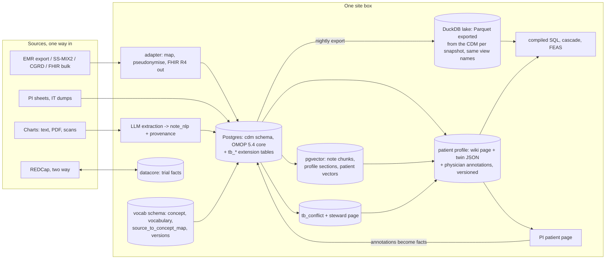

# TrialBox: patient data architecture, consortium and roles (design proposal, 2026-11-09)

*Status: proposal, not built. Read against `origin/master` ada9c8f. Owner's direction of 2026-11-09 is in §0. Every
claim about today's code names a file and line. Facts about outside standards were checked on the web today unless
marked "unverified".*

## 0. What the owner asked for (2026-11-09)

- A **data steward / database owner** role. One person (Changfu, or Makoto) holds the whole patient database of a
  site: inputs all data, monitors it, manages it, runs the REDCap connection.
- Each **PI** has their own studies and patient lists. A PI sees everything for their patients, chart numbers
  included (decided today; this reverses D-133 and is referred to below as D-143).
- The database "seems not very good; at least it needs to be stable". It must hold **all** of a patient's data,
  structured and unstructured.
- Notes are interpreted by an LLM into structured items in categories. Some items already exist as structured
  data. A note may contradict them. This differs between hospitals.
- Across a **hospital consortium**: align and reconcile. OMOP or another standard may be needed. The taxonomy may
  be standard or local.
- Different specialties have different items (CDR in neurology, DAS28 in rheumatology). The database must be
  flexible.
- A **profile per patient**, longitudinal. The owner's earlier concept, "Patient profiling, the keystone capability
  of Anamnesis", arrived during this review and is kept verbatim as
  `docs/reviews/2026-11-09-owner-patient-profiling-concept.md`. Its core: a symbolic profile (OMOP/FHIR-grounded,
  auditable) and a learned profile (embeddings), bound by one patient key; layers identity, trajectory, personal
  setpoint, multimodal, phenotype, risk/forecast, gap, eligibility, biological, similarity; a versioned profile
  object; a profile assembler; "the profile is a projection, never a replacement for the record".
- The owner's clarification of the idea, in their words: "like a Karpathy wiki: put together all patient data, and
  the LLM writes a profile, which can link to key information; the patient profile page can add physician thoughts,
  structured or written; it needs to be machine readable; and introduce a vector database concept; both can be
  continuously updated."

**Owner's answers later the same day (decided; the design below treats them as given):**

1. **Scope.** A full clinical data repository now, used first for trials; the Anamnesis layers (forecast, gap,
   setpoint) come later on the same base.
2. **Data steward.** Named hospital staff per site (Changfu at CGMH, Makoto at a Japanese site). Aimedics supports
   but never holds patient data.
3. **Specialties.** All subspecialties; the model must be generic. First templates: rheumatology, neurology,
   oncology, nephrology / general internal medicine.
4. **Profile writer.** Reuse the judge of the deployed pair (D-124) at night and when idle; incremental updates after
   the first build.
5. **Consortium.** Counts **and** de-identified profiles may leave a hospital for research, under agreements (an IRB
   approval and a data-sharing contract per hospital). Design the de-identification of profiles (citations and
   quotes must carry no identifiers; k-anonymity or differential privacy on shared aggregates) and federated counts
   with small-cell suppression.
6. **Physician annotations.** A structured entry by a physician counts as confirmed data (signed, audited). Free text
   is read by the models as a note. Neither may exclude a patient silently: every exclusion appears on an "excluded
   and why" page.
7. **Conflicts.** The data steward resolves for the whole database; a PI may resolve for their own study's patients.
   Unresolved means unknown, never an exclusion.
8. **v1 profile layers.** The record (cited), the timeline, phenotype, eligibility, **plus** personal lab baselines
   (setpoint), the gap finder, and similar patients (vectors). The SaMD implication of the gap finder is addressed
   explicitly (§2.7.3): research-use labelling, PI-only display, no automated action.
9. **Core model.** OMOP CDM in PostgreSQL; Japanese and Taiwanese codes mapped to OMOP concepts plus local concepts
   (ids ≥ 2,000,000,000); FHIR stays for exchange in and out.
10. **Vectors.** pgvector inside the same PostgreSQL.
11. **Freshness.** Structured facts and the machine-readable profile update within minutes; the LLM-written text
    nightly, or on request for one patient.
12. **Profile access.** Data stewards see all profiles; a PI sees the full profiles of their own studies' patients;
    CRCs their study's patients; every view audited; everyone else nothing, or de-identified counts.

The short answer: keep what is sound (pseudonyms at the door, one trial database with versioned migrations, the
"proposed never counts" rule, snapshot-pinned screening), and replace the implicit, rebuilt-nightly lake schema with
an OMOP CDM v5.4 core in PostgreSQL that the DuckDB lake is *derived from*. Add provenance and trust to every fact,
a concept registry with versioned local maps, a conflict table with a steward page, a per-patient profile (a cited
wiki page the LLM writes, a machine-readable twin, physician annotations as facts, and a pgvector index, all on the
box), and a steward role. Do it in steps that keep `e2e_simple` and the screening counts identical.

---

## 1. Today, honestly

### 1.1 The layers

```
hospital export ──► adapter (map, pseudonymise) ──► FHIR R4 NDJSON per snapshot
                                                      ├─► HAPI (fhir-store): delta PUT by content hash
                                                      └─► lake: Parquet per snapshot ──► one DuckDB file per snapshot
site set-up (sheets, dumps, charts) ──► sitesetup (Postgres) ──► publish ──► lake/site/*.ndjson (joined at rebuild)
trial facts (forms, REDCap, sheets) ──► datacore (Postgres)
marks, candidates, screening numbers ──► orch / site / study schemas (Postgres)
```

| Layer | Where | What it holds | Who reads it |
| --- | --- | --- | --- |
| Lake snapshots | `services/lake/store.py:1-9` (`ndjson/<snap>/`, `parquet/snapshot=<snap>/`, `db/<snap>.duckdb`, `CURRENT`) | 13 flat tables (`services/lake/flatten.py:24-131`): patient, practitioner, encounter, appointment, condition, observation, medication, procedure, report, document, claim, site_fact, consent; plus `document_chunk` (text, tokens, 1024-float embedding) and `lake_meta` | the compiled SQL, the cascade, FEAS, COHORT, CASE, NAV, the readiness page |
| `site_fact` | `flatten.py:110-122`; source rows in Postgres `sitesetup.fact` (`services/sitesetup/store.py:31-37`) | the site's own facts with `basis` proposed / confirmed; in Postgres also status, quote, `decided_by`, `before` | `matching/proposed.py` (the widening check), FEAS basis counts, the readiness page |
| Data core | Postgres schema `datacore` (`services/datacore/store.py:25-45`): form, owner, value, history, conflict, source_cfg, src_record; lifecycle tables (v2) | trial facts: one TEXT value per (study, record, event, field), with history and TrialBox-vs-source conflicts | entry pages, REDCap sync, exports, lifecycle |
| FHIR / HAPI | database `hapi`; `services/adapter/load_fhir.py` (delta by sha256 of the canonical JSON, D-122) | the same clinical facts as the lake, as FHIR R4 resources with TW Core / JP Core claims | only the compile-time CQL equivalence gate (D-130); nothing at run time |
| Other Postgres schemas | `trialbox_wf`: wf, orch (jobs, pool, candidates, candidate_events, cohort_tables, trial_cache; `services/orchestrator/db.py:18-122`), study, site, auth, mail, pidmap (`services/adapter/pidmap.py:27-40`), trace, mpi (`services/dataplat/mpi/__init__.py:37-50`), library, datacore, sitesetup, terminology (D-137), refdata (D-140) | jobs, candidate lists, marks, users, the reverse pseudonym map (AES-GCM), licensed masters, the reference pack | each service through its own `Database` |
| Terminology | `services/criteria_compiler/terminology/*.parquet` (icd10cm_full real; loinc_tw 27 rows, atc 24, nhi_drug 24 synthetic, nhi_order 4, synonyms); `terminology/mapper.py` | the code lists the compiler maps criteria to; ValueSets with code families (D-113) | the criteria compiler, site-setup suggestions |
| Local code maps | `sitesetup.local_code` per space (`store.py:38-42`), system `urn:trialbox:local:<kind>` (`sitesetup/mapping.py:22-46`) | one confirmed target per local code, per site | publish (re-codes facts), mapping_check |
| Pseudonyms | `libs/tb_common/crypto.py:36-40` (`HMAC-SHA256(site key, mrn.strip())[:32]`), `services/adapter/pidmap.py` | pid everywhere; chart numbers only in the AES-GCM map | reveal (`services/orchestrator/app.py:279-306`) |

### 1.2 What is stable and worth keeping

- **Pseudonym at the door.** One keyed pseudonym per site; names and chart numbers never reach the lake, HAPI or
  the datacore (`adapter/pipeline.py`, `pidmap.py`). ISO 25237-style. Keep.
- **One trial database with versioned migrations** under an advisory lock (`libs/tb_common/db.py:155-175`). Keep.
- **The one rule.** A proposed fact lives in `site_fact` only; the compiled SQL never reads it; it can only widen a
  decided answer to unknown (`matching/proposed.py:1-22`). Tested by `tests/unit/test_one_rule.py`. Keep.
- **Fail-closed unknowns.** Unreadable code systems and off-list family codes are unknown, never "no" (D-113,
  D-130). Keep and extend to values (B-01) and conflicts (§2.5).
- **Snapshot-pinned, read-only, SELECT-only lake queries** with a memory cap (`lake/store.py:240-270`). Keep.
- **The datacore's ownership model.** One owner per field; a difference is a conflict a person closes, with the
  trail kept (`datacore/store.py:36-38`, D-123). Keep; generalise it to clinical facts (§2.5).
- **Audit chain** with hashed lines (`tb_common/audit.py`). Keep.

### 1.3 Specific weaknesses

Schema and model:

1. **The lake schema is implicit and unversioned.** It is a Python dict (`lake/flatten.py:24-131`). There is no
   schema version in `lake_meta` (`lake/store.py:191-193`); a lake built before D-135 is detected by the *absence*
   of `site_fact` (D-135 "reads as no proposed facts"). Adding a column means editing the dict and every reader.
2. **Rebuilt from scratch every night, in memory.** `rebuild()` reads every NDJSON file into Python lists, flattens,
   writes Parquet, then builds the DuckDB file (`lake/store.py:120-200`). The adapter holds the whole batch in
   memory (4.9 GB at 15k patients, `docs/VALIDATION.md:100`; A-05). There is no upsert; a snapshot is the whole
   hospital again.
3. **Two copies of every clinical fact.** HAPI and the lake both hold them; ARCHITECTURE §1 says "never two stores
   of record for one fact", but neither is marked as the record. HAPI is read by nothing at run time (D-130) and a
   full reload took about 8 h at 500k (D-122).
4. **No provenance on a row.** No lake table says which source system, which source record, which snapshot first
   saw a fact, or whether a person confirmed it, except `site_fact.basis` (`flatten.py:110-122`). The compiled SQL
   cannot tell an EMR diagnosis from a sheet diagnosis.
5. **No clinical status beyond a string.** `condition.status` is a free string (`flatten.py:233-245`). The SS-MIX2
   reader reads PRB-2/3/4/14/16 only (`services/adapter/sources/ssmix2/source.py:370-388`) and never the 疑い
   (suspected) flag, so a suspected malignancy is a malignancy (review P-04, finding "suspected 1"). An exclusion
   criterion drops the patient silently.
6. **Values are numeric or nothing.** `observation.value_num` is NULL whenever the source value is text ("75 H",
   "<0.3", "陰性"; `flatten.py:247-265`), and the compiled SQL turns that NULL into FALSE
   (`compile_sql/generator.py:168-176`; B-01, Blocker). Units come from the lookup, not the row (B-09;
   `adapter/mapping/engine.py:371-400`). There is no `value_text` column outside `site_fact`.
7. **Code slots are country-shaped.** `medication` has exactly `nhi_code` and `atc` (`flatten.py:267-287`): any
   first non-ATC coding lands in `nhi_code`, so at a Japanese site a YJ or HOT code sits in a column named for
   Taiwan's NHI and is compared with the NHI ValueSet (`generator.py:96-110`). `observation.local_code` is "the last
   coding if there are two" (`flatten.py:249-250`). `condition` has one (code, system) pair, so the 標準病名 beside
   the ICD-10 (D-137) is kept in FHIR but not in the lake row.
8. **Terminology lives in Parquet files inside a service**, not in the database (`criteria_compiler/terminology/`).
   Local maps live in `sitesetup.local_code` per *space*, and the licensed masters in schema `terminology`. Three
   places, three shapes, no shared concept id.
9. **Derived values are code, not data.** eGFR and other derived atoms are rendered into SQL from component
   observations (`generator.py:188-247`) with formulas in `tb_common.derived`. There is no versioned definition a
   steward can read, and no stored derived row a profile can show.
10. **No patient-centric read path.** CASE resolves one pid and runs queries against the lake (`scenarios/case.py:
    196-232`); the PI page assembles criteria results per job. Nothing holds "this patient over time".
11. **A second data platform exists unwired.** `services/dataplat` (L0–L5, MPI, reconcile, lineage) is reached only
    by `tools/cascade_e2e.py`; the product does not use it. Two data models in one repository.

Integrity and operations:

12. **Pseudonym joins are fragile.** The adapter hashes `str(raw)` (`engine.py:259-263`), site set-up hashes
    `half_width().strip()`; Excel drops leading zeros; no step reports a sheet pseudonym that matches no patient
    (B-15). Record keys differ in case between sources (B-16).
13. **REDCap sync can blank TrialBox's values** on a longitudinal project without `event` (B-03, High).
14. **Site publish changes the current snapshot under the same id** (`lake/store.py:127-130`; D-135 "not
    byte-identical", FR-REP-02). Point-in-time reproducibility holds only for the hospital feed alone.
15. **One connection per store, never reconnected** (`libs/tb_common/db.py:106-131`; A-02 High, A-11). A Postgres
    restart takes every service down until a human restarts it.
16. **Keys are created silently next to the data they protect** (`tb_common/crypto.py:43-52`; S-01, S-11).
17. **Roles do not match the owner's intent.** `User.can_reveal` is administrator and coordinator only
    (`services/console/auth.py:157-160`, D-133); the investigator may not. Administrators `can_view_phi` by default
    (`auth.py:150-154`; S-19). There is no steward role; the coordinator does the steward's work (D-135: "a
    coordinator or administrator confirms each code"). `X-TB-Actor` is unverified (S-09).
18. **No reason-for-change, no record lock, no e-signature** on trial data (review 03, J-GCP row).

---

## 2. The target model

### 2.1 One picture



Three rules hold the picture together:

1. **The CDM is the store of record for clinical facts.** The lake is derived from it. HAPI is demoted to the
   compile-time gate (and later dropped or fed from the CDM).
2. **Every fact row carries provenance and a trust level.** The compiled SQL reads a view that admits only
   `coded` and `confirmed` rows. Proposed and conflicted rows can only widen an answer to unknown.
3. **A concept id is the one key for meaning.** Standard concepts where a standard exists; local concepts
   (≥ 2,000,000,000) where none does; one versioned map per site from local codes to concepts.

### 2.2 The standard core: OMOP CDM v5.4 in PostgreSQL, the lake derived from it

**Decided (owner's answer 9):** OMOP CDM in PostgreSQL as the store of record; JP and TW codes mapped to OMOP
concepts plus local concepts ≥ 2,000,000,000; FHIR for exchange in and out. The evaluation below is kept as the
record of why, and because it names the trade-offs the build must handle (SNOMED, vocabulary size, the export to
DuckDB).

**What OMOP CDM v5.4 is** (checked today at ohdsi.github.io/CommonDataModel/cdm54.html): 39 tables. Clinical:
PERSON, OBSERVATION_PERIOD, VISIT_OCCURRENCE, VISIT_DETAIL, CONDITION_OCCURRENCE, DRUG_EXPOSURE,
PROCEDURE_OCCURRENCE, DEVICE_EXPOSURE, MEASUREMENT, OBSERVATION, DEATH, NOTE, NOTE_NLP, SPECIMEN,
FACT_RELATIONSHIP. Health system: LOCATION, CARE_SITE, PROVIDER. Derived: DRUG_ERA, DOSE_ERA, CONDITION_ERA,
EPISODE, EPISODE_EVENT. Metadata: METADATA, CDM_SOURCE. Vocabulary: CONCEPT, VOCABULARY, DOMAIN, CONCEPT_CLASS,
CONCEPT_RELATIONSHIP, RELATIONSHIP, CONCEPT_SYNONYM, CONCEPT_ANCESTOR, SOURCE_TO_CONCEPT_MAP, DRUG_STRENGTH, plus
COHORT and COHORT_DEFINITION. Every clinical table has `*_concept_id` (standard), `*_source_value` (verbatim) and
`*_source_concept_id` (the local or source-vocabulary concept), a `*_type_concept_id` (where the record came from),
and `MEASUREMENT` has `value_as_number`, `value_as_concept_id`, `unit_concept_id`, `value_source_value`, `range_low`,
`range_high`, and `measurement_event_id` / `meas_event_field_concept_id` to link to another record.
`NOTE_NLP` has `snippet`, `offset`, `lexical_variant`, `note_nlp_concept_id`, `note_nlp_source_concept_id`,
`nlp_system`, `nlp_date`, `term_exists`, `term_temporal`, `term_modifiers`. `FACT_RELATIONSHIP` links any two facts
by domain and id with a relationship concept.

**The four options.**

| Option | For | Against | Verdict |
| --- | --- | --- | --- |
| A. OMOP CDM as the store of record (Postgres), lake derived from it | Patient-centric by construction (`person_id` on every row); provenance and source values are first-class; one concept key; a consortium can run OHDSI tools (ATLAS, Achilles, the Data Quality Dashboard) on the same shape; the current lake tables map 1:1 (§5 step 4); HL7 Vulcan's FHIR-to-OMOP IG (v1.0.0-ballot Sept 2025, v2.0.0 ballot in the current build) gives a vetted FHIR → OMOP path for the adapter's output | Standard concepts for conditions are SNOMED-based, and Japan and Taiwan are not SNOMED members (`2026-11-09-baseline-open-data.md` row "SNOMED CT"); Athena's SNOMED licence text restricts non-member territories, and whether the ICD10CM → SNOMED "Maps to" rows may be loaded in a non-member country is **unverified: counsel**; OMOP has no column for an LLM's confidence; the vocabulary tables are large (GBs) | **Recommended**, with the SNOMED mitigation below |
| B. FHIR-native store (HAPI as the record, CQL or FHIRPath at run time) | Already produced by the adapter; JP Core and TW Core profiles are FHIR | D-130 made SQL the only runtime engine for a reason (CQL on HAPI is slow and the 500k reload took 8 h, D-122); a resource-per-fact store is poor for columnar screening at 10^7–10^8 facts; no standard concept layer; HAPI's own schema is not ours to version | No |
| C. The current lake, hardened (add columns, version the dict) | Smallest change | Still a nightly full rebuild from NDJSON in memory; still no concept registry, no provenance model to share with a consortium, no OHDSI tooling; "stable" would mean freezing a shape that was built for one screening path | No as the end state; yes as step 2 of the migration |
| D. Hybrid: OMOP core in Postgres as record, DuckDB lake exported from it per snapshot, FHIR as exchange format only | Everything A gives; the SQL engine keeps DuckDB (measured: FEAS 100,200 patients × 36 month-ends in 215 s, `VALIDATION.md:95`); the compiled SQL keeps its view names so approved rulesets stay byte-identical; Postgres holds the long-lived truth with upserts, indexes and partitions | Two engines to run (we already run both); the export step is new code | **This is A, done so that nothing visible changes. Decided (owner's answer 9).** |

**Trade-offs, named.**

- *Query performance for the SQL engine.* Unchanged: the engine reads DuckDB over Parquet exactly as today. The
  Parquet is exported from the CDM instead of flattened from NDJSON. DuckDB reads Postgres directly too
  (postgres scanner), useful for the steward's pages, not for screening.
- *Consortium federated queries.* OHDSI's tools expect the CDM in a relational database. Postgres is their home
  ground. DatabaseConnector added DuckDB support in 6.1.0 (changelog), and Eunomia runs on DuckDB, so the lake
  could also be addressed; whether Achilles and the Data Quality Dashboard run end to end on DuckDB is
  **unverified**. Plan on Postgres for OHDSI tools.
- *Japan and Taiwan coding.* OMOP's Athena vocabularies include ICD10, ICD10CM, LOINC, ATC and others; they do not
  include MEDIS 標準病名, JLAC10, YJ, HOT or Taiwan's NHI codes. Those become **local vocabularies** in our
  `concept` table (ids ≥ 2,000,000,000), mapped once per site to the concepts our screening already uses
  (ICD-10-CM families, LOINC, ATC codes from the NHI list). This is the same work as D-135's mapping, written to one
  table. OHDSI Japan (founded 2019) works on exactly this mapping and a 2025 OHDSI paper describes Japan's
  FHIR-plus-standard-codes approach; the Taipei Medical University group runs OMOP in 3–4 hospitals (2023 MHLW
  report). Current adoption counts: **unverified**.
- *SNOMED mitigation.* TrialBox's screening does not need SNOMED (`baseline-open-data.md` §1 item 5). So:
  `condition_source_concept_id` carries the ICD-10-CM (or WHO ICD-10, MEDIS) concept; `condition_concept_id` is
  set to the SNOMED standard concept only at a site that holds an affiliate licence, else `0`. Screening and
  families read the source concept. OHDSI network studies would need the standard concept; that is a consortium
  decision (§3, Q2).
- *Cost of migrating from the current lake.* Low to moderate, because the lake tables are already OMOP-shaped
  (patient → PERSON, encounter → VISIT_OCCURRENCE, condition → CONDITION_OCCURRENCE, observation → MEASUREMENT /
  OBSERVATION, medication → DRUG_EXPOSURE, procedure → PROCEDURE_OCCURRENCE, document and report → NOTE,
  site_fact → the same tables plus NOTE_NLP and provenance, death → DEATH). The adapter's canonical rows
  (`services/adapter/mapping/templates/CANONICAL.md`) are the ETL input. Effort is in §5.

**TrialBox extension tables** (prefix `tb_`, same schema, versioned with the CDM):

| Table | Why OMOP alone is not enough |
| --- | --- |
| `tb_fact_provenance (domain_concept_id, fact_id, source_kind, source_system, source_record_id, source_version, snapshot_first_seen, snapshot_last_seen, trust, model, prompt_version, confidence, note_id, quote_offset, quote_len, confirmed_by, confirmed_at, rejected_by, before_json)` | OMOP has `*_type_concept_id` and `note_nlp.nlp_system`, but no confidence, no confirmation, no "before correction" |
| `tb_conflict` (§2.6) | OMOP has no conflict state |
| `tb_score_definition`, `tb_score_component` (§2.3) | OMOP stores derived values as MEASUREMENT rows, not their definitions |
| `tb_concept_registry_meta` (owner site, status proposed/shared/retired, replaced_by) | the "shared local" process of §2.4 |
| `tb_patient_profile`, `tb_profile_page`, `tb_annotation`, schema `vec` (§2.7) | the twin, the cited wiki page, physician annotations and the vector index |
| `tb_specialty_template`, `tb_finder_rule` (§2.3, §2.7.3) | specialty item sets and the rule-based gap finder, as data |
| `tb_research_project`, `tb_export` (§3.3) | de-identified profile exports under an IRB approval and a contract |
| `tb_snapshot (snapshot_id, cdm_version, tb_schema_version, vocab_version, mapping_version, built_at, row_counts, sha)` | reproducibility |

### 2.3 Flexible specialty items

**Rule: a new item is a row in the concept registry, never a column.** The model is generic for every
subspecialty (owner's answer 3): CDR, DAS28, CDAI, ECOG, MMSE, eGFR and every future item are MEASUREMENT (numeric
or coded result) or OBSERVATION (fact without a value) rows whose `*_concept_id` points at a concept. A
**specialty template** is data too: a named set of items, a lab panel, the scores and the finder rules (§2.7.3) a
specialty wants on its profile pages and readiness checks (`tb_specialty_template (name, version, item_concepts[],
lab_panel[], scores[], finder_rules[])`). The first four templates ship with the release: rheumatology, neurology,
oncology, nephrology / general internal medicine. A site adds or edits a template on the console; no release. The concept carries the domain, the value type (number, coded, text), the
allowed unit(s) and the valid range. Adding an item:

1. Steward opens "Items" on the console, searches the registry. If LOINC (or another standard the site holds) has
   the item, pick it. Which scores have LOINC codes is checked per item at build time (**unverified** here; LOINC
   has codes for several scales, not all).
2. Else create a local concept in the site's range, with name (ja / zh-TW / en), domain, value type, unit, range,
   and the specialty tag (`neurology`, `rheumatology`, `oncology`, `nephrology`, `general`).
3. Map the site's source code or sheet column to it (one row in `source_to_concept_map`, versioned).
4. From the next ingest, rows appear. No schema change, no release.

**Derived scores are definitions, not code.**

```
tb_score_definition (score_concept_id, version, valid_from, formula_kind, formula, unit_concept_id,
                     min, max, requires_all_components, author, approved_by, approved_at)
tb_score_component  (score_concept_id, version, role, component_concept_id, unit_concept_id, min, max, required)
```

`formula_kind` is one of a small fixed set the box implements (`weighted_sqrt_log`, `sum`, `ckd_epi_2021`,
`jsn_2009`, `cockcroft_gault`, …); `formula` holds the coefficients as JSON. A model never writes a formula. The
compute step runs after ingest and on confirmation: it writes a MEASUREMENT row with
`measurement_type_concept_id` = "derived", `tb_fact_provenance.source_kind = derived`, and FACT_RELATIONSHIP rows
from the score to each component (relationship "derived from"). Examples the first release ships, with their
published forms:

| Score | Components (concepts) | Formula (version 1) |
| --- | --- | --- |
| DAS28-ESR | tender joint count 28, swollen joint count 28, ESR (mm/h), patient global (0–100 VAS) | 0.56·√TJC + 0.28·√SJC + 0.70·ln(ESR) + 0.014·GH |
| DAS28-CRP | TJC28, SJC28, CRP (mg/L), GH | 0.56·√TJC + 0.28·√SJC + 0.36·ln(CRP + 1) + 0.014·GH + 0.96 |
| CDAI | TJC28, SJC28, patient global (0–10), evaluator global (0–10) | sum |
| CDR global | the six CDR box scores, or entered directly | entered (0, 0.5, 1, 2, 3), or Washington University algorithm (version 2) |
| MMSE | total 0–30, entered | entered |
| ECOG | 0–5, entered | entered; coded value |
| eGFR (JSN 2009) | serum creatinine (mg/dL), age, sex | 194 · Cr^-1.094 · age^-0.287 (× 0.739 if female) |
| eGFR (CKD-EPI 2021) | as above | the existing `tb_common.derived` |

Unit handling: the component row's `unit_concept_id` must equal the definition's unit or a UCUM conversion the box
holds; otherwise the score is not computed and a data-quality flag is raised (this is B-09 made structural). A
missing required component gives no row, never a partial score. A re-approved definition version recomputes
forward; old rows keep their version in provenance.

What the compiled SQL sees: the derived MEASUREMENT row, like any lab. The `_derived` path in
`compile_sql/generator.py:198-247` can then shrink to "latest value of concept X", with the definitions as data.

### 2.4 Standard and local taxonomy

```
vocab.vocabulary            one row per vocabulary: ICD10CM (public), LOINC (notice), ATC-from-NHI, ICD10-WHO (codes only),
                            MEDIS, JLAC10, YJ, HOT, NHI-drug, NHI-order, TW-ICD10CM-2014, TW-ICD10CM-2023,
                            TB-SHARED (consortium local), TB-<site> (site local), each with version and licence
vocab.concept               concept_id, name (ja, zh-TW, en via concept_synonym), domain, vocabulary, class,
                            standard flag, code, valid_from/to; TrialBox adds value_type, unit, range, specialty
vocab.concept_relationship  "Maps to", "Is a", "Has component"; the ICD-10-CM families of D-113 become ancestor rows
vocab.source_to_concept_map site_id, source_vocabulary, source_code, target_concept_id, mapping_version,
                            mapped_by, mapped_at, method (licensed | name | nhi_pas | manual), status
```

Rules:

- **Ranges.** OHDSI convention (Themis, documented in the OHDSI forums and the CommonDataModel repository): custom
  concepts use ids ≥ 2,000,000,000 and may appear only as source concepts, never as standard. TrialBox:
  `TB-SHARED` takes 2,000,000,000–2,099,999,999; each site takes a block of 10 million above that, assigned by the
  consortium coordinator (`TB-site-01` 2,100,000,000–2,109,999,999, …). No two sites can collide.
- **Mapped once per site** (D-135 kept). A local code maps to exactly one target concept per `mapping_version`. A
  remap creates a new version; facts carry the version they were coded under; the nightly ingest re-codes under
  the current version and records both.
- **Unmapped stays unknown** (D-130 kept). An unmapped local code is a source concept with no "Maps to"; screening
  says `unknown_code_system`.
- **Shipping.** The reference-data pack (D-140) grows a `vocab` part: the public vocabularies and `TB-SHARED`. Sites
  load MEDIS, JLAC10 and the TW workbooks with the existing loaders into the same tables. The licensed-master
  loader of D-137 writes `vocab.concept` rows instead of its own tables.
- **"Shared local" process** (§3.5): a site proposes a `TB-<site>` concept for promotion; two stewards from other
  sites confirm the definition; the coordinator assigns a `TB-SHARED` id and the next vocabulary release maps the
  site concept to it ("Maps to"). Facts need no rewrite: the site concept stays as the source concept.

### 2.5 Unstructured notes into structured facts

```
chart text ──► redact (guard) ──► NOTE (note_text redacted copy, note_id = keyed hash, note_type, language,
                                       visit, provider; file kept in the orchestrator's data folder as today)
           ──► LLM extraction (prompt chart_facts_v1, schema llm_chart_facts_output; quote must be found in the text)
           ──► NOTE_NLP row per proposed fact: snippet = quote, offset, lexical_variant, note_nlp_concept_id,
               nlp_system = "<prompt>@<version>/<model build sha>", term_exists (negation, "疑い", "ruled out" → false),
               term_temporal (history / current), term_modifiers ("value=75;unit=mL/min;confidence=0.82;laterality=…")
           ──► tb_fact_provenance (source_kind = note_llm, trust = proposed, model, prompt_version, confidence, note_id, quote)
           ──► steward or CRC confirms / corrects / rejects (D-135, one tap, audited)
           ──► on confirm: a CONDITION_OCCURRENCE / MEASUREMENT / DRUG_EXPOSURE row, type concept "NLP-derived,
               confirmed" (the OMOP Type Concept vocabulary has NLP type concepts; exact ids to be checked at build),
               provenance trust = confirmed, FACT_RELATIONSHIP fact → note_nlp row
```

- **Provenance on every proposed fact**: note id, quote with offset, model build, prompt version, confidence,
  extraction date. Today's `sitesetup.fact` has the quote and `before`, not the model or confidence
  (`sitesetup/store.py:31-37`); the extension table adds them.
- **People confirm** (D-135 unchanged). Who may: the steward always; a CRC for patients of their own studies. A PI
  may not confirm a clinical fact (they mark patients); see §4.
- **Stored apart, queried together.** Note-derived facts and source-coded facts sit in the same OMOP tables, told
  apart by `*_type_concept_id` and `tb_fact_provenance.trust`. Two views:
  - `screen.<table>`: trust ∈ {coded, confirmed} and no open conflict — what the compiled SQL and FEAS read.
  - `full.<table>`: everything, with trust and provenance columns — what the steward page, the profile and the
    LLM context read.
- **Trust levels** (ordered): `coded` (EMR, claims, SS-MIX2), `confirmed` (person confirmed a proposed fact),
  `sheet` (a PI's spreadsheet, coded as given; counted like coded today — Q1 asks whether that stays),
  `derived`, `proposed`, `rejected`. FEAS reports the share per level (D-135's basis, extended).
- **疑い and negation.** A suspected diagnosis from SS-MIX2 PRB (the suspected flag, field to be confirmed on vendor
  samples) or from a note ("疑い", "r/o", "疑似") is `condition_status_concept_id` = suspected, and the screening view
  treats it as *unknown* for both inclusion and exclusion: never met, never excluded.

### 2.6 Contradictions and reconciliation

**The three cases and the rule for each.**

| Case | Example | Rule |
| --- | --- | --- |
| Note against a structured record | note says "eGFR 75", lab table says 48 on the same day; note says "no history of malignancy", claims say C50.9 | The structured record stays authoritative for screening. The note fact stays `proposed`, so D-135 widens the answer to unknown. A conflict row is opened. Only a steward closes it; a confirmed note fact with a reason may then supersede |
| Two sources against each other at one site | EMR birth date 1958-03-01, PI sheet 1985-03-01; SS-MIX2 PPR says resolved, extended-storage note says active | The hospital system is authoritative for clinical facts; TrialBox or the attached source for trial facts (D-123). The other value is kept with `trust` unchanged and a conflict row; the patient is unknown on criteria the fact touches (D-135 does this for demographics already) |
| Two hospitals against each other | site A codes M10.9 (gout), site B records the same person with M1A (chronic gout) | No automatic merge. Pseudonyms are per site; cross-site identity exists only inside an explicit, consented linkage project (§3). Each site's facts are authoritative for its own encounters. The conflict is shown to both stewards; each decides for their site. Aggregates count by site |

**States.**

```
tb_conflict (conflict_id, person_id, concept_id, kind {note_vs_coded | source_vs_source | site_vs_site | duplicate},
             fact_a (domain, id, trust, source_kind), fact_b (…), detected_at, detected_by {ingest | publish | manual},
             state {open | agree | resolved}, resolution {keep_a | keep_b | both_true | neither | superseded},
             reason TEXT NOT NULL on resolve, authority {hospital_record | steward | pi_clinical_note | source_owner},
             resolved_by, resolved_at, reopened_from)
```

- `agree`: two sources say the same thing (within the concept's tolerance and unit); recorded so a profile can say
  "confirmed by two sources".
- `conflict` (open): the facts differ. Every criterion that reads either fact is `unknown` with the new reason code
  `conflict` (words in en / ja / zh-TW, D-118 style). The PI list says "needs information: records disagree".
- `resolved-by`: resolution, reason and authority. "Authority" says *why this person could settle it*: the hospital
  record is authoritative by default; **the steward resolves for the whole database; a PI resolves for the
  patients of their own studies** (owner's answer 7), recorded as `pi_clinical_judgement` with the study; a
  resolution by a PI is visible to the steward, who may reopen it with a reason; a source owner (REDCap, a sheet)
  settles trial facts only (D-123).
- Resolving never deletes. The losing fact gets `trust = rejected` with the conflict id in provenance. Reopening is
  a new row linked by `reopened_from`.

**The steward's conflicts page** (`/data/conflicts`): one row per conflict with the patient's pseudonym (and the
chart number behind a reveal), the concept in the reader's language, both values with source, date, trust and the
quote when one side is a note, the criteria and studies it blocks, and three buttons (keep A, keep B, both true /
neither) with a required reason. Filters: by kind, study, specialty, age of the conflict. Bulk: "the sheet's birth
dates are wrong, keep the EMR" applies the same resolution to a selected set, one audit event each. The readiness
page counts open conflicts per study.

**Screening is fail-closed.** An unresolved conflict is `unknown`, never an exclusion and never "met". This is the
same shape as `unknown_code_system` (D-130) and `proposed_fact` (D-135): the compiled SQL is unchanged, the
screening view hides the conflicted facts, and a post-check widens any decided answer the hidden facts could change.
FEAS shows "patients with a conflicting record: n" beside the proposed count.

**Nothing excludes silently: the "excluded and why" page.** Review P-04 found that the patients a SCREEN excluded
appear on no page. The target adds `/studies/{rs}/excluded`: every excluded patient of the latest run with the
criterion, the facts (ids, trust, source) and the quote when a note decided it, paged and read-only, for the PI and
the CRC of the study and for the steward; a weekly sample of ten is put on the PI's list to confirm (owner's answer
6). An exclusion caused by a clinician-entered fact names the author. This page is where a wrong exclusion is
caught; the conflict and widening rules are what keep it short.

### 2.7 The patient profile

This section follows the owner's concept (`2026-11-09-owner-patient-profiling-concept.md`, §3–§4 and §9) and the
owner's clarification in §0. The owner's two faces map onto four things in TrialBox:

| Owner's words | In TrialBox | Where |
| --- | --- | --- |
| "the LLM writes a profile, which can link to key information" ("like a Karpathy wiki") | **the wiki page**: a human-readable page per patient, written by the local model, every statement cited to a fact id or a note id with a quote; regenerated incrementally, with a diff and a history | `tb_profile_page` |
| "the page can add physician thoughts, structured or written" | **annotations**: a physician's free text and structured entries, stored as first-class, attributed, versioned facts that flow back into the CDM and screening | `tb_annotation` → CDM rows with trust `clinician` |
| "it needs to be machine readable" | **the twin**: the versioned profile object (owner's §4 JSON), schema-versioned, read by screening, matching and the LLM context | `tb_patient_profile` |
| "introduce a vector database concept" | **the vector index**: pgvector in the same Postgres over note chunks, profile sections and one patient vector; retrieval for profile writing, cohort-by-example, similarity | `vec.*` |

The owner's rule holds everywhere: **the profile is a projection, never a replacement for the record.** Exact facts,
counts and screening decisions are computed from the CDM; the wiki text and the vectors are inference and are
labelled so.

#### 2.7.1 The wiki page (LLM-written, cited, incremental)

```
tb_profile_page (person_id, page_version, snapshot_id, twin_version, lang, built_at, model_build, prompt_version,
                 markdown, citations JSONB, uncited_sentences INT, sections_changed TEXT[], sha, prev_sha)
```

- **Content.** A page has fixed sections in a fixed order (Summary, Problems, Medications, Labs and trends,
  Specialty scores, Timeline, Open questions and conflicts, Physician notes, Studies). The model writes the prose of
  Summary, Problems, Medications, Labs and Timeline from the twin (§2.7.3) and from retrieved note chunks (§2.7.4).
  Physician notes and Studies are rendered from data, never written by the model.
- **Every statement cites.** The writing prompt returns sentences each with one or more citations:
  `[[fact:<domain>/<id>]]`, `[[note:<note_id>@<offset>:<len>]]`, `[[score:<concept>/<date>]]`,
  `[[annotation:<id>]]`. The box verifies every citation before the page is stored: a fact id must exist in the
  twin; a note quote must be found in the note text at that offset (`tb_common.quotes`, as D-135 does for chart
  facts). A sentence whose citation fails is dropped and counted in `uncited_sentences`; a page with any dropped
  sentence shows a banner "n statements could not be verified and were removed". The page is therefore a
  rendering of the record, in the record's words, and a reader can open every link.
- **No new facts from the page.** The writer may only restate what the twin and the cited notes say. Its output
  schema has no field for a diagnosis, value or date that is not a citation target. This is the same shape as the
  judge's quote rule (D-115): the model points, it does not assert.
- **Incremental.** A page is rewritten only for the sections whose inputs changed since `prev_sha`
  (`sections_changed`); unchanged sections are copied with their citations re-verified against the new snapshot.
  Each rewrite is a new `page_version`; the page shows "changed since your last visit" as a diff; the full history
  is kept for the snapshot retention and listed on the page.
- **Three languages.** The page is written in the site's language; a reader may ask for another language and gets
  a translation of the same cited sentences (the consent-translate path exists; `llm_consent_translate_output`).
- **Determinism and reproducibility.** Model text is not byte-reproducible (A-10). The page carries its
  `model_build`, `prompt_version`, `snapshot_id` and `twin_version`; the twin it was written from is
  byte-reproducible; a re-run compares citation sets, not prose.

#### 2.7.2 Physician annotations, as facts

```
tb_annotation (annotation_id, person_id, author, author_role, at, kind {free_text | phenotype | score | eligibility_note |
               not_a_candidate | correction}, text, structured JSONB, concept_id, value_as_number, value_as_concept_id,
               unit_concept_id, as_of_date, study (nullable), supersedes, status {active | retracted}, reason)
```

- **Two forms.** Free text ("prefers morning visits; on DMARD taper since spring") and structured entries chosen
  from the concept registry: an adjudicated phenotype ("seropositive erosive RA", a condition concept), a score at
  a visit ("DAS28-CRP 4.9 on 2026-10-03", a measurement concept), a clinical judgement about a study
  ("not a candidate because of planned surgery", an `eligibility_note`), or a correction of a documented fact.
- **First-class facts (owner's answer 6).** A structured entry by a physician is **confirmed data**: it writes a
  CDM row (CONDITION_OCCURRENCE, MEASUREMENT or OBSERVATION) with `*_type_concept_id` = "clinician-entered" and
  `tb_fact_provenance.trust = confirmed`, `source_kind = clinician`, signed by the author (the author's account and
  a once-per-session step-up; an e-signature meaning "I entered this" recorded in the audit), versioned by
  `supersedes`; retraction end-dates the row and keeps it. A free-text annotation is a NOTE of type "physician
  annotation": searchable, embedded, cited by the page, and **read by the models as a note** (the judge may quote
  it at S3 under the two-model rule like any note). It is never parsed into facts.
- **Feeds screening, never silently.** A clinician-entered fact counts like any confirmed fact in the screening view
  and may therefore decide a criterion; when it causes an exclusion, the "excluded and why" page (§2.6) shows the
  fact and its author. A `not_a_candidate` note for a study marks the patient "not suitable" for that study with
  the reason (today's mark path, audited; never changes a screening result, D-104). A `correction` that contradicts
  a coded fact opens a conflict (§2.6) rather than overwriting; until it is resolved, the affected criteria are
  unknown. A free-text note can contribute to an exclusion only as a quoted note under the two-model rule, and that
  exclusion appears on the same page.
- **Who may write.** A physician with an account (a PI, a sub-investigator, or a treating physician given the
  `clinician` affiliation) for patients they may see; a CRC for free text and visit scores of their own studies'
  patients (a CRC's structured entry is `proposed` until a physician or the steward confirms it); the steward for
  corrections. Each annotation is an audit event with the author's role.

#### 2.7.3 The twin: the versioned profile object

The owner's §4 object, reduced to what TrialBox computes today and extended as layers arrive:

```json
{
  "person_id": "<32-hex pseudonym>", "snapshot_id": "2026-11-09", "twin_version": "1.0",
  "versions": {"cdm": "5.4", "tb_schema": 7, "vocab": "2026.1", "mapping": "site-01/3", "score_defs": {"DAS28-CRP": 1}},
  "identity":   {"age_band": "60-69", "sex": "F", "first_visit": "2014-03", "last_visit": "2026-10", "departments": ["RHEU", "NEPH"]},
  "trajectory": {"conditions": [{"concept": 2100000012, "code": "M05.9", "status": "active", "first": "2015-02-11", "last": "2026-10-03",
                                  "sources": 3, "trust": "coded", "facts": ["condition_occurrence/88213", "..."]}],
                 "drugs":      [{"concept": 1, "atc": "L04AB04", "start": "2019-05-01", "end": null, "facts": ["drug_exposure/..."]}],
                 "labs":       {"CRP": {"unit": "mg/L", "latest": {"v": 12.1, "d": "2026-10-03", "fact": "measurement/..."}, "trend": [[ "2026-04-02", 8.0], ["2026-07-01", 9.4]]}},
                 "scores":     {"DAS28-CRP": {"def_version": 1, "latest": {"v": 4.9, "d": "2026-10-03", "fact": "measurement/..."}, "history": []}},
                 "timeline":   [{"month": "2026-10", "visits": 2, "notes": 3, "note_ids": ["n-..."]}]},
  "phenotype":  {"documented": ["M05.9"], "adjudicated": [{"concept": 2100000012, "by": "annotation/412", "at": "2026-10-20"}], "suspected": [], "latent_subtype": null},
  "eligibility": [{"study": "RA-2026-01", "snapshot": "2026-11-09", "status": "needs_information", "unmet": [], "unknown": ["DAS28 ≥ 5.1 at screening"], "facts": ["..."]}],
  "quality":    {"open_conflicts": ["conflict/77"], "proposed_pending": 2, "unknown_code_systems": ["urn:trialbox:local:lab-code"], "unreadable_values": 1, "missing_units": 0},
  "annotations": [{"id": 412, "kind": "phenotype", "by_role": "investigator", "at": "2026-10-20"}],
  "setpoint":   {"CRP": {"n": 14, "personal_median": 3.1, "mad": 0.9, "rcv_pct": 42, "unit": "mg/L", "window": "2019-2026",
                         "latest_vs_setpoint": "above", "facts": ["measurement/..."]}},
  "gap":        [{"rule": "ra_seropos_no_biologic", "rule_version": 1, "label": "research use only",
                  "evidence": ["condition_occurrence/88213", "measurement/..."], "absent": "drug_exposure in ATC L04AB/L04AC",
                  "status": "open", "shown_to": ["investigator", "steward"]}],
  "embedding":  {"patient_vector": "vec.patient/<person_id>/<twin_version>", "neighbors_available": true},
  "forecast": null, "biological": null, "multimodal": null,
  "provenance": {"built_at": "...", "built_by": "profile_assembler@<build>", "audit": "<event id>"}
}
```

- **Schema-versioned** (`twin_version`), stored as JSONB in `tb_patient_profile (person_id, snapshot_id,
  twin_version, body, sha)` and as Parquet per snapshot in the lake. A twin for one snapshot and version is
  byte-reproducible (no model text in it).
- **Layers in v1** (owner's answer 8), all computed from the CDM by the deterministic assembler:
  - *record (cited)*: identity and the cited trajectory (conditions, drugs, labs, scores, each with fact ids);
  - *timeline*: visits and notes by month;
  - *phenotype*: documented, adjudicated (physician annotations), suspected; no latent subtype yet;
  - *eligibility*: the screening results per study the reader may see, filled at serve time;
  - *setpoint (personal lab baselines)*: per analyte with at least `n_min` values (default 6) over a window, after
    unit normalisation (§2.3; B-09 fixed in step 1): personal median and MAD (robust to outliers), the reference
    change value from the analyte's analytical and within-person variation (the owner's `hematologic_setpoints`
    method supplies the table of variations per analyte), and a flag when the latest value is outside the personal
    range although inside the population range ("abnormal for this person"). Shown on the page as a line beside the
    lab trend; **not read by screening** (a criterion compares values, not deviations) until a protocol asks for it;
  - *gap finder*: see below;
  - *similar patients*: the patient vector and the nearest neighbours (§2.7.4), for feasibility by example;
  - *quality* and *annotations* as above.
- **Later layers**, kept as `null` with their keys reserved so the schema does not change: risk and forecast (model
  heads), biological, multimodal (no such data on a TrialBox box). They arrive on the same base from the Anamnesis
  platform (owner's answer 1).

**The gap finder in v1, and its SaMD line.** The owner's gap layer is "what is true but unrecorded" (owner's §7).
In TrialBox v1 it is **rule-based, not model-based**: a finder rule is data in the specialty template
(`tb_finder_rule (rule_id, version, specialty, name_ja/zh/en, evidence_pattern, absence_pattern, lookback_days,
approved_by, approved_at)`), with the same shape as a criterion: evidence that is present (a report concept such
as "UIP pattern" in a radiology report, a seropositive and erosive RA phenotype, an eGFR slope below a threshold
computed as a derived measurement) and a record that is absent (no IPF diagnosis code, no biologic DMARD exposure,
no nephrology visit). The compiled SQL of the screening engine evaluates it, so it is deterministic, fail-closed
(unknown codes and conflicts give no gap) and auditable. The result is a `gap` entry on the twin and a line on the
page.

Rules that keep it outside the clinical decision pathway, and therefore outside SaMD as the box is labelled:

1. **Research use only.** Every gap line carries the label "possible undocumented condition, research use only,
   not a diagnosis" in the reader's language; the page's footer repeats the product's intended use (pre-screening
   support for research staff, a person decides). The box's intended-use statement in `docs/SECURITY.md` §7 names
   the finder and this label.
2. **PI and steward only.** A gap entry is shown to the steward and to the PI of a study whose scope the patient is
   in; never to a CRC, a viewer, a monitor, or in any export, mail or aggregate. It is never on a worklist.
3. **No automated action.** A gap entry changes no screening answer, opens no candidate, sends no mail, writes no
   fact. The only path from a gap to the record is a physician's structured annotation (§2.7.2), signed, which is
   then an ordinary confirmed fact. Recontacting a patient about a gap is outside TrialBox (the owner's
   benefit-gated recall belongs to the Anamnesis governance plane).
4. **Rules are approved like criteria.** A finder rule is drafted by a steward, approved by a PI of that specialty
   on the S20-style page, versioned, and listed on the readiness page with its counts. A model never writes a rule.
5. **Measured before shown.** A rule is enabled at a site only after a sample of its hits (ten per rule) has been
   read by a physician and the precision recorded; the number is shown next to the rule.

When a model-based gap or forecast head arrives later (owner's §4 pipeline), it is a different product claim: it
informs a clinical decision and is a medical device (TFDA first, PMDA second; the owner's §9). It must not be
switched on inside TrialBox's research-use labelling; it comes with its own registration, calibration report and
intended-use text, and the twin's reserved `forecast` key is where its output would go.

**Who sees the twin and the page (owner's answer 12; role rules, §4).** The steward: every patient. A PI: the full
profiles of their own studies' patients (the study's scope population, not only the listed candidates), full
identifiers after a reveal (D-143); the "eligibility" layer and the "Studies" section are filtered to the reader's
studies at serve time. A CRC: the same for their studies. Site admin / IT: no. Viewer, CRO, monitor: no. Consortium
coordinator and research projects: never a profile, only de-identified counts or a contracted export (§3.3). Every
view of a page or a twin is an audit event with the reader, the pid and the study under which they saw it.

**How it feeds screening and the models.** Today S3 sends the judge note excerpts chosen by lexicon and embedding
hits, up to 2,500 tokens, newest note first (`matching/cascade/engine.py:67,555-567`; A-06). With the twin, the
context for a (patient, criterion) pair becomes: the twin's lines relevant to the criterion's concepts (problem
list, the lab panel, the scores, the adjudicated phenotypes) with their fact ids and dates, **then** the quoted note
sentences with note id and offset, retrieved by the vector index and the lexicon. The judge must still quote the
note for a note-based answer (D-115 unchanged); the structured lines are background and are marked so. The
verifier gets the same. The assistant ("why is this patient on the list?") reads the same twin, so the wiki page,
the screening and the assistant never disagree.

#### 2.7.4 The vector index: pgvector in the same Postgres

Today the embeddings live in DuckDB (`document_chunk.embedding FLOAT[1024]`, `lake/store.py:35,169-171`) with an
FTS index and cosine search (`store.py:273-305`), rebuilt per snapshot from the embed service (`embed_service/
embedder.py:10`, 1024 dimensions). That serves S2b well but it is snapshot-bound and cannot hold per-patient
vectors that change between snapshots, physician annotations written today, or profile sections.

| Option | For | Against |
| --- | --- | --- |
| **pgvector in `trialbox_wf`** (schema `vec`) | one database, one backup, one access layer, one set of roles and audit; transactional with the facts it indexes (an annotation and its vector commit together); HNSW and IVFFlat indexes; the `vector` type indexes up to 2,000 dimensions (our 1,024 fit; `halfvec` to 4,000); the owner's concept already names pgvector; no new service on the box | needs a Postgres image with the extension (the compose `db` is `postgres:16-alpine`, `deploy/docker-compose.yml:38`; switch to the `pgvector/pgvector:pg16` image or build the extension into our image, pinned by digest); HNSW build on 10^6–10^7 chunks takes memory and time (set `maintenance_work_mem`, build at night) |
| Keep DuckDB only | already there; fast columnar scans | snapshot-bound; no transactional updates; no row-level roles; cannot index what changes between nights |
| A separate vector database (a dedicated service) | purpose-built ANN | another service to secure, back up, audit and restore; a second copy of PHI-bearing text; another port on the network sheet; no transactions with the facts; nothing in our scale needs it |

**Decided (owner's answer 10): pgvector in the same PostgreSQL.** Keep DuckDB's per-snapshot index for S2b until
step 7a moves S2b to pgvector, then drop the DuckDB copy.

```
vec.note_chunk     (note_id, chunk_no, person_id, note_date, note_type, text_sha, embedding vector(1024), model, built_at)   HNSW, cosine
vec.profile_section(person_id, page_version, section, embedding vector(1024), model)                                        HNSW
vec.patient        (person_id, twin_version, embedding vector(1024), method, built_at)                                      HNSW
```

- **Note chunks** are embedded once per `text_sha` (the embed cache of `lake/store.py:202-238` moves here), so an
  unchanged note costs nothing on later nights.
- **Profile sections** are embedded when a page version is stored: "find patients whose Problems section reads like
  this one".
- **The patient vector** in v1 is the mean of the patient's chunk vectors weighted by recency plus the embedded
  Summary section: cheap, explainable, good enough for "patients like these three" feasibility. A learned patient
  embedding from a foundation model (owner's §4 pipeline) is a later layer and would replace `method`.
- **Uses in v1.** (a) Retrieval for the wiki writer: the top-k chunks per section query, cited by note id and
  offset. (b) S2b semantic ranking, as today, now across snapshots. (c) Cohort-by-example for feasibility: a CRC
  picks three known patients; the box lists the nearest 200 by patient vector and runs the structured criteria on
  them; the answer is still the screening engine's, the vector only proposes. (d) Similarity on the steward's
  duplicate check (two pseudonyms with near-identical note vectors and the same birth year flag a possible
  chart-number variant, B-15).
- **Rules.** Vectors never decide: no screening answer, exclusion, mark or count is read off a vector. Vectors are
  PHI (they can be inverted; owner's §9): they stay in `trialbox_wf`, inside the box, in the backup, never in an
  export or an aggregate; the consortium receives no vectors. Access to similarity queries follows the profile
  role rules. Each query is an audit event with the reader and the seed patients.

#### 2.7.5 Computing and refreshing (owner's answer 11: facts and the twin within minutes; text nightly or on request)

```
within minutes: a feed file lands, a sheet is published, a fact is confirmed, a conflict is resolved, an annotation
                is signed → CDM upsert for the rows → conflicts and scores for the affected persons → their twins
                rebuilt → new note chunks embedded → the page marked "text older than the record" with the changed
                facts listed under it
nightly:        snapshot export of the CDM to Parquet (what screening pins) → twins for every changed person →
                wiki pages for changed sections (model job, GPU, after the night's screening) → S2b/S3 read the
                pinned snapshot, the twins and the vectors
on request:     a PI or steward presses "update the text now" on one patient → the page is rewritten on the next
                model slot (minutes on a resident-pair box; queued for the night on the sleep-swap box when a run
                holds the card); audited
```

- **Two clocks, on purpose.** The CDM, the conflicts, the scores and the twin follow the record within minutes
  (the adapter watches the feed folder and the sheet, dump and chart paths publish straight into the CDM; the
  nightly 02:00 run becomes the full consistency pass and the snapshot). Screening keeps its nightly pinned snapshot
  for reproducibility (§2.8); a PI who needs today's facts for one patient sees them on the page and the twin at
  once, marked "not yet in tonight's screening snapshot".
- The assembler is deterministic Python and SQL over the CDM; the page writer is a model job in the orchestrator
  (`PROFILE` scenario), budgeted like SCREEN and gated by the canary (D-117): when the canary fails, pages are not
  rewritten and the old page stays with a notice; the twin still updates.
- **GPU budget.** A page write is about 3,000 input and 800 output tokens per patient per full write. At the
  measured single-stream rate (D-139: 6.3 s per patient-criterion for the judge) a first full build of 50,000 pages
  is of the order of 100 GPU-hours single-stream, about 15–20 hours with 8 concurrent streams on the resident-pair
  profile; a 500,000-patient site needs ten nights or a staged build (patients on study scopes first). Nightly
  incremental writes touch the 1–5 % of patients with new data and fit in one night on every tier. The sleep-swap
  5090 box writes pages only for patients on active study scopes. The estimate must be re-measured with concurrent
  streams (A-07) before the first build is scheduled.
- **Which model writes (owner's answer 4).** The judge of the deployed pair (D-124) writes, at night and when the
  card is idle (the `PROFILE` scenario runs after the night's screening jobs and yields to any on-demand job);
  after the first build, only incremental updates. The verifier checks the citations' quotes against the notes as a
  second reader before a page is stored (the same pair rule as screening, applied to text rather than verdicts).
  No cloud model; D3 data never leaves the box.

#### 2.7.6 The page in the console

`/patients/{pid}` (steward: any pid; PI and CRC: a pid on their lists) shows the wiki page with its citations as
links (a fact opens its row and provenance; a note opens the note at the quote), a "changed since" diff, the twin's
quality flags, the open conflicts, the Studies section with the reader's studies, and the annotation panel
(free text, or a structured entry picked from the registry). Every open is an audit event. The identifiers appear
only after a reveal (§4.2).

### 2.8 Stability

- **Schema versioning.** One migration list per schema as today (`tb_common.db.migrate`), with forward-only
  numbered steps and a `tb_snapshot` / `METADATA` row naming `cdm_version = 5.4`, `tb_schema_version`,
  `vocab_version`, `mapping_version`. The lake's `lake_meta` gets the same four fields. A reader refuses a snapshot
  whose versions it does not know (today it guesses by table presence).
- **Idempotent ingest.** Natural key per source row: (site_id, source_system, source_table, source_record_id,
  source_version). The adapter upserts on that key into the CDM and provenance; a row that disappears from the
  source is end-dated (`valid_to`), not deleted. A night that fails half-way is re-run with the same result.
  Replaces the all-or-nothing NDJSON rebuild; the delta logic of `load_fhir.py` (content hash) is reused. Because
  the upsert is idempotent, it can also run **as files arrive** (the feed folder watched, deltas every few minutes),
  which is what owner's answer 11 needs; the 02:00 run stays as the full pass and the snapshot.
- **Snapshots for reproducibility.** Each night exports Parquet from the CDM under a new `snapshot_id`, with the four
  versions and row counts in `tb_snapshot`. A job pins its snapshot as today. A site publish writes to the CDM and
  the *next* snapshot; it no longer rewrites the current one (closes FR-REP-02). "Point-in-time" screening =
  snapshot id + ruleset tag + profile version, all in the job record.
- **Backup and restore.** `trialbox backup` already dumps `trialbox_wf` and every data folder into one encrypted
  `.tbbak` (D-126); the CDM, vocab and profile schemas ride along. Add the Parquet snapshots directory to the
  layout explicitly, keep `tools.backup_drill` green, and fix B-05 (hash while streaming). Restore order: Postgres,
  then snapshots, then verify `tb_snapshot` row counts against Parquet.
- **Performance at 50k–500k patients.** Facts: at 50–200 per patient-year and 10 years, 2.5·10^7 to 10^9 rows at
  the extremes; 10^7–10^8 is the realistic band. Postgres: MEASUREMENT, OBSERVATION, DRUG_EXPOSURE,
  CONDITION_OCCURRENCE and NOTE_NLP partitioned by hash of `person_id` (16 partitions at 50k, 64 at 500k), indexes
  on (person_id, concept_id, date) and (concept_id, date); provenance keyed by (domain, fact_id). Analytics stay in
  DuckDB: the nightly export writes only changed persons' partitions (Parquet by `person_id` hash bucket), so a
  rebuild is proportional to the night's change, not the hospital (A-05). The measured DuckDB numbers (FEAS 100k ×
  36 in 215 s with a 6 GB cap, `VALIDATION.md:95`) stand. The in-memory flatten goes away. Note text and
  embeddings stay in the lake only (never in Postgres).
- **Connections.** A pool per service (psycopg_pool, 2–4 connections, health-checked) replaces the one connection
  (A-02, A-11); `/healthz` runs `SELECT 1`.
- **Keys.** `trialbox keys init` as an explicit step; no silent creation in VALIDATION or PRODUCTION (S-11); the pid
  map and HMAC keys wrapped by a KEK outside the data volume (S-01). Not new to this design, but the CDM makes the
  pid map more valuable, so it comes first in the plan.

---

## 3. The consortium

Several hospitals, each with its own box and possibly a different EMR. Nothing patient-level leaves a site by
default. Under agreements (owner's answer 5: an IRB approval and a data-sharing contract per hospital, per
project), two things may leave: **aggregate counts** with small-cell suppression (§3.2) and **de-identified
profiles** for research (§3.3). Everything else stays.

### 3.1 Alignment: one shared vocabulary, local maps per site, all versioned

```
consortium coordinator ──► vocabulary release vN (TB-SHARED + public vocabularies + ICD-10-CM families)
                          ──► signed pack, same format as the reference-data pack (D-140)
site A ──► loads vN; its source_to_concept_map (A, version a.k) maps A's codes to vN concepts
site B ──► loads vN; its own map (B, version b.m)
a count asked at vN is answered by every site at vN, each with its own map version in the answer's header
```

A site may run behind by at most one release; the coordinator's receiver refuses older answers.

### 3.2 Federated feasibility counts, OHDSI style

1. The coordinator writes a cohort definition: TrialBox's criterion IR, compiled to the same DuckDB SQL every box
   runs (the approved ruleset of a study, or a FEAS-only draft). No SQL is written by hand or by a model.
2. The definition is sent as a signed file (mail or USB, the box's existing update path). A steward at each site
   approves it on the console before it runs (a definition can read anything in the CDM; a person must see it).
3. Each box runs it on its current month-end snapshot and produces the **aggregate only**: funnel counts per
   criterion, age and sex bands, department counts, the basis split (coded / confirmed / proposed / conflict /
   unknown code system), with small-cell suppression (counts under 5 reported as "<5", as the sponsor pack already
   does), signed with the box's key, with the vocabulary and map versions.
4. The coordinator's receiver (a box without patient data) verifies, stores and sums. Cohort tables (COHORT and
   COHORT_DEFINITION) are OMOP tables, so the results can later be shared with OHDSI tools if the consortium joins
   the network.

Later, with the owner's and every site's approval: OHDSI's Achilles characterisation and the Data Quality Dashboard
on each site's Postgres CDM, exporting only their aggregate JSON.

**Suppression and noise on shared aggregates.** Every count below 5 is reported as "<5" (as the sponsor pack does);
a cross-tabulation whose cells could be differenced to a small count is coarsened (age bands of ten years, no cell
with fewer than 5); where a project asks for repeated queries on the same population, the box adds calibrated noise
(the dataplat privacy accountant, Laplace or Gaussian mechanism with a per-project ε budget tracked and shown on the
export page) so that repeated counts cannot be differenced to one patient. The method and the budget are named in
the data-sharing contract and printed on the export's manifest.

### 3.3 De-identified profiles for research (owner's answer 5)

A research project may receive profiles, never the record. The export is a **project-specific de-identified twin**
per patient in the approved cohort, built by a deterministic exporter from the twin (§2.7.3), under these rules:

| Element of the twin | In the exported profile |
| --- | --- |
| `person_id` (site pseudonym) | replaced by a project pseudonym `HMAC(project key, person_id)`; the project key is held by the site, so a project cannot link two exports or two sites unless the contract says so and the sites share the key under it |
| Dates | shifted per patient by a random offset within ±180 days, constant within the patient (intervals and order kept); ages as bands; years only in the timeline |
| Quasi-identifiers (age band, sex, department, visit years, rare conditions) | generalised until every patient shares them with at least k − 1 others in the export (k = 5 by default; the contract may set it higher); a patient who cannot be generalised is left out and counted |
| Fact ids (`facts: [...]`) | replaced by project-local opaque ids; the mapping stays on the box so the site can answer a query about one row without the project ever holding a site id |
| Quotes and note text | **not exported by default.** When a contract allows quotes, each quote passes the PHI guard (`tb_common` guard: names, chart numbers, IDs, phones, addresses, dates) **and** a steward's review of the project's quote sample; a quote with any residual identifier fails the whole export, not just the row. Full note text never leaves |
| Free-text annotations | not exported (they are notes) |
| Structured annotations | exported as facts with `source_kind = clinician` and no author |
| Vectors | not exported in v1 (they can be inverted; owner's §9); a later contract may allow vectors trained under differential privacy, decided per project |
| Gap entries, setpoints | exported only when the project's IRB approval names them, with the research-use label |
| Wiki page text | not exported; the project writes its own from the exported twin if it wants prose |
| Provenance | kept: trust level, source kind, snapshot date (shifted), versions |

Operations: the project is created on the console by the steward with the IRB number, the contract, the cohort
definition (an approved ruleset or a cohort table), the allowed elements and k; the export is a signed file listed on
the box's "what left this box" page with its hash, recipient, element list and row count; every export is an audit
event; a re-export uses the same project key so a longitudinal project sees the same pseudonyms. The receiving
research environment is outside TrialBox and is named in the contract.

### 3.4 Cross-site conflicts

- **Vocabulary conflicts** (the same local code mapped to different concepts at two sites, or two sites defining
  near-duplicate local concepts): detected at the coordinator from the map versions each site publishes (codes and
  targets only, no patients). Listed for the stewards; resolved by a shared concept or a corrected map.
- **Patient-level conflicts across sites** exist only inside a linkage project: an IRB-approved study that links the
  same person's records at two sites with consent or under the law's research exception, using an MPI (the
  `dataplat.mpi` tables are a starting point: `mpi_person`, `mpi_identifier`, `mpi_merge`, `pid_alias`). Even then
  the linkage key is a project-specific pseudonym, each site keeps its own facts, and conflicts are shown to both
  stewards (§2.6, third row). No default behaviour links patients across sites.

### 3.5 Governance: who approves a new shared concept

| Step | Who | Record |
| --- | --- | --- |
| Propose (name in three languages, domain, value type, unit, range, specialty, example source codes) | a site steward | `tb_concept_registry_meta.status = proposed` |
| Review for duplicates against TB-SHARED and the public vocabularies | the coordinator | comment |
| Confirm the definition | two stewards from other sites (the "shared" in shared local) | approvals, audited |
| Assign the TB-SHARED id, publish in the next vocabulary release | the coordinator | release notes |
| Adopt | each site maps its local concept "Maps to" the shared one; facts keep their site concept | map version |
| Retire or replace | the same path; `replaced_by` set; nothing deleted | |

A consortium **vocabulary committee** (one steward per site plus the coordinator) meets on the release cadence:
quarterly, chaired by the head hospital's steward, with Aimedics as secretary.

### 3.6 Privacy law

- **Japan (APPI).** Medical history is 要配慮個人情報 (sensitive personal information). Providing personal data to a
  third party needs consent or a legal exception; 仮名加工情報 (pseudonymised information) may be used within the
  handler but not provided to third parties; 匿名加工情報 (anonymised information) may, under the Act's rules.
  Aggregate counts with small-cell suppression are the safe default. Whether a specific linkage project fits the
  academic-research exception is for each site's ethics committee and counsel, not the software.
- **Taiwan (PDPA).** Medical records are special-category data under Art. 6; processing for research needs a legal
  basis and de-identification or consent. The 2022 Constitutional Court judgment on the NHI research database
  (111年憲判字第13號) asked for an independent oversight mechanism and an opt-out right; its exact requirements for
  hospital consortia are **unverified** here and need counsel.
- **Design consequence.** The receiver of counts holds no patient data; the default cross-site artefacts are
  vocabulary files, cohort definitions and suppressed aggregates. A de-identified profile export (§3.3) exists only
  inside a project with an IRB approval and a contract per hospital; whether a given export is 匿名加工情報 under
  APPI or de-identified under PDPA is the site's and counsel's call, and the exporter's settings (k, dates, quotes
  off) are there to make that call easy. Every outbound file is listed on the box's "what left this box" page with
  its hash and recipient. Linkage projects are opt-in, per project, with their own keys.

---

## 4. Roles and permissions

### 4.1 The roles

| Role | Scope | One-line duty |
| --- | --- | --- |
| **Data steward / database owner** | one site, every patient | named hospital staff (owner's answer 2: Changfu at CGMH, Makoto at a Japanese site; Aimedics supports and never holds patient data); ingests, maps codes, confirms and reconciles facts for the whole database, runs REDCap and sheet connections, watches data quality, creates research export projects, answers "why is this fact here" |
| **PI (investigator)** | their studies | approves criteria, reads their study's patients in full (D-143), marks patients, resolves conflicts for their own study's patients (owner's answer 7), writes signed annotations, reads the gap finder for their study's patients |
| **Clinician** (affiliation, not a role) | their own patients | a treating physician who is not a PI: reads profiles and writes signed annotations for patients they treat (department scope); no studies, no marks |
| **CRC (coordinator)** | their studies | runs feasibility and screening, works the lists, contacts patients, enters trial data, confirms proposed facts for their study's patients |
| **Site admin / IT** | the box | accounts, health, updates, backups, keys; no patient data |
| **Viewer / CRO / monitor** | assigned studies | aggregate reports; a monitor may verify trial records for their study (source-data verification) behind a reveal |
| **Consortium coordinator** | no site box | vocabulary releases, cohort definitions, receives aggregates; never a patient |

### 4.2 The matrix

Actions: R read, W write, C confirm/resolve, X export, V reveal identifiers, A approve. "own" = the role's own
studies and their listed patients. "–" = no access; the page answers 403 (404 for a study outside scope).

| Object | Steward | PI | CRC | Site admin / IT | Viewer / CRO / monitor | Consortium coord. |
| --- | --- | --- | --- | --- | --- | --- |
| Identifiers (chart number, name) in the pid map | V (any, with reason) | V (own, with reason, step-up) | V (own, with reason, step-up) | – | monitor: V (own study's enrolled subjects, step-up, for SDV); viewer, CRO: – | – |
| Clinical facts, coded (`screen.*`) | R W(ingest) | R (own) | R (own) | – | – | – |
| Proposed facts (note_nlp, provenance) | R C | R C (own) | R C (own) | – | – | – |
| Conflicts | R C (whole database) | R C (own study's patients) | R (own), comment | – | – | – |
| Patient profile (page and twin) | R (any) | R (own) | R (own) | – | – | – |
| Physician annotations | R W(corrections) | R W (signed, own) | R W(free text, visit scores as proposed; own) | – | – | – |
| Gap finder entries | R | R (own study's patients) | – | – | – | – |
| "Excluded and why" page | R (any study) | R (own) | R (own) | – | – | – |
| Similarity queries (cohort by example) | R | R (own) | R (own) | – | – | – |
| Research export projects (de-identified profiles) | W (create, approve, run) | R (own project) | – | – | – | receives the file named in the contract |
| Note text | R (any) | R (own) | R (own) | – | – | – |
| Vocabulary and local maps | R W | R | R | – | – | R W (TB-SHARED releases) |
| Ingest, feeds, REDCap and sheet links | R W (run, attach, sync) | – | R (status) | R (service health only) | – | – |
| Studies and criteria | R | R W A (own) | R W (own; prepares, never approves) | – | R (own, aggregate) | R W (cohort definitions, no patients) |
| Candidate lists, marks, outcomes | R | R W(marks, own) | R W(outcomes, own) | – | – | – |
| Trial records (forms, datacore) | R | R (own) | R W (own) | – | monitor: R (own), viewer / CRO: – | – |
| Aggregate reports, FEAS, sponsor pack | R X | R X (own) | R X (own) | – | R X (own, suppressed) | R (received aggregates) |
| Audit trail | R (data events) | R (own studies' events) | R (own studies' events) | R (system events, no pids) | – | – |
| Users, settings, updates, backups, keys | – | – | – | R W | – | – |
| Patient-level exports (screening log with chart numbers, registry xlsx) | X (audited, step-up) | X (own, audited, step-up) | X (own, audited, step-up) | – | – | – |

Rules behind the cells:

- **Reveal.** Only for a pid on a list the reader may see (today's listed-pid rule, `orchestrator/app.py:294-303`),
  with a reason, after a once-per-session step-up (TOTP when built, S-02), rate-limited per *verified* actor
  (signed by the console, persisted in Postgres, S-09), one audit event per reveal with the pid, the reader, the
  reason and the study. A PI's reveal is new (D-143): `User.can_reveal` becomes "administrator never; steward,
  coordinator and investigator for their scope"; `docs/SECURITY.md:64-65` and the role text in the user guide
  change with it.
- **Audit.** Every C, V, X and A is an event with actor, object ids and reason; W on clinical facts records the
  ingest run; "reason for change" becomes a required field on trial-record edits (closes the J-GCP gap) and a
  record lock after a monitor's verification.
- **Rate limits.** Reveals: 60 per hour per actor (today's default) and a daily cap per role (PI and CRC 200,
  steward 1,000; configurable per site); exports: one patient-level export per study per day per actor without a
  steward's approval; alerts to the steward and the admin at 3× the 30-day median.
- **Break-glass.** A steward or PI may open a patient outside their lists (a referral, an emergency check) by
  entering a written reason and a second person's confirmation (steward confirms a PI; admin confirms a steward);
  access lasts 24 hours, is tagged `break_glass` in the audit, and appears on the steward's weekly review list and
  in the monthly audit report. Nobody can break glass silently, and the admin confirming sees no patient data.
- **Admin sees no patient data.** `can_view_phi` is removed from `admin` (today `auth.py:150-154`). Admin reads the
  audit without pids. The pid map key stays operable by the admin for backup and restore without the ability to
  resolve a pid on a page (the reveal path checks role, not key access).

### 4.3 Mapping onto today's roles

| Today (D-93, D-104, D-110; `console/auth.py:28-31`) | Target | Change |
| --- | --- | --- |
| `admin` (everything; `can_view_phi`, `can_reveal`) | Site admin / IT | loses patient data and reveal; keeps users, health, updates, data-source wiring at the service level |
| `coordinator` (hospital CRC or SMO coordinator; mapping, facts, REDCap today by D-135) | CRC, and, when the account is flagged `steward`, the steward's duties | a new `steward` flag or role; the mapping, confirmation, conflict and feed pages move behind it; a CRC keeps confirmation for their own studies |
| `investigator` (approves, marks, no reveal, D-133) | PI | gains reveal and the full patient page for own studies (D-143); approving and marking unchanged |
| `viewer` (reports, audit) | Viewer | loses `/audit` and `/jobs` across studies (S-19) |
| `cro` (aggregate only) | CRO / monitor | a `monitor` affiliation gains trial-record read and SDV reveal for own study's enrolled subjects |
| — | Consortium coordinator | new; lives on the receiver, not on a site box; no sign-in to a site console |

Implementation note: the simplest safe change is a sixth role `steward` in `ROLES` with `affiliation = hospital`
and no study scope, plus `can_reveal` reading the scope rule above; the per-site switch "who is the steward" is a
users-page action; the owner's answer 2 names the first holders.

---

## 5. The migration path

Principles: every step ships on its own and is tested; `e2e_simple` stages 0–14 and the GOUT-COH funnel counts stay
identical through every step (golden tests); no big-bang rewrite; the approved SQL stays byte-identical until the
owner re-approves rulesets for a reason of their own. Efforts are for one engineer who knows the code, in weeks
(w) or days (d), and include tests and the document change in the same pull request.

| # | Step | What ships | Golden test | Effort |
| --- | --- | --- | --- | --- |
| 0 | **Golden tests** | `tests/golden/`: the e2e_simple stage counts, the GOUT-COH funnel on the synthetic hospital, the SCREEN candidate set and per-criterion verdicts for one snapshot, the FEAS basis table, frozen as fixtures with a one-command refresh and a diff report | the tests themselves | 2 d |
| 1 | **Fix what the migration must not carry** | B-01 (unreadable value → NULL and reason `unknown_value`, both engines and the oracle), B-09 (row unit vs lookup unit → unknown on mismatch), B-15 (one chart-number normaliser with a site rule; unmatched sheet pseudonyms listed), B-16, the 疑い flag read as `suspected` → unknown, B-03 | counts change only where a patient was wrongly excluded; each change listed in the PR | 1.5 w |
| 2 | **Provenance and trust on the lake, nothing else moves** | new columns on every lake table (`source_kind`, `source_system`, `source_record_id`, `trust`, `status_concept`, `value_text`), filled by the flattener; views `condition`, `observation`, … keep their names and admit trust ∈ {coded, confirmed}; `lake_meta` gains schema version; `site_fact` kept as a view | identical | 1 w |
| 3 | **Concept registry and versioned maps** | schema `vocab` (concept, vocabulary, concept_relationship, concept_synonym, source_to_concept_map, versions) fed from the terminology Parquet, the refdata pack, the D-137 masters and `sitesetup.local_code`; local ids ≥ 2 B; `mapping_check` and the site-setup mapping page read and write it; the compiler's ValueSets resolve through it | identical (same codes, new home) | 2 w |
| 4 | **CDM core in Postgres; the lake becomes an export** | schema `cdm` with the OMOP 5.4 DDL for PERSON, OBSERVATION_PERIOD, VISIT_OCCURRENCE, CONDITION_OCCURRENCE, DRUG_EXPOSURE, PROCEDURE_OCCURRENCE, MEASUREMENT, OBSERVATION, NOTE, NOTE_NLP, FACT_RELATIONSHIP, DEATH, CDM_SOURCE, METADATA and `tb_fact_provenance`, `tb_snapshot`; the adapter upserts CDM rows from its canonical rows (keyed by source record) beside the NDJSON it writes today, nightly and as feed files arrive (minutes); a nightly export writes Parquet per snapshot with views named as today; HAPI unchanged | identical funnel, candidates and FEAS from the exported lake; a parity test compares NDJSON-flattened and CDM-exported Parquet row for row for one night; a feed file dropped at 10:00 is in the CDM by 10:05 and not in the pinned snapshot until the night | 4.5 w |
| 5 | **Notes into NOTE and NOTE_NLP** | site-setup facts write NOTE_NLP rows and provenance (model, prompt version, confidence); confirm / correct / reject write the CDM rows with trust; `site_fact` view derived from them; publish writes to the CDM (and the next snapshot), closing FR-REP-02 | identical e2e stage 12 | 1.5 w |
| 6 | **Conflicts and "excluded and why"** | `tb_conflict`, detection at ingest and publish, reason code `conflict` in both engines, the conflicts page (steward: all; PI: own study's patients), FEAS conflict count, readiness page count; the `/studies/{rs}/excluded` page with the weekly sample of ten (P-04); the datacore's TrialBox-vs-source conflicts stay where they are and are listed on the same page | identical on the synthetic hospital (no planted conflicts yet); a new fixture with planted conflicts has its own expected counts; the excluded page lists exactly the SCREEN's excluded set | 2.5 w |
| 7a | **The twin and the vector index** | the deterministic assembler and `tb_patient_profile` (twin v1 layers) in the nightly export; pgvector in the compose `db` image (pinned digest), schema `vec`, note chunks embedded once per sha, the patient vector; S2b reads pgvector behind a flag, then the DuckDB embedding copy goes; cohort-by-example for feasibility | SCREEN candidate set identical with S2b on either index (same top-k on the synthetic hospital); `backup_drill` with `vec` | 3 w |
| 7b | **The wiki page and annotations** | the `PROFILE` scenario (judge writes at night and idle, verifier checks quotes, canary-gated), citation verification, incremental sections, diff and history, three languages; `tb_annotation` with signed structured entries writing confirmed CDM rows, free text as notes, the mark path for `not_a_candidate`, corrections as conflicts; the `/patients/{pid}` page with the annotation panel; S3 context from the twin with cited facts behind a flag | candidate set identical with the flag off; with the flag on, measured on TREC (N-12 gate ≤ 5 %) and on the synthetic hospital before the flag flips; a page test proves every stored sentence has a verified citation; an annotation that excludes appears on the excluded page | 4 w |
| 7c | **Setpoints, specialty templates and the gap finder** | `tb_specialty_template` with the four first templates; the setpoint layer (per-analyte median, MAD, RCV table, "abnormal for this person" flag) on the twin and the page; `tb_finder_rule` compiled by the criteria compiler, the approval page, the research-use label, PI-and-steward-only display, the ten-hit precision check; nothing reads setpoints or gaps in screening | screening counts identical by construction (neither layer is in the screening view); a finder-rule fixture on the synthetic hospital (planted UIP reports without an IPF code) has its own expected hits | 2.5 w |
| 8 | **Specialty score definitions** | `tb_score_definition` / `tb_score_component`, the eight definitions of §2.3, the compute step, the items page; `_derived` reads stored rows when a definition exists | eGFR counts identical (CKD-EPI unchanged); JSN eGFR added as a second concept | 1.5 w |
| 9 | **Roles** | `steward` role, D-143 PI reveal, admin without patient data, the matrix enforced by one permission function used by pages and `/api/v1`, break-glass, rate limits in Postgres keyed by verified actor, reason-for-change on trial-record edits | the walk's 403/404 matrix updated; e2e stage checks for the PI reveal and the admin's refusal | 1.5 w |
| 10 | **Stability** | connection pool and `/healthz` DB check (A-02, A-11), incremental export by changed persons, partitions at the 50k tier, keys init ceremony (S-11), backup drill with the CDM, B-05 | `tools.backup_drill` and `hospital_sim scale` at 50k within today's times | 1.5 w |
| 11 | **HAPI demoted** | the CQL gate reads a FHIR export generated from the CDM (FHIR-to-OMOP IG mappings, reversed) or keeps the adapter's NDJSON; HAPI leaves the nightly path; later removal is a separate decision | equivalence gate ≥ 98 % unchanged | 1 w |
| 12 | **Consortium: counts** | vocabulary release as a pack part; cohort definition file with steward approval; aggregate answer with suppression, the ε budget and a signature; a receiver that verifies and sums; the vocabulary-committee page | a two-box test on the synthetic JP and TW sites: the sum equals the per-site FEAS counts; no cell under 5 in any answer | 3 w |
| 13 | **Research export of de-identified profiles** | research projects on the console (IRB number, contract, cohort, elements, k); the exporter of §3.3 (project pseudonyms, date shift, k-anonymity generalisation, opaque fact ids, quotes off by default, the guard and the steward's sample when on); the "what left this box" page; audit | a re-identification test on the synthetic hospital: no exported row with a quasi-identifier group under k; every quote in a quotes-on export passes the guard; the planted PHI spans of `tools.synth_hospital` (D-106) never appear in an export | 3 w |

Total: about 34.5 weeks; steps 0–10 (the single-site target) about 27.5 weeks. Steps 1 and 10 can start now; steps 2–4
are sequential; 5, 6, 7a, 7b, 7c and 8 can be parallelised by two people after 4 (7b needs 7a and 5; 7c needs 8's
definitions table). Steps 12 and 13 follow the first site's stable run (owner's answer 1: trials first).

What does **not** change at any step: the pseudonym scheme and the pid map; the two-model rule; the approved SQL
text; the datacore's trial-data model; the console's pages for the CRC's daily work.

---

## 6. Decided today, and the questions that remain

**Decided by the owner on 2026-11-09** (recorded in §0 and applied above; not asked again): the scope is a full
clinical repository used first for trials (§2.2); the steward is named hospital staff per site and Aimedics never
holds patient data (§4.1); the model is generic across subspecialties with four first templates (§2.3); the judge
writes the profile pages at night and when idle, incrementally after the first build (§2.7.5); counts and
de-identified profiles may leave under an IRB approval and a contract per hospital (§3.2, §3.3); a physician's
structured entry is confirmed data, free text is a note, nothing excludes silently (§2.7.2, §2.6); the steward
resolves conflicts for the whole database and a PI for their own study's patients, unresolved is unknown (§2.6);
the v1 profile layers include setpoints, the gap finder and similar patients, with the gap finder labelled research
use, shown to PI and steward only, and taking no automated action (§2.7.3); the core is OMOP CDM in PostgreSQL with
local concepts and FHIR for exchange (§2.2); vectors are pgvector in the same PostgreSQL (§2.7.4); facts and the
twin update within minutes, the text nightly or on request (§2.7.5, §2.8); stewards see all profiles, PIs and CRCs
their studies' patients, every view audited, others nothing or de-identified counts (§2.7.3, §4).

**Settled in this design without a question** (say so if you disagree): every page version is kept while its
snapshot is kept and annotations are never deleted (§2.7.1, §2.7.2); the page is written in the site's language and
translated on request (§2.7.1); the vocabulary committee meets quarterly, chaired by the head hospital's steward
(§3.5); vectors never leave a box in v1 (§3.3).

**Questions that remain**, each with a recommended answer:

| # | Question | Recommended answer | Why |
| --- | --- | --- | --- |
| 1 | Does a PI's spreadsheet count like coded EMR data for screening, as today (D-135), or as `sheet` trust that needs one confirmation per column? | **As coded, with the column's provenance shown** and a conflict row whenever the EMR disagrees. | Changing it would turn today's working stage 12 into "needs information" for every sheet patient; the conflict rule catches the dangerous cases. |
| 2 | SNOMED standard concept ids: filled where a site holds an affiliate licence, or empty everywhere? | **Empty everywhere in v1** (`*_concept_id = 0`, source concepts filled). Revisit if the consortium joins an OHDSI network study. | Japan and Taiwan are non-member territories; screening does not need SNOMED; the licence terms for the mapping rows are unverified. |
| 3 | HAPI after step 11: keep for the compile-time gate, or remove? | **Keep only until the gate runs on the CDM export; then remove.** | It costs memory and an 8 h reload at scale and serves nothing at run time. |
| 4 | Break-glass: second-person confirmation, or reason only? | **Second person**, as §4.2. | A reveal outside a list is the event hospital IT and auditors ask about first; two people and a 24 h window are cheap. |
| 5 | Does a sponsor's monitor (CRA) get source-data verification access to trial records and a reveal for enrolled subjects? | **Yes, as a `monitor` affiliation of the CRO role**, own study, step-up, audited. | Sponsor trials need SDV at the site; today the CRO role sees aggregates only. |
| 6 | Gap finder: who approves a finder rule at a site, and what precision on the ten-hit check enables it? | **A PI of the rule's specialty approves, like a criterion; enable at ≥ 7 of 10 confirmed hits**, shown beside every gap line. | A rule a physician has not read, or one that is mostly wrong, must not reach a PI's page even under a research-use label. |
| 7 | De-identified profile exports: k = 5, dates shifted ±180 days, quotes off, as the defaults a contract may only tighten? | **Yes.** | These are the common floor in both countries' research practice; counsel confirms per project. |
| 8 | Treating physicians who are not PIs: console accounts (`clinician` affiliation) in v1, or after the first site? | **After the first site.** v1 physicians are PIs and sub-investigators. | A department scope and its consent question are new work; the first site's studies have named investigators. |
| 9 | The first full profile build on the head hospital's card: when, and in what order? | **After step 7b passes its gates; study-scope patients first, then by last visit, newest first; nights only**, after re-measuring the per-page time with 8 concurrent streams (A-07). | The §2.7.5 estimate (15–20 h for 50k pages) is from a single-stream figure; the first build competes with the night's screening. |

---

## Appendix A. Table map, today → target

| Today (lake / Postgres) | Target (CDM / extension) | Notes |
| --- | --- | --- |
| `patient (pid, birth_date, sex, deceased_date)` | `PERSON` (+ `DEATH`) | `person_source_value` = pid; year/month/day of birth from birth_date; gender concept from sex |
| `encounter (eid, pid, start, dept, practitioner_id, class)` | `VISIT_OCCURRENCE` (+ `CARE_SITE` for dept, `PROVIDER`) | class → visit concept; dept → care_site with a local concept |
| `appointment` | `VISIT_OCCURRENCE` with a "scheduled" type, or `tb_appointment` | keep local; NAV reads it |
| `condition (cid, pid, code, system, onset, recorded, status, eid)` | `CONDITION_OCCURRENCE` | both ICD-10 and 標準病名 kept: one as source concept, the other via `FACT_RELATIONSHIP` or `condition_source_value`; status → `condition_status_concept_id` incl. suspected |
| `observation (oid, pid, code, system, effective, value_num, unit, value_code, category, local_code)` | `MEASUREMENT` (labs, vitals, scores) and `OBSERVATION` (facts without a value) | `value_source_value` keeps "75 H"; `unit_concept_id` from the row; `local_code` → source concept |
| `medication (mid, pid, nhi_code, atc, authored, start, end, status, name, dose)` | `DRUG_EXPOSURE` (+ `DRUG_ERA` derived) | source concept = YJ / HOT / NHI as given; ATC via "Maps to"; no country-named columns |
| `procedure` | `PROCEDURE_OCCURRENCE` | |
| `report (conclusion)` | `NOTE` (type report) + `MEASUREMENT` for coded results | |
| `document (text)` | `NOTE`; text and embeddings stay in the lake's `document_chunk` | Postgres holds metadata and the redacted text only if the owner wants search there; default: lake only |
| `claim` | `tb_claim` (local) or `COST` / `PAYER_PLAN_PERIOD` | keep local in v1; only `product` is read by the compiler |
| `consent` | `OBSERVATION` (research-contact consent concept) or `tb_consent` | keep local in v1 |
| `site_fact` | `NOTE_NLP` + `tb_fact_provenance` + the fact's own table | the `site_fact` view stays for `matching/proposed.py` |
| `sitesetup.fact / local_code / check_item / fix` | `NOTE_NLP` + provenance; `vocab.source_to_concept_map`; unchanged; unchanged | |
| `terminology/*.parquet`, schema `terminology`, `refdata` terms | `vocab.*` | one home |
| `datacore.*` | unchanged | trial facts are not clinical facts |
| `orch.candidates`, `site` marks | unchanged | read by the profile's "Studies" section at serve time; `not_a_candidate` annotations write through the mark path |
| `document_chunk.embedding` (DuckDB) | `vec.note_chunk` (pgvector), plus `vec.profile_section`, `vec.patient` | DuckDB keeps text, tokens and FTS; the embedding copy goes after step 7a |
| — | `tb_patient_profile` (twin), `tb_profile_page` (wiki), `tb_annotation` | new |

## Appendix B. Reason codes added

| Code | Meaning | Where it appears |
| --- | --- | --- |
| `unknown_value` | a value in the window could not be read as a number in the expected unit | B-01, step 1 |
| `suspected` | the only matching diagnosis is marked suspected (疑い) | step 1 |
| `conflict` | a fact the criterion reads is in an open conflict | step 6 |

All three are unknown, never an exclusion and never "met"; words in en, ja and zh-TW (D-118).

## Appendix C. Sources checked today

- OMOP CDM v5.4 table list and columns: https://ohdsi.github.io/CommonDataModel/cdm54.html
- Custom concepts ≥ 2,000,000,000 (Themis convention): https://forums.ohdsi.org/t/local-concepts-numerical-space/3511 ,
  https://forums.ohdsi.org/t/how-to-give-concept-ids-to-a-new-vocabulary/14896 , OHDSI/CommonDataModel PR #605
- OHDSI DatabaseConnector DuckDB support (6.1.0 changelog): https://rdrr.io/cran/DatabaseConnector/f/NEWS.md ;
  Eunomia on DuckDB: CRAN Eunomia reference manual
- HL7 Vulcan FHIR to OMOP IG: https://hl7.org/fhir/uv/omop/2025Sep/ (v1.0.0-ballot), https://build.fhir.org/ig/HL7/fhir-omop-ig/
- JP Core: 1.2.0 released 2025-07-30 per the JAMI IG pages (https://jami-fhir-jp-wg.github.io/jp-core-v1xpages/jpcore-r4/main/);
  the box validates against 1.1.0 (D-137). Upgrading the rules file is a small, separate change.
- OMOP in Japan and Taiwan: OHDSI APAC 2020/2021 community-call slides; MHLW research report 202306005A (2023);
  OHDSI 2025 symposium paper by Yamashita (Japan platform adaptation). Adoption counts unverified.
- SNOMED CT licence text on Athena (non-member territories): https://athena.ohdsi.org/ term pages; member list
  https://www.snomed.org/members
- pgvector index limits (HNSW and IVFFlat: `vector` up to 2,000 dimensions, `halfvec` up to 4,000; `halfvec` since
  0.7.0): the pgvector README (github.com/pgvector/pgvector) via secondary guides read today; confirm against the
  README of the pinned version at build.
- The owner's profiling concept: `docs/reviews/2026-11-09-owner-patient-profiling-concept.md` (received 2026-11-09,
  kept verbatim), with its own source list.
- Earlier TrialBox decisions and reviews cited by number are in `docs/DECISIONS.md` and `docs/reviews/`.
