# The journey and simplicity review (lane R, 2026-11-17)

**Reader:** the owner, a clinician. Then the integrator and the lanes, for the cards at the end.

**What was reviewed:** master `8f5d429c` (train 66). The product was run in this review: the in-process demo
(`tools/demo.py`: one synthetic hospital, the stub model, the studies GZQO and GOUT-COH), walked in a real browser as
the administrator, the coordinator, the PI, a sub-investigator, the data steward, the viewer and the CRO account, at a
desktop width (1280 px) and a phone width (390 px), in English, Chinese (Taiwan) and Japanese. The runbooks and the
EDC connector were read; no install was run. No cloud call, no cost, synthetic data only.

**How to read a finding:** "seen" means seen in the running product; "read" means read in code or a document.
Each finding names the page or file, what a user meets, why it matters, and the smallest change that fixes it.
The eight areas were reviewed by eight sub-sessions and merged here; where two areas found the same thing it appears
once, under the area where it matters most.

---

## One-page summary

**The core is good.** The PI's weekly list, the evidence sheet with the quoted sentence, the mark with Undo, the
hand-over of a mark to the coordinator as a dated task, the SAE acknowledgement that names who and when, the
feasibility report with its sponsor copy, the EDC pre-fill with a source for every value: these are careful and
honest. The translations are clean. No page scrolls sideways on a phone.

**The complexity is real, and it has one cause: the console grew by adding, and nothing was taken away.**

1. **It covers more of the trial than it shows.** Feasibility, start-up records, screening, approach, consent,
   enrolment, visits, deviations, serious adverse events, monitoring, study close and opt-out all exist as pages.
   But the guide on the home page stops at "6 · Enrolled", its "Next" button points back to feasibility, and nothing
   leads a person from one phase to the next.
2. **The thread breaks at consent.** A candidate (before consent) and a participant (after) are two records of one
   person with no link between them. The coordinator must go home and find the person again. The PI has no menu path
   to enrolled participants at all.
3. **The same people are on seven lists, and the counts disagree.** For GZQO, at the same moment: the home card said
   2 consented and 1 enrolled; the registry 1 and 1 with 1 withdrawn; the research-office page 0 and 0.
4. **The menu is a drawer of everything.** A coordinator on a study page has 4 top items, 25 under "More", 7 header
   controls and up to five rows of in-page links. The steward has 8 top items. The same page appears under two or
   three names.
5. **Help does not help yet.** The command field understood 15 of 50 plain phrases, and sent "report an SAE" to
   the feasibility reports.
6. **A site cannot switch anything off.** A feasibility-only hospital still meets SAE banners, delegation-log chores
   and EDC pages.
7. **The owner's EDC is connected to the machine, not to the coordinator.** No page a coordinator uses links to the
   EDC, shows its state, or says it is down.
8. **Install and upkeep are engineered with care but are not yet an appliance:** 35 runbook pages in English only,
   the command the runbook names does not exist, restore is 6 to 9 typed commands, and neither installer has yet
   finished on real hardware.

**Three things to fix first, because each misleads a user today:**

- "Data collected so far may be used: No" on a withdrawal is stored and read by nothing (C-1).
- The Operations page tells the site how to go back after an update; the box refuses exactly that (H-3).
- "Overdue serious adverse event reports" lists events that have no deadline yet (B-4).

**The proposal in one sentence:** one opening page per role that shows "what needs you today" (at most five lines)
and one strip per study with the eight phases of a trial, the current one lit; a study-scoped menu in place of
"More"; two people lists (Candidates, Participants) fed by one status; and a `modules:` list so a site sees only
what it uses. Section D has the sketch.

**Size of the work:** 58 cards. Before a pilot: 28 small, 17 medium and 2 large, most of them in lane C2. The
other 11 (four of them large) can wait or be designed now and built during the pilot. The table is in section 10.

---

## The map: the whole journey, with the gaps

```
 FEASIBILITY     START-UP        SCREENING       APPROACH        CONSENT / ENROL
 [covered]   →   [pages exist,   → [covered]   → [covered]   ✂  [covered]
                  no checklist]                                  (no link from the candidate)

 RANDOMISE / DRUG    VISITS + DATA      SAFETY        MONITORING            DEVIATIONS
 (outside TrialBox,  → [covered; EDC  → [covered]  →  [partly: no PI link, → [covered]
  no signpost)          is a silo]                      no queries]

 AMENDMENT           CLOSE-OUT              ARCHIVE            OPT-OUT / ERASURE
 [partly: three    → [switch exists,     →  [command line]  →  [opt-out covered;
  unlinked records]   hidden, no checklist]                     no receipt, no erasure request]

 ✂ = the product drops the thread here.   The home page's guide ends at ENROL.
```

| Phase | Covered? | Main pages | Who | What is missing |
| --- | --- | --- | --- | --- |
| Feasibility for a sponsor | Yes | `/reports`, `/studies/X/feasibility`, sponsor copy, research-office counts | coordinator, PI, viewer, CRO | Counts differ by role on the research-office page (A-L3) |
| Start-up: protocol in, criteria approved | Yes | `/pilot/protocol`, the approval page | coordinator, PI | After approval nothing says "now set up the study" |
| Start-up: team, delegation log, IRB record, consent-form version, SAE rules, visit schedule, who to screen | Yes, on five pages | `/studies/X/team`, `/irb`, `/setup`, `/state`, `/schedule` | coordinator, PI | **No start-up checklist** (A-2). The IRB number is typed in three places |
| Screening and the candidate list | Yes | `/studies/X/week`, `/candidates`, `/not-matched`, `/pilot/case` | PI, coordinator | Three lists of the same people (D-2) |
| Approach, referral, contact | Yes | patient sheet, `/referrals`, coordinator tasks | PI, sub-I, coordinator | The treating doctor's answer never returns to the investigator (B-6) |
| Consent, enrolment, screening log | Yes | `/studies/X/subjects/NO`, `/screening-log` | coordinator | **No link from the candidate to the participant** (A-3) |
| Randomisation, study drug, kits, payments, site file | Outside TrialBox by design | – | – | No signpost where the user leaves TrialBox (A-M6) |
| Visits and data | Yes | `/subjects`, `/visits`, `/entry`, `/history` | coordinator | The PI has no link (A-4). Five "trial data" areas (G) |
| EDC pre-fill and signature | Yes (REDCap-style API) | `/studies/X/edc...` | coordinator, investigator | Reached only through study set-up; not on the participant page (G-1) |
| Safety (AE, SAE, acknowledgement) | Yes | `/sae`, participant page, banners | coordinator, PI | False "overdue" (B-4); one-tap acknowledgement on a phone (E-3) |
| Monitoring and the CRO view | Partly | `/studies/X/monitor`, SDV sheet, monitor grant | CRO, PI | The PI cannot find the page he granted; no query thread (A-M5) |
| Deviations, amendments | Yes / partly | `/deviations`, approval "Amendment record", `/reconsent` | coordinator, PI | Three unlinked records for one amendment |
| Close-out | Partly | `/studies/X/state` (Open, Paused, Closed, retention years) | coordinator, PI | Hidden; no checklist; the runbook says it is not built (A-M1) |
| Opt-out, withdrawal, erasure | Partly | `/site/opt-outs`, participant "Withdraw" | steward, coordinator | No receipt, no "what do we hold", withdrawal's data-use answer unused (C-1 to C-3) |

---

## A. The trial life cycle, phase by phase

### High

**A-1. The home page's "Next" is stuck in feasibility, and the strip ends at enrolment.**
`/home` as coordinator (seen); `services/console/home.py:463`, `services/console/studies.py:709`.
GZQO has an enrolled participant, an open SAE and four possible deviations; its card says "Next: fill the site fields
and finalise the report". For AD-MAB the home card says "run the feasibility report" while its week page says "start
screening". The one guide on the coordinator's first page points backward.
*Smallest fix:* make "site fields" a task, not the "Next"; after the first enrolment let "Next" name the most
urgent of: SAE to acknowledge, visit overdue, deviation to answer. Later: the eight-phase strip of section D.

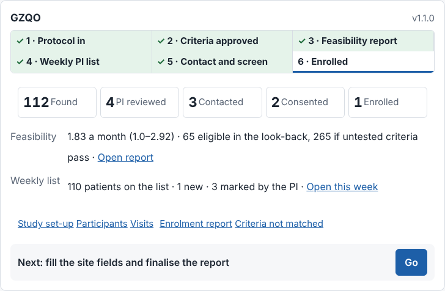

**A-2. No start-up checklist.**
Team, IRB approval, consent-form version, SAE rule set, who to screen, visit schedule and identifiers live on five
pages under three different sub-menus. In the demo (seen) GZQO is at "step 6 of 6" with no SAE rule set, "Who to
screen: not set yet: a screening run of this study stops until you choose", and no IRB number.
*Smallest fix:* one "Start-up" block on the study card: seven lines, each done or not done, each a link. It reads
state that already exists.

**A-3. Candidate and participant are not linked.**
`/studies/GZQO/patients/PID` as coordinator (seen). The page shows "Screening no. GZQO-0002" as plain text and
only contact outcomes, even for a patient already consented. After "Reached, visit booked" the panel offers "Not
approached" and "Lost contact", not consent. The screening log links back to the candidate, never forward.
A new coordinator stops here; a monitor asking "why was this subject eligible?" copies a number between three pages.
*Smallest fix:* make the screening number a link wherever it appears; after "Reached, visit booked" show
"Record consent" for that person; on the participant page add "Screening evidence", "EDC review", "History".

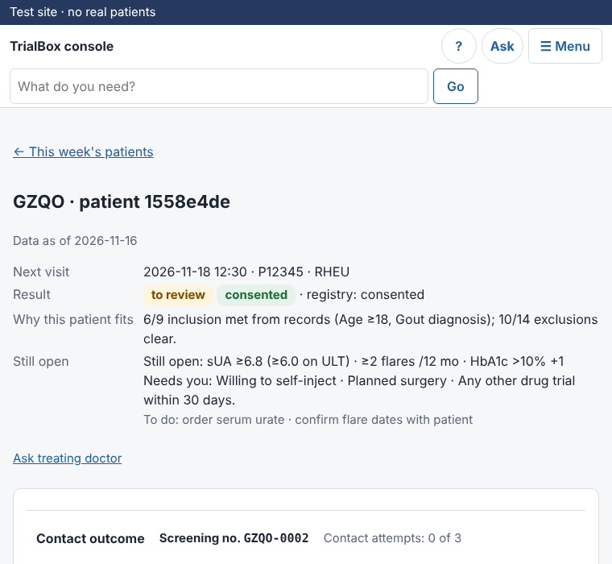

**A-4. The PI cannot reach participants, visits, deviations, monitoring or the study's state.**
PI menu and week page (seen): no such link. The pages open if he types the address. Under GCP the PI oversees
enrolled participants; today he reaches them only through an SAE banner.
*Smallest fix:* add "Participants" to the sub-menu already on the PI's week page.

### Medium

- **A-M1. Study close exists but is hidden, and the runbook denies it.** `/studies/X/state` (seen): Open, Paused,
  Closed, with a reason and retention years; the close is refused while a participant is on study
  (`services/console/study_setup.py:546`). `docs/runbook/20-close-out-and-decommissioning.md` line 31 says the switch
  "is not built yet". *Fix:* correct the runbook; add a five-line close checklist on the state page.
- **A-M2. Bug: the state page's browser title is about 2,600 characters of raw HTML.**
  `services/console/templates/study_state.html:11` opens the title block and closes it at line 41. *To see it:*
  sign in as coordinator, open `/studies/GZQO/state`, read the tab title. *Fix:* close the block on line 11.
- **A-M3. One IRB approval, three unlinked places** (`/irb`, `/state`, the approval page's amendment record).
  *Fix:* after approving an amended version, one line: "Update the IRB record and the consent-form version", linked.
- **A-M4. Bug: a raw text key on the participant page.** `/studies/GZQO/subjects/GZQO-0004` shows
  "life.vstate.unplanned" (seen). `services/datacore/lifecycle.py:1037` produces the state; `i18n_life.py` has no
  string for it. *Fix:* add it in three languages.

  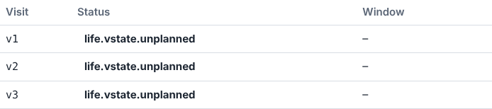
- **A-M5. Monitoring: wrong advice, no PI link, no queries.** A CRO account without a grant is told to "ask the
  TrialBox administrator to change your role"; the right advice is "the study's PI grants a monitoring visit".
  *Fix:* reword; link "Monitoring" from the delegation log. Queries: leave them in the EDC and say so on the page.
- **A-M6. No signpost where TrialBox ends.** *Fix:* one line on the participant and set-up pages: "Not in
  TrialBox: randomisation, study drug, payments, the site file."

### Low

- A-L1. "Consent" in the menu (`/pilot/consent`) is a plain-language explainer and records no consent. Rename it.
- A-L2. "Withdraw" does not hint that refusing use of the records is a separate step with the data steward.
- A-L3. Research-office counts for GZQO differed by role (coordinator "<5", viewer "5" and "0"). Recheck.
- A-L4. On set-up, the SAE rules and "who to screen" (which blocks a run) sit below the optional REDCap block.

---

## B. The journey of each user

### What each role meets

| Role | First five minutes | A normal day | The rare task |
| --- | --- | --- | --- |
| PI | Lands on this week's patients. 91 controls; the first patient row is below the first phone screen | Open a candidate 1 click; Approach 2 clicks; Not suitable 3 to 4 (a reason); acknowledge an SAE 2 | Delegation log 2 clicks; break-glass needs a pseudonym typed by hand |
| Sub-investigator | Same page; nothing says "you are a sub-investigator" | Same clicks; refusals are explained well ("Approach is not delegated to you…") | Read-only |
| Coordinator | "My work": 9 sections, 103 controls, 3,800 px (7,300 px on a phone) | Contact outcome 2 clicks. Consent: **4 clicks and 4 pages, with no onward link**. Visit 3 to 4 | Re-consent, withdraw, deviation: 3 clicks each, once you know "Participants" exists |
| Administrator (IT) | "Admin": 10 sections, 52 controls; "Overview" is a second health page | Health 0 clicks; account 2; backups 2 | Break-glass needs a job id typed by hand; restore hold hides under "Feature flags" |
| Data steward | Lands on break-glass reviews; 8 top items | Opt-outs, audit, data operations, conflicts: 1 click each, clear pages | Account requests: no link anywhere |
| Privacy office | No seeded account; created in this review through the two-person rule | – | – |
| Viewer | Feasibility reports; 2 controls in the page. Clean | 1 to 2 clicks | – |
| CRO | Sponsor copy, said plainly. After a PI's grant: a banner and one click to the subjects | 1 to 2 clicks | – |

### Hand-overs between roles (each tried with two sign-ins unless marked "read")

| From → to | Trigger | Does the sender see it? | Does the receiver see it on landing? | If nobody acts |
| --- | --- | --- | --- | --- |
| PI → coordinator | Mark "Approach" | Yes, with Undo | Yes: a dated task with the PI's note; but it sat 13th, under 7 chores | Turns "overdue" |
| Sub-I → coordinator → treating doctor | "Ask treating doctor" | Yes | Yes | Overdue label |
| Coordinator → investigator | The doctor's answer | Yes | **No** | Nothing |
| Coordinator → PI | SAE saved | Yes: "waiting", then "acknowledged by … at …" | Yes; 2 clicks | Stays; daily mail |
| Coordinator → PI | Criteria ready to approve | Yes (read) | Banner (read) | Stays |
| Coordinator → investigator | EDC drafts to sign | No line anywhere (read) | **No** | Nothing |
| Admin → steward | An account that needs a second person | "Asked…" | **No**: not on the steward's pages | Nothing |
| Admin → steward | Break-glass grant | Yes | Yes; mail at once | 7-day rule stated |
| PI → CRO | Monitor grant | Yes | Yes, with visit id and end date | Ends by itself |

### High

**B-1. No bridge from screening to conduct** (the same break as A-3, from the coordinator's side). One
"Record consent" button on the contact panel and on the task closes it.

**B-2. One person's status lives in four places with different numbers.** Seen at the same moment for GZQO:
home card "2 contacted, 2 consented, 1 enrolled"; registry "contacted 0, consented 1, enrolled 1, withdrawn 1";
Participants "consented 1, on study 1, withdrawn 1"; research office "approached 5, consented 0, enrolled 0". The
registry also lets a coordinator set "enrolled" from a drop-down, beside the real consent form.
*Smallest fix:* one source (Participants); the other pages read it; the drop-down goes.

**B-3. The coordinator's home buries the work.** `/home` (seen): two SAE cards for one participant, visits, then
tasks, where 7 of 14 were "Compare the X delegation log" or "Fill in the site fields" for idle studies, all dated
today, above the PI's hand-over. *Fix:* hand-overs first; monthly chores as one line; fold idle studies; raise
conduct chores only for a study that has a consented participant.

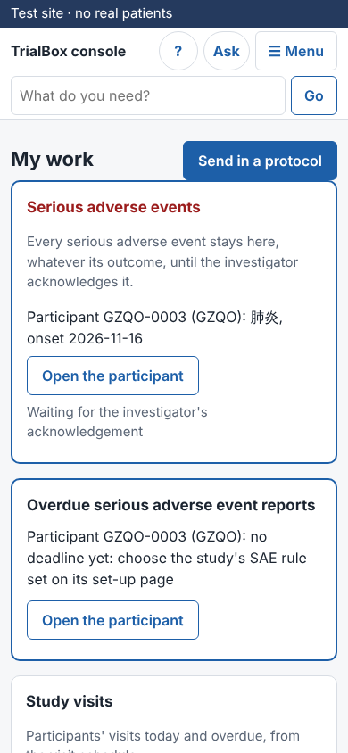

**B-4. "Overdue serious adverse event reports" lists events with no deadline.** PI and coordinator landing pages
(seen) show "Overdue … · 2" with the text "no deadline yet: choose the study's SAE rule set". The participant page
gives a different cause. A false "overdue" on the first page teaches people to ignore the real one.
*Fix:* a separate line "Reporting deadlines not set", one cause, a link to the setting.

**B-5. The command field does not know the words of a trial.** `/cmd?q=` (seen): of 50 plain phrases typed
across six roles, 15 opened the right page, 3 a wrong one, 32 nothing. "report an SAE" and "report a deviation"
open the feasibility reports; the administrator's "reset password" opens his own account; the steward's "audit"
is refused though Audit is in his menu. "enrol a patient", "consent", "withdraw", "delegation log", "納入受試者",
"同意書", "被験者を登録" are not understood. *Fix:* match against every menu label and participant step in three
languages; on no match show the role's pages.

### Medium

- **B-6. The treating doctor's answer does not come back** to the investigator's page. *Fix:* a "Doctor agreed"
  pill and a worklist.
- **B-7. Account requests are invisible to the second person**; the time on that page is UTC while every other
  page uses the site's time. *Fix:* a "Waiting for you" line on the steward's landing page.
- **B-8. The 403 page gives the wrong advice.** The administrator on a study page is told to "ask the
  administrator". *Fix:* name the role that can open the page; the permission table has it.
- **B-9. The sub-investigator and the PI share one role label.** *Fix:* show the delegated tasks under the name.

**Keep:** the sub-investigator's refusal sentences; Undo on every mark; the CRO's "sponsor copy" sentence; the
SAE acknowledgement with name and time; the printable role guide.

---

## C. The journey of the data

### Forward: from a hospital record to an export

| Hop | Where a person sees it | Provenance shown | Not shown | One click back? | |
| --- | --- | --- | --- | --- | --- |
| Hospital source → box | `/data-ops` (steward) | Source, night, state, who, what the gate said | Nothing per patient | No | Amber |
| The stored record | No page | – | Batch, file and row are stored but shown to nobody | No | Red |
| Screening answer from coded data | "Every criterion with its evidence" | Value, unit, date, code | Source system, the code's name, **the computed value** (eGFR shows only creatinine; BMI a height and a weight seven weeks apart) | No: text, not a link | Amber |
| Screening answer from the notes | Same | The sentence word for word, its date, a "test model" mark | The real model's name and version; the rest of the note | No | Amber |
| Candidate list and run | `/candidates`, `/week`, the run page | Run date, data date, criteria version | The funnel counts are not links | Partly | Amber |
| Mark, chart number | Patient page | Who, when; chart number once, after a reason, recorded | – | Yes | Green |
| Screening log | `/screening-log` | Number, dates, mark, consent-form version | No link forward to the participant | Back only | Green |
| Participant | `/subjects/NO` | Every step: day, who, which form | **No pseudonym, no link to the evidence** | No | Amber |
| EDC pre-fill | `/edc/review/NO` | Kind, readable line, table, row, snapshot | The reference is cut off at the right edge | No | Green |
| Signed and sent | Review, trail, history | Signer, role, time, meaning | Three trails for one participant | Partly | Amber |
| Export | PDF, XLSX, ODM, CSV | The feasibility PDF and sponsor pack: full | Screening log, ODM, CSV, data XLSX: **no exporter, no software version** | – | Amber |

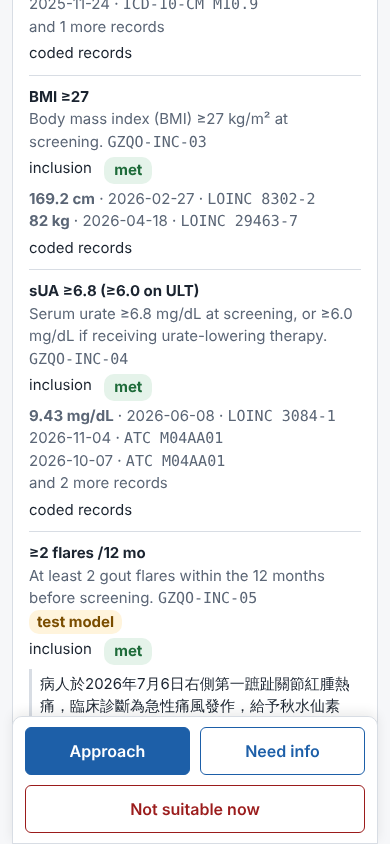

### Reverse: opt-out, withdrawal, erasure

| Journey | Who, where | Removed | Kept | Receipt | |
| --- | --- | --- | --- | --- | --- |
| Opt-out from research use | Steward or privacy office, `/site/opt-outs`, one form | 87 stores (read: `docs/validation/erasure-registry.md`) | Audit, the register, an enrolled subject's trial record. **28 stores still owed**: lake snapshots, the FHIR store, backups, the encrypted identity | One sentence. Nothing per patient; nothing on what could not be removed | Amber |
| Withdrawal of consent | Coordinator, participant page | Nothing (correct) | The trial record | **"Data may be used: No" is read by nothing.** In the demo seed, values were signed and sent three minutes after the withdrawal | Red |
| Erasure or access request | Nobody: no page, no action | Only what opt-out removes | – | The audit report answers "who looked", not "what do you hold" | Red |

### High

**C-1. "Data may not be used" on withdrawal does nothing.** `services/datacore/builtin/forms.csv:67`; no reader
in `services/` or `libs/`. A coordinator ticks "No"; exports and the EDC send go on.
*Smallest fix:* when the answer is No, refuse the EDC send, mark the participant's rows in exports "use withdrawn
on <date>", and show the answer on the participant page. The record is kept (GCP).

**C-2. No receipt for an opt-out, and no view of what remains.** `/site/opt-outs`. A privacy officer cannot
answer a patient truthfully. *Smallest fix:* on the register row: "cleared at <time>: N stores; still held until
<date>: lake snapshots, backups, audit", generated from the erasure registry; a red line when the worker has not run.

**C-3. No page says what the box holds about one patient.** Needed for an access or erasure request under
Taiwan's PDPA and Japan's APPI. *Smallest fix:* a steward page by pseudonym: per store, rows yes or no, plus the
screening numbers linked to that pseudonym.

**C-4. The patient's trail breaks at enrolment.** The one-patient audit report (`/audit/patients/<pid>`) showed
16 events for the followed patient and none of the data entry or the EDC signature, which are filed under the
screening number. *Fix:* include the events of the screening numbers mapped to the pseudonym. (Seen on one report;
the join was not read in code.)

### Medium

- **C-M1. Evidence cannot be opened.** *Fix:* each evidence line opens the stored record (the fields the EDC page
  already shows) and, for a quote, the whole note.
- **C-M2. Derived criteria show the inputs, not the result.** *Fix:* "eGFR 98 (CKD-EPI 2021) from creatinine 0.81
  on 2026-08-15"; warn when the inputs are far apart in time.
- **C-M3. Codes without names** ("LOINC 3084-1", "ATC M04AA01"). *Fix:* name first, code after.
- **C-M4. Exports do not say who made them or with which software.** *Fix:* one "about" block on every file and
  one ledger row with the file's hash.
- **C-M5. Three trails for one participant.** *Fix:* one "History" tab that merges form history and the EDC trail.
- **C-M6. The model is not named on a note-derived answer** when a real model is used (read:
  `_criteria.html`, `_opinion_src.html`). *Fix:* "read by <model> <version>" on the row.

**Keep:** the reveal of a chart number (reason, once, recorded, capped); the purpose question before a candidate
page; the sponsor pack's README; the feasibility PDF's footer; the generated erasure registry and its test.

---

## D. Simplicity and assistance

### The menu, counted

| Role | Top bar | Under "More" (home) | Under "More" (study page) | Listed twice |
| --- | --- | --- | --- | --- |
| Administrator | 3 | 20 | 20 | Users; "Jobs" and "Runs" |
| Coordinator | 4 | 16 | **25** | "Candidate registry" = "Registry"; "Overview" = "My studies" |
| PI, sub-I | 3 | 22 | 22 | Registry; "Overview" = the week page |
| CRO | 1 | 3 | 3 | Reports |
| Viewer | 1 | 6 | 6 | Reports, three times |
| Steward | **8** (the rule D-104 says four) | 11 | 11 | Break-glass, opt-outs, staff, audit |

Every role also has seven header controls: logo, "?", "Ask", the command field with "Go", the account, the language
with "Change", "Sign out". No study switcher, no breadcrumb; on most study pages no top item is lit.

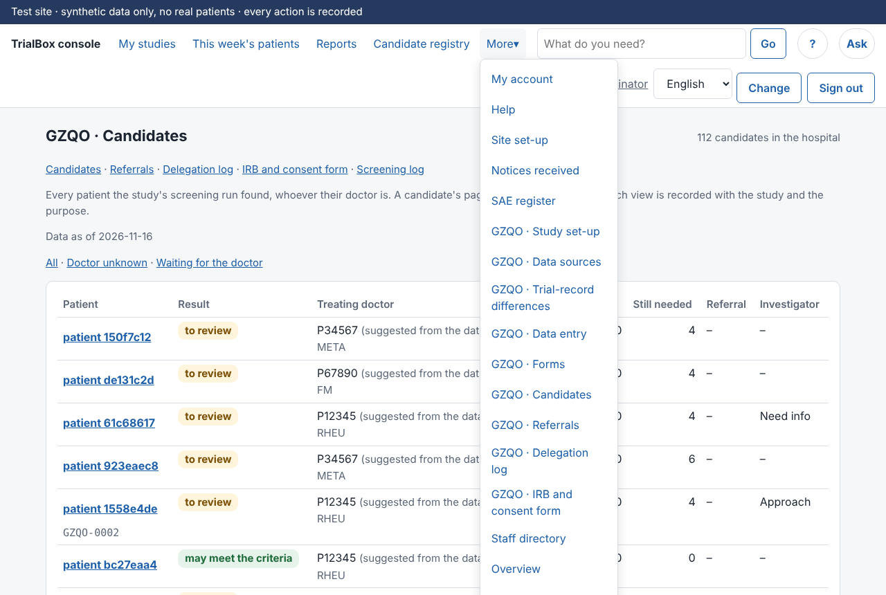

### One thing, several names

| The thing | Names on screen today | One word |
| --- | --- | --- |
| The landing page | "My studies", "My work", "Overview", "My home page" | **Home** |
| A person before consent | candidate, patient, registry row, cohort member | **Candidate** |
| A person after consent | participant, subject, record | **Participant** |
| "patient f148c659" | pseudonym | **Patient code** |
| The lists of people | This week's patients, Candidates, Candidate registry, Registry, Screening log, Participants, cohort | **Candidates** and **Participants** |
| Machine work | job, run, FEAS, SCREEN, CASE, MICROBATCH, INGEST, cascade | **Count**, **weekly list**, **one-patient check**; the rest for IT only |
| The criteria | ruleset, criteria version, "v1.1.0" | **Study criteria** |
| Things to reconcile | Trial-record differences, Clinical conflicts, Data sources | **Values to check** |
| Messages | Notices received, Mail notices, Notification settings | **Notifications** |
| `/reports` | "Reports" (it holds only feasibility) | **Feasibility** |

System words still on clinical pages: "From the MICROBATCH run of 2026-11-17" on the PI's page; "Ruleset" as a
column header; "v1.1.0" on every card; "DEV · data class D0" in the footer; environment-variable names
("TB_SAE_OFFICE_MAILBOX") shown to clinicians. The review of 2026-11-08 asked for these; they are still open.

### High

**D-1. "More" is a drawer of everything.** `services/console/templates/_nav.html`. Its first line says "All
older pages stay reachable", and that is the cause. *Smallest fix now:* delete the duplicates and the legacy
"pilot" entries (New request, Protocol, Consent explainer, Cascade, Single case, Runs, Overview) for clinical roles;
bring the steward's top bar to four. No function is lost: the pages stay at their addresses. *Later:* the
study-scoped menu below.

**D-2. Seven lists of the same people.** `/studies/X/week`, `/candidates`, `/pilot/registry/X`, `/screening-log`,
`/subjects`, `/cohort` (never linked), `/site/patients`. *Fix:* two pages, Candidates (before consent, with a
"mine / whole hospital" filter) and Participants (after), on one status source; the screening log becomes an export
of both. (This is also B-2.)

**D-3. Help is in four places and answers little.** "?", "Ask", the command field, "More → Help". "Ask" answers
two kinds of question. The glossary explains seven trial words and none of the system words on screen.
*Fix:* one Help control with one search box; the glossary gains the words in the table above.

**D-4. The coordinator's home is too long and repeats itself** (B-3 has the detail).

### Medium

- D-M1. Page title, heading and menu label disagree (`/jobs` is "Runs" in the menu and "Jobs" as heading). One
  rename pass in three languages.
- D-M2. `/reports` rows say "no feasibility report yet" with no button, while the home card offers one.
- D-M3. The "Cascade" link leads to "The synthetic site drop is not mounted (TB_CONSOLE_SOURCE_DIR)". Hide the
  link when it is not mounted, as the test mailbox already does.
- D-M4. Criteria labels inside tasks stay English in Chinese and Japanese pages.

**Keep:** the empty state of a study with nothing yet (one sentence, one button); the 404 page; the "Next"
button per study once it follows the whole life cycle; the folded SAE banners; the translations.

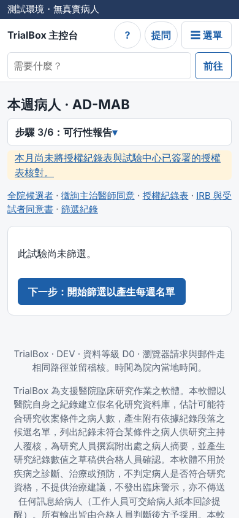

### Proposal: an opening page by role and study phase

```
+------------------------------------------------------------------------------+
| TrialBox    [ Study: GZQO v ]                      Search / Help    crc   EN |
| Home | Candidates | Participants | Safety | Set-up              (for GZQO)   |
+------------------------------------------------------------------------------+
| NEEDS YOU TODAY  (at most 5, one click each)                    [see all 14] |
|  !  SAE GZQO-0003: the PI has not acknowledged                  [Open]       |
|  3 clinic visits tomorrow to prepare                            [Open list]  |
|  PI asked: contact patient a44a2675                             [Open]       |
+------------------------------------------------------------------------------+
| MY STUDIES                                                                   |
| GZQO    Feasib > Start-up > Screening > [ENROLMENT] > Visits > Safety >      |
|         Monitoring > Close      110 candidates · 2 consented · 1 enrolled    |
|         Next: [Record consent for GZQO-0004]                                 |
| SITE5B  Feasib > [START-UP 4 of 7 done] > ...     Next: [Choose SAE rules]   |
| AD-MAB, RA-JAK: not started                       [Run feasibility]          |
+------------------------------------------------------------------------------+
```

- **The top bar has at most five items:** Home, then four that follow the chosen study: Candidates, Participants
  (visits, data, deviations as tabs), Safety, Set-up (documents, team, IRB, forms, state, close). A study switcher
  replaces the "GZQO · …" lines under "More". Language, notifications and sign-out go under the account. "More"
  disappears for clinical roles.
- **The phase strip has eight phases,** the current one lit, each a link to that phase's page. A phase TrialBox
  does not carry (randomisation) or a module the site has switched off is grey and says so. Start-up shows
  "4 of 7 done" from the checklist of A-2.
- **What each role sees first:**

| Role | "Needs you today" | Top bar |
| --- | --- | --- |
| PI | SAEs to acknowledge; candidates ready to decide (a count and one button into the week list); doctor answered; signatures due. With one study and nothing urgent: straight to the week list, as today | Home, Candidates, Participants, Safety |
| Sub-investigator | The same, within the delegated tasks, named under the account | Home, Candidates, Participants |
| Coordinator | The sketch above | Home, Candidates, Participants, Safety, Set-up |
| Steward, privacy office | To review: break-glass, opt-outs, account requests, values to check, restore hold | Home, Reviews, Registers, Audit |
| Administrator (IT) | Health, failed work, accounts waiting, backup age, certificate days | Home, Users, System, Hospital set-up, Audit |
| CRO monitor | The studies granted, "Monitoring" lit; or "no monitoring visit is open for you" | Home, Monitoring |
| Viewer, research office | Feasibility table and the office counts as two tabs | Home |

---

## E. Mobile

The owner has declined a separate app. Nothing below proposes one: these are changes to the existing pages.

**The foundations are good.** No page scrolls sideways (0 px on 30 pages, three languages). Buttons and fields
are 44 px high; fields use 16 px text; there is one stylesheet with 17 breakpoints; the menu needs no script; the
address is kept through sign-in; date and select fields are the phone's own; Chinese and Japanese wrap correctly.

**The PI's core task already works on a phone:** tap a patient, read the evidence in a full-screen sheet, mark
with a bar fixed at the bottom, Undo offered. Two taps. It is the best phone screen in the product.

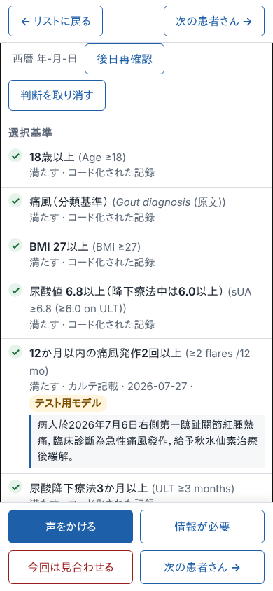

### Which tasks belong on a phone

| Task | Role | Taps | Today at 390 px |
| --- | --- | --- | --- |
| Open the morning list from the mail | PI | 1 + sign-in | Works; but the first screen shows no patient |
| Read a candidate's evidence | PI | 1 | Works |
| Mark Approach / Need info | PI | 2 | Works |
| Mark Not suitable | PI | 4 | Works |
| Acknowledge an SAE | PI | 2 | Works, but too easily (E-3) |
| The task list | Coordinator | 0 | Usable with effort: the page is 6,500 to 7,300 px |
| Record a contact outcome | Coordinator | 2 | Works |
| Mark a visit done | Coordinator | 4 | Usable with effort |
| Report an SAE | Coordinator | 3 + the fields | Usable with effort; a half-filled form is lost on time-out |
| Look up a participant | Both | type the number | Works well |
| Sign pre-filled EDC values | Coordinator | many | **Broken** (E-2) |
| Approve criteria | PI | – | Not for a phone: read there, approve at a desk |

Desk-only, and rightly so: item mapping, study set-up, the delegation log, the screening log, data operations,
accounts, audit, exports, protocol upload.

### High

**E-1. The PI's first phone screen shows no patient.** `/studies/GZQO/week` (seen). Header, title, counts, step
strip, two SAE folds, a delegation warning, a five-link row, the date, the tabs, a heading and a help line come
first; the first patient row starts at 856 px (English), 774 (Chinese), 796 (Japanese) of an 844 px screen.
The morning mail promises the list; the doctor between patients gets a screen of administration.
*Smallest fix:* under 760 px, put the list directly under the title and fold the rest into one "Study" fold below.

| Chinese (Taiwan) | Japanese | English |
| --- | --- | --- |
| 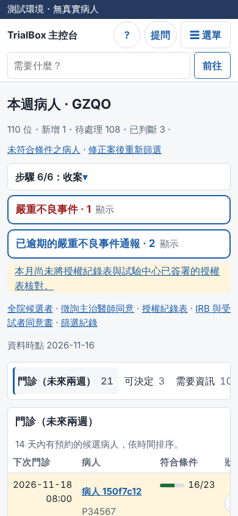 | 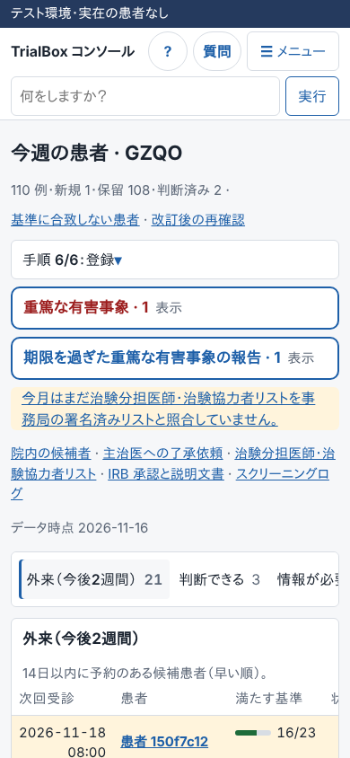 | 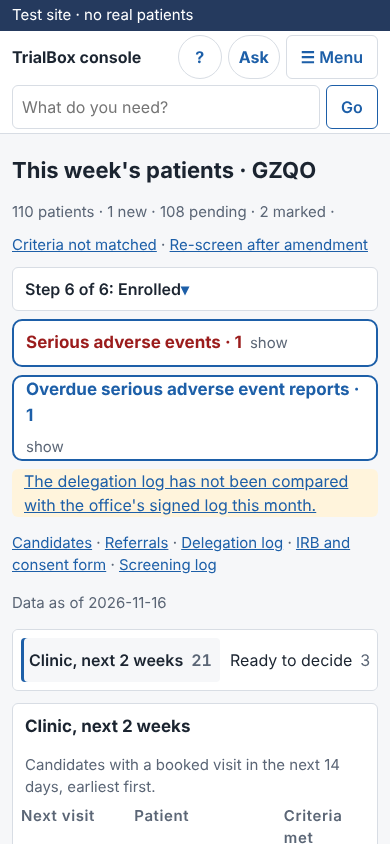 |

**E-2. EDC review cannot be done on a phone.** `/studies/GZQO/edc/review/GZQO-0003` (seen). Only Item and Value
fit; Source, State and Action are off-screen, and the source is the point of the page.
*Smallest fix:* one card per item under 640 px (the stylesheet's `table.stack` rule exists). Until then, say
"open this on a computer".

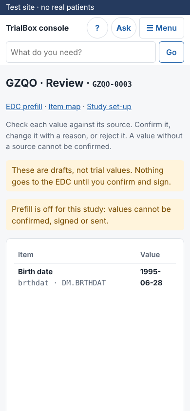

**E-3. An SAE is acknowledged by one tap, with no confirm and no way back.** The fold shows the term and onset
and a primary button next to "Open the participant". It is a regulatory record made by a thumb.
*Smallest fix:* show term, onset, seriousness and participant, then confirm (the product has a confirm page).

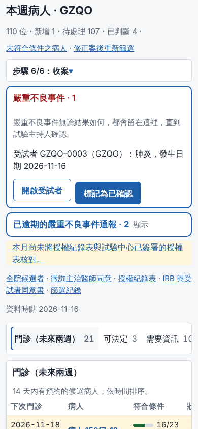

**E-4. Tables hide the column that matters.** Week list: Status and the mark are off-screen. `/sae`: 1 of 4
columns shows, after seven paragraphs of rules. Nothing says a table scrolls sideways.
*Smallest fix:* worklist and SAE rows as cards under 640 px; a fade on the right edge elsewhere.

### Medium

- **E-M1. No "add to home screen".** No manifest, no icon; `/favicon.ico` and `/manifest.webmanifest` give 404
  (seen). *Fix:* a manifest, two icons, a theme colour. No offline, no service worker.
- **E-M2. A mail link tapped in webmail always shows the sign-in page, even with a live session**, because the
  session cookie is withheld on a link arriving from another site (`SameSite=Strict`, correct). *Fix:* keep
  Strict; let the sign-in page do one same-site hop so a live session is seen.
- **E-M3. A ten-minute idle lock loses a half-filled AE or visit form** without warning. *Fix:* use the form
  guard that set-up already has, and keep the text in the tab as the mark's note is kept.
- **E-M4. "More" on a phone is 22 links and about 980 px**, covering the language picker and "Sign out".
- **E-M5. In the patient sheet the note and reason fields come before the evidence.** Read first, mark second.

### A phone-first version needs, in order of value

1. Patients first on the week page. 2. Worklist rows as cards. 3. A "Today" block per role, five lines (the same
"needs you today" as section D). 4. SAE acknowledgement in two steps. 5. Manifest and icons. 6. The live-session
hop for mail links. 7. EDC review as cards. 8. Sub-menus as 44 px chips. 9. Guard for long forms.

---

## F. Modularity

**Today a site cannot switch on only what it uses.** There is one product switch: the workspace on or off
(`TB_CONSOLE_WORKSPACE`; `services/console/app.py:1329`). Everything clinical comes with it. The other switches
are technical (six operational flags; GPU or stub at install) or per study and late (EDC pre-fill, the REDCap
link), and only one of them hides a menu item (the test mailbox: hidden and 404 when off, the right pattern).

**The code is closer to modular than the screens.** About 35 page groups are each registered by one call, but
unconditionally; the menu, the home page and the permission table (75 actions) know nothing of features.
A feasibility-only site can install without a GPU (`install.sh --mode stub`), and still gets 12 containers, the full
menu, SAE banners and a six-step strip that ends at "Enrolled".

### Proposed modules

| Module | Contains | Roles | Needs | Depends on |
| --- | --- | --- | --- | --- |
| **Core** (always) | Sign-in, accounts, help, audit, break-glass, hospital set-up, staff, opt-outs, operations | all | CPU | – |
| **Feasibility** | Protocol in, criteria approval, feasibility report, sponsor pack, research-office counts | coordinator, PI, viewer, CRO | CPU; a model only to read a protocol PDF | Core |
| **Screening** | Week list, patient sheet, candidates, referrals, not-matched, one-patient check, screening log | coordinator, PI, sub-I | GPU for criteria read from notes | Feasibility |
| **Conduct** | Participants, visits, schedule, deviations, SAE, delegation log, IRB record, study state and close | coordinator, PI | CPU | Core |
| **EDC link** | The link to the EDC, item map, pre-fill, review and sign, the trail | coordinator, PI, admin | A reachable EDC | Conduct |
| **Monitoring** | Monitor grant, CRO page, SDV sheet | CRO, PI | – | Conduct |
| **Data stewardship** | Data operations, item catalogue, values to check, restore hold | steward, privacy, admin | – | Core |

Cohort and registry work is better a **study type** than a module: it reuses the Feasibility and Screening pages.

### How the home page changes

Rule: a link shows only if its module is on **and** the role may use it. A switched-off module's address answers
one plain page: "This site does not use <module>. Ask <administrator>." The phase strip greys the phases of
modules that are off.

- **A feasibility-only site.** Coordinator's top bar: Home, Feasibility, New request. The study card has three
  steps. No delegation-log chores, no SAE banner, no pipeline counts. About 8 links in all, where today there are 29.
- **A screening and EDC-link site.** The sketch of section D, with an "EDC" line on each participant.

### High

**F-1. No way to switch a feature off.** This is the main mechanical cause of "the console has become complex".
*Smallest step* (medium, lane C2, about a week by line count): a `modules:` list in `settings.yaml`, all on by
default so no box changes; one table from address prefix to module; the menu, the home page and one route guard
read it; the installer asks one question, "what will this site use?".

**F-2. Conduct chores appear for studies that are not in conduct** (the delegation-log comparison and "SAE rules
need checking" for three studies with no feasibility report). *Fix:* raise them only when the study has a
consented participant.

### Medium

- F-M1. The EDC is spread over four places with two different "off" wordings (see G).
- F-M2. The scheduler plans the Taiwan-insurance job and the cohort job on every box (`scheduler.py:279`).
- F-M3. The larger refactor (routers mounted per module; a `module:` field on every permission row; compose
  profiles per module so a feasibility box runs fewer containers) can wait until after a pilot.

---

## G. The EDC in the journey

Read only from this repository (`services/edc_backend/`, `services/console/edc_door.py`, the tests, `docs/data/13`
and `14`). The connector was off in the demo, so its "on" state is from code and tests.

**TrialBox has five separate "trial data" areas, and none names the others:**

| What the screen calls it | Where | What it is | How a coordinator reaches it |
| --- | --- | --- | --- |
| EDC prefill (item map, review, trail, copy-assist) | `/studies/X/edc...` | Drafts CRF values from the hospital record; a person confirms, signs, sends | Only a small link strip on study set-up |
| Data sources, trial-record differences, forms, data entry, change history | `/studies/X/sources`, `/conflicts`, `/forms`, `/entry`, `/history` | TrialBox's own small EDC | "More", on a study page |
| REDCap connection | `/admin/redcap` | Addresses and keys | Administrator only |
| Participants, visits, deviations | `/studies/X/subjects...` | The site's own log of each participant | The home card |
| "EDC connection" (the link to the owner's EDC) | `/admin/edc` | Status, map, held writes, sign-on, events | **No link anywhere** |

### Where the EDC should appear in a study's journey

```
 STAGE       TRIALBOX                                          THE EDC
 Set-up      Choose "this study's EDC", once            <==1== forms, visits, arms (the EDC is master)
             Item map: what TrialBox may draft          ==2==> (reads the form list; writes nothing)
 Enrolment   Consent → enrolled
             "Create in the EDC" on the participant     ==3==> record created; its id comes back
 Visits      Visit due → "Pre-fill" → confirm → sign
             Send                                       ==4==> values arrive; read back; compared
             Visit row: "sent 4, not accepted 1"        <==5== "form completed", "record saved"
             "Open this visit in the EDC"               ==6==> the coordinator finishes the form there
             (single sign-on, lands on that form)       <==7== "Back to the TrialBox participant"
 Monitoring  "2 open queries" on the participant        <==8== queries and SDV live in the EDC
             AE on the home list                        <==9== "AE reported"
 Close-out   "EDC locked on <date>"                     <==10= lock, export, archive are done in the EDC
```

**Today:** crossings 1, 2 and 4 work through the REDCap-style API. 5 and 9 arrive but cause only a re-read and an
audit line. 8 is stored and shown nowhere. 3, 6, 7 and 10 do not exist.

### What TrialBox should show of the EDC's state

| State, per participant and visit | Shown today? | Where | Gap |
| --- | --- | --- | --- |
| Not created in the EDC | Only after a failed send | A banner | Not on the participant page |
| Drafted, to review | Yes, a count | `/studies/X/edc` only | Not on the participant, the visits or home |
| Signed; sent | Yes | Same | Same |
| Accepted (read back equal) | Per value | The trail only | The table shows "Signed 5, Sent 4": the reader must work out that one failed |
| Not accepted | Partly | The trail; a one-time banner | The review row looks like the accepted ones |
| Changed in the EDC afterwards | Yes, a warning | Review | Good |
| Form completed; query open; locked | No | – | Missing |
| The EDC is reachable | Administrator only | `/admin/edc` | The coordinator gets no line |

### Moving between the two without losing one's place

Today there is no link from TrialBox into the EDC. Single sign-on works only when the EDC starts it. The way back
can already work: `/studies/{study}/subjects/{screening number}` is a stable address and the map is keyed by
screening number. **Clicks today,** coordinator, from home: confirm and sign one pre-filled visit of five values is
10 clicks, 8 page loads and one password (three clicks to arrive, one per value, each a reload). To see whether the
EDC accepted it: 3 clicks for the trail; "the form is complete, no query" cannot be seen at all.

### High

**G-1. A coordinator cannot get from the participant to the pre-fill, or back.** Visits are "v1, v2" on one side
and "event_1_arm_1", typed by hand, on the other. *Smallest fix:* on each visit row "Pre-fill" and one state word,
linked; "Back to participant" on Review; one visit-to-event table in the visit schedule.

**G-2. No link into the EDC and no agreed way back.** *Fix:* "Open in the EDC" on participant, visit and Review;
give the EDC the return address. The EDC's page-address pattern is a question for the owner (through the
integrator; lane E does not read the EDC's repository).

**G-3. A held write is invisible to the person who should own it.** `edc_link.html:21-30`. Only an administrator
can open the page; it lists each held write as a bare "Confirm this write" button with no participant, no holder
and no time left; it lapses silently after 15 minutes; pressing it shows raw JSON. No page creates one.

**G-4. Two write paths into the EDC with different safeguards.** The signed Send: coordinator, a source per
value, an electronic signature, read-back. The tool write: administrator, one click, no signature
(`edc_door.py:119-137`). An auditor will ask which is the rule. *Recommendation:* the signed Send is the only way a
value enters the EDC; keep the tools for reads and for opening a query; leave the write tool off for the pilot.

**G-5. Bug: the administrator's "EDC connection" page is titled "EDC prefill", with the pre-fill help.**
`edc.title` and `edc.help` are defined in both `i18n_step3.py:108` and `i18n_edc.py:9`, and the second wins.
*To see it:* sign in as admin, open `/admin/edc`. *Fix:* rename the connection's keys; add a test that no text key
is defined twice or missing in a language.

**G-6. "Not accepted" is easy to miss.** In the demo the birth date was refused ("conflict: not overwritten");
only the trail says so. *Fix:* a warning on the row with the reason and the next step; a "Not accepted" column.

### Medium

- G-M1. Pre-fill has no worklist and no home line ("3 values to review, 1 not accepted").
- G-M2. No message to the coordinator when the EDC is down or not linked. One line: "EDC: connected / not
  answering since 10:42 / not linked; your signed values are kept and can be sent later".
- G-M3. The study-to-EDC map has no form; saving needs a hand-made API call.
- G-M4. Three places per study ask for an EDC or REDCap key. Choose "this study's EDC" once, in set-up.
- G-M5. "Send to REDCap", "No REDCap record" beside "Sent to the EDC". Say "the EDC" everywhere.

### What becomes redundant once the owner's EDC is the record

Recommendation: **TrialBox's own data pages are a working aid, not a second EDC of record.** Keep Participants,
visits, AEs, deviations and the site forms behind them (they are the site's own log and feed the home page). Keep
pre-fill, signature, Send and the trail. For a study linked to the EDC, hide free data entry of CRF forms, the
two-way REDCap attach and "trial-record differences": two writable copies of a CRF make conflicts by design. Fold
`/admin/redcap` and `/admin/edc` into one page. Names: one section **Trial data** holding **Participants**,
**Pre-fill for the EDC**, **Site records**, **EDC link**. "Door", "data core", "proposal" and "tool" never appear
on screen.

---

## H. Install and maintenance, from the site's side

A reading review: the runbooks, the installer scripts, the rehearsal's steps. No install was run.

**The engineering under each task is careful:** signed media, checks before anything changes, a backup before an
update, automatic rollback, a restore that first keeps the box as one more backup. Refusals mostly end "nothing
was changed".

### The tasks, counted (hand counts from the documents; approximate)

| Task | Steps | Typed commands | Decisions | Pages open | The likely failure, and the message |
| --- | --- | --- | --- | --- | --- |
| Install, Linux box | about 12, plus a 9-part acceptance | 6 to 8, plus 9 for acceptance | about 13 | 6 to 8 | No measured record for the card, or no TPM. Plain, English only |
| Install, Windows | 22 checklist boxes | 0 (double-click); 6 after, each a long `wsl …` line | about 8, plus 14 wizard answers | 5 | Wrong Windows edition or driver. 96 messages in three languages: good |
| Update | 3 | 1 copy, then 2 buttons | 1 | 1 | No backup key: refused, clearly. Good |
| Back up | set-up 4; daily 0 | 2 and two hand edits | 3 | 1 to 2 | Share not mounted: a red tile, the health mail, the morning mail. Good |
| Restore | about 10 | 6 to 9 | 5 to 7 | 3 to 4 | A missing reference pack or later events: the next step is only in the runbook. **No screen** |
| Diagnose | open | 1 to 6 | which of 35 symptoms | 2 to 5 | `doctor` is precise, in engineer's English, shell only |
| Renew a certificate | 5 | 3 | 1 | 1 | Checked before the swap. Good. The warning is not on the admin page |
| Close out, decommission | 8 | about 12 | several | 4 to 5 | Forgetting a store the plan cannot see |

An appliance-grade version is one screen per task on the Operations page (`/admin/ops`), in the reader's language,
with the shell kept for the vendor. Backup is there already; update is nearly; restore, diagnosis, the support
file and the certificate are not.

### High

**H-1. Neither install route has finished on real hardware.**
`docs/handover/installer-first-contact-2026-11-15.md`: the first real Linux install "stopped while sealing" the
keys, with four faults open. `docs/handover/WINDOWS-INSTALL-CHECKLIST.md`: "Nothing below has run on Windows".
A hospital's IT person would be the first tester. *Fix:* one full install on the pilot's hardware type, by a person
holding only the site's documents. (This is already proof runs R2 and R3 of the plan; the point here is "holding
only the site's documents".)

**H-2. No one place to start, and the numbering misleads.** `docs/runbook/` holds 35 files; the numbers 04, 08,
11, 12 and 22 are each used more than once; pages for builders sit in the same list as pages for a site.
*Fix:* one site index ("Your box: install, update, back up, restore, something is wrong, certificate, close out")
linking seven site pages; move the builders' pages out.

**H-3. The console tells the site to do something the box refuses.** `services/console/i18n_ops.py:82`: "To go
back after a good update, apply the previous release's bundle." `tools/verify_update.py` rejects that as a
downgrade, and the Apply button passes no override. (Read in code; not reproduced on a box.)
*Fix:* "Going back after a good update needs Aimedics: call support", in three languages.

**H-4. Restore is the hardest task and has no screen.** The owner has declined a remote session for the pilot, so
the site does it alone or waits for a visit. *Fix now:* a one-page restore card with the exact lines; make the
restore run the role script and the migration itself. *Later:* a restore screen on a fresh box's first-run page.

**H-5. The runbook is English only.** The IT one-page, the network sheet, the Windows owner page and the
Operations page are translated; the Linux installer's messages, every `doctor` line and the seven task pages are
not. Under the owner's rule (the product adapts to the hospital) they should exist in Chinese and Japanese.

### Medium

- **H-M1. The command the runbook names does not exist.** The runbook writes `trialbox doctor` about 60 times;
  `pyproject.toml` installs no `trialbox` command. The real line is long. *Fix:* a small wrapper.
- **H-M2. `doctor` and the support file are invisible in the console.** *Fix:* two buttons on the Operations
  page: "Check this box" and "Make the support file".
- **H-M3. An update still needs a shell for its first step** (copying the bundle into a folder).
- **H-M4. Settings named in two places** (the time zone in `settings.yaml` and in `deploy/.env`); the wizard
  writes both, hand edits do not. *Fix:* a "Box settings" form for the ten day-2 values.
- **H-M5. Steps to run by hand after a given update hide in the runbook's prose.** *Fix:* the updater runs them.
- **H-M6. Certificate days are not on the admin page**, so a box without mail shows nothing until the browser warns.
- **H-M7. Backup set-up sits outside the IT form's wizard**; until done, `doctor` fails and the update refuses.

### Low

- H-L1. Restore time is unmeasured (`22-disaster-recovery…md`: "No restore has been measured yet").
- H-L2. A note from this review: the demo's own first start needs `make jvm-deps` and `make fonts`; the failure
  says so plainly ("run `make jvm-deps`"). Good message; `make demo` could run them itself.

**Keep:** the IT one-page (three asks: an address, a data connection, a firewall line); the Windows owner page;
refusals that end "nothing was changed"; the backup line in the coordinators' morning mail.

---

## 10. Proposed cards

Sizes: S small (a day or less), M medium (a few days), L large (a week or more). Lanes: A2 screening, B2 lake and
masking, C2 console, D installer and CI, E EDC and terminology, W Windows. "Before" = needed before a hospital
pilot; "wait" = can wait.

### Fix first (each misleads a user today)

| # | Card | Area | Size | Lane | When |
| --- | --- | --- | --- | --- | --- |
| 1 | Honour "data may not be used" on withdrawal: refuse the EDC send, flag exports, show it on the participant | C-1 | S | E, C2 | Before |
| 2 | Correct the "go back after a good update" sentence, three languages | H-3 | S | C2 | Before |
| 3 | SAE banner: separate "deadline not set" from "overdue"; one cause | B-4 | S | C2 | Before |
| 4 | Bugs: the state page's title; the "unplanned" string; `/admin/edc` title and help; a test for double or missing text keys | A-M2, A-M4, G-5 | S | C2 | Before |
| 5 | Runbook 20: the per-study close exists; a close checklist on the state page | A-M1 | S | D, C2 | Before |

### The thread through the life cycle

| # | Card | Area | Size | Lane | When |
| --- | --- | --- | --- | --- | --- |
| 6 | Link the screening number to the participant everywhere; "Record consent" after a booked visit; participant page links back to evidence, EDC review, history | A-3, B-1, C-4 | S | C2 | Before |
| 7 | "Participants" in the PI's study menu | A-4 | S | C2 | Before |
| 8 | Home "Next" follows the whole life cycle; site fields become a task | A-1 | M | C2 | Before |
| 9 | Start-up block on the study card: seven lines, done or not | A-2 | M | C2 | Before |
| 10 | One status source: registry, home card and office counts read Participants; remove the registry's drop-down | B-2, D-2 | M | C2 | Before |
| 11 | "Doctor answered" pill and worklist | B-6 | S | C2 | Before |
| 12 | Monitor refusal wording; link Monitoring from the delegation log; "queries live in the EDC" | A-M5 | S | C2 | Before |
| 13 | "Not in TrialBox" line (randomisation, drug, payments, site file) | A-M6 | S | C2 | Before |
| 14 | One amendment prompt tying approval, IRB record and consent-form version | A-M3 | M | C2 | Wait |
| 15 | Eight-phase strip, study switcher, study-scoped top bar; "More" removed for clinical roles | D | L | C2 | Design now; build in the pilot |
| 16 | Merge the people lists into Candidates and Participants | D-2 | L | C2, E | Wait (after card 10) |

### Simplicity and help

| # | Card | Area | Size | Lane | When |
| --- | --- | --- | --- | --- | --- |
| 17 | Prune "More": duplicates, "Overview", legacy pilot links; steward's top bar to four; hide Cascade when not mounted | D-1 | S | C2 | Before |
| 18 | One name per page: title = heading = menu label, three languages | D-M1 | S | C2 | Before |
| 19 | Coordinator home: hand-overs first, at most five "needs you", chores as one line, idle studies folded; conduct chores only for studies in conduct | B-3, F-2 | M | C2 | Before |
| 20 | Command field: match menu labels, participant steps and the glossary in three languages; fix the misroutes | B-5 | M | C2 | Before |
| 21 | 403 page names the role that can; the glossary gains the system words | B-8, D-3 | S | C2 | Before |
| 22 | Replace job words on clinical pages ("List made…", "Study criteria"); no variable names to clinicians | D | S | C2, A2 | Before |
| 23 | Steward "Waiting for you" line; link account requests; site time | B-7 | S | C2 | Before |
| 24 | Merge "?", Ask and the command field into one Help and Search | D-3 | M | C2 | Wait |

### The data's journey

| # | Card | Area | Size | Lane | When |
| --- | --- | --- | --- | --- | --- |
| 25 | Opt-out receipt on the register: cleared, still held and until when, worker state | C-2 | M | C2, B2 | Before |
| 26 | "What the box holds about this patient" page for the steward | C-3 | M | C2, B2 | Before |
| 27 | An evidence line opens the stored record or the whole note | C-M1 | M | C2, A2 | Before |
| 28 | Show the computed value and its formula for derived criteria; warn on inputs far apart | C-M2 | S | A2 | Before |
| 29 | Name the model and version on note-derived answers | C-M6 | S | A2 | Before (with a real model) |
| 30 | One "about" block and one ledger row for every export | C-M4 | S | C2 | Before |
| 31 | Finish the 28 owed erasures (lake snapshots, FHIR store, identity, backups) | C | L | B2 | Before real data |
| 32 | Names before codes; run-page counts link onward; one merged history per participant | C-M3, C-M5 | M | C2 | Wait |

### Mobile

| # | Card | Area | Size | Lane | When |
| --- | --- | --- | --- | --- | --- |
| 33 | Week page: patients first under 760 px; worklist rows as cards | E-1, E-4 | S | C2 | Before |
| 34 | SAE acknowledgement: detail and a confirm step; SAE register as cards | E-3 | S | C2 | Before |
| 35 | "Today" block per role, five lines (shares its logic with card 19) | E | M | C2 | Before |
| 36 | Web manifest, icons, favicon, theme colour | E-M1 | S | C2 | Before |
| 37 | The sign-in page passes a live session through (mail links) | E-M2 | S | C2 | Before |
| 38 | EDC review as one card per item (first: an "open on a computer" note) | E-2 | M | E | Before pre-fill is used at a site |
| 39 | Guard and keep half-filled forms; phone "More" in two folds; evidence before the mark fields | E-M3 to M5 | S | C2 | Wait |

### Modules

| # | Card | Area | Size | Lane | When |
| --- | --- | --- | --- | --- | --- |
| 40 | `modules:` list in settings, read by the menu, home and a route guard; a "not used at this site" page | F-1 | M | C2 | Before |
| 41 | Installer question "what will this site use?"; a no-GPU line on the admin home | F | S | D | Before |
| 42 | Routers per module; `module:` on permission rows; compose profiles; scheduler by module | F-M3 | L | C2, D | Wait |

### The EDC

| # | Card | Area | Size | Lane | When |
| --- | --- | --- | --- | --- | --- |
| 43 | Participant page: per-visit EDC state and "Pre-fill"; "Back to participant"; one visit-to-event table | G-1 | M | C2, E | Before |
| 44 | Review: a "not accepted" warning with the reason; a "Not accepted" column | G-6 | S | E | Before |
| 45 | Home line "Pre-fill: N to review, N not accepted"; a landing line for drafts to sign | G-M1 | S | C2 | Before |
| 46 | One decision record: the signed Send is the only write path; the write tool off for the pilot | G-4 | S | E | Before |
| 47 | "Open in the EDC" with single sign-on, and the return address (needs the EDC's address pattern from the owner) | G-2 | M | E | Before, if the EDC is used in the pilot |
| 48 | EDC status line for coordinators; a form for the study-to-EDC map; link `/admin/edc` | G-M2, G-M3 | S | E | Before, if the EDC is used |
| 49 | One EDC choice per study; "the EDC", not "REDCap"; the "Trial data" names; hide free data entry for a study with an EDC of record | G | M | C2 | Wait |
| 50 | Show "query opened" and "form completed" per participant; held writes labelled, if the tool is ever switched on | G-3 | M | E | Wait |

### Install and maintenance

| # | Card | Area | Size | Lane | When |
| --- | --- | --- | --- | --- | --- |
| 51 | One full install on real pilot hardware by a person holding only the site's documents | H-1 | L | D, W | Before |
| 52 | A site index and seven site task pages; builders' pages moved; duplicate numbers fixed | H-2 | M | D | Before |
| 53 | Restore card with the exact lines; restore runs the role script and the migration itself | H-4 | M | D | Before |
| 54 | A `trialbox` wrapper command on the host and in WSL2 | H-M1 | S | D | Before |
| 55 | Operations page: "Check this box" (doctor) and "Make the support file"; a certificate tile | H-M2, H-M6 | M | C2, D | Before |
| 56 | The seven site pages, `doctor`'s lines and the Linux installer's messages in Chinese and Japanese | H-5 | M | D, C2 | Before, for the site's language |
| 57 | Update from a plugged-in disk; a "Box settings" form; the updater runs its own after-steps | H-M3 to M5 | M | D, C2 | Wait |
| 58 | A restore screen on a fresh box's first-run page; a guided "Close this study" and "Retire this box" | H-4 | L | C2, D | Wait |

**Count:** 58 cards. Before a pilot: 28 small, 17 medium, 2 large (cards 31 and 51). Can wait or be designed
now: 11, four of them large.

---

## 11. Decisions only the owner can make

**1. Which modules does the first hospital pilot switch on?**
Recommendation: **Feasibility and Screening on; Conduct and the EDC link off at first**, switched on for one study
when the first patient consents. The first users then meet about a third of today's menu, and cards 43 to 50 can
land during the pilot instead of before it. If you want the EDC in the pilot from day one, cards 43 to 48 move
to "before".

**2. Is your EDC the record for CRF data, with TrialBox's own data pages a working aid for the site's log?**
Recommendation: **yes**, and values enter the EDC only through the signed Send (the "apply draft" tool stays off).
This settles the open item of plan 42 section 4e ("the data core's own capture, made an EDC of record or kept a
working aid"). If yes, please pass, through the integrator, the EDC's page-address pattern for a record, a visit
and a form, so "Open in the EDC" can be built without anyone reading the EDC's repository.

**3. May the legacy pages leave the menu, and may the opening page be rebuilt around roles and phases?**
Recommendation: **yes to both.** Pruning (card 17) loses no function and can go now. The phase strip and the
study-scoped menu (card 15) replace the rule "at most four items; everything else under More" (D-104); it should
show in grey the phases TrialBox does not carry, so a new user sees the truth about coverage.

**4. When a participant withdraws and says the data may not be used, and when a patient asks "what do you hold;
erase it": what should the box do?**
Recommendation: on withdrawal, **keep the record, stop sending to the EDC, and flag the rows in exports**; the
sponsor decides on analysis. For a patient's request, **one named action for the steward or the privacy office
with a printed receipt**: what is held, what was cleared, what is kept and why (audit, the trial record, backups
until they age out).

---

## 12. How this review was made, and its limits

- **Seen in the running product:** the pages, clicks, counts, phone measurements and both sides of each hand-over
  named above, on the in-process demo with the stub model and synthetic patients, on 2026-11-17.
- **Read only:** the EDC connector's "on" state (the connector is unset in the demo, and pre-fill was switched
  off for GZQO, so Confirm, Sign and Send were not pressed); the criteria approval page (no job was waiting); the
  SDV sheet before a grant existed; the TOTP step; the morning mail; every install and maintenance step.
- **Not verified:** H-3 was read in code, not reproduced on a box. C-4 rests on one audit report. The step,
  command and decision counts of section H are hand counts. The sizes of cards are estimates from line counts.
- **State left in the review's own demo** (synthetic, discarded with the session): a few marks, one SAE and its
  acknowledgement, one referral, one break-glass grant, one monitor grant, one privacy-office test account.
- **The screenshots** under `img/` show synthetic data only: pseudonym codes, synthetic study names and screening
  numbers; no secret and no real name. Each was looked at before it was added. 13 files, 1.2 MB.
- **A note on the demo's seed:** GZQO-0003's values are signed and sent after its withdrawal is entered, and its
  step list shows "Candidate" dated after "Approached". Worth fixing in the seed so the demo does not show the
  thing C-1 warns about.
- Earlier reviews built on: `2026-11-08-ux-review-novice.md`, `2026-11-09-user-journeys-e2e.md`,
  `2026-11-09-dataflow-lifecycle-review.md`. Fixed since then: the opt-out path, the batch registry, the export
  ledger for job files. Still open from them: the system words on clinical pages; "patient f148c659" as a name;
  provenance stored but not shown; three places to set up REDCap.
- No product code and no test was changed. Bugs are reported above as findings with the steps to see them.
