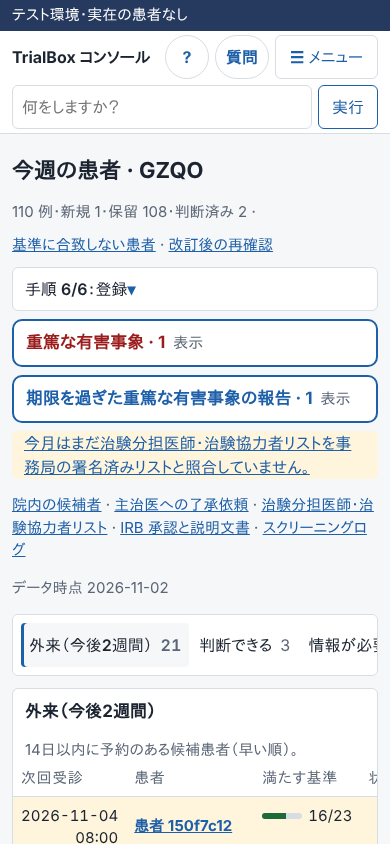
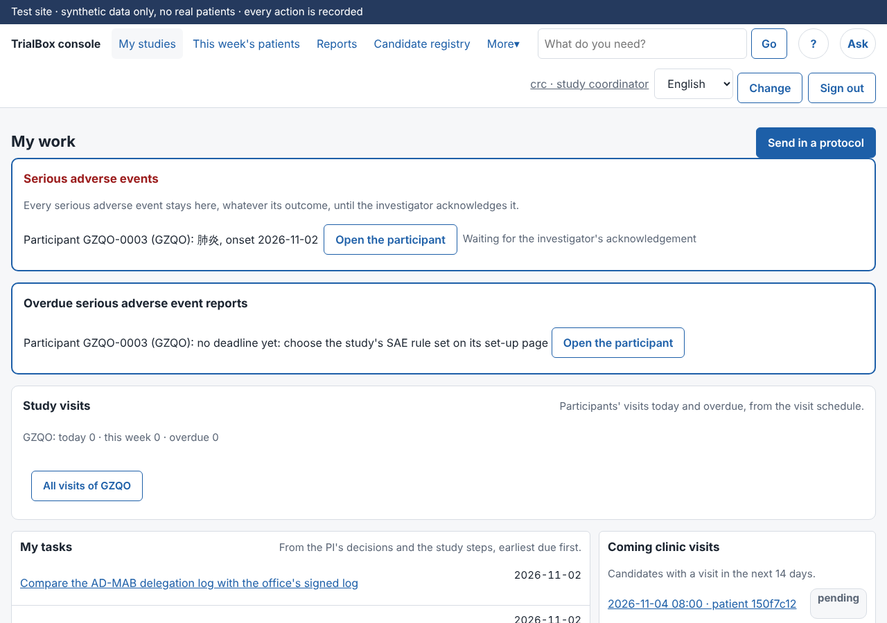
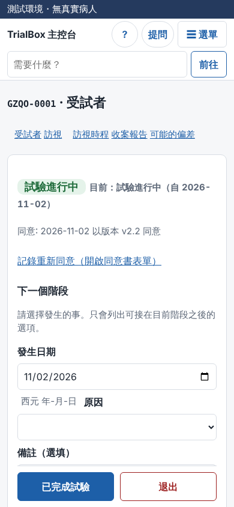
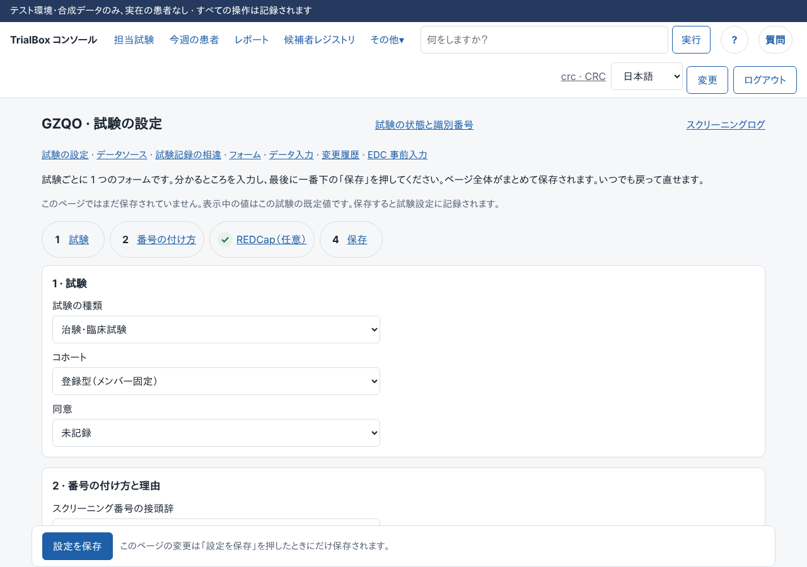
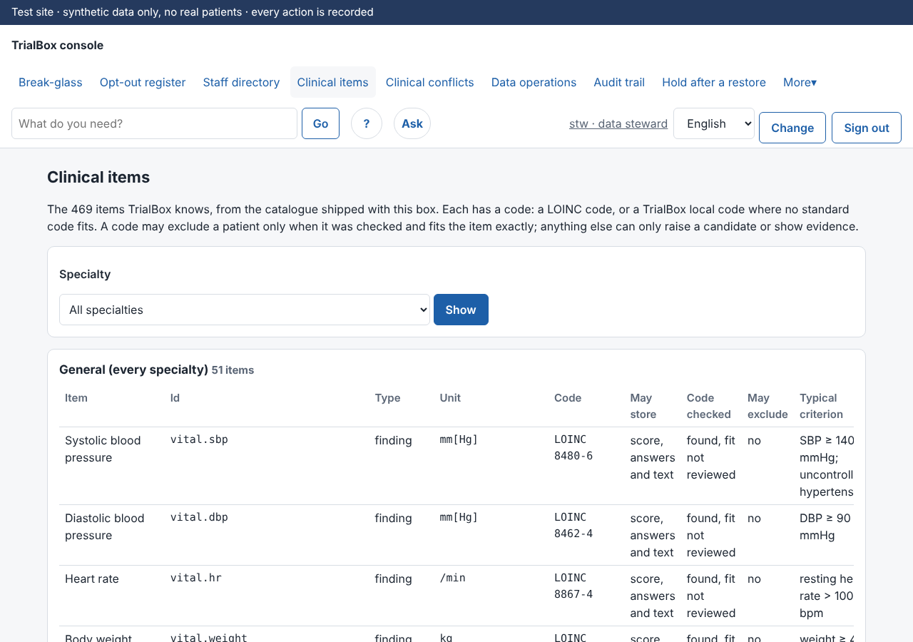
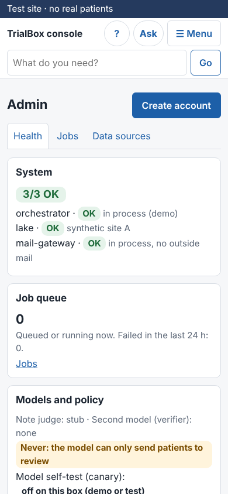

# The interface and the experience: the system of the console (lane J, root review 09, 2026-11-17)

**Reader:** the owner first (the summary). Then the builders: 1 the interface measured as a system, 2 ten journeys,
3 the design system, 4 what open work teaches, 5 the build path, 6 the owner's decisions.

**What was analysed:** master `8778394f0` (train 79): `services/console/static/console.css` (565 lines),
`static/console.js` (60 lines), the 134 templates and the 3,099 text keys per language. The branches
`origin/agent/J3-phone-first` and `origin/agent/J2-one-status` were read with `git diff`, not merged. Seen: the
journey review's screenshots (`docs/reviews/img/`), lane J's screenshots under `/var/tmp/trialbox-0/*/shots/` and one
synthetic box started for this page (the demo seed, port 8171, stopped and deleted after). Public sources were opened
on 2026-11-17. No product code was changed. Synthetic and public data only.

**What this page does not repeat.** The journey review (`docs/reviews/2026-11-17-journey-and-simplicity.md`, cited
as **R** with its ids), review 02 (`02-journeys.md`, cited as **02** with its A11Y-1 to A11Y-7 and 02/J-n cards),
the life-cycle walk (**F-01 to F-21**), plan 9 (`docs/plan/45-plan-9-2026-11-17.md`). Lane J's cards J-1 to J-12 are
"in hand": this page gives them the design depth they lack and says which design piece belongs to which card.

**Marks.** **[R]** read (file and line follow); **[Seen]** seen in a screenshot (path follows) or on the synthetic box;
**[S]** source (a public link, opened for this page on 2026-11-17); **[M n]** measured (row n of the measurement log,
section 7, with its command); **[O]** opinion, to be argued with; **not verified** could not be checked (section 8).

---

## Summary (one page, plain words)

**What is good enough today.** Text contrast passes WCAG 2.2 AA in light and dark mode (4.6:1 to 15.7:1)
except the dark amber row (02's A11Y-2); field borders fail non-text contrast (A11Y-1) [M 3]. Every button, field and menu item
is at least 44 px high since D-133 [R `console.css:349-361`]. The PI's patient sheet on a phone is the best page in
the product: one patient, why he fits, the open questions, and four large buttons fixed at the bottom of the screen
[Seen `/var/tmp/trialbox-0/phone-walk/phone-evidence-en.png`]. The texts are short (median four words) and the three
languages have the same 3,099 keys [M 6]. No framework, one stylesheet, one tiny script: that is an asset for an
offline box, not a weakness [O].

**What is not good enough.** The console has no design system; it has a stylesheet that grew by decision number.
Measured from the one stylesheet: 26 different spacing values, 13 border radii, 8 font sizes, 32 rule blocks that
style buttons, 60 state classes in 11 families that paint with 4 colours, and a second layer (D-133) that overrides
the first [M 1]. The same state can be amber on one page and green on the next ("contacted":
`console.css:108` against `:174`) [R]. Pages have no common skeleton: 65 of 106 pages use a header row, 4 a row of
actions [M 2]. On the pages each role meets first, 30 of 59 have no primary button and 13 have two to five; the
coordinator's home has 67 actions and five filled buttons, the first of which starts a new study; the steward's
"Clinical items" is one page of 16,460 words [M 4]. The words drift: the person
after consent is "participant" or "subject" in English, 被験者 or 参加者 in Japanese; the coordinator is 研究護理師 —
a research *nurse* — in Traditional Chinese [M 5]. Only 1 of 83 form pages warns before a typed form is lost [M 7].

**The five changes that matter most** [O]:

1. **Tokens first (09/DS-1, S):** one block of named colour, type, spacing and radius values at the top of the
   stylesheet, with a control border at 3.7:1, and the rest of the file rewritten to use only them. It fixes A11Y-1 and
   A11Y-2 on the way and is the ground every other card stands on.
2. **One page header with one primary action (DS-5, M):** title, study, the one thing to do next, in the same place on
   every page; on a phone that action moves to a bar at the bottom, as on the patient sheet. It is the visible half of
   J-7 (opening page) and J-8 (one name per page).
3. **One state pill fed by J-2's one status (DS-4, M):** five tones (ok, warn, bad, info, neutral) chosen in one
   Python table; 60 state classes deleted.
4. **One form field and one error pattern (DS-6, M):** label, hint, error tied to the field, an error summary at the
   top, and the "leave without saving?" guard on every form that takes typed text. Fixes A11Y-4.
5. **A term list enforced by a test, then read by clinicians (DS-16, S, and decision 2):** twenty core words fixed in
   en, zh-TW and ja; a catalogue check refuses the other spellings; two native clinicians per language read the result.

**What it costs.** 20 cards: 10 small, 8 medium, 2 large (section 5), about five to six weeks of one builder in
lane J, most of it alongside J-5 to J-12 rather than after them. No new dependency is needed; adding one (htmx) is
put to the owner as a question, with the recommendation to stay script-free [O].

---

## 1. The interface as a system, measured

### 1.1 Visual tokens: what the one stylesheet holds

| Measure | Today | Comment | Mark |
| --- | --- | --- | --- |
| Rule blocks | 466 | after comments removed; 226 distinct class names | [M 1] |
| Named colour tokens | 14 (light and dark) | `--bg` to `--banner`, `console.css:3-11` | [M 1], [R] |
| Colour literals outside the tokens | 8 (`#fff`, `#3d3d3d`, `#000`, `#bbb`, `#ddd` ×2, `#fff6db`, `#555`, `#f5c542`) and 2 `rgba` shadows | the amber row (`:319`) mixes a literal into the background: the cause of A11Y-2 | [M 1] |
| Font sizes (weights) | 8: 11, 15 (32 uses), 16, 17, 18, 22, 26 px and 1.5em (4 weights) | 15 px in the base layer, then `body { font-size: 16px }` in the D-133 layer (`:349`): two bases | [M 1], [R] |
| Line height | one global 1.5 (`:14`); no rule for Chinese or Japanese | DADS asks 1.7 for 16–17 px Japanese text (section 4) | [R], [S] |
| Spacing values | 26 distinct lengths (8 px ×71, 12 ×55, 6 ×45, 10 ×44, 4 ×26, 16 ×19, then 2, 14, 1, 7, 9, 3, 18, 20, 22, 24, 40 px and seven `rem` values) | a 4-step scale would carry them all | [M 1] |
| Border radii (shadows) | 13 (6 px ×17, 10, 4, 8, 3, 5, 22, 999 px, 50 %, four partial corners); 4 shadows | | [M 1] |
| Control heights | 28, 30, 32, 36 px in the base layer, then 44 px for all in the D-133 layer | the second layer overrides the first instead of replacing it | [M 1], [R `:52-56`, `:350-355`] |
| Breakpoints | 640 px (5 blocks), 760 px (10), 1150 px (1), print, dark | two phone breakpoints for one phone | [M 1] |
| Decision ids in comments | 24 distinct D-/T- ids | the file is organised by history, not by component | [M 1] |

### 1.2 Components: how many ways the same thing is drawn

| Component | Variants found | Mark |
| --- | --- | --- |
| Button | 32 rule blocks touch buttons; in templates: 97 `<button>` with no class (primary), 55 `secondary`, 18 `small secondary`, 9 `small`, 4 `secondary danger`, 3 computed; 83 links styled as buttons | [M 1], [M 2] |
| Table | 98 tables; classes: `candidates` 44, none 38, `compact` 12, `worklist` 2, `stack`, `approval`, `funnel`, `sched`, `copyassist`; three different ways to turn a table into cards on a phone (`table.stack`, J-3's `worklist` cards, J-3's `pf-cards`) | [M 2], [R J-3 diff] |
| State badge | `.pill` and `.state`; 60 state classes in 11 families (`st-`, `stt-`, `mk-`, `ref-`, `tier-`, `rd-`, `vd-`, `v-`, `pc-`, `life-`, `s-`) painting with 4 colours; "contacted" is amber as `st-contacted` and green as `stt-contacted` | [M 1], [R `console.css:108`, `:174`] |
| Message box | `.error`, `.warn`, `.ok` (each a coloured box), `.card.attention` (blue border), `.banner` (dark bar), `.toastp`, `tr.amber`; no "info" level; an alert is `role="alert"` in some, nothing in others | [R `console.css:64-66`, `:31-33`] |
| Page layout | 11 signatures: 77 pages only stacked cards, 10 `card narrow`, 6 `formstack`, 4 `grid`, 2 `tiles+tabs`, and one each of `bench`, `crcgrid`, `steps`; three page widths (1180, 1480 px, 440 px narrow) | [M 2] |
| Page heading | 105 of 106 pages have one `<h1>` (`oidc_done.html` has none, `audit_patient.html` two); 49 headings read "X · study", 54 another form | [M 2] |
| Header row (title + action) | 65 of 106 pages use `.headrow`; 4 use `.actions`; 1 uses `.next` | [M 2] |

### 1.3 Contrast against WCAG 2.2 AA, every text and background pair

25 pairs per mode, WCAG formula, from the tokens [M 3]. All text pairs pass in light mode (lowest 4.58:1, muted
text on the amber row); in dark mode the amber row fails (2.95 and 2.64:1, A11Y-2); the border `--line` is 1.27 to
1.53:1 (A11Y-1). **New here:** the focus ring holds on every surface, including the dark selected row (5.4:1) [M 3];
every pill carries its word, so 1.4.1 passes, but the colour means nothing reliable since one word changes colour
by page [R, O].

### 1.4 Focus, targets and the weight of each page

Measured on the synthetic box with a browser, signed in as each role, on the first ten pages the role's menu offers
(fewer for the CRO monitor and the viewer, whose menus are shorter), at 1280 and 390 px, in English [M 4]. "Actions"
are visible links, buttons, fields and summaries inside `main`; "stops before" are visible focusable controls before
`main` in the order of the page.

| Role | Page (first ten of the menu) | Actions (1280) | Stops before content (1280 / 390) | Primary buttons | Height on a phone |
| --- | --- | --- | --- | --- | --- |
| PI | week (the landing page) | 53, 42 of them links | 37 / 8 | 2 ("Acknowledge" first, 305 px under the title) | 3,439 px |
| PI | study set-up | 42 | 36 / 7 | 0 (save in a sticky bar) | 4,857 px |
| PI | registry, reports, account, help, site, notices, SAE register | 1 to 16 | 27 / 7 | 0 or 1 | 976 to 3,394 px |
| Coordinator | home ("My work") | **67** | 31 / 7 | **5** ("Send in a protocol" first, in the header row) | **6,791 px** |
| Coordinator | week, reports, registry, account, help, site, notices, SAE, staff | 1 to 45 | 31–41 / 7–8 | 0 to 2 | 900 to 3,439 px |
| Steward | break-glass (first menu item) | 0 | 30 / 7 | 0 | 1,061 px |
| Steward | clinical items | 2 | 30 / 7 | 1 ("Show") | **77,458 px; 16,460 words; the whole catalogue in one page** |
| Steward | audit trail | 59 | 30 / 7 | 4 | 5,663 px; **scrolls sideways at 1280 px** |
| Administrator | home ("Admin", health tab) | 15 | 34 / 7 | 1 ("Create account") | 4,156 px |
| Administrator | users | 70 | 34 / 7 | 1 | 6,920 px |
| CRO monitor, viewer | their whole menus (3 and 6 pages) | 1 to 7 | 15–18 / 7 | 0 to 2 | 976 to 2,122 px |

The sub-investigator's ten pages match the PI's within one action. Over the 59 page views at 1280 px: median 7 actions per page, maximum 70; median 30 focus stops before the content on
a desktop (02 counted eleven controls in the header; the menu's own links add the rest) and 7 on a phone, where the
menu is folded; 30 pages with no primary button, 16 with one, 13 with two or more; where there is one, it is in the
left half in 23 pages and the right half in 6, and within 80 px of the title in only 5 [M 4]. On a phone 19 of 59
pages are taller than three screens; no page scrolls sideways on a phone [M 4]. Targets: the only controls under
24 px are 22 px checkboxes inside 44 px labels (the label is the target) and links inside sentences (the standard's
exception), so 2.5.8 holds; the skip link exists, so 2.4.1 holds despite the 30 stops [M 4, R `base.html:13`].
Focus is visible everywhere (3 px ring, `console.css:58-59`) [R].

### 1.5 Text: length, reading level, system words

| Measure | en | zh-TW | ja | Mark |
| --- | --- | --- | --- | --- |
| Keys | 3,099 | 3,099 | 3,099 | [M 6] |
| Median length | 4 words | 8 characters | 11 characters | [M 6] |
| Long texts | 39 values ≥ 40 words; longest 133 words | 51 values ≥ 80 characters; longest 249 | 125 values ≥ 80 characters; longest 337 | [M 6] |
| Sentences over 25 words | 38 of 3,638 | – | – | [M 6] |
| Reading grade of the 622 texts of ≥ 12 words | Flesch–Kincaid ≈ 6.6 (12.4 words per sentence; syllables estimated) | not measured (no comparable formula used) | not measured | [M 6] |
| Values with system words (MICROBATCH, SCREEN, ruleset, `TB_…`, version numbers) | 49 | – | – | [M 6] |

The English is plain; Japanese is the longest (median 11 characters against 8 in zh-TW) [M 6]. The intended-use
statement (about 110 words) closes every page [Seen `after2-admin-health-en-390.png`]: right to show, wrong on every
page of a phone [O].

### 1.6 The twenty core words in three languages

Counted as the number of text values that use each rendering [M 5]; more than one rendering means drift.

| Concept | en (values) | zh-TW (values) | ja (values) | Proposed one word (en / zh-TW / ja) |
| --- | --- | --- | --- | --- |
| Opening page | Home 1, My studies 2, My work 1, Overview 2 | 首頁 3, 我的試驗 2, 總覽 2 | ホーム 3, 担当試験 10, 概要 2 | Home / 首頁 / ホーム |
| Person before consent | candidate 56, patient 237 | 候選者 27, 候選病人 7, 病人 246, 個案 2 | 候補者 34, 候補患者 5, 患者 229 | Candidate / 候選者 / 候補者 |
| Person after consent | participant 38, subject 22 | 受試者 62 | 被験者 34, 参加者 14 | Participant / 受試者 / 被験者 (治験); 研究対象者 for non-治験 (02/J-7) |
| The pseudonym shown | patient code 5, pseudonym 23 | 病人代碼 5, 代號 10, 化名 15 | 仮名 23 | Patient code / 病人代碼 / 患者コード |
| SAE | SAE 3, serious adverse event 11 | SAE 3, 嚴重不良事件 12 | SAE 3, 重篤な有害事象 12 | full words in headings, "SAE" in tight cells |
| Acknowledge (PI) | acknowledge 12, confirm 57 | 確認 163 | 確認 235, 承認 113, 了承 32 | Acknowledge / 確認知悉 / 確認 — keep 承認 for approvals only |
| PI | PI 39, principal investigator 4, investigator 54 | 試驗主持人 32, other 主持人 47 | 治験責任医師 12, 責任医師 45, 研究責任者 5 | PI / 試驗主持人 / 治験責任医師 (研究責任者 by study type) |
| Sub-investigator | sub-investigator 4, sub-I 1 | 協同主持人 5 | 治験分担医師 9, 分担医師 5 | Sub-investigator / 協同主持人 / 治験分担医師 |
| Coordinator | coordinator 54, CRC 2 | **研究護理師 57**, CRC 2 | CRC 57 | Coordinator / **decision 4** / CRC（治験コーディネーター） |
| Study | study 227, trial 29, protocol 44 | 試驗 256, 研究 127, 計畫書 42 | 試験 194, 治験 71, 研究 45, プロトコル 25 | Study; "protocol" only for the document |
| Consent | consent 93 | 同意 124 | 同意 88 | one word already |
| Enrol | enrol 18, enroll 18, register 37 | 收案 44, 納入 32, 登錄 33 | 登録 76 | Enrol (British, as the rest) / 收案 / 登録 |
| Visit | visit 95, appointment 8, clinic 11 | 訪視 70, 門診 25, 就診 11, 回診 7 | 来院 68, 受診 24, 外来 12 | Study visit 訪視 来院; Clinic visit 門診 外来 (two concepts, kept apart) |
| Screening | screening 151 | 篩選 153, 篩檢 1 | スクリーニング 132, 選定 2 | one word |
| Criteria | criteria 129, ruleset 14 | 條件 159, 標準 15 | 基準 151, 条件 9 | Study criteria / 納入排除條件 / 選択・除外基準; "ruleset" off clinical pages |
| Delegation log | delegation log 13 | 授權紀錄表 11, 授權表 6, 授權紀錄 2 | 治験分担医師・治験協力者リスト 9, 委任 9, 分担表 2 | Delegation log / 授權紀錄表 / 治験分担医師・治験協力者リスト (the J-GCP list's own name; decision 2) |
| Feasibility | feasibility 28 | 可行性 28 | 実施可能性 28 | one word already |
| Withdraw | withdraw 15 | 退出 18, 撤回 16 | 中止 16, 脱落 7, 撤回 2 | Withdraw / 退出 (同意撤回 for consent) / 中止 (同意撤回 for consent) |
| Sponsor | sponsor 28 | 試驗委託者 26, 委託者 1 | 治験依頼者 21, 依頼者 6, スポンサー 2 | Sponsor / 試驗委託者 / 治験依頼者 |
| Steward | steward 9 | 資料管理 11 | データ管理 6, データスチュワード 3 | Data steward / 資料管理人 / データ管理責任者 (decision 2) |

The last column is a proposal [O] for the native reviewers of decision 2, not a ruling. Some counts are inflated by compounds (病人 inside 候選病人; 確認 is also "check") [M 5]; the table shows where drift
exists, not its exact size. The coordinator in zh-TW is a finding: 02 lists the research nurse as a role the product
does not yet know, while the zh-TW interface already calls the coordinator a research nurse [R `02-journeys.md:126`,
M 5].

### 1.7 Primary action, states and forms

| Question | Today | Mark |
| --- | --- | --- |
| How many pages have a primary (filled) action? | of 59 page views: 30 none, 16 one, 13 two to five | [M 4] |
| Is it in the same place? | No. The coordinator's home puts "Send in a protocol" top right [Seen `img/09-01-crc-home-en-1280.png`]; the PI sheet puts four at the bottom [Seen `phone-evidence-en.png`]; the participant page puts "Study completed" beside "Withdraw" in mid-page [Seen `j4/shots/after2-participant-en-390.png`] | [Seen] |
| Empty states | 71 `empty` uses in 48 templates; wording is a sentence ("No deviation recorded.") with an action below on 2 pages seen; none says why it is empty or who fills it | [M 2], [Seen] |
| Error | page-level `.error` box, not tied to the field, except the entry form (`form.entry .q.bad`, `console.css:340`); `aria-invalid` in 2 templates | [R], [M 2] |
| Loading, success | loading: none (server-rendered), a running job reloads every 5 s (A11Y-7, `base.html:7`); success: a green `toastp` with Undo on the patient sheet and participant page; elsewhere a redirect with no message | [Seen], [R `console.css:245`] |
| Labels | 361 fields, 333 `<label>`, 289 with `for=` | [M 2] |
| Required marks | `required` attribute 91 times; a visible mark (`.req`, red asterisk) in 2 templates only | [M 2], [R `console.css:342`] |
| Date fields | 32 native date inputs: the browser shows its own order (11/02/2026 in an en-US browser) while the hint says YYYY-MM-DD | [M 2], [Seen `after2-participant-en-390.png`] |
| Guard against loss | `data-guard` on 1 form (`setup.html`) of 83 form pages; 11 templates take free text; the mark note alone is kept in session storage | [M 7], [R `console.js:21-31`, `:44-57`] |
| Confirm before harm | typed confirmation on 3 templates (admin, accounts); Undo on 6; Withdraw on the participant page has neither a preview nor an Undo-free path | [M 7], [Seen] |

---

## 2. The ten journeys that matter

Each: the steps today, where a first-time user stalls, and the redesign in words and two text wireframes (390 px
phone, 1280 px desktop). Wireframes use the components of section 3: **PH** page header, **TL** task line, **PC**
person card, **SP** state pill, **EB** evidence block, **BB** bottom action bar, **PS** phase strip, **SW** study
switcher, **BN** banner, **CC** confirm with consequence. In each wireframe the left box is 390 px, the right 1280 px.

### J1. The PI's morning list, on a phone

**Today:** sign in → the week page of the last study [Seen `docs/reviews/img/r-09-pi-week-en-phone.png`]: title,
counts line, two links, a step fold, two SAE boxes, a delegation warning, five links, "data as of", two tabs, then
the table. The first patient appears at the very bottom edge of the first screen, after about fifteen other things;
the table's fourth column is cut off in ja and zh-TW [Seen `img/09-02-pi-week-ja-390.png`,
`docs/reviews/img/r-11-pi-week-zh-TW-phone.png`]. The page holds 42 actions on a phone [M 4]. J-3 moves the list up
behind its flag [R J-3 diff].



**Stall:** a PI who has never seen it reads "Step 6 of 6: Enrolled" and "Overdue serious adverse event reports · 1"
before any patient, and does not know which of the 110 he is meant to look at [O].
**Redesign:** "Needs you today" first (SAE to acknowledge, then "3 ready to decide"); the list below as person
cards with one line of why; the study's chores in one fold at the end (J-3 does this); one primary action per card
("Decide").

```
┌──────────────────────────────┐         ┌────────────────────────────────────────────────────────────────┐
│ TrialBox  [GZQO ▾]       ☰   │  SW     │ TrialBox  [Study GZQO ▾]  Home Candidates Participants Safety   │
│ BN! 1 SAE to acknowledge  ›  │         │ PH  Ready to decide · GZQO                       [Decide next ›]│
│ PH Ready to decide (3)       │         │ BN! 1 SAE to acknowledge: GZQO-0003, onset 2 Nov          [Open]│
│ PC patient 51a5db6a   SP new │         │ ┌─ filter: Ready 3 | Clinic 14 days 21 | Need info 10 ─┐        │
│    8/9 inclusion · visit 4 Nov│        │ │ PC 51a5db6a  new  8/9 · visit 4 Nov 08:00  [Decide] │        │
│    [Decide ›]                │         │ │ PC 150f7c12  new  7/9 · visit 6 Nov 10:30  [Decide] │        │
│ PC patient 150f7c12 …        │         │ └─────────────────────────────────────────────────────┘        │
│ ▸ Study GZQO (2 need you)    │  fold   │ Study GZQO: phase strip PS ……… Enrolment ■ ………                  │
└──────────────────────────────┘         └────────────────────────────────────────────────────────────────┘
```

### J2. The PI's evidence and mark

**Today:** the patient sheet: identity, "why this patient fits", what is still needed, the criteria with quotes, and
a sticky bar of four buttons [Seen `phone-walk/phone-evidence-en.png`]. A mark gives a green toast with Undo
[Seen `phone-walk/phone-outcome-en.png`]. This is the pattern to copy elsewhere [O].
**Stall:** "Next patient" is twice on the screen (top and bar); "Not suitable now" sits under "Approach" with the
same size, one slip apart; the criteria list is long before the source quotes [Seen].
**Redesign:** keep it; make the bar the **BB** component; put "Next patient" only in the bar after a mark; give
"Not suitable" a reason picker in the bar's second step, not a second big red button; each criterion an **EB**.

```
┌──────────────────────────────┐         ┌──────────────┬───────────────────────────────────────────────┐
│ ‹ List   patient 51a5db6a  › │         │ Ready (3)    │ PH patient 51a5db6a · SP new · visit 4 Nov    │
│ Why: 8/9 inclusion met …     │         │ ▸ 51a5db6a   │ Why: 8/9 inclusion, 12/14 exclusions clear    │
│ Needs you: self-inject?      │         │   150f7c12   │ Needs you: willing to self-inject?            │
│ EB ✓ Age ≥18  "born 1961" src│         │   …          │ EB ✓ sUA ≥6.8 "7.4 mg/dL on 2026-06-30" note  │
│ EB ? Planned surgery  src    │         │              │ EB ? Planned surgery — not in the records     │
│ BB [Approach] [Need info] [⋯]│         │              │ BB [Approach] [Need info] [Not suitable ▾]    │
└──────────────────────────────┘         └──────────────┴───────────────────────────────────────────────┘
```

### J3. The coordinator's day

**Today:** "My work": a primary button "Send in a protocol", then two SAE cards for the *same* event, study visits,
tasks, coming clinic visits, then a card per study [Seen `img/09-01-crc-home-en-1280.png`]: 67 actions, five primary
buttons, 6,791 px on a phone [M 4]. The menu holds 25 links under "More" on a study page (R, D).



**Stall:** the only filled button on the home page starts a new study, the least frequent task of a coordinator's
week [O]; the same SAE appears twice with different words ("Serious adverse events", "Overdue … reports") [Seen].
**Redesign:** J-6's "Needs you today" as at most five **TL** task lines, sorted by deadline, each with its one
action; one SAE line per event; studies below as rows with the **PS** phase strip and "Next"; "Send in a protocol" moves
to the study switcher's "New study".

```
┌──────────────────────────────┐         ┌────────────────────────────────────────────────────────────────┐
│ PH Today · crc               │         │ PH Today          NEEDS YOU TODAY (5 of 14)   [Study ▾] [New] │
│ TL! SAE GZQO-0003 [Remind PI]│         │ TL! SAE GZQO-0003 · PI has not acknowledged · 2 d  [Remind PI] │
│ TL  Call 51a5db6a  [Record]  │         │ TL  Call patient 51a5db6a · attempt 2 of 3 · from 3 Nov [Call] │
│ TL  3 visits tomorrow   [›]  │         │ TL  3 study visits tomorrow                     [Open visits]  │
│ MY STUDIES                   │         │ MY STUDIES  GZQO  PS Feas›Start›Screen›[ENROL]›…›Close         │
│ GZQO PS ■■■■□□□□ Enrolment  │         │   110 candidates · 2 consented · 1 enrolled [Consent GZQO-0004]│
│   Next: [Consent GZQO-0004]  │         │ SITE5B PS [START-UP 4 of 7]            Next: [Choose SAE rules]│
└──────────────────────────────┘         └────────────────────────────────────────────────────────────────┘
```

### J4. A contact outcome

**Today:** after the PI's "Approach", the coordinator opens the same sheet; under the toast is "Contact outcome",
screening number, attempts "1 of 3", a warning "the next attempt can be recorded from 2026-11-03", then outcome buttons
below the fold [Seen `phone-walk/phone-outcome-en.png`].
**Stall:** the outcome buttons are below the first screen; the amber box reads as a problem, not a rule [Seen, O].
**Redesign:** the outcome is the bar's job on this page for this role: **BB** with "Reached" / "Not reached" /
"Declined"; a choice opens one short form (date, channel, note) with Undo after; the attempt rule as plain hint text.

```
┌──────────────────────────────┐         ┌────────────────────────────────────────────────────────────────┐
│ PH Call patient 51a5db6a     │         │ PH Contact patient 51a5db6a · attempt 2 of 3     SP to contact │
│ PI: Approach, 2 Nov (pi)     │         │ PI decided Approach on 2 Nov · phone on the referral sheet     │
│ Attempt 2 of 3 · from 3 Nov  │         │ Attempts: 1 Nov not reached (crc)                              │
│ BB [Reached] [Not reached]   │         │ [Reached] [Not reached] [Declined]   ← in the header row       │
│    [Declined]                │         │                                                                │
└──────────────────────────────┘         └────────────────────────────────────────────────────────────────┘
```

### J5. Consent and enrolment

**Today:** a candidate is consented on the consent page; the participant then exists on "Participants" with its own
id; D-1224 linked the two; the participant page shows state, "Next step" with a date, then two buttons side by side,
"Study completed" (primary) and "Withdraw" (danger), then "Reason for the undo" and "Undo the last step"
[Seen `j4/shots/after2-participant-en-390.png`, `img/09-03-participant-zh-TW-390.png`].
**Stall:** the next step offered is "Study completed" on the day of enrolment; Withdraw is one tap from it; the date
field shows the browser's order (11/02/2026) beside a hint "YYYY-MM-DD" (西元 年-月-日 in zh-TW) [Seen].



**Redesign:** a **review-and-sign** page per step (section 3.3): what will be recorded (who, what, version of the
consent form, date), the consequence ("the participant moves to On study; visit 1 is scheduled for 7–11 Nov"),
one button named for the act ("Record consent"); Undo for a day; Withdraw lives under "More actions" with **CC**.

```
┌──────────────────────────────┐         ┌────────────────────────────────────────────────────────────────┐
│ PH Record consent · GZQO-0004│         │ PH Record consent · candidate 51a5db6a → GZQO-0004            │
│ Form: ICF v2.2 (IRB 1 Oct)   │         │ Check before you record             | What happens next        │
│ Signed on [2026-11-02]       │         │ Consent form  ICF v2.2   [Change]   | ■ Consented              │
│ Taken by  crc     [Change]   │         │ Signed on     2 Nov 2026 [Change]   | □ Eligibility check      │
│ Then: eligibility check      │         │ Taken by      crc        [Change]   | □ Enrol, visit 1 7–11 Nov│
│ BB [Record consent]          │         │ [Record consent]   You can undo this until 3 Nov 23:59.        │
└──────────────────────────────┘         └────────────────────────────────────────────────────────────────┘
```

### J6. A study visit

**Today:** the participant page lists visits in a table (v1 Done "outside the window", v2 and v3 Coming); on a phone
the window column is cut [Seen `after2-participant-en-390.png`]; J-3 turns it into cards behind its flag [R J-3 diff].
**Stall:** nothing on the visit row says what to do; recording a visit is under "Visits" in another page [Seen, R].
**Redesign:** each visit a row with **SP** (Due, Done, Late, Missed) and one action ("Record visit" on the due one);
the visit form follows the form template with its own data-entry and the EDC hand-off line (EDC A-cards).

```
┌──────────────────────────────┐         ┌────────────────────────────────────────────────────────────────┐
│ PH GZQO-0001 · On study      │         │ PH Participant GZQO-0001 · On study since 2 Nov   [Record v2]  │
│ v1 SP done 2 Nov (late 5 d)  │         │ Visit  Window          State        Action                     │
│ v2 SP due 27 Nov–1 Dec       │         │ v1     7–11 Nov        done 2 Nov   –                          │
│    [Record visit]            │         │ v2     27 Nov–1 Dec    due          [Record visit]             │
│ v3 18 Jan–1 Feb   coming     │         │ v3     18 Jan–1 Feb    coming       –                          │
└──────────────────────────────┘         └────────────────────────────────────────────────────────────────┘
```

### J7. An SAE reported and acknowledged

**Today:** the coordinator adds an adverse event from the participant page; the form is long: in Japanese each
radio choice is a 44 px row, so "seriousness, severity, outcome, relatedness" fill four screens
[Seen `j3/shots/ae-form-crc-after-on-ja-390.png`]. The PI acknowledges from the SAE box on the week page
("Mark as acknowledged") [Seen `r-12-sae-acknowledge-zh-TW-phone.png`]. The home shows the SAE twice (J3).
**Stall:** no summary of what was entered before saving; the deadline is not on the form; the acknowledgement button
does not say what it records (who, when) [Seen, O].
**Redesign:** the form in three short groups (what, how serious, what was done) with a **review-and-sign** step that
shows the reporting clock ("report to the sponsor by 3 Nov 14:00, 24 h") and "Save and tell the PI"; the PI's
acknowledgement is a **review-and-sign** with "Acknowledge as PI (pi, 2 Nov 15:20)".

```
┌──────────────────────────────┐         ┌────────────────────────────────────────────────────────────────┐
│ BN!! SAE · report by 3 Nov   │         │ BN!! Serious adverse event · report to sponsor by 3 Nov 14:00  │
│ PH Acknowledge SAE GZQO-0003 │         │ PH Acknowledge SAE · GZQO-0003                                │
│ Pneumonia, onset 2 Nov       │         │ What        Pneumonia · onset 2 Nov · hospitalised             │
│ Serious: hospitalised        │         │ Relatedness Possibly related (crc)                              │
│ Related: possibly (crc)      │         │ Reported by crc, 2 Nov 14:05                                    │
│ BB [Acknowledge as PI]       │         │ [Acknowledge as PI]  Records: pi, now, this version of the report│
└──────────────────────────────┘         └────────────────────────────────────────────────────────────────┘
```

### J8. Study start-up

**Today:** the site wizard and the study set-up page: 13 links styled as buttons on the wizard
[M 2: `site_wizard.html` 13 `a.button`]; the study set-up page: a row of eight links, a paragraph, four step chips
(1 試験, 2 番号の付け方, ✓ REDCap, 4 保存) and a sticky save bar — 42 actions and 4,857 px on a phone [M 4, Seen
`img/09-06-study-setup-ja-1280.png`]; the home's step guide stopped at "6 · Enrolled" (R, A).
**Stall:** thirteen equal buttons give no order; the step chips are a fourth step-like pattern (beside `.steps`,
the week page's "Step 6 of 6" fold and the J-3 fold) and do not say which steps are done beyond one tick [M 2, Seen, O].



**Redesign:** the GOV.UK task list pattern (section 4): steps grouped (Documents, Team, Ethics, Data, Safety rules),
each a row with a status word (Done, To do, Cannot start yet), the next one carrying the only primary button.

```
┌──────────────────────────────┐         ┌────────────────────────────────────────────────────────────────┐
│ PH Start-up · SITE5B  4 of 7 │         │ PH Start-up · SITE5B                       4 of 7 done         │
│ Documents, Team      Done    │         │ 1–2 Documents, Team  Protocol v1.1, 5 people   Done            │
│ Ethics, Criteria     Done    │         │ 3–4 Ethics, Criteria IRB 1 Oct, criteria approved   Done       │
│ SAE rules      To do         │         │ 5 SAE rules   choose the rule set            [Choose SAE rules]│
│   [Choose SAE rules]         │         │ 6 EDC link    after SAE rules                Cannot start yet  │
│ EDC link   Cannot start yet  │         │ 7 Open        after all above                Cannot start yet  │
└──────────────────────────────┘         └────────────────────────────────────────────────────────────────┘
```

### J9. The steward's reviews

**Today:** the steward has 8 top items and 11 under "More" (R, D); opt-outs, break-glass, account requests and
values to check are separate pages with separate tables [Seen `j4/shots/after-optouts-en-390.png`]. The steward's
first menu item, break-glass, has no action when nothing is open; "Clinical items" prints the whole catalogue of 469
items in one page: 16,460 words, 77,458 px on a phone; "Audit trail" scrolls sideways at 1280 px [M 4, Seen
`img/09-05-steward-items-en-1280.png`].
**Stall:** no single "to review" list; each page has a different table and a different button word [Seen, O].



**Redesign:** one review queue (list template) with a filter by kind; each item a **review-and-sign** page with
"Approve" / "Refuse with reason"; two-person items show who did the first half.

```
┌──────────────────────────────┐         ┌────────────────────────────────────────────────────────────────┐
│ PH To review (4)             │         │ PH To review                           Kind: [All ▾]  4 open   │
│ TL Break-glass · admin · 1 h │         │ Kind          Who      Since   Waits for       Action           │
│    [Review]                  │         │ Break-glass   admin    1 h     you (2nd person) [Review]        │
│ TL Opt-out · 2 records [›]   │         │ Opt-out       crc      1 d     you              [Review]        │
│ TL Account request · cra [›] │         │ Account req.  cra      2 d     you              [Review]        │
└──────────────────────────────┘         └────────────────────────────────────────────────────────────────┘
```

### J10. The administrator's health

**Today:** "Admin" with tabs, "System 3/4 OK", job queue, models, a 30-line reference-data list, operations,
backups "no backup yet", update, accounts, approvals, audit — 4,275 px on a phone in lane J's shot, 4,156 px on the
box seeded for this page [Seen `j4/shots/after2-admin-health-en-390.png`, `img/09-04-admin-health-en-390.png`, M 4].
The primary button is "Create account"; the first screen shows "3/3 OK" and the model policy, not the backup.



**Stall:** the two red facts ("an opt-out does not reach the stores", "no backup yet") are in the middle of the page
in the same size as the reference-data list [Seen].
**Redesign:** a dashboard template: a row of at most six status tiles (Services, Backups, Certificates, Disk, Jobs,
Opt-out worker), red first; each tile opens its page; the reference data moves to its own page.

```
┌──────────────────────────────┐         ┌────────────────────────────────────────────────────────────────┐
│ PH Health                    │         │ PH Health                                    [Create account]  │
│ BN!! No backup yet  [Back up]│         │ BN!! No backup yet · BN!! Opt-out worker stopped               │
│ BN!! Opt-out worker stopped ›│         │ [Services 3/4] [Backups ✗] [Certs 41 d] [Disk 62%] [Jobs 0] [Opt-out ✗]│
│ Services 3/4  ›              │         │ Accounts 8 · 0 waiting       Audit: 20 refused sign-ins (24 h) │
│ Certs 41 d · Disk 62 %  ›    │         │                                                                │
└──────────────────────────────┘         └────────────────────────────────────────────────────────────────┘
```

---

## 3. The design system TrialBox should have

For the existing stylesheet, no framework or build: tokens are custom properties on `:root`; each component is a
class with a markup pattern and a Jinja macro in one new file, `templates/_ds.html` [O].

### 3.1 Tokens

**Colour roles** (light / dark; contrast measured [M 3], [M 8]):

| Token | Light | Dark | Use | Replaces |
| --- | --- | --- | --- | --- |
| `--c-page` | #f6f7f9 | #11161d | page background | `--bg` |
| `--c-surface` | #ffffff | #1a212b | cards, fields | `--card`, `#fff` |
| `--c-sunken` | #eef0f3 | #262e3a | sub-areas, neutral pill | `var(--bg)` used as a fill |
| `--c-text` / `--c-text-muted` | #1b2430 / #5b6676 | #e6eaf0 / #a5afbd | text (15.7 and 5.8:1 on surface) | `--ink`, `--muted` |
| `--c-rule` | #d8dde4 | #2e3845 | decorative lines only (table rules) | `--line` |
| `--c-control` | #7b8594 | #7c8797 | field, checkbox and chip borders, 3.7:1 / 4.5:1 | `--line` on controls (A11Y-1) |
| `--c-action` / `--c-on-action` | #1d5fa8 / #fff | #6aa8f0 / #0d1520 | primary button, links, focus | `--accent`, `--accent-ink` |
| `--c-ok`, `--c-warn`, `--c-bad` (+ `-bg`) | as today | as today | state tones | same |
| `--c-info` / `--c-info-bg` | #1d4f86 / #e8f0fa | #a9cdf7 / #172a40 | info tone (7.3 and 8.9:1) | `.card.attention` |
| `--c-neutral` / `--c-neutral-bg` | #5b6676 / #eef0f3 | #c3cad5 / #262e3a | pending, coming, not started | `stt-pending`, `vd-pending_human` |
| `--c-banner-test` / `--c-banner-prod` | #253a5e / #3d3d3d | #2c3f63 / #3d3d3d | environment banner | literal `#3d3d3d` |

Rule: no colour literal outside `:root`; the amber row uses `--c-warn-bg` (A11Y-2). Dark mode keeps following the
system (`prefers-color-scheme`); both schemes pass once DS-1 lands [M 3, M 8].

**Type** (one scale for Latin, Traditional Chinese and Japanese) [S DADS typography, O]:

| Token | Size / line height | Use |
| --- | --- | --- |
| `--t-meta` | 14 px / 1.5 (CJK 1.6) | footers, timestamps only; never below 14 px |
| `--t-body` | 16 px / 1.5 (CJK 1.7) | everything else |
| `--t-lead` | 18 px / 1.5 (CJK 1.6) | h3, the "why" line, a person's name in a card |
| `--t-h2` | 20 px / 1.4 (CJK 1.5) | section headings |
| `--t-h1` | 24 px / 1.3 (CJK 1.5) | the page title |
| `--t-num` | 28 px / 1.2, tabular | counts on tiles |

```css
:root { --font: system-ui, -apple-system, "Segoe UI", Roboto, "Noto Sans", sans-serif; --lh: 1.5; }
:lang(zh-TW) { --font: system-ui, "Microsoft JhengHei UI", "PingFang TC", "Noto Sans TC", sans-serif; --lh: 1.7; }
:lang(ja)    { --font: system-ui, "Yu Gothic UI", "Hiragino Sans", "Noto Sans JP", "Meiryo", sans-serif; --lh: 1.7; }
body { font: var(--t-body)/var(--lh) var(--font); line-break: strict; overflow-wrap: anywhere; }
:lang(zh-TW) em, :lang(ja) em { font-style: normal; font-weight: 700; }   /* CLReq: no italics for Han emphasis */
```

The `lang` attribute is already set per page [R `base.html:2`]; system fonts keep the box offline and the bundle small
(a web font would be a decision: 3). `line-break: strict` applies the kinsoku rules of JLReq and CLReq for closing
punctuation [S JLReq, CLReq]. Numbers, dates and codes keep Latin glyphs (tabular) in all three languages.

**Spacing:** `--s-1` 4, `--s-2` 8, `--s-3` 12, `--s-4` 16, `--s-5` 24, `--s-6` 32, `--s-7` 48 px (7 values for 26).
**Radius:** `--r-1` 4 px (code, small chips), `--r-2` 8 px (controls, cards), `--r-pill` 999 px (3 for 13).
**Elevation:** `--e-0` none; `--e-1` `0 -2px 8px rgb(0 0 0 / .08)` (sticky bars); `--e-2` `0 4px 16px rgb(0 0 0 / .12)`
(pop-overs). **Targets:** `--hit` 44 px for every control; links in running text excepted (2.5.8). **Widths:**
`--w-read` 46rem (forms and reading), `--w-page` 1180 px, `--w-wide` 1480 px (bench).

### 3.2 Components

Each has a class, its states, a Jinja macro, and the role or ARIA it carries.

| # | Component | Markup pattern (classes) | States | A11y | Replaces |
| --- | --- | --- | --- | --- | --- |
| 1 | **Page header** with one primary action | `<header class="ph"><p class="ph-ctx">Study GZQO</p><h1>…</h1><div class="ph-act"><a class="btn">…</a></div></header>` | with / without action; on a phone the action moves into the bottom bar (7) | one `h1`; the title text equals `<title>` | `.headrow`, `.actions`, `.next` |
| 2 | **Button** | `.btn` primary, `.btn.sec`, `.btn.quiet` (text), `.btn.danger`; `.btn.sm` only inside tables | default, hover, focus, disabled (with reason as hint), busy (`aria-busy`, label "Saving…") | `<button>` for acts, `<a>` for going | 32 rule blocks |
| 3 | **Task line** | `<li class="tl tl-bad"><a>What</a><span class="tl-why">who, since</span><span class="tl-due">due</span><a class="btn sm">Act</a></li>` | tones bad/warn/info; overdue; done (struck, with Undo) | list semantics; due as `<time>` | `.tasks li`, SAE boxes, `.rail a` |
| 4 | **Person card** | `<article class="pc"><h3><a>patient 51a5db6a</a></h3>{{ pill }}<p class="pc-why">8/9 inclusion</p><p class="pc-meta">visit 4 Nov</p><a class="btn sm">Decide</a></article>` | candidate / participant; new; selected; muted (set aside) | whole card one link plus one button; `aria-current` for selected | `table.worklist` cards, `pf-cards`, `table.stack` |
| 5 | **State pill** | `<span class="pill" data-tone="ok">On study</span>` | 5 tones: ok, warn, bad, info, neutral | the word is the meaning; colour only repeats it | 60 state classes |
| 6 | **Evidence block** | `<div class="eb" data-verdict="met"><b>sUA ≥ 6.8</b><q>7.4 mg/dL</q><cite>lab, 30 Jun 2026</cite></div>` | met, not met, unknown, needs a person | verdict as hidden text before the label | `.critl li`, `blockquote.quote` |
| 7 | **Bottom action bar** (phone) | `<div class="bb">` sticky bottom, up to 3 buttons, overflow "⋯" as `<details>` | idle, busy, done (toast with Undo in place) | in DOM order after the content; not covering the focused field | `.markbar`, `.savebar` |
| 8 | **Form field with error** | macro `field(name, label, hint, error, required)` → label, hint, input with `aria-describedby`, error `<p id=…-err>` and `aria-invalid` | empty, filled, error, read-only | error summary at the top with links to fields; `Error:` added to `<title>` | `.error` boxes, `.q.bad` |
| 9 | **Confirm with consequence** | a page (not a modal): "What will change", the list of effects, one button named for the act, "Cancel" as a link | normal; two-person (shows the first person and time) | page `h1` names the act | `confirm.html`, `admin_confirm.html` |
| 10 | **Empty state** | `<div class="empty"><p class="empty-what">No deviations recorded</p><p>Deviations appear here when…</p><a class="btn sec">Add a deviation</a></div>` | first use, nothing matches filter, not allowed, failed to load | plain text; no image | 71 ad hoc `empty` |
| 11 | **Banner by severity** | `<div class="bn" data-sev="urgent" role="alert">` | `info`, `warn`, `urgent` (red, `role=alert`, at most one per page), `done` (green, `role=status`) | at most two per page (NHS rule) | `.error`, `.warn`, `.ok`, `.card.attention`, `tr.amber` |
| 12 | **Phase strip** | `<ol class="ps"><li data-state="done">Feasibility</li><li aria-current="step">Enrolment</li>…</ol>` | done, current, to do, off (module off), not carried by TrialBox | hidden "done"/"current" text (USWDS) | `.steps` |
| 13 | **Study switcher** | `<details class="sw"><summary>Study GZQO</summary><ul>…</ul></details>` | one study (plain text), many, none | `details/summary` (APG disclosure) | "GZQO · …" lines under "More" |

The bar (7) and the header (1) are one rule together: **one primary action per page**, top-right in the header on a
desktop, in the bar on a phone [O]. A page with no act (a report) has no primary button.

### 3.3 Page templates

| Template | Skeleton (top to bottom) | Pages it covers (examples) |
| --- | --- | --- |
| **List** | header (title, count, primary "Add" if any) → filter row → person cards or table (cards under 640 px) → pager → empty state | Candidates, Participants, SAE worklist, review queue, accounts |
| **Detail** | header (name, state pill, primary act) → context strip (identity, dates) → sections → history (oldest first, collapsed) → bottom bar on a phone | patient sheet, participant, SAE case, study |
| **Form** | header (the act) → error summary → fields in groups (`fieldset`) of at most seven → one primary button named for the act, Cancel link; guard against loss on | AE form, consent entry, set-up forms |
| **Review and sign** | header ("Check before you …") → summary list with "Change" links → consequence box ("What happens next") → re-authentication if a signature → one button | consent, enrol, withdraw, SAE acknowledge, mark approval, break-glass |
| **Dashboard** | header → urgent banners → at most six tiles → "needs you today" task lines → per-study rows with phase strip | Home per role, Health, research office |

### 3.4 Content rules

1. **One name per page** (J-8): the menu label, the `<title>`, the `h1` and the breadcrumb word are the same string,
   from one text key.
2. **Verbs on buttons**, naming the act and its object: "Record consent", "Acknowledge as PI", "Record visit 2"; never
   "OK", "Submit", "Change", "Go" (today "Change" is the language button and "Go" the search) [R `base.html:47`, `:31`].
3. **Numbers with units and with their base:** "8 of 9 inclusion criteria", "attempt 2 of 3", "7.4 mg/dL".
4. **Dates** shown as "2 Nov 2026" (en), 2026年11月2日 (ja), 2026/11/02 (zh-TW); times with the site's zone once on the
   page ("times in Asia/Taipei"); a date entered with three labelled fields or a native input *without* a format hint
   that contradicts the browser.
5. **Pseudonyms shown as "patient code"** (病人代碼, 患者コード) with the code in a monospace chip; never "pseudonym",
   化名 or 仮名 on a clinical page.
6. **No system words on clinical pages**: no run kinds, no versions (put them in "Details"), no environment variables
   (49 values today [M 6]).
7. **Emphasis in CJK by weight, not italics;** quotation marks 「」 in zh-TW and ja; full-width punctuation in
   running Han text, half-width around Latin codes [S CLReq].

### 3.5 Motion and feedback

- **Undo over confirm** for acts reversible for a while (marks, contact outcomes, visit records, consent entry until
  day end): the act happens at once; a `done` banner with "Undo" stays until the next act. Typed confirmation only for
  irreversible acts (account disable, break-glass, erase on opt-out) [O].
- **Optimistic state without a script:** Post/Redirect/Get to the page with the new pill and the `done` banner.
- **Saved indicator:** no save-as-you-go; one save button per form and "Saved 14:05 by crc" under the header [O].
- **Busy:** the one script sets `aria-busy` and "Saving…" on submit and refuses a second click (double submission
  on slow hospital networks: not measured). **Motion:** none; `prefers-reduced-motion` honoured if any is added.
- **Live status** instead of the 5-second refresh: `<p role="status">` and a "Refresh" button (A11Y-7).

### 3.6 What in today's CSS is kept, merged or deleted

From the 466 rule blocks [M 1] (estimates by family, [O] for the split):

| Fate | Rule blocks (approx.) | What |
| --- | --- | --- |
| Kept as is | ~150 | layout of the bench, charts, print, the J-3 phone rules, utility classes (`.sr`, `.mono`, `.nowrap`) |
| Merged into a component | ~190 | 32 button blocks → 6; 60 state classes → 5 tones; `.error/.warn/.ok/.attention/.toastp/tr.amber` → banner; three table-to-card patterns → person card; `.headrow/.actions/.next` → page header; `.critl` and `.quote` → evidence block |
| Deleted | ~125 | the D-133 override layer once the base uses the tokens (it re-sets heights, sizes and paddings); duplicate `.nowrap` and `.markrow`; literal fallbacks `var(--x, #ddd)`; the 760 px breakpoint folded into 640 px |

Target: about 300 rule blocks, every value a token, one section per component, decision ids kept in comments only
where a rule exists *because* of a decision [O].

---

## 4. What the best open work teaches

Opened on 2026-11-17. Activity is the registry's latest version date [M 9]; licence from the registry entry or the
licence file where opened. Nothing here needs a new dependency to be useful; every pattern is markup and CSS [O].

| Source | Licence | Activity | Pattern worth taking (not the dependency) | Verdict |
| --- | --- | --- | --- | --- |
| GOV.UK Design System [S https://design-system.service.gov.uk/components/error-summary/, https://design-system.service.gov.uk/patterns/check-answers/, https://design-system.service.gov.uk/patterns/complete-multiple-tasks/] | code MIT (`govuk-frontend` 6.6.0); content Open Government Licence v3.0 | 6.6.0 on 2026-10-15 | error summary at the top, linked to fields, "Error:" in the title, message text equal to the inline one; "check answers" with Change links and a declaration before the button named for the act; task list statuses (Completed as plain text, Incomplete, Cannot start yet unlinked) | **Adopt the patterns** (DS-6, review-and-sign, J8) |
| NHS.UK frontend and the NHS service manual [S https://service-manual.nhs.uk/design-system/components/warning-callout] | MIT (`nhsuk-frontend` 10.7.2); manual OGL v3 | 10.7.2 on 2026-11-09 | warning callout: time-critical or health-affecting only, short heading, at most two per page; care cards for urgency; inset text for the lesser | **Adopt** the severity rules for the banner (DS-9) |
| U.S. Web Design System [S https://designsystem.digital.gov/components/step-indicator/] | mostly CC0 1.0 per the repository page; npm "see LICENSE.md" | 3.14.0 on 2026-08-18 | step indicator: `aria-current` on the current step, hidden "completed"/"not completed" text, pending steps visible but not disabled-looking | **Adopt** for the phase strip (DS-10) |
| デジタル庁デザインシステム (DADS) [S https://design.digital.go.jp/, https://design.digital.go.jp/dads/foundations/typography/] | site licence not stated on the pages opened (not verified); `@digital-go-jp/design-tokens` MIT | v2.18.2, 2026-10-21; tokens 2.1.0 on 2026-10-20 | 16 px baseline for body and UI, nothing under 14 px; line height 170 % at 16–17 px, 150 % at 20–32 px; two weights; letter spacing 0.02em at 16–26 px; notification and emergency banners as separate components | **Adopt the numbers** for the type tokens (DS-2) |
| Taiwan government | no public component design system found; the 數位發展部 "政府網站服務規範" and the accessibility guideline exist as documents (search result, not opened in full) | – | – | **Not verified**; a native reviewer should check the 無障礙 guideline's checklist against DS-1 |
| Carbon (IBM) [S https://carbondesignsystem.com/patterns/empty-states-pattern/] | Apache-2.0 (`@carbon/react` 1.120.0, 19 dependencies) | 2026-11-04 | empty states by cause: first use, after a user action (no results), error (permission, configuration, system); title + body + one action | **Adopt the taxonomy** (DS-8); ignore the library (React) |
| OpenMRS 3 [S https://om.rs/3 via the search result; https://openmrs.atlassian.net/wiki/spaces/docs/pages/26938255] | MPL-2.0 (`@openmrs/esm-framework` 11.0.0) | 2026-10-06 | the patient banner always on top of a chart, fewer values on a phone; a workspace side panel for forms beside the chart | **Learn from** (detail template, the bench); its design pages are on a third-party site and Zeplin (not opened) |
| LibreClinica [S https://github.com/reliatec-gmbh/LibreClinica] | LGPL-3.0 and GPL-3.0 | active branch, 28 open issues | Java/Tomcat server pages; nothing specific worth taking | **Ignore** (copyleft; no pattern) |
| Medplum; Primer CSS | Apache-2.0 (`@medplum/react` 5.2.17); MIT (`@primer/css` 22.3.3) | 2026-11-11; 2026-10-29 | registry metadata only; documentation not opened | **Not verified**; nothing taken |
| Polaris (Shopify) [S https://github.com/Shopify/polaris/blob/main/LICENSE.md] | MIT-based with a field-of-use limit: only for apps that integrate with Shopify | 13.9.5 on 2025-03-26 | – | **Ignore**: the licence is a finding; do not copy code or assets |
| htmx [S https://github.com/bigskysoftware/htmx, licence file] | 0BSD | 2.0.11 on 2026-09-22; ~14 kB minified and gzipped, no dependencies, no build | partial page updates from server HTML; keeps the server-rendered model | **Question to the owner** (decision 1); recommendation: not now |
| Alpine.js | MIT (`alpinejs` 3.17.5, 1 dependency) | 2026-10-20 | client state in attributes | **Ignore**: its standard build is said to need `unsafe-eval` under CSP (not verified); the box's CSP allows one hashed script |
| HTML First [S https://html-first.com/] | none stated | – | prefer the browser's own elements (`details`, `dialog`, forms) and fewer layers | **Learn from** (it is the console's present practice) |
| JLReq (W3C Note, 2020-08-11) [S https://www.w3.org/TR/jlreq/] | W3C document licence | maintained note | kinsoku (characters not at line start or end), spacing between Japanese and Latin text, solid setting | **Adopt** via `line-break: strict` and the content rules |
| CLReq (W3C draft note, 2026-11-04) [S https://www.w3.org/TR/clreq/] | W3C document licence | updated 2026-11-04 | Taiwan centres punctuation in its cell and uses 「」 first; emphasis by dots, not italics; at most a quarter-character space between Han and Latin | **Adopt** in the content rules (3.4 rule 7) |
| WAI-ARIA Authoring Practices [S https://www.w3.org/WAI/ARIA/apg/patterns/] | W3C software licence per the footer (examples: not confirmed) | 29 patterns | disclosure for "More" and the study switcher; tabs; alert; modal dialog only where unavoidable | **Adopt** (fixes A11Y-5 with `details`) |
| Inclusive Components [S https://inclusive-components.design/] | no licence stated | 11 articles | cards (one link per card, the rest as buttons), data tables, notifications (live regions), toggle buttons | **Learn from** (person card, banner) |
| BudouX | Apache-2.0 (`budoux` 0.10.4, 2026-11-16) | active | phrase-aware line breaks for Japanese | **Ignore** as a dependency; the browser's `word-break: auto-phrase` does the same where supported (not verified) |

---

## 5. Build path

### 5.1 Cards, in the order of what waits for what

Written as **09/DS-n** (review 09, design system). Lane J unless named.

| Card | What | Size | Waits for | Belongs to / precedes | Test or measurement that proves it |
| --- | --- | --- | --- | --- | --- |
| 09/DS-1 | Tokens on `:root` (3.1) in light and dark; `--c-control` on fields; the amber row on `--c-warn-bg`; no literal colours outside `:root` | S | – | precedes all; closes A11Y-1, A11Y-2 | a stylesheet lint: no hex outside `:root`; the contrast script [M 3] in CI with every pair ≥ its threshold |
| 09/DS-2 | Type scale and CJK rules: per-language font stacks, line heights, `line-break: strict`, no italics for Han emphasis | S | DS-1 | J-3 | screenshots at 390 px in ja and zh-TW: no line starting with 、。」); a native reader's sign-off (decision 2) |
| 09/DS-3 | Buttons: four variants, one small size; the D-133 override layer removed | M | DS-1 | – | rule-block count for buttons ≤ 6; every target ≥ 44 px in the walk [M 4] |
| 09/DS-4 | One state pill: `data-tone` from one Python table keyed by J-2's states; 60 classes deleted | M | DS-1, J-2 | J-5 | a unit test: every state has one tone; a grep finds no `st-`, `stt-` … classes |
| 09/DS-5 | Page header macro with one primary action; `<title>` = `h1` = menu label | M | DS-3 | J-7, J-8 | a page test over every route: one `h1`, at most one primary button, title equals heading |
| 09/DS-6 | Field macro with error, error summary, required mark, the guard against loss on every form with text | M | DS-1 | – (closes A11Y-4) | every POST form rendered with one invalid value: error summary present, `aria-invalid` on the field; the guard attribute on 100 % of forms with text |
| 09/DS-7 | Confirm with consequence and Undo rules (3.5); typed confirmation only for irreversible acts | S | DS-5 | J-5 | a list of acts with their fate (undo or confirm), checked by a test per act |
| 09/DS-8 | Empty, error and "not allowed" states as one macro; live status instead of the 5 s refresh | S | DS-1 | J-6 | each list page rendered empty: the macro is present; A11Y-7 closed |
| 09/DS-9 | Banner by severity (four levels; at most one urgent and two in all per page) | S | DS-1 | J-6 | a page test counting banners per page |
| 09/DS-10 | Phase strip component | S | DS-4 | J-7 | screen-reader text names done and current; the strip in three languages at 390 px fits two lines |
| 09/DS-11 | Study switcher and the top bar of at most five items; "More" removed for clinical roles | M | DS-10, J-10 | J-7, J-9 | menu counts per role (R, D) re-measured: ≤ 5 top items for clinical roles |
| 09/DS-12 | Bottom action bar for phones generalised from the patient sheet; used by participant, contact outcome, SAE acknowledgement | M | DS-3, J-3 on master | J-3 follow-up | V24 phone walk: the primary act visible without scrolling on 390 × 844 for the five pages |
| 09/DS-13 | Task line and "Needs you today" | S | DS-4, DS-9 | J-6 | home per role: ≤ 5 lines, one per SAE event |
| 09/DS-14 | Person card; the three table-to-card patterns replaced | S | DS-4 | J-5 | no sideways scroll and no clipped column at 390 px on the two lists |
| 09/DS-15 | Templates: list, detail, form, review-and-sign, dashboard as Jinja layouts; pages moved one journey at a time | L | DS-5 to DS-14 | J-5 to J-12 | the ten journeys of section 2 pass the usability test (5.2) |
| 09/DS-16 | Term list of the twenty words (1.6) as data, and a catalogue check that refuses the non-preferred spellings per language | S | decision 2 (words), decision 4 | J-8, J-12 | `tools.text_keys` extended: zero refused spellings |
| 09/DS-17 | Visual regression in CI (5.3) | M | DS-1 | all | the job fails on an unreviewed difference |
| 09/DS-18 | Content pass: dates and times (3.4 rule 4), no system words on clinical pages, footer statement on the about page and the sign-in page only | S | DS-16 | J-12 | a grep of rendered clinical pages for the 49 system words finds none |
| 09/DS-19 | Delete: rules no template uses after DS-15 (a used-selector check against rendered pages) | L | DS-15 | – | rule blocks ≤ 300; the used-selector check in CI |
| 09/DS-20 | The steward's long pages: "Clinical items" opens on one specialty with a pager (today 469 items, 16,460 words); the audit trail's table stops scrolling sideways at 1280 px (cards or wrapped cells) | S | DS-14 | J-9 (steward's opening page) | the walk [M 4]: no page over 10 screens on a phone, no sideways scroll at 1280 px |

Count: 10 S, 8 M, 2 L. Lane J holds all; DS-6 and DS-7 touch forms owned by lane C2a and need its review [O].

### 5.2 The usability test that proves the journeys

- **Who and what:** first-time users holding only their role's guide (J-12): PI and coordinator 3 per language each
  (18), steward and administrator 2 per language each (12); 45 minutes on the synthetic box, half on a phone, half on
  a desktop [O]; tasks are the ten journeys, each from the opening page to a stated end ("the SAE shows 'acknowledged
  by you'").
- **Success criterion:** per journey, at least 80 % of sessions finish without asking and without a wrong act (wrong
  patient, wrong study, an act recorded that should not be); median time within twice an expert's time; no critical
  error in any session for J5, J7 (consent, SAE). A journey that fails goes back to its card. Rounds: a baseline on
  today's pages before DS-15, then one after each pair of journeys moved.

### 5.3 Visual regression that fits the existing walks

The lane J walks already sign in and screenshot at 390 and 1280 px in three languages (`/var/tmp/trialbox-0/j3/shots/`
naming) [Seen]. The check: twelve pages (home per role ×4, week, patient sheet, participant, AE form, SAE case,
set-up, health, review queue) × 2 widths × 3 languages = 72 screenshots of the first screen only (not the full page)
at a fixed date and data seed, fonts fixed to those of the CI image. Compared with the same job run on `origin/master`
(no baseline images in the repository); a difference over 0.1 % of pixels is shown as a side-by-side artefact for a
person to accept. Both runs together are about 4 minutes of CPU on the existing compose image (estimate, not measured).

### 5.4 What to delete

The D-133 override layer (after DS-3), 60 state classes (DS-4), `confirm.html`'s generic wording (DS-7), the
5-second refresh (DS-8), "More" for clinical roles (DS-11), the duplicated "Next patient" link (DS-12), the three
table-to-card patterns (DS-14), the second SAE card on the home (DS-13), the reference-data list on the health page
(moves to its own page), the footer statement on every page (DS-18).

---

## 6. Decisions only the owner can make

| # | Question | Facts | Recommendation |
| --- | --- | --- | --- |
| 1 | May a small no-build script library be added (htmx), or does the console stay script-free beyond its one hashed script? | htmx is 0BSD, about 14 kB minified and gzipped, no dependencies, no build; it would be served by the box (offline), and the CSP hash list would grow by one file. The pages are server-rendered and work without script today [S, R `console.js:3`] | **Stay script-free for now.** Every pattern of section 3 works with full-page Post/Redirect/Get. Revisit only if the phone walk shows a reload after a mark costs more than a second on the hospital network (measure first) |
| 2 | A native-reader review of the zh-TW and ja wording by clinicians | 3,099 keys per language; the 20-word list of 1.6 first (about 2 hours each), then the 125 ja and 51 zh-TW long texts [M 6] | **Yes**: two clinicians per language (one investigator, one coordinator), the term list first, paid as the owner arranges; their choice is binding for DS-16 |
| 3 | Ship a CJK web font, or rely on system fonts? | Noto Sans TC/JP are under SIL OFL 1.1 (as the DADS page states for Noto Sans JP) and would add several MB per language to the bundle; system fonts differ by machine | **System fonts**, with the per-language stacks of 3.1; revisit if a hospital's PCs show the wrong Han forms |
| 4 | The coordinator's word in zh-TW: 研究護理師 (used 57 times) or 研究協調員 | in Taiwan many coordinators are research nurses; 02 treats the research nurse as a distinct person | **Ask the reviewers of decision 2**; meanwhile do not add a second word |
| 5 | "Patient code" as the one word for the pseudonym on clinical pages | today "pseudonym" 23 values, 化名 15, 仮名 23 [M 5] | **Yes** (病人代碼, 患者コード), subject to decision 2 |

---

## 7. Measurement log

All scripts are under `/var/tmp/trialbox-0/b9/` (scratch, not committed); outputs beside them.

| # | What | Command | Result |
| --- | --- | --- | --- |
| 1 | Stylesheet tokens and components | `python3 /var/tmp/trialbox-0/b9/css_audit.py services/console/static/console.css`; pill classes `grep -o '\.pill\.[a-z_-]*\|\.critl \.ic\.[a-z_-]*\|\.s-[a-z_]*' console.css \| sort -u \| wc -l` | 466 rule blocks, 226 classes, 14 tokens, 8 literals, 8 font sizes, 26 spacings, 13 radii, 4 shadows, 32 button blocks, 60 state classes |
| 2 | Templates | `python3 /var/tmp/trialbox-0/b9/tpl_audit.py services/console/templates` | 106 pages, 28 partials; 361 fields, 333 labels, 289 `for=`; 91 `required`; `aria-invalid` 4 in 2; 98 tables; 11 layout signatures; 65 header rows |
| 3 | Contrast | `python3 /var/tmp/trialbox-0/b9/contrast.py` | 50 pairs; failures: `--line` (1.27–1.53:1) and the dark amber row (2.64, 2.95:1) |
| 4 | Rendered pages per role | `node /var/tmp/trialbox-0/b9/walk.js http://127.0.0.1:8171 <pw file> walk.json` (Playwright, Chromium, en) 59 page views per width; table 1.4; summary `python3 /var/tmp/trialbox-0/b9/walk_sum.py`; screenshots `node shots.js` (six, section 2) |
| 5 | Terms | `PYTHONPATH=libs:services:. .venv/bin/python /var/tmp/trialbox-0/b9/terms.py` | table 1.6 |
| 6 | Text length and level | `… /var/tmp/trialbox-0/b9/readlevel.py` | median 4 words; FK ≈ 6.6 on 622 texts; 49 system-word values |
| 7 | Forms and guards | `grep -l "data-guard"`, `grep -l "<textarea"`, `grep -li undo` over `templates/` | guard 1 template; free text 11; Undo 6; typed confirm 3 |
| 8 | Proposed tokens | `python3 /var/tmp/trialbox-0/b9/proposed.py` | all proposed pairs pass (3.48–8.85:1) |
| 9 | Registry metadata | `python3 -I /var/tmp/trialbox-0/b9/npm.py` (npm registry, latest version, date, licence) | table 4 |

---

## 8. What this document did not verify

- A screen-reader run (NVDA, VoiceOver) of any journey (focus order was counted, not listened to). The rendered walk covered each role's first menu pages in English only (zh-TW and ja judged from screenshots); the
  usability test of 5.2 has not been run, so every "stall" in section 2 is the analyst's reading of the screens.
- The Taiwan government design guidance (no component system found; documents not opened in full); the DADS licence; Medplum's, Primer's and OpenMRS 3's design documentation (registry metadata only);
  OpenClinica (not opened); Alpine's CSP requirement; the browser support of `word-break: auto-phrase`.
- The CI cost of the visual regression job (estimate only); the double-submission risk; whether J-3's and J-2's
  branches change any count above once merged (both read as diffs, not run).
- The Flesch–Kincaid figure uses estimated syllables; no reading-level measure was applied to zh-TW or ja. The term
  counts of 1.6 are substring counts (compounds inflate them).
